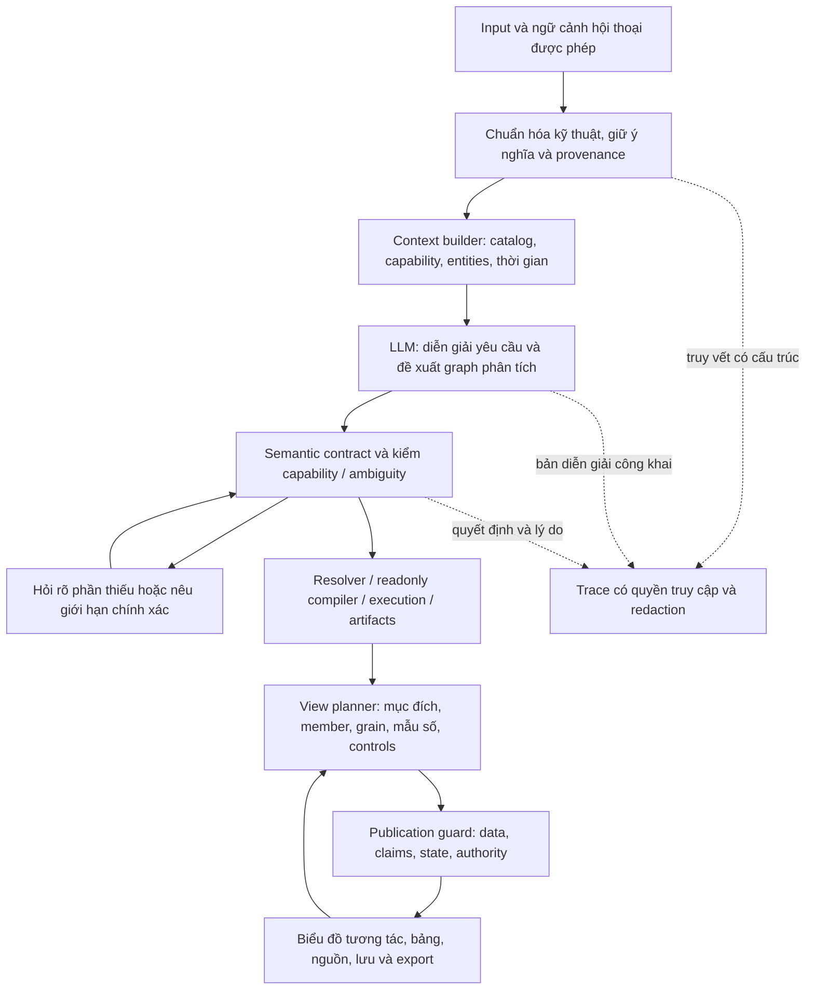

# AI Data Analyst — Tài liệu tổng hợp

Ngày cập nhật: **23/10/2026**. Đây là **file chính duy nhất để đọc và theo dõi công việc**; nội dung nghiệm thu, PLAN, bổ sung kiến trúc và checklist đã được gom từ sáu file trước.

**Trạng thái hiện tại:**

- **Reliability đợt trước:** DONE trong corpus/phạm vi đã nghiệm thu, policy33. Đây là kết quả lịch sử, không chứng nhận mọi câu hỏi mới hay tính năng mới.
- **Cải thiện toàn Trợ lý AI:** **IN_PROGRESS / TẠM DỪNG THEO YÊU CẦU / CHƯA NGHIỆM THU**. Bản giao thực thi mới nhất là **[mục H](#claude-execution-plan)**; checkpoint thực tế tại H.15. Các mục PLANNED/NOT_RUN phía dưới là đặc tả gốc, chưa tự động được coi là đạt.
- Có **56 kịch bản nền dự kiến** (48 core + 8 bổ sung); cần đối chiếu bằng chứng từng yêu cầu. Live cuối của Claude 32/40 chưa đạt; không dùng kết quả reliability lịch sử để chứng nhận code mới.
- **Quyền live mới từ người dùng ngày22/10, khoảng14:00:** Claude được dùng API key/runtime hiện có để live test và phát sinh phí trong scope công việc; không bị giới hạn bởi campaign12/36sends lịch sử. Xem phạm vi, ledger và cách tối ưu tại H.10.

**Claude bắt đầu ở H, dùng A để cập nhật checklist; tra B–C khi cần chi tiết contract.** H là chỉ dẫn thực thi mới nhất, mở rộng và ưu tiên hơn các giới hạn công việc/quyền live cũ của phần PLAN. Không cần đọc lại toàn bộ lịch sử để bắt đầu. D–G là bằng chứng và giới hạn lịch sử, không phải chứng nhận source sau triển khai. E–F mặc định thu gọn.

## Mục lục

- [A. Checklist công việc mới](#current-checklist)
- [B. PLAN chính: so sánh và tương tác biểu đồ](#comparison-plan)
- [C. Bổ sung: hiểu yêu cầu, chọn nhóm, hỏi lại và logs](#meaning-selection)
- [H. PLAN giao Claude: hiểu input → bài toán → biểu đồ → nghiệm thu độc lập](#claude-execution-plan)
- [D. Nghiệm thu reliability đợt trước](#historical-acceptance)
- [E. Qualification lịch sử](#historical-qualification)
- [F. GOALS/checkpoint reliability lịch sử](#historical-reliability-goals)
- [G. Review ca kiosk so với cửa hàng chính tại HCM, 12:28](#kiosk-main-review)
- [Chỉ mục bằng chứng và bản gốc](#evidence-index)

Khi thực thi, cập nhật checklist/trạng thái của phần công việc mới trong file này; không đổi kết quả lịch sử thành chứng nhận cho source mới. Không thêm production branch theo câu hỏi, tên tỉnh hay số tiền mẫu để làm test xanh.


<a id="current-checklist"></a>

## A. Checklist công việc mới — đang nghiệm thu

Ngày22/10/2026 · **IN_PROGRESS** (Claude bắt đầu thực thi22/10; checkpoint đang hoạt động ở [H.15](#claude-active-checkpoint)).

Mục tiêu: mọi bài toán giữ đúng mục đích phân tích, có chế độ So sánh/Tổng gộp/Xem riêng và lọc theo đối tượng khi hợp lệ; data, KPI, lời giải thích và export cùng view semantics. Thực hiện qua engine/contract/UI dùng chung, không vá câu HCM/ĐàNẵng.

Đọc [PLAN chi tiết](AI_DATA_ANALYST_TONG_HOP_20261022.md#comparison-plan), [acceptance48scenarios](evaluation/comparison-workspace-20261022/acceptance-cases.json), [fixture dự kiến](evaluation/comparison-workspace-20261022/independent-fixture-spec.json). 56scenario gốc có mapping bằng chứng hữu hạn tại `execution/qualification-coverage-map.json`, không tự quy thành56/56PASS. Bản mới đang nghiệm thu policy40, xem H.15; baselinepolicy33 chỉ là lịch sử.

- [x] CW00 — Freeze baseline/source/capability inventory; independent fixture/holdout và tests đỏ.
- [x] CW01 — ComparisonFrame, perchartcapability/viewstate và semantics local/global/legend.
- [x] CW02 — Resolver/lenses/query memberaxis, union, ratio/AOV/distinct, snapshot vàbudget.
- [x] CW03 — Server viewresolution/cache/ownership/version/atomic publication, 0LLM.
- [x] CW04 — Shared UI controls, comparedefault, facets/tables, responsive/keyboard.
- [x] CW05 — KPI/claims/subgroup/baseline/mẫu số/nhận định đúngactiveview; UC01–UC04.
- [x] CW06 — Saved/reopen/map/globalrevision/preview/Word currentview và permission recheck.
- [x] CW07 — Dynamic capabilityinventory, grammar/coverage/reasons; noncity, domains/classes/missions/depths.
- [ ] CW08 — Regression/security/property/raworacle/browser/performance/buildhash.
- [ ] CW09 — Full qualificationJSON/MD/manualdemo +limits; chỉ DONE sau toàncriticalgates.

Các tick CW00–CW07 ghi nhận triển khai và bằng chứng local/guided có giới hạn, **không thay gate live/transfer và toàngoal của CW08–CW09**. Không quy mọi tổ hợp16domain48metric thành đã được kiểm. Bằng chứng hiện hành ở H.15–H.16.

**Mở rộng bắt buộc từ14:00:** thực hiện [H](#claude-execution-plan) trong cùng goal: semantic input/context và operator composition; tỷ lệ/exposure/đồng hạng; controls và analytical usefulness; audit cơ chế chấm điểm với oracle độc lập; live/transfer/negative tests được phép. Không đóng CW09 chỉ vì comparison toggles đã hoạt động. Phases là thứ tự phụ thuộc nội bộ; không kết thúc mỗi phase để chờ user bảo làm tiếp.

### Checkpoint lập kế hoạch (lịch sử trước triển khai)

Chỉ tạo PLAN, GOALS, baselinehashes, acceptancecases và fixturespec. **Không sửa code sản phẩm, không mở campaign AI, không thay dữ liệu nguồn/schema/quyền, không commit/push**.
Ca ban đầu scope/numeric đúng4charts/6resultsets, nhưng comparativecontext không giữ trong hỗ trợ; KPI thiếusubgroup, captionwrongsort, coverage4/6. Numeric pass không thay gate cải thiệntrải nghiệmso sánh.
Mỗi phase hoàn tất phải tiếp phase sau khi đang được giao triểnkhai; không đónggoal vì đãcó nútUI. Giữ trạng thái riêng với DONEhistorical của reliabilityPLAN trước.


### Bổ sung12:10 — Selection→comparison và clarification

Incident canonical revenue hợp lệ nhưng “ổn định nhất” chưa có typed score capability; request dừng no_progress sau2calls, diagnostic đọc alternatives như missing metrics. Xem [addendum](AI_DATA_ANALYST_TONG_HOP_20261022.md#meaning-selection).
CW00 thêm testsđỏ; CW01–CW02 thêm selector definition/eligibility; CW03–CW05 clarification/repair/UI/message; CW07–CW09 qualification các criterion được quảng bá. Tổng core48 +additional8 =56scenario planned, NOT_RUN. Lượt chẩn đoán mới0provider/0businessSQL/0productedits; chưa fix.

### Yêu cầu bổ sung — xử lý ở cấp kiến trúc toàn Trợ lý AI

Bắt buộc [addendum mục8](AI_DATA_ANALYST_TONG_HOP_20261022.md#meaning-selection): capability inventory tất cả entry modes/missions/classes/states, unified meaning/state/clarification contract, generic operator composition và typed diagnostics. CW08–CW09 thêm coverage/operator-composition/entry-mode parity receipts. Không thêm full câu hỏi, địa phương hay số tiền mẫu vào production. Đây vẫn là thiết kế PLANNED, chưa triển khai.


<a id="comparison-plan"></a>

## B. PLAN chính — so sánh, chế độ xem và bộ lọc

Ngày: **22/10/2026** · Trạng thái: **PLANNED — CHƯA TRIỂN KHAI / CHƯA NGHIỆM THU**.

Yêu cầu: với bài toán so sánh, người dùng phải xem được **so sánh các đối tượng**, **tổng gộp trong phạm vi**, hoặc **riêng từng đối tượng**; có điều khiển rõ tại biểu đồ. Mọi số, KPI, nhận định, map và export phải giải thích đúng chế độ đang xem. Áp dụng qua kiến trúc dùng chung, không thêm nhánh riêng cho Hồ Chí Minh/Đà Nẵng.

Phạm vi chính: **toàn tab Trợ lý AI**, các entry modes, nhiệm vụ, metric classes và ba độ sâu; cùng report renderer được BI, preset, saved reports sử dụng phải nhận cùng hợp đồng. Không mở rộng thành thay mọi bộ lọc của toàn data platform hoặc migration địa giới.

Bản nghiệm thu reliability policy33 vẫn là bằng chứng của corpus cũ. Nó **không chứng nhận tính năng tương tác/so sánh trong PLAN mới**. Theo dõi riêng ở [GOALS mới](AI_DATA_ANALYST_TONG_HOP_20261022.md#current-checklist), không đổi lịch sử test đỏ/xanh hoặc gọi phần mới là DONE trước khi thực thi.

### 1. Bằng chứng và nguyên nhân gốc

Ca quan sát: “so sánh doanh thu thành phố đà nẵng và thành phố hồ chí minh”, report lúc11:30, session `caa3a343-b4e6-4dec-a554-9cae29495a8a`, revision1, depth deep.

- Cột chính so sánh đúng hai thành phố; tổng1.805.747.500đ, HCM1.555.659.500đ, ĐàNẵng250.088.000đ.
- Ba chart phụ dùng filter `city IN (...)` nhưng group_by chỉ order_type, period hoặc period×store_type: **scope đúng nhưng mất trục so sánh thành phố**, thành tổng quan của tập hai thành phố.
- Report ghi mission compare, nhưng requested semantic requirement hiện là `aggregate`, dimension city, filter IN. Không được chỉ kiểm `analysis_kind == comparison` để nhận diện mọi bài so sánh.
- `WorkspaceFilters` và dropdown ở card hiện chủ yếu **thêm lọc chờ cho toàn report**. Đổi bar/line/area là presentation; không có hợp đồng chuyển aggregate ↔ compare ↔ member với data/claims tương ứng.
- KPI strip hiện chọn “largest group”/“change” theo evidence/query order. Bởi vậy có ba ô “Doanh thu cao nhất” thuộc city, hình thức nhận hàng, store; -21,9% chỉ thuộc main-store subgroup mà thiếu tên subgroup ở chi tiết.
- `chart_relevance_service.grammar_decisions` có rule form/cap khiến store/payment views bị loại. Metadata coverage ghi renderer_unsupported, dashboard lại ghi outside_mission_grammar: phải thống nhất lý do, không nới grammar tràn lan để đủ số chart.
- Một số mô tả sort/how_to_read chung không khớp presentation thực; multi-series insight chọn một series mà không nêu tên.

Bằng chứng: [review trường hợp thực](evaluation/ai-system-reliability-impl-20261021/codex-user-two-cities-20261022/REVIEW.md), [report gốc](evaluation/ai-system-reliability-impl-20261021/codex-user-two-cities-20261022/report-summary.json), [numeric](evaluation/ai-system-reliability-impl-20261021/codex-user-two-cities-20261022/review.json), [narrative](evaluation/ai-system-reliability-impl-20261021/codex-user-two-cities-20261022/narrative-review.json).

**Chẩn đoán:** thiếu hợp đồng “đang so sánh ai/với ai/theo gì” xuyên suốt planner, artifact, state, presentation và claim. Thêm nút frontend trên số tổng hiện tại sẽ không khôi phục được số riêng từng đối tượng.

### 2. Trải nghiệm đích: điều khiển dễ hiểu, không quá tải

#### 2.1. Mỗi chart có một thanh điều khiển nhất quán

Ví dụ minh họa; tên đối tượng do catalog/result cung cấp:

```text
Doanh thu theo tháng
[So sánh] [Tổng gộp] [Xem riêng]
Đang so sánh: [Hồ Chí Minh ✓] [Đà Nẵng ✓]
Hiển thị: [Giá trị thực ▾]          [Đặt lại]
Chỉ biểu đồ này · Toàn bộ thời gian · So sánh 2 đối tượng

                  plot

[Nguồn & dữ liệu] [Nhận định từ biểu đồ]
```

- **So sánh:** giữ từng member, vẽ thành series/cột/panel riêng, màu nhất quán trong report. Đây là default cho các view đủ khả năng của bài toán compare.
- **Tổng gộp:** một population union có công thức hợp lệ; nhãn “Tổng của 2 đối tượng đã chọn”, không gọi toàn quốc/toàn hệ thống.
- **Xem riêng:** chọn một canonical member, xem category/trend/store_type của member đó, có nhãn tên ngay trên card.
- Selector “Đối tượng so sánh” khác selector breakdown như “Hình thức nhận hàng”, “Loại điểm bán”. Không cho một dropdown lẫn hai nghĩa.
- Thay đổi loại chart là điều khiển riêng “Cách hiển thị”, không giả rằng chuyển donut thành bar đã trở thành so sánh.
- Control chỉ áp dụng khi có nghĩa. Mode không hỗ trợ hiển thị lý do ngắn; không đặt nút dùng được rồi trả chart tổng cũ. Single-member chỉ có Xem riêng/Tổng hợp tương đương, không tạo cặp giả.
- Hai member: chips trực tiếp; nhiều member: chọn/tìm kiếm có giới hạn, trạng thái “đã chọn x/y”; không tự cắt Top5 để vừa chart. Ngưỡng số series theo chart type/capability, do policy có lý do, không literal tỉnh.
- Mobile: controls wrap/thu vào mục “Chế độ & đối tượng”, luôn hiện nhãn mode/member; không nằm đè plot. Keyboard/focus/aria phải dùng được.

#### 2.2. Quy tắc thao tác cục bộ và toàn báo cáo

Mặc định thanh trên card **chỉ đổi biểu đồ đó**, không tự sửa KPI đầu trang, map, primary answer hoặc chart khác. Card luôn hiển thị “Chỉ biểu đồ này”.

Hành động riêng “Áp dụng lựa chọn cho toàn báo cáo” tạo draft ở thanh report; người dùng bấm Apply để tạo revision mới. Tất cả view/KPI/map/kết luận đổi cùng revision. Reset chart trở về default của **report revision hiện hành**; reset report về phạm vi đã duyệt gốc dùng hành động report riêng, kiểm quyền lại.

Ẩn một series qua legend là **ẩn hiển thị**, không đổi population, share base hoặc short answer. Muốn đổi population phải dùng Xem riêng/selector member. Ghi “Đang ẩn 1 series”; export chính sách rõ, không tự diễn giải phần còn nhìn thấy thành toàn population mới.

#### 2.3. Cụ thể cho bốn chart trong ví dụ

| View | Default bài so sánh | Tổng gộp | Xem riêng |
|---|---|---|---|
| City revenue | Cột HCM và ĐàNẵng + delta, % có baseline rõ | KPI tổngunion, không ép vẽ một cột vô ích | KPI/member summary |
| Hình thức nhận hàng | Grouped bars theo hình thức, series theo city; tỷ trọng tùy chọn dùng mẫu số mỗi city | Donut/cột một population union | Donut/cột cho city đã chọn |
| Doanh thu tháng | Hai đường city trên cùng trục thời gian | Một đường tổngunion | Một đường/member |
| Tháng × loại điểm bán | Hai đường city; chọn loại điểm bán, hoặc facets theo loại điểm bán | Series loại điểm bán trên union | Series loại điểm bán trong một city |

Không vẽ 2city×3store_type thành6 đường rối nếu thiếu chỗ; giữ city là trục comparison và chuyển store_type thành filter/facet. Bảng exact-data luôn khả dụng. Những biểu đồ phụ không đủ grain không được giả lập bằng cách chia tổng theo tỷ lệ.

### 3. Bất biến bắt buộc

1. **Population hợp lệ trước presentation.** Mọi mode/member selection là subset/union được server chứng minh nằm trong approved scope và quyền hiện tại.
2. **Comparison frame theo requirement**, không mặc định một frame toàn report; nhiều goal độc lập có scope/clock khác nhau phải giữ riêng.
3. **Same metric / formula / clock / grain đủ tương thích** mới so sánh trực tiếp. Khác unit/period/metric phải có alignment/normalization policy hoặc panel riêng; không cộng VND với %.
4. **Additive mới sum qua chiều cho phép.** AOV/ratio cần tử/mẫu cùng population; distinct phải union raw keys hoặc sketch được catalog cho phép. Không average/sum chỉ số nhóm.
5. **Union nhóm giao nhau không double count.** Nếu không có grain/keys đủ chứng minh union thì Tổng gộp unavailable, có lý do.
6. Mọi chart state có `member set + view spec + artifact + revision + access + epoch + policy` fingerprints. Query mới/snapshot mới không trộn vào report cũ im lặng.
7. Title, legend, KPI, fact, interpretation, summary và source cùng **active view**, đúng subgroup/baseline/mẫu số/sort/period.
8. Không giữ insight cũ cạnh data mới. Đang chờ thì giữ view cũ nguyên khối và có nhãn, hoặc skeleton cả data+claims; chỉ publish bundle đã verified.
9. Local UI state không được giả làm report revision mới. Global changes phải qua server atomic publication hiện có.
10. Chọn mode/member đã khai báo và mở insight **0 LLM**. Không gửi input mới chỉ để chuyển mode. Nếu thiếu artifact, truy vấn server bounded chỉ đọc và kiểm quyền.
11. Không sửa metric population/threshold quyền/READ ONLY/budget để render được nhiều chart. Không dùng model text hoặc frontend caption làm authority.
12. Test chứng minh cả membership/giá trị/claim, không chỉ nút tồn tại/title có tên city/HTTP200.

### 4. Hợp đồng dữ liệu đề xuất

Các tên dưới là **thiết kế dự kiến**, chưa phải field/endpoint đang tồn tại. Chốt schema ở CW01 trước khi sửa consumers.

#### 4.1. ComparisonFrame — nghĩa so sánh được duyệt

Server tạo IDs và refs từ semantic input + canonical resolution:

```text
ComparisonFrame
  id, requirement_ids, source_input_refs, kind(entity | time | metric | cohort)
  axis_dimension_id?, metric_ids, population_ref
  members[{id, label, canonical_identity?, filters?, period_ref?, metric_ref?, cohort_ref?}]
  baseline_member_id?, alignment_policy?, overlap_policy
  observed_members, requested_members, missing_members
  supported_views/modes + reasons, policy_version, fingerprint
```

- Model có thể đề xuất **nghĩa** comparison, không được tự cấp artifact/query/owner ID, công thức, member ACL, SQL hoặc kết quả.
- Guided/preset/refine tạo cùng frame qua adapter server. Nếu aggregate+city grouping+IN filter đi kèm yêu cầu so sánh rõ như incident, server phải giữ quan hệ comparison; không phụ thuộc enum operation duy nhất.
- Không suy “filter IN có2member = user muốn compare”: overview trong hai tỉnh vẫn là overview. Chỉ default compare khi intent/structured choice/input provenance có bằng chứng. Mơ hồ thì hiển thị lựa chọn trục, không đoán âm thầm.
- Đối tượng trùng tên dùng canonical key; display label không là identity. Các nhóm từ user-defined composite filters phải typed, bounded, authorized.
- Comparison theo hai kỳ giữ exact source dates và alignment position; không đổi ngày chỉ để hai đường trùng trục. Snapshot-only không trở thành historical series.
- Comparison nhiều metric khác unit dùng panel/scale riêng hoặc chỉ số chuẩn hóa có công thức/reference; union thường không có nghĩa, disable thay vì generic total.
- Fixed TopN cohort dùng materialized selected keys; local mode không rerank. “Xếp hạng lại từng kỳ” là operation khác, chỉ mở khi user chọn rõ và được policy hỗ trợ.

#### 4.2. ChartViewContract — khả năng của mỗi logical lens

```text
ChartViewContract
  logical_view_id, requirement_id, comparison_frame_ref?
  analysis_purpose, primary/supporting, default_mode
  available_modes[{id, availability, reason, required_grain, compatible_presentations}]
  member_selector, breakdown_selectors, measures, base_unit, additive_axes
  permitted_value_modes(absolute | within_member_share | index_if_governed)
  denominator_policy, total_policy, missingness_policy, clock_policy
  source_artifact_refs, authority_fingerprints, version
```

Một logical lens có nhiều presentation/mode, **không đếm mỗi mode là một bằng chứng/view độc lập**. `analysis_purpose=compare` khác `chart_type=bar`. Comparison cùng một metric không bắt buộc mọi chart trông giống nhau; phải giữ khả năng phân biệt member.

#### 4.3. ChartViewState và ChartViewArtifact

State: report session/revision, logical_view_id, contract fingerprint, mode, selected_member_ids, breakdown selections, value mode, presentation, optional hidden series IDs.

Artifact: approved canonical view spec, full row artifact refs, rendered rows/series, local KPIs, fact/claim refs, insight, coverage/caveats, source epoch, parent report fingerprint, view fingerprint/version.

Tách **semantic view state** (member/mode/filter/normalization) khỏi **presentation state** (layout/chart orientation/legend visibility). Cả hai cần lưu khi export “đang xem”; thay presentation không tự tính lại population.

#### 4.4. Lifecycle/API

Ưu tiên mở rộng pipeline/workspace hiện có, không dựng engine SQL song song. Chốt một đường server resolve chart view (dự kiến `POST /api/ai/chart-view`, tên có thể thay):

- Input chỉ IDs/typed selections + parent revision/fingerprints/request ID; cấm SQL, row data, arbitrary table và model continuation.
- Xác minh owner/access/contract/members trước cache; coalesce duplicate request. Có cancel/stale ticket giống workspace controller hiện có.
- Output một bundle atomic data+insight+source+capabilities, không cập nhật session nghĩa gốc chỉ vì local view; local artifact lưu có TTL/capacity riêng.
- Cache hit đủ grain: không warehouse query. Client có thể render biến thể đã server verify/pack sẵn; không tự tính business aggregation trên preview.
- Artifact thiếu grain: server tạo bounded variant qua resolver/compiler/batch. Dùng cùng snapshot với parent nếu còn khả năng; nếu không, **không gắn data mới vào report epoch cũ**: yêu cầu refresh/áp dụng revision mới rõ ràng, giữ parent immutable.
- Hết TTL/schema/access đổi trả typed expired/stale/permission; không fallback sang toànscope hoặc gọi lại LLM.
- Global apply vẫn dùng `workspace-revision`, phải commit toànreport atomic. Không để endpoint local bypass verification của global.

### 5. Query planning và metric semantics

#### 5.1. Giữ trục so sánh qua các supporting lenses

Ví dụ tổng quát member M, breakdown D, bucket T:

- Compare category: group_by M,D; compare trend: M,T; compare segmented trend: M,T,D với D thành facet/filter có giới hạn.
- Khi member đã là trục chính, không thêm member axis trùng lặp. M là entity ID chứ không label tùy ý.
- Các lens không tương thích M hoặc clock được đánh dấu not_applicable/unsupported; ưu tiên một lens khác có ích hoặc bảng, không bỏ M rồi vẫn gọi compare.
- Tổng hợp và member-specific views có thể dùng artifact chung nếu **đủ grain + aggregation law**. Projection/dedup/tử-mẫu do kernel server đã verified, không sum trên50 dòng preview.
- Chọn chiến lược batch/precompute bounded cho common default modes; không sinh mọi member×metric×depth×mode ngay từ đầu. Chi phí query/rows/bytes/operations tính đúng budget hiện có; on-demand không reset budget vô hạn.

#### 5.2. Quy tắc theo metric class

| Class | Tổng gộp | Compare/Xem riêng |
|---|---|---|
| Sum/count additive | Sum union fact population, đúng grouping law | Giá trị riêng từng member |
| Ratio | Sum tử/sum mẫu khi population compatible; không avg percentages | Giữ tử/mẫu/exposure và threshold theo member |
| AOV/average | Weighted raw numerator/denominator cùng valid population | Hiện đơn vị/mẫu số member rõ |
| Distinct | Union raw identity; không cộng member counts | Keys scoped theo entity ACL; không tiết lộ PII |
| Snapshot | Aggregation chỉ qua axes có định nghĩa; as_of rõ | Không bịa time history; so sánh as_of tương thích |
| Forecast | Fit trên union history riêng nếu được hỗ trợ; không cộng intervals | Fit/history/backtest/interval riêng member; actual/forecast khác kiểu |
| Relationship/driver | Không generic sum | Giữ cùng grain/sample; unsupported khi không có join/clock hợp lệ |

Zero, negative, null, no_data xử lý theo metric definition; zero baseline không tạo inf hoặc tăng100% giả. Nhóm thiếu kỳ là gap/no_data có caveat, không tự fill0 trừ missingness policy cho phép.

Cơ cấu có ít nhất hai mẫu số khác nhau: “% trong từng member” và “% toàn tập đang chọn”. Chọn rõ bằng control/label; default compare cơ cấu dùng **% trong từng member**, absolute có thể chuyển. Hai option không được chia sẻ insight cũ.

### 6. UI dùng chung và report consistency

#### 6.1. Tổ chức thông tin

- Header report: nhiệm vụ, members/baseline, thời gian, mode mặc định; không trộn nút bố cục với nút phân tích.
- Card header: purpose (“So sánh”/“Tổng gộp”/“Xem riêng”), active member labels, breakdown/value mode, unit/period. Legend giữ màu member ổn định khi reorder/filter.
- Card controls ở trên plot; Nhận định/Nguồn phía dưới. Dùng một component chung, không copy nhánh JSX riêng từng mission.
- “Các góc nhìn” (Diễn biến/Cơ cấu/...) phân loại logical lens; “Chế độ xem” điều khiển data projection. Hai hệ tab khác nghĩa, nhãn khác nhau.
- Card local override khác report phải nhìn thấy ngay. Map và KPI đầu trang ghi theo **phạm vi report**; có thể có card KPIs theo activeview. Chỉ đồng bộ chúng khi user chọn global apply.
- Map đang có sales/network modes phải dùng adapter cùng authority; không ép map thành mọi loại comparison. Filter city trên map và local chart không âm thầm tác động nhau; “đồng bộ toànreport” explicit.

#### 6.2. KPI và lời giải thích

Bài compare hai member cùng metric: ưu tiên **A, B, chênh lệch tuyệt đối, % so với baselineB**. Có thể chọn cặp trong frame khi nhiều member; không tự chọn hai extreme rồi giả đó là cặp user yêu cầu.

Không thay KPI chính bằng maxstore/maxchannel chỉ vì evidence đó đứng sớm. KPI subgroup phải có nhãn tên subgroup và kỳ ngay khi đóng details. Ví dụ “Chi nhánh chính · Jan→Sep: -21,9%” khác “Toàn bộ loại điểm bán · Jan→Sep: -22,06%”.

Insight kernel nhận active view context, không lấy fact đầu tiên của toàn artifact. Multi-series phải nói rõ member/series nào, hoặc so sánh các member đầy đủ; không dùng một đường đại diện cho toànchart. Sort/how_to_read sinh từ actual rendering/order/presentation, không từ chung nhãn metric.

Report short answer/kết luận chính vẫn theo report scope khi chỉ local override. Phần kết luận có thể liệt kê “nhận định đang xem” riêng với view state và label, không lặng lẽ thay kết luận gốc. Khi export currentview, server tái tạo phần kết luận active views có refs tương ứng.

#### 6.3. Coverage

Đo theo logical analytical questions được trả lời, không số nút/modes/series. Phân biệt: data_limited, incompatible_grain, unsupported_mode, capacity_limited, missing_lens_plan, renderer_unsupported, outside_mission_grammar. Một reason code chạy từ planner đến coverage/UI/export; không ghi renderer không hỗ trợ khi thực ra bị grammar loại.

Không hứa đủ6/6 bằng filler. Bài so sánh bắt buộc có primary pair và các supporting comparative lenses được capability quảng bá; partial phải rõ còn thiếu gì. Numeric correct không thay comparative relevance.

### 7. Những file/lớp cần tác động

| Tầng hiện có | Công việc |
|---|---|
| `analysis_intent.py`, `mission_contract_service.py`, `request_anchors.py`, `semantic_preflight_contract.py` | Contract nghĩa/member/adapter; giữ comparison qua aggregate representation và refinements |
| `analytical_resolver.py`, `analysis_expansion_service.py` | Resolve typed frame, truyền member axis/dependency qua lenses, bump plan policy khi nghĩa đổi |
| `analytical_query_service.py`, `analysis_query.py`, `query_execution_batch.py`, capacity/artifact services | Query variants đủgrain, immutable refs, union/ratio/distinct semantics, budget/snapshot |
| `chart_relevance_service.py`, `dashboard_planner_service.py`, `analyst_contract.py` | Mode/purpose/renderer compatibility, grammar/capacity reason, groupedbar/facet/table |
| `workspace_service.py`, `agent_pipeline.py`, `common.py`, router `ai.py` | Contract/state API, revision/owner/access/cache, saved legacy adapters |
| `goal_provenance_service.py`, `analysis_quality_service.py`, `verification_reconciliation_service.py` | View-specific goal/claim/denominator/provenance mutations, publication guard |
| `insight_service.py`, `chart_insight_service.py`, `answer_requirement_service.py` | Member/series-specific findings, KPI priority, caption/render consistency |
| Web `components/report/ReportWorkspace.tsx`, `Charts.tsx`, `ChartInsight.tsx`, `workspace/KpiStrip.tsx` | Shared control bar, percardstate, chart data/insight atomic, keyboard/responsive |
| Web `utils/workspaceInteraction.mjs`, `analystDashboardLayout.mjs`, `workspacePresentation.mjs` | Typed request controller, KPI selection, stale/draft/presentation distinctions |
| `GeographicReportPanel.tsx`, `geography_exploration_service.py` | Adapter để map/report/cục bộ đồng bộ rõ, không query ngoài scope |
| Saved report/router reports, `docx_service.py`, `WordReportPreviewModal.tsx` | Server-owned activeview persistence/export, caption/controlstate manifest |

Có thể tách module mới `comparison_context_service`/`chart_view_service` và UI `ChartViewControls`; đây là tên dự kiến, không bắt buộc thêm service nếu lớp hiện tại đủ gọn. Không đổi toàn bộ architecture thành engine mới hoặc thêm thư viện chỉ để có toggle.

### 8. Thứ tự triển khai và điều kiện qua phase

Một mục tiêu xuyên suốt: đạt comparative usefulness + view consistency trên toàn luồng công bố. Hoàn tất phase thì tiếp phase sau, không kết thúc công việc ở nút UI đầu tiên.

| Phase | Ưu tiên | Việc cụ thể / đầu ra | Cổng qua phase |
|---|---|---|---|
| CW00 | P0 trước code | Freeze source/capability inventory, original incident, corpus/independent oracle, before screenshots | Có red cases cho mất member axis, KPI subgroup, local/global ambiguity; không sửa trước baseline |
| CW01 | P0 | Chốt ComparisonFrame/ChartViewContract/state invariants, adapters và compatibility matrix | Contract roundtrip cho entity/time/metric/cohort + noncompare controls; forged members reject |
| CW02 | P0 | Resolver/lens/query kernel giữ member, chuẩn union/ratio/AOV/distinct, same epoch, bounded variants | Raw oracle từngkey/giátrị, metamorphic ngoài scope; không nới SQL/security/budget |
| CW03 | P0 | Endpoint/controller/state/cache/saved adapters; local view atomic, global revision riêng | 0LLM; cache đủgrain0query; stale/race/access negative controls đạt |
| CW04 | P1 | Shared control bar và renderer default compare/single/aggregate; filter/facet; tables | Entity/category/trend/multiseries dùng cùng pattern, default compare rõ; mobile/keyboard đạt |
| CW05 | P0 | KPI/insight/conclusion/verifier theo activeview, caption exactsort/member | Mutations mode/member/denominator/partition/fact/date fail; UC01–UC04 hết tái hiện |
| CW06 | P1 | Saved/reopen, report/global/map sync, Word currentview và original option | Server reconstruct exact state, permission recheck; preview/export đúng actualview cùng refs |
| CW07 | P1 | Registry capability inventory, grammar/coverage/reasons; mở rộng noncity/all eligiblefamilies/depths | UC05–UC06 có behavior đúng/caveat, dynamicinventory có receipt từngcapability |
| CW08 | P0 nghiệm thu | Full offline/integration/property/security/browser, raw warehouse SQL, performance; source freeze build đúngservice | Critical semantics100%, relevantregressionđạt; không đồng thời heavytests với serving/live |
| CW09 | P0 bàn giao | Realcase+holdouts UI, saved/export visualQA, qualification JSON+MD+demo/checkpoint | Chỉ DONE khi gates mục11 đều đạt; còn partial quantrọng thì NOT_QUALIFIED với caseID |

CW04 và CW05 không tách phát hành: không đưa data mode mới lên UI nếu claims vẫn thuộc mode cũ. Không nêu tiến độ% tự ước lượng thay gate.

### 9. Bộ kiểm thử đóng băng trước triển khai

Có [48 scenario được lên kế hoạch](evaluation/comparison-workspace-20261022/acceptance-cases.json): **36 development +12 reserved transfer**, tất cả `NOT_RUN`. Đây chưa phải 48 tests pass. [Baseline432 source hashes](evaluation/comparison-workspace-20261022/planning-baseline.json) hiện khớp policy33; phải kiểm lại working tree/capabilities trước khi thực thi.

[Fixture độc lập dự kiến](evaluation/comparison-workspace-20261022/independent-fixture-spec.json): members Alpha/Beta, ngoài scopeGamma rất lớn. Giá trị nhỏ dễ tính tay:

| Oracle | Alpha | Beta | Union Alpha+Beta |
|---|---:|---:|---:|
| Revenue | 300 | 700 | 1.000 |
| Valid orders | 2 | 3 | 5 |
| AOV | 150 | 700/3 | 200 |
| Terminal cancellation | 1/3 | 2/5 | 3/8 =37,5% |
| Valid customer distinct | 1 | 2 | 2 |

Tăng revenueGamma1.000.000→5.000.000: không đổi view/fact của Alpha/Beta. Bổ sung DANG_GIAO status control, overlap, duplicate labels, partialmonths, negative/zero/null và snapshots; không chỉ dùng fixture additive đơn giản.

Đối chứng riêng: tên sản phẩm/danh mục, stores trùnglabel, voucher/customer distinct, risk exposure, forecast ngắn/rỗng, time comparison. Reserved transfer giữ raw values/oracle riêng khỏi vòng tune; mô tả scenario đã công khai **không gọi là blind holdout**. Nếu rawholdout đã dùng để sửa, ghi lại thành regression và bổ sung holdout mới khi cần đo khả năng chuyển bài toán.

#### 9.1. Ma trận thực thi, không chỉ48 dòng

- 3 độ sâu × modes hợp lệ × member counts1/2/many × rich/sparse/empty. Property trực tiếp cho cohort/denominator/permission và pairwise cho phần không critical.
- Mọi mission/capability hiện hành trong inventory: overview, compare, ranking, trend, composition, forecast, risk, relationship/driver nếu quảng bá; free text/guided/preset/refine/saved phải có controls.
- Mọi metric class và từng domain đủ điều kiện có ít nhất một representative; nêu explicitly loại khôngeligible và lý do. Không hardcode số26domain/55tỉnh/2member thành tính phổ quát.
- Switch mode, subgroup, breakdown, value mode, legendhide, pagination/search, export/reopen: kiểm complete immutable results/facts chứ không chỉ firstpage.
- Mutations: outside member, forged SQL/ID, wrongowner, narrowingaccess, oldrevision, wrongview/fingerprint, swapped baseline, denominator khác, stale insight, legendhide mislabeled filtering, snapshot đổi, raw row injection.
- Native browser 1280/1440/1920/390; đo controls không overlap/plot readable; mode change rapidrace/IME/keyboard, no unexpected LLM.
- Word xuất currentview tối thiểu compare, total, single, missing/rate cases; render và xem mọi trang mẫu đã chọn, giữ export hash/viewstate. XML-only không chứng minh layout.

#### 9.2. Ghi nhận lệnh và môi trường

Dùng runner backend cô lập hiện có, process/module khi cần memory; container test cùng image, networknone, 2CPU/1,5GiB đã dùng trước. **Không chạy fulltest trên serving0,5CPU** hoặc bật lại container cũ rồi giả source/image vẫn khớp.

```bash
# Web, từ data-platform/web-ui; testfiles mới được bổ sung ở phase triển khai
npm run typecheck
node --test src/utils/*.test.mjs
# E2E: dùng scripts/config Playwright hiện có; kiểm package.json trước khi chọn lệnh.
# Backend: dùng .claude/scripts/dp-test.sh module tests.<module> hoặc runner cô lập
# đã ghi trong handoff; offline luôn AI_OFFLINE=1, không dùng discover với runtime env.
```

Package web hiện không có script lint: không đưa `npm run lint` thành gate giả. Build đúng web/api service sau thayđổi; xác minh bundle thật HTTP khớp container/source. Schema/migration không thuộc PLAN này; nếu phát hiện bắt buộc phải đổi thì chuẩn bị thiết kế/SQL review trước, theo quyền repo.

### 10. Hiệu năng, tương thích, rollout

- CW00 đo baseline click→view/firstresult, query count/bytes/cache, local rendering và footprint; ghi phần cứng/quota/data/cardinality. Chốt budget định lượng ở CW01 **trước khi tune**, không sửa ngưỡng sau khi thấy test đỏ; không hứa50ms cho serving0,5CPU.
- Explicit plan budget cho default views + on-demand variants; không query cho mỗi click khi đã có artifact đủgrain. 10 lần click cùngselection đangchờ phải coalesce, không tạo10job hoặc model calls.
- Dynamic defaults/member colors/capabilities từ contractversion; không lưu color identity theo index khi member reorder. Largecardinality có warning/table và search bounded.
- Bump plan policy/cache namespace khi nghĩa/queryexpansion đổi; bump UI/view/insight/exportschema theo đúng consumer. Không dựa vào displaytitle làm cachekey.
- Report cũ: legacy adapter chỉ cho modes có đủ artifacts/authority. Thiếu membergrain thì read-only oldview và hành động refresh có thông báo; không suy số từ nationaltotal. Saved artifacts giữ originrevision, không tự migrate nguồn.
- Dùng featureflag nếu cần rollout, nhưng rollback về **toàn bộ version tương thích** (contract+UI+insight), không chỉ tắtcontrol giữnewdata. Trước default-enable phải qua criticalgates; trả report cũ trung thực tốt hơn falselycomparative.
- Không đổi .env/secret, không đọc/in key/password, không source geography mapping hay dữ liệu nguồn; giữ workingtree thayđổi sẵn, không reset/stash/clean/restore/commit/push.

### 11. Cổng nghiệm thu cuối

Chỉ đóng DONE khi **đồng thời**:

1. **Nghĩa:** mọi requested comparison có typed frame/member/baseline/period hoặc trạng thái thiếu rõ; supporting không biến compare thành tổng quan ngầm.
2. **Số liệu:** exact keys/rows/aggregates/denominators đủ mọicriticalcases; union/ratio/AOV/distinct/overlap đúng; ngoài scope không ảnh hưởng tập cố định.
3. **Tương tác:** mỗi chart applicable có mode/filter dùng được đúngdata; local/global/legend semantics rõ; không widen quyền hoặc silentlyrefreshsnapshot.
4. **Claims:** KPI/mainanswer/activeinsight/conclusion/export đúng view/subgroup; không còn UC01–UC04; 0stale/unsupportednumeric claim; sort/readinstructionkhớpchart.
5. **Relevance:** comparison default giữ member ở các lens advertised; chart phụ tổnggộp phải là choice/label rõ, không chỉ dán “So sánh” lên chartoverview.
6. **An toàn/lifecycle:** owner/access/revision/schema/epoch/TTL/cancelrace/idempotency, saved/download/viewartifact negative controls đạt; exportsserverowned.
7. **Coverage:** ma trận48scenario và expansion thực chạy có receipts; mọiskip/unsupported/partial ghi rõ; không lấy48/48 để khẳng định mọi tổ hợp.
8. **UI/Word:** browser thật/allbreakpoints/keyboard và nativeexport QA đạt; screenshot không thay raworacle, cũng không dùng raworacle thay UIQA.
9. **Regression/performance:** related + finalbackend/web/typecheck; test-only corrections giải thíchgiữhistoricalattempts; sốđo môi trường tươngứng; build/hash/runtimekhớp.
10. **LLM:** chuyểnmode/filter/insight0provider khi không đổi nghĩa cần diễn giải. Kiểm free-text/meaning bằng live theo **quyền mới H.10**, có frozen qualification inputs, ledger, accounting và tiêu chí dừng; không cần hỏi lại quyền campaign đã được user cấp. Không retry để thay đỏ bằng xanh. Offline đủ cho các toggles deterministic; không dùng offline để giả đã kiểm model live.
11. **Bàn giao:** finalJSON+MD có sourcehash/bundle/image, before/after, query/callledger, caseIDs, currentviewexport và manualdemo, giới hạn thật. Newscope còncriticalred thì NOT_QUALIFIED; không mượn DONE cũ.

### 12. Demo bắt buộc và hướng tiếp tục

Demo sau triển khai: chạy câu người dùng qua ba độ sâu, xác nhận default comparison; đổi donut/category sang tổnggộp/HCM/ĐàNẵng; trend2lines↔union↔member; storetypefilter/facet; mỗi lần kiểm exact data/claim. Áp dụng một member toànreport, map/KPI/answer chuyển cùngrevision. Reopen/export đúngstate. Lặp scenario tươngđương với sản phẩm hoặc stores, thêm rate/distinct và sourceempty; không chỉ demo hai tỉnh.

**Bước tiếp theo khi được giao triển khai:** CW00 kiểm lại baseline/capability inventory, viết đỏ cho mất comparisonaxis và stale/subgroupclaims trên fixture độc lập → CW01 contracts → CW02...CW09. Hiện tại chỉ có tài liệu, baseline và specs; **chưa có codefix hoặc kết quả test của PLAN mới**.


### 13. Bổ sung sau khi gặp câu “hai tỉnh có doanh thu ổn định nhất”

Xem [selection/clarification addendum](AI_DATA_ANALYST_TONG_HOP_20261022.md#meaning-selection). Selector tính từ dữ liệu phải tạo cohort rồi mới so sánh; alias alternatives không thành nhiều chỉ số bắt buộc. Criterion chưa support thì needs_input/unsupported rõ, không đổi thành Top revenue.
Core48scenarios +8selection/clarification scenarios =**56scenario dự kiến, tất cả NOT_RUN**. Bổ sung vào CW00–CW05/CW07–CW09, không coi việc thêm nút mode đã giải quyết khả năng hiểu/selection này. Incident mới DIAGNOSED/NOT_FIXED, không sửa source hoặc gọi thêm model.

### 14. Ràng buộc sửa toàn hệ thống phân tích

[Addendum mục8](AI_DATA_ANALYST_TONG_HOP_20261022.md#meaning-selection) là yêu cầu bắt buộc xuyên CW00–CW09: inventory toàn Trợ lý AI, một semantic contract/state machine, kết hợp operator qua grain/capability, clarification và diagnostics dùng chung, transfer/metamorphic tests. Các incident là bằng chứng để tìm abstraction thiếu, không là danh sách nhánh hardcode cần thêm. Báo cáo nghiệm thu phải có receipts coverage/operator composition/entry-mode parity; không đủ nếu chỉ làm câu HCM/ĐàNẵng hoặc “ổn định nhất” chạy xanh.


<a id="meaning-selection"></a>

## C. Thiết kế bổ sung — hiểu yêu cầu, chọn nhóm, hỏi lại và logs

Ngày22/10/2026 · **PLANNED / NOT_IMPLEMENTED**. Thuộc [PLAN comparison workspace](AI_DATA_ANALYST_TONG_HOP_20261022.md#comparison-plan), không phải bản vá riêng cho câu “ổn định nhất”.

### 1. Vì sao phải bổ sung

[Incident thực](evaluation/comparison-workspace-20261022/stability-selection-incident/REVIEW.md): “so sánh doanh thu bán hàng của 2 tỉnh có doanh thu ổn định nhất” bị dừng sau2lượtAI, UI yêu cầu các revenue variants không được hỏi. Canonical revenue đúng, nhưng tiêu chí chọn hai tỉnh là phép tính dẫn xuất chưa được hợp đồng hiện hành biểu diễn đầy đủ.

Bài toán này gồm **selection → comparison**, khác trường hợp user gọi tên hai tỉnh. Sửa mỗi UI toggle hoặc thêm alias “ổn định” không đủ.

### 2. Nhóm vấn đề cần giải quyết chung

1. **Alias alternatives không phải multiple obligations.** Cụm canonical khóa revenue, candidate siblings chỉ là alternatives. Diagnostic/repair/UI phải giữ distinction, không đọc danh sách candidate IDs thành “cần tất cả chỉ số này”. Explicit request thật về nhiều metric vẫn phải được kiểm đầy đủ.
2. **Clarification là outcome hợp lệ.** Có canonical metric không có nghĩa mọi semantics đã đầy đủ. Thiếu criterion/time/cadence phải giữ phần đã biết và hỏi đúng phần còn thiếu, không biến clarify thành repeated repair chỉ vì chưa có executable requirements.
3. **Computed member selection là node có authority.** Bài “hai tỉnh ổn định nhất”, “ba cửa hàng tăng trưởng nhanh nhất” cần typed selector, nguồn dữ liệu, score definition, eligibility, period, ranking/tie policy trước comparison. Không thay bằng Top revenue hoặc model tự chọn tên.
4. **Capability preflight và runtime phải thống nhất.** Nếu criterion chưa được support, nói chưa hỗ trợ hoặc đưa structured alternatives có thật; không báo READY như đã hiểu đầy đủ. READY_FOR_AI chỉ nói có thể diễn giải, phải tách rõ khỏi READY_TO_EXECUTE.

### 3. Contract mở rộng dự kiến

Đặt một `CohortSelectionSpec` (tên dự kiến) làm nguồn members cho ComparisonFrame:

```text
source metric + entity dimension + approved base scope
selection criterion ID + formula/policy version
history period + bucket cadence + complete/partial handling
eligibility/exposure/missingness rules
score direction + limit + tie/null policy
selected canonical keys + score artifact + lineage
```

Criterion IDs do registry server khai báo, không nhận expression/SQL tùy ý của LLM. Tách **metric được so sánh** khỏi **criterion chọn member**. Muốn tiêu chí nào chưa có definition phải typed unsupported/needs_input, không nhét vào revenue metric ID.

Các dạng tiêu chí trong inventory phải xét khả năng thực tế: level/rate hiện có, tăng trưởng, biến động/ổn định, threshold-breach count và user-defined composite criteria nếu sau này được quản trị. Không bắt buộc quảng bá tất cả; mỗi loại có supported/unsupported và lý do rõ.

### 4. “Ổn định” phải được định nghĩa trước khi tính

- Phương án thường dùng là **CV = độ lệch chuẩn / trung bình** theo các kỳ đầy đủ; nhỏ hơn nghĩa ít biến động tương đối. Đây là phương án đề xuất, không tự coi là nghĩa duy nhất của người dùng.
- Có thể dùng độ lệch chuẩn tuyệt đối hoặc độ biến động giữa kỳ nếu business chọn; mỗi phương pháp có semantic khác. Formula, population/stddev convention, missingness và period phải công khai, versioned.
- CV không áp dụng đơn giản khi mean bằng0/gần0, metric có giá trị âm không phù hợp, history quá ngắn, inactive/zero-only hoặc coverage không đạt. Không chọn tỉnh không có đơn chỉ vì score0.
- Eligibility/minimum periods/exposure phải do policy được chốt và có positive/negative controls; không tự đặt ngưỡng để fixture xanh. Phân biệt source missing với tháng có doanh thu thật bằng0.
- Time window/cadence thiếu: hỏi người dùng hoặc đề xuất default được công bố để chọn; không ngầm lấy mọi thời gian hay coi tháng đang dở là đầy đủ. Selection period và comparison period phải có refs riêng nếu khác nhau.
- Ties, nulls và actual<N có policy. Thiếu hai tỉnh đủ điều kiện → insufficient data; không tự fallback hai tỉnh doanh thu cao nhất.

### 5. Luồng đúng cho incident

1. Giữ metric revenue, entity city và sốmember2; nhận “ổn định nhất” là selector chưa resolve.
2. Nếu chưa có criterion capability: trả “Chọn tỉnh theo độ ổn định chưa được hỗ trợ”, nêu alternatives có thật; không tiêu calls để model đoán công thức.
3. Nếu capability có nhưng thiếu tham số: trả needs_input với controls cho criterion/window/cadence, echo phần đã biết; không hỏi lại metric revenue đã rõ.
4. Khi đủ hợp đồng: query city×bucket trong approved scope, tính score trên series đủ điều kiện, rank theo score, materialize2canonical keys kèm scores/definition/eligibility.
5. ComparisonFrame lấy đúng selected keys. Chart comparison/total/single, KPI và export giữ selection lineage và label “Hai tỉnh được chọn theo ... trong kỳ ...”.
6. Mode local không chọn lại cohort. Muốn thay phương pháp/window → hành động semantic mới, revision mới và selection chạy lại có chủ đích.

### 6. Repair và thông báo lỗi

- Tách incomplete meaning khỏi invalid generated structure. Với clarification có nội dung hợp lệ, không ép model thêm requirement cho phần user chưa định nghĩa.
- Nếu draft thiếu clarification object, bounded repair vẫn có thể sửa schema; exhausted phải hiển thị “chưa tạo được câu hỏi làm rõ/contract”, không suy thành user đã thiếu sáu metric.
- UI mô tả exact canonical metric/field thiếu, alternatives hiển thị là lựa chọn. Không flatten broad candidate set thành danh sách bắt buộc.
- Capture diagnostics chỉ typed IDs/phases/issuecodes/draft shapes theo policy; không log raw prompt/provider output/PII/key. Giữ logical/physical calls rõ, no-progress dừng; không retry mù.

### 7. Tích hợp phase và nghiệm thu

- CW00: freeze incident/log, red tests canonical alternatives và valid clarification, raw stability fixture độc lập trước sửa.
- CW01–CW02: criterion registry/typed selection/capability/eligibility; selection→frame lineage, noncity controls. Nếu criterion chưa được triển khai thì gate là **honest unsupported/needs_input**, không giả full support.
- CW03–CW05: structured clarification controls, state/repair/error wording, dynamic cohort view and claims. Không bỏ criterion khi thiếu support.
- CW07–CW09: capture actual capabilities và qualification của criterion nào được quảng bá; đủ oracles/mutations/regression/UI. Nếu quảng bá stability thì phải làm đủ selection engine và raw numeric gates, không chỉ thông báo đẹp.

[8 scenario bổ sung](evaluation/comparison-workspace-20261022/stability-selection-cases.json) đều **NOT_RUN**; cộng với48scenario core thành56scenario dự kiến, không phải56tests pass. Bao gồm multiple repeated canonical aliases, valid clarification, unsupported score, CV/mean0/historyshort, noncity growth selection, tie/actual<N, selected-cohort invariance và malicious formula/member injection.

Không có thay đổi source sản phẩm, không có campaign provider mới ở lượt lập bổ sung này. Hai calls của incident được giữ làm history, không lấy quyền fixed12campaign cũ để replay tự do.

### 8. Phạm vi sửa ở cấp hệ thống theo yêu cầu bổ sung của người dùng

Người dùng yêu cầu giải quyết ở cấp kiến trúc toàn Trợ lý AI, không mỗi câu lỗi thêm một nhánh. Đây là ràng buộc thực thi cho **mọi mission và entry mode**, không chỉ comparison/stability. Không mở rộng sang thay pipeline đồng bộ dữ liệu hoặc module không liên quan.

#### 8.1. Phân biệt ba nguyên nhân, không quy mọi lỗi cho model

- **Output model chưa hợp lệ:** request thực có clarification_required và repair không tiến triển. Chưa có raw draft nên không suy đoán chính xác model đã bỏ field hay nói gì; log này chưa đủ quy toàn bộ nguyên nhân cho LLM.
- **Khả năng biểu diễn/thực thi còn thiếu:** “ổn định nhất” cần phép chọn nhóm theo score của chuỗi thời gian; hiện score diagnostic chưa phải criterion được khai báo/compile thành selection. Cho model mạnh hơn cũng không tự tạo ra một operator server an toàn đang thiếu.
- **Điều phối/diagnostics chưa phân biệt đúng trạng thái:** nghĩa chưa đủ, criterion chưa support và structure sai có đường đi riêng. Missing-metric diagnostics hiện có thể liệt kê cả candidate set cho một alias; đây không phải bằng chứng cả candidate set là nghĩa vụ của user. Cần sửa contract/error rendering dùng chung.

#### 8.2. Một hợp đồng nghĩa và state machine cho mọi nhiệm vụ

Tái sử dụng AnalysisIntentEnvelope/resolver hiện có, mở rộng các điểm thiếu; không dựng một semantic engine cạnh tranh chỉ cho câu mới. Mỗi requirement phải có:

- Mục tiêu/operator, metric canonical và definition refs, entity/axis, thời gian, scope, selection/baseline/dependency nếu có.
- Trường đã được user/structured choice xác định; trường còn thiếu/ambiguous; khả năng đã được server chứng minh có hoặc không. Candidate alternatives là typed alternatives, không phải conjunctive obligations.
- Source input refs và canonical resolution; executable IDs/SQL/access/công thức vẫn server-owned.

Mọi adapter free text/guided/preset/refine/saved đi đến cùng phân loại:

| Trạng thái | Hành vi |
|---|---|
| Meaning đủ, capability hợp lệ | Compile/execute qua đường chung |
| Thiếu quyết định thực sự của user | needs_input với các field cụ thể, giữ phần đã biết; trả lời clarification phải merge có kiểm chứng |
| Nhiều cách hiểu thực sự | Cho lựa chọn nghĩa có thật, không tự biến một candidate list thành nhiều requirement |
| Meaning rõ nhưng thiếu operator/definition/data contract | unsupported hoặc data_limited đúng cấp; không repair để model bịa capability |
| Provider draft sai schema hoặc mâu thuẫn trường đã khóa | Bounded repair đúng field; exhausted là interpretation failure có mã/lý do chính xác |
| Provider transport/auth/quota lỗi | Typed provider error; không hướng dẫn user đổi metric/scope khi vấn đề là transport |

Không gọi READY_TO_EXECUTE chỉ vì nhận được một keyword revenue. READY_FOR_AI chỉ xác nhận có thể gửi để diễn giải, phải giải thích đúng khác biệt ở UI. Không tiếp tục sửa bằng AI khi thông tin chỉ user mới quyết định hoặc capability registry xác nhận không có.

#### 8.3. Đóng khả năng kết hợp operator thay vì thêm route theo câu mẫu

Inventory bao gồm các primitive hiện có và phần cần bổ sung: metric/time/scope binding → aggregate/time series → derived feature được quản trị → selection/ranking → fixed cohort → comparison → views/claims.

Với mọi cặp operator được công bố là có thể kết hợp, khai báo input/output grain, dependencies, population, formula và required data. Ví dụ selection bằng growth/stability/breach-count cùng một giao diện score criterion; mỗi criterion vẫn có công thức/eligibility được duyệt riêng. Một graph generic phải chạy được trên city/store/product khi catalog xác nhận tương thích, hoặc trả reason chính xác nếu không.

Không dùng câu hỏi chứa tên địa phương, số tiền mẫu hoặc full-string matching để quyết định query/score/answer. Thêm alias thuần từ vựng hoặc metric definition vào catalog là cấu hình có kiểm chứng; thêm nhánh trả lời dành riêng cho full câu mẫu là không được chấp nhận.

#### 8.4. Kiểm chứng tổng thể, không đợi mỗi lần demo mới tìm lỗi

Trước sửa, tạo inventory machine-readable: **entry mode × mission/operator × metric class × grain/clock × states**. Gán mỗi khả năng advertised về resolver/executor/view/claim thực; phần chưa nối phải unsupported rõ hoặc được triển khai trước khi quảng bá.

- Kiểm các luật chung: thay tên member/metric tương thích/period/reference date/count không đổi ý nghĩa cấu trúc; đổi ngoài cohort không đổi kết quả; nhu cầu hỏi lại không biến thành invalid-contract; unsupported không được tự fallback metric khác.
- Mỗi fix phải có ca gốc và transfer controls ở domain/entity khác, negative và metamorphic. Test là cách kiểm chứng abstraction dùng chung; không có production branch trỏ test ID/case text.
- Mọi consumer của lỗi dùng cùng typed missing fields/alternatives/capability reasons. Kiểm cả UI, API, bounded repair context và persisted diagnostics; chỉ sửa caption ở màn hình cuối là chưa đạt.
- Hạn chế corpus hữu hạn phải được công bố. Không gọi một bộ test xanh là bằng chứng hiểu mọi cách diễn đạt chưa thấy; không dùng tăng số regex hoặc provider retries thay việc bổ sung primitive/contract còn thiếu.

Bổ sung vào CW00 inventory, CW01 state/semantic contract, CW02 compositional resolver, CW03 lifecycle/clarification, CW05 diagnostics/claims và CW08–CW09 gates. Khi nghiệm thu phải có **inventory coverage receipt**, **operator composition receipt** và **same contract across entry modes receipt**, không chỉ screenshot câu gốc chạy được.


### 9. Quan sát được bản diễn giải của model để chẩn đoán đúng

Mỗi request cần trace ngữ nghĩa có cấu trúc theo phase primary/repair, phân biệt **model draft → normalization → resolved meaning → rejected constraints**. Log vận hành chỉ counts/errors không đủ để trả lời model đang diễn giải ra sao. Không yêu cầu/ghi chain-of-thought hoặc lời giải thích tự đánh giá của model.

Thiết kế trace bounded và sanitized: envelope decision; requirement IDs; canonical metric/dimension IDs; operation/selection type; time-shape/cadence; member count; clarification reason/missing-field enums; capability status; normalization rule IDs; issue codes và affected fields. Unknown concept giữ typed unresolved marker/hash thay raw text; không raw prompt, filter values, data samples, SQL, key, token/cookie hay provider free prose trong global log. Fields cần chẩn đoán không thể đưa vào global log lưu receipt riêng owner-scoped, TTL/capacity/access/audit rõ.

Trace phải ghi được cả failure trước session creation, link request/provider attempt/repair phase bằng IDs và fingerprints; tách phần user/server đã khóa khỏi model đề xuất. Response diagnosis/API owner-scoped và service logs dùng cùng schema redaction. Xác minh positive/negative controls: trace đủ để xác định decision/clarification/meaning, không leak PII/secret; không serialize raw provider payload.

Áp dụng tại CW00 thiết kế observability, CW01 contract, CW03 failure lifecycle, CW05 diagnostic presentation, CW08 kiểm trace/privacy. Không dùng generic error “không hiểu” để che mất phase và meaning draft thực; cũng không coi model tự nói “đã hiểu” là evidence thực thi đúng. Đây là bổ sung thiết kế, chưa sửa instrumentation sản phẩm.


<a id="claude-execution-plan"></a>

## H. PLAN thực thi giao Claude — hiểu input, phân tích đúng, biểu đồ có ích và kiểm chứng độc lập

**Bản yêu cầu mới nhất: 22/10/2026, khoảng14:00, Asia/Ho_Chi_Minh. Trạng thái: PLANNED / IMPLEMENTATION_NOT_STARTED.** Người viết PLAN chưa triển khai các mục dưới đây. Claude nhận nhiệm vụ phải kiểm working tree/runtime thực tế trước khi tiếp tục; không coi mô tả hiện trạng là source hash còn hiệu lực mãi.

### H.0. Một mục tiêu và một tài liệu

Mục tiêu: với input tự nhiên trong phạm vi dữ liệu được phép, LLM có đủ context để diễn giải đúng ý định; server giúp biến ý định thành bài toán có thể thực thi, tính đúng dữ liệu, chọn biểu đồ sát câu hỏi và cung cấp thao tác để người dùng xem sâu. Mỗi số, lời giải thích, bộ lọc, trạng thái lưu và export phải cùng nghĩa. Mở rộng phạm vi bài toán bằng các primitive dùng chung, không bằng danh sách câu mẫu trả lời sẵn.

**Chỉ một goal thực thi xuyên suốt, dùng checklist CW00–CW09 tại A, mở rộng theo H.** Xong một dependency/milestone thì tiếp mục sau trong cùng nhiệm vụ. Không gửi final “xong phase1, bạn có muốn phase2 không”, không tự dừng sau khi có PLAN/UI demo. Cập nhật ngắn trong lúc tiếp tục làm; chỉ nghiệm thu DONE khi H.12 đạt. Nếu context/công cụ gián đoạn, lưu checkpoint trong chính file này rồi tiếp tục; gián đoạn không phải DONE. Blocker thật phải nêu bằng chứng và phần còn thiếu, không hứa đã hoàn thành.

Đây là **yêu cầu về kết quả và các bất biến kiến trúc**, không bắt Claude giữ nguyên mọi tên class/endpoint hoặc lựa chọn triển khai gợi ý ở B–C. Claude phải tự đọc code, lập luận thiết kế hợp lý, thay phần thiết kế không phù hợp bằng phương án tốt hơn có lý do và tests. Không dựng engine song song, không viết lại toàn bộ nền tảng chỉ để thêm nút; tái sử dụng phần đã đúng và loại bỏ các đường nghĩa mâu thuẫn.

H ưu tiên hơn phần PLAN cũ khi khác về phạm vi, live test và nhịp thực thi. D–F là lịch sử không được viết lại để làm đẹp kết quả. Chỉ sửa file MD tổng hợp này để cập nhật PLAN/checklist/checkpoint/nghiệm thu; code/tests/JSON/ảnh/log phục vụ triển khai được tạo đúng thư mục chức năng, không phát sinh thêm nhiều PLAN/GOALS/ACCEPTANCE.md. Không đọc lại hàng trăm dòng lịch sử mỗi lần cần một lệnh.

### H.1. Hiện trạng đã có bằng chứng, không suy đoán

| Thành phần | Đã có / đã kiểm | Khoảng trống phải giải quyết chung |
|---|---|---|
| Free text và nhiệm vụ có cấu trúc | Canonical metrics/dimensions, input integrity, semantic preflight, hybrid planner, resolver, readonly compiler, bounded repair | Candidate aliases có lúc thành nhiều obligations; keyword recognition chưa chứng minh hiểu quan hệ, criterion hay đủ khả năng thực thi. Không để preflight chặn mọi ý nghĩa ngoài các câu mẫu. |
| Phạm vi/ranking | Policy33 đã có cohort-scoped query, weighted ratio, immutable artifacts, ownership/revision; ca shipper mới giữ đúng Top5 | Cần member/composite selection, tie/exposure/uncertainty semantics, phân biệt fixed cohort và rerank từng kỳ; không mặc định mọi chart đã có đủ thông tin so sánh. |
| Supporting views | Có expansion, visual grammar, nhiều depth/lens | Có chart đúng scope nhưng mất trục so sánh; quantity/coverage của chart chưa phản ánh usefulness. |
| Renderer và controls | Có chart types, layout, pagination, legend, drill/filter chờ toàn report | Chưa có hợp đồng thống nhất So sánh/Tổng gộp/Riêng; local/global khó phân biệt; zoom/legend không thay thế lọc có ngữ nghĩa. |
| Narratives/KPI | Facts có refs, verifier có kiểm số/grounding, một số metric được quản trị | Nhận định rawVND gắn với chart%, subgroup bị thiếu tên; maxstore/maxcell lẫn vào strip; highest/lowest khi đồng hạng tạo kết luận ít giá trị. |
| Quality scoring | Có deterministic verifier, `accuracy_assessment=not_measured`, trust dimensions, legacy weighted mode | `chart_checks` tái dùng grammar/renderer sản phẩm: hữu ích để kiểm consistency nhưng có thể cùng sai với sản phẩm. Không dùng self-consistency hoặc điểm tổng làm ground truth cho mức hiểu input/usefulness. |
| Catalog/UI quảng bá | Ảnh “Hỏi được gì” hiện16nhóm/50chỉ số; catalog local tại lúc lập H có109metric,65dimension,41subject,8mission | Đây là các lớp/denominator khác nhau, không mặc định109metric đều public. Cần inventory actual advertised/authorized/implemented, truy nguyên vì sao public ít hơn registry. Không đóng băng các số này vào code. |
| Regression lịch sử | Policy33 hữu hạn đã nghiệm thu; pipeline API/web đang có nhiều thay đổi trong working tree | Recheck source/image/bundle/runtime. Không reset thay đổi có sẵn, không dùng historical pass làm chứng nhận source mới. |

**Bốn incident đại diện cho các lớp lỗi, không phải bốn nhánh cần vá:**

1. HCM/ĐàNẵng lúc11:30: đúng tổng1.805.747.500đ và scope, nhưng chart phụ gộp hai thành phố; KPI−21,9% là riêng loại cửa hàng chính. Bằng chứng đầy đủ tại B và evaluation tương ứng.
2. “So sánh doanh thu bán hàng của2tỉnh có doanh thu ổn định nhất” lúc12:10: `no_progress` sau2calls; diagnostics có nhiều revenue variants không được yêu cầu. Chưa có raw model draft để nói chính xác model nghĩ gì; thiếu typed selection criterion/clarification path là vấn đề đã xác định. Xem C.
3. Kiosk so với cửa hàng chính HCM lúc12:28: G ghi đầy đủ. Main1.490.749.500đ, tổng kiosk64.910.000đ; ba subtype đúng số nhưng primary answer chọn hai cực trị thay cho union kiosk↔main. Stacked100 đúng marks% nhưng nhận định rawVND. Main410điểm so với kiosk19điểm: tổng22,97lần, bình quân theo danh mục hiện tại chỉ chênh6,43%; chưa điều chỉnh ngày hoạt động/chi phí.
4. Top5shipper lúc13:44, session `b06d1472-2dfe-46da-b0d2-12ad381b06fe`, revision1:6resultsets,58chartvalues,8factvalues đã kiểm khớp raw hiện có. Tập được chọn có7/7,5/5,14/14,39/39,2/2, tổng67/67=100%;136trong288shipper có terminal trips cùng100%. SQL tiebreak UUID_ASC, không phải vượt trội nghiệp vụ. Có người79/79cũng100% không được chọn. Chart44điểm bán chỉ xét67chuyến của5shipper,28điểm chỉ có1chuyến; trend9tháng đều100%, khối lượng12,7,7,8,4,9,9,6,5. Conclusion vẫn có action “chỉ số có sự biến động” dù tỷ lệ không đổi. Top5 không phải toàn hệ thống: toàn registered terminal population7.519/7.854=95,73%.

Kiểm shipper trước đây chỉ lưu ở `/private/tmp/shipper-output-audit-20261022-b06/`, có thể mất. Facts trên được ghi ở đây để Claude không lệ thuộc thư mục tạm. Khi triển khai phải tạo fixture tái hiện và fresh read-only oracle; nếu session TTL hết thì giữ incident lịch sử, tạo request mới có ledger, không tuyên bố đã đọc lại bản cũ. Epoch đã đổi giữa report và raw audit; số khớp không là chứng minh cùng historical transaction.

### H.2. Ranh giới trách nhiệm: LLM hiểu nghĩa, server hỗ trợ và kiểm thực thi



- **LLM:** hiểu paraphrase/typo/quan hệ/ý định, phân biệt câu hỏi chính với ngữ cảnh; đề xuất requirements/dependencies, members/selector, baseline/time và mục đích từng view. Có thể đề xuất vài phương án hợp lệ, nhưng phải chốt một interpretation hoặc needs_input theo contract. Không cần/không lưu chain-of-thought.
- **Server:** cung cấp ngữ cảnh đúng và bounded; xác nhận entity/capability/formula/grain/joins/time/ACL; compile và tính; sở hữu IDs/artifacts/selection/claims/state. Không dùng model để cộng số, đoán số thiếu, tự dựng lịch sử hay quyết định quyền truy cập.
- **View planner/renderer:** map mục đích phân tích và shape dữ liệu sang cách trình bày phù hợp, controls thực thi được, disclosure đúng. Model không cần quyết định pixel, màu theo index hay SQL cho một lần đổi chart.
- **Verifier:** bảo vệ publication bằng các luật rõ. Nó có thể bắt sai contract/số liệu, không có quyền tự đổi input thành câu dễ hơn để lấy điểm cao.
- **Independent evaluator:** kiểm từ input/ground truth/warehouse và thao tác thực tế; không gọi kết quả “độc lập” nếu chỉ chạy lại production renderer/claim generator.

Không chọn một cực đoan “mọi thứ do LLM tự làm” hoặc “LLM chỉ nhắc lại keyword mà server đã hardcode”. Phân biệt rõ: lexical aliases/business definitions/versioned capabilities là cấu hình có kiểm chứng; nhánh theo nguyên câu, tên tỉnh, ID incident, số tiền fixture, người dùng/test ID để chọn đáp án là không chấp nhận.

### H.3. Làm cho LLM hiểu đầu vào tốt hơn trên mọi entry mode

Claude phải xem đường đi thực trong `input_integrity_service`, `request_anchors`, `semantic_candidate_service`, `semantic_preflight_contract`, `one_shot_context`, planners/resolver; chỉnh ở lớp sở hữu semantics, không chỉ tăng regex trong UI.

**Context builder dùng chung:**

1. Giữ nguyên input và refs trong session có quyền; chỉ normalize Unicode/space/typo khi không đổi nghĩa. Tách raw input khỏi canonical interpretation; trace được từng normalization quan trọng. “Kisok” phải resolve được bằng cơ chế alias/entity thích hợp, không cần full-sentence override.
2. Cấp cho model metric definitions, unit, numerator/denominator, valid statuses, subject/grain, joins, clock/as_of, historical capability, dimensions và operators tương thích. Không gửi toàn bộ109metric/65dimension mọi lần; retrieval theo ngữ nghĩa+catalog, giữ alternatives khi thật sự mơ hồ và hỗ trợ mở rộng retrieval bounded nếu query hợp lệ chưa tìm thấy.
3. Có dữ liệu freshness/completeness/missingness và entity references được phép. Không nhầm “không có trong tập ứng viên retrieval đầu” thành “không có dữ liệu/không hỗ trợ”. Cache context theo catalog/schema/access fingerprint; không dùng cache khác quyền.
4. Ngữ cảnh follow-up phải mang report meaning, applied scope/time, selected cohort/view và phần user đang nhắc tới. “Hai tỉnh đó”, “chỉ kiosk”, “so sánh cùng kỳ”, “không lấy giao hàng”, “giữ bộ lọc, đổi sang số đơn” phải giải nghĩa trong context. Không đưa dữ liệu phiên khác hay coi draft filter chưa áp dụng là scope đã commit.
5. Few-shot nếu cần phải ngắn, đa domain/metric class, gồm answer/clarify/unsupported; examples hướng cấu trúc reasoning/output, không cung cấp câu mẫu để match đáp án. Holdout không đưa vào prompt/retrieval cache dùng huấn chỉnh.

**Output semantics tối thiểu, có thể mở rộng contract hiện có:**

```text
MeaningEnvelope
  decision: analyze | needs_input | unsupported | insufficient_data
  requirements[]: goal, operators, metric_refs, entity_refs, base_scope, time_refs
  dependencies[]: aggregate -> feature -> selection -> comparison -> view
  comparison: member definitions, baseline, overlap/alignment policy
  selection: criterion_ref, exposure/history eligibility, tie_policy, fixed_or_dynamic
  chart_intentions[]: question_answered, analytical_role, required_axes, value_mode
  assumptions[]: field, source(default|user|context), value_ref, visible_explanation
  unresolved[]: field, reason, bounded_options, preserves_known_fields
```

Các field/ID trên là ngữ nghĩa dự kiến, không bắt buộc thêm schema song song. Model chỉ đề xuất IDs thuộc catalog/capability hoặc unresolved; server cấp authoritative IDs sau resolution. Mọi requirement có provenance từ user/context/explicit structured choice hoặc supporting policy. Supporting không được biến thành điều người dùng đã yêu cầu.

**Meaning ledger / đủ hay chưa đủ:**

- Kiểm input→proposed→normalized→resolved, còn thiếu/đã đổi gì. Không lấy đủ JSON fields làm chứng minh đúng ý người dùng. Canonical revenue đã rõ không bị broaden thành item/payment/store revenue vì alias cùng từ “doanh thu”.
- Không suy mọi filter hai giá trị là compare; không bỏ comparator khi model biểu diễn bằng aggregate. Composite “các kiosk” có thể là union nhượng quyền+vệ tinh; giữ subtype tùy chọn và bộc lộ định nghĩa nhóm cho user.
- “Ổn định nhất”, “hiệu quả nhất”, “tốt nhất” có thể cần criterion/exposure/window. Cung cấp lựa chọn có định nghĩa và giải thích ngắn; không âm thầm thay thành doanh thu cao nhất. Không hỏi lại những field đã rõ.
- Sử dụng mặc định khi hợp lý và có thể giải thích (ví dụ câu không có thời gian dùng scope mặc định được UI công bố). Những mặc định thay đổi bản chất chọn người thắng, mẫu số hoặc “ổn định” phải thể hiện rõ/chọn theo policy được quản trị, hoặc hỏi khi thiếu quyết định thực sự.
- Clarification là outcome đúng cho ambiguity thật; trả lời clarification đi qua cùng validator, merge vào meaning cũ. Invalid provider structure mới là bounded repair; không đốt repair khi thiếu thông tin chỉ user quyết định.
- Đo first-pass interpretation, clarification precision, false-unsupported và semantic drift sau refinement riêng; không dùng một số “hiểu input” tự model cho điểm.

### H.4. Mở rộng bài toán bằng operator/capability dùng chung

**Mở rộng trong scope dữ liệu, không hứa mọi câu hỏi đều trả lời được.** Trước sửa, inventory theo domain/subject, public metric, operator/family, metric class, grain/clock, entry mode, lifecycle và authority. Chỉ quảng bá khả năng có đường resolve→execute→view→claim thực. Một subject thiếu lịch sử không thể làm forecast bằng cách vẽ snapshot thành time series.

| Họ bài toán cần xem xét xuyên domain đủ điều kiện | Primitive / dữ liệu bắt buộc | Output có ích |
|---|---|---|
| Tổng quan và chẩn đoán quy mô | aggregate + scope/time + base counts | KPI tổng đúng định nghĩa, một vài breakdown liên quan và nguồn |
| So sánh đối tượng/kỳ/nhóm gộp | canonical members/composites, baseline, alignment | A/B, gap, trend/member, composition within-member, drill có kiểm soát |
| Ranking Top/Bottom N, từng nhóm | eligible population, rank metric, N, partition, ties | Rank/tie rõ, exposure, full candidate population summary và chosen cohort |
| Xu hướng, tăng/giảm, cùng kỳ | comparable complete buckets, calendar, baseline | Level và change, partial/missing rõ, không bịa zero |
| Chọn nhóm rồi phân tích/so sánh | feature/score registry → selector → fixed cohort | Growth/stability/rate/breach-count khi dữ liệu và định nghĩa đủ |
| Tỷ lệ, AOV, distinct, cơ cấu | đúng numerator/denominator/identity union | Rate kèm số gốc, mẫu số và loại share; không cộng tỷ lệ |
| Tương tác hai chiều, phân khúc | compatible join/grain/axes | Cross-tab/grouped/facet và normalization có nghĩa |
| Risk, ngưỡng, ngoại lệ | governed signal/reference, exposure, history nếu cần | Breaches cùng mức hỗ trợ, không gọi ngưỡng mặc định là đánh giá rủi ro toàn diện |
| Forecast và quan hệ/driver | capability hiện có, đủ history/sample, fit/backtest | Prediction intervals/limitations hoặc correlation, không khẳng định nguyên nhân |

Yêu cầu triển khai mới gồm primitive còn thiếu nhưng có thể tính từ dữ liệu hiện tại: composite member unions; selection theo growth/stability có definition/eligibility hợp lệ; ranking tie/exposure policy; active-view normalization/claims. Không giải quyết bằng việc ẩn toàn bộ nhóm tính năng khó. Nếu primitive thực sự thiếu nguồn thì ghi unsupported chính xác và nêu loại dữ liệu thiếu; capability nào đã quảng bá phải chạy đúng hoặc gỡ lời hứa và ghi gap, không lấy unsupported làm cách tăng pass cho positive cases.

Criterion registry phải có formula/version, unit/direction, compatible metric classes, window/cadence, min history/exposure, zero/negative/null/missingness, ties và provenance. Growth và stability dùng cùng selection interface nhưng công thức riêng có kiểm chứng; CV không là nghĩa duy nhất của ổn định. Claude tự chọn quy ước hợp lý, ghi lý do, cung cấp semantics rõ và test edges; không để model viết expression tùy ý rồi thực thi.

Đổi tên tỉnh→sản phẩm/store, đổi metric sang một metric tương thích, đổi N/window không cần thêm production branch. Graph composition phải giới hạn fanout/rows/time và không nhân query Cartesian. `actual<N`, không đủ điều kiện, denominator0, overlap members, label trùng và access hẹp là các outcome có hợp đồng, không chọn member ngoài scope để lấp chỗ.

### H.5. Ranking, tỷ lệ, đồng hạng và độ mạnh của bằng chứng

Đây là chính sách chung cho delivery, cancellation, promotion/conversion, ratings và mọi rate/ranking đủ điều kiện; không thêm rule theo chữ “shipper”.

- Mỗi tỷ lệ trình bày được numerator, denominator, population/status/time và source; giữ components theo grouping. Toàn cohort phải sum numerator/sum denominator trên đúng quần thể, không avg rates; distinct có luật union riêng.
- Tách **display_position**, **statistical rank/tie_group**, **deterministic tiebreak** và **business criterion**. UUID ổn định có thể dùng để pagination/tái lập, không là lý do người đứng đầu tốt hơn. Hiện được số đồng hạng và “đang chọn5trong136người cùng100%” theo dữ liệu thực, không hardcode5/136.
- Tỷ lệ thô2/2 và39/39 bằng nhau về point estimate nhưng khác lượng bằng chứng. Hiển thị `2/2 · 100%`, không chỉ thanh100%. Tooltip/table/chi tiết có exposure; người dùng xem được toàn nhóm đồng hạng hoặc lọc lượng quan sát.
- Không âm thầm thêm minimum trips hoặc xếp hạng theo confidence bound khi user hỏi tỷ lệ thô. Có thể cung cấp chế độ “Tỷ lệ quan sát”, “Đủ lượng quan sát” hoặc “Ước lượng có xét độ bất định” nếu method được quản trị; label/formula/order/selection phải đổi tương ứng và user biết đây là thước đo khác.
- Claude đánh giá phương pháp uncertainty thích hợp cho từng metric (ví dụ binomial intervals khi giả định hợp lệ), tham khảo nguồn phương pháp gốc khi cần. Không vẽ confidence nếu assumptions không đúng; không dùng một thuật toán cho mọi metric và gọi là “chính xác nhất”. Không dùng n nhỏ để tuyên bố ổn định hoặc tốt nhất trong tương lai.
- Fixed cohort chọn trên toàn kỳ giữ đúng members khi nhìn theo tháng/chi nhánh. “Top từng tháng” là query khác. Nêu selection window, observation window và selection bias: đã chọn cohort100% toàn kỳ thì trend100% không là phát hiện độc lập mạnh.
- Nếu tất cả bằng nhau: nhận định đồng hạng/không có chênh lệch, tránh “cao nhất/thấp nhất” tạo phân biệt giả. Nếu rate không đổi nhưng volume đổi: nói đúng mỗi chỉ số; không phát action từ template “có biến động” khi không có evidence.
- Branch chart trong fixed driver cohort không đại diện toàn branch. Header/tooltip/facts nói rõ “các chuyến của nhóm đang chọn tại điểm bán”; local member filtering phải giữ mẫu số nhất quán, không rớt cohort theo join phụ.
- Threshold như<90% được ghi là rule version/configuration. Màu xanh chỉ nói chưa chạm rule, không là chứng nhận tổng thể hay độ tin cậy thống kê. Kiểm color semantics cho metric higher/lower/contextual, không gắn green cho mọi số lớn.

### H.6. Biểu đồ phải trả lời câu hỏi và thao tác được

**Ưu tiên primary answer trước, supporting sau.** “Có nhiều biểu đồ” không bằng “trả lời đúng câu hỏi”. Mỗi logical view lưu `question_answered`, `member_axis`, `measure/transform`, `grain`, `population/denominator`, `time`, `role`, `source_refs`, `available_interactions`. Không đủ shape/definition thì dùng bảng rõ hoặc typed limit, không chuyển thành chart khác rồi vẫn ghi đã trả lời.

| Mục đích | Cách trình bày mặc định cần cân nhắc | Thao tác có ích |
|---|---|---|
| Compare category/member | Grouped bar/dot hoặc small multiples, cùng metric/scale rõ | Chọn member, baseline, total/single, absolute/share hợp lệ |
| Compare trend | Member lines hoặc facets, màu member ổn định | Khoảng thời gian/granularity được hỗ trợ, index có baseline, xem riêng, tooltip có giá trị gốc |
| Composition giữa members | Grouped/100% stacked hoặc facets theo member | % trong member ↔ absolute ↔ % toàn scope, label mẫu số |
| Ranking | Horizontal bar/dot + table cho tên dài/nhiều nhóm | Search, sort theo criterion, đồng hạng, exposure filter, xem tiếp; không rerank do pagination |
| Rate/support | Rate kèm numerator/denominator, table/dot và interval khi hợp lệ | Xem sample size, eligible population, method/threshold, đối chiếu volume |
| Cross-tab | Matrix/heatmap khi hai axes có ý nghĩa | Absolute ↔ row-share ↔ column-share, chọn axes/members hợp lệ, drill ô bằng keys |
| Forecast/actual | Actual/forecast phân biệt, interval và reference point | Horizon hợp lệ, history/details/backtest, không đổi giả thành data observed |
| Snapshot/map/high cardinality | As_of view/map/table và bounded drill | Entity search, detail, scope rõ, missing coordinates/no-data disclosure |

Không bắt mọi chart có cùng toàn bộ nút. Server cấp capability phù hợp từng view; control hiện rõ khi dùng được, lý do ngắn khi không dùng được. Tránh thanh công cụ dày đặc che plot; advanced options ở “Tùy chọn”, các thao tác chính ở header. Không để một chart trống nhiều khoảng trắng trong khi nhãn hoặc mẫu số lại không đọc được.

**Tương tác chung cần hoàn thành:**

1. **So sánh / Tổng gộp / Xem riêng**, có member selector, default bám intent. Logical view không đổi câu hỏi ngầm khi đổi presentation.
2. **Local filter vs apply whole report** có nhãn, pending/applying/applied rõ. Click thanh/điểm/ô có thể chọn để xem chi tiết/lọc cục bộ; không tự commit toàn report. Có “Áp dụng toàn báo cáo” và “Đặt lại chart”.
3. **Xem dữ liệu và nguồn:** mở bảng đầy đủ có paging/search, canonical IDs ẩn sau display label hợp lệ, tử/mẫu/đơn vị/kỳ/phạm vi/definition, lineage. Không suy số từ preview bị cắt; download data phải theo current authorized view và có nhãn.
4. **Drill/facet:** đi từ nhóm→member/detail được server cấp, giữ breadcrumb/undo/reset. Không drill vào cấp nguồn không có hoặc làm lộ PII. Không mặc định phân tích địa chỉ thật từ tên store.
5. **Legend, zoom, brush, sort:** phân biệt highlight/hide với filter. Hiding series không tự đổi tổng/mẫu số; semantic subset phải đi view resolver và đổi labels/claims. Zoom chỉ đổi khung nhìn, không âm thầm chọn quần thể mới.
6. **Tooltip/microcopy:** có member, kỳ, giá trị, unit, raw components nếu rate; date format ngắn theo cadence và full date khi hover, số tiền thống nhất, tránh ISO chồng nhau hoặc `676338k` không dễ đọc. Caption sort/type phải khớp actual renderer.
7. **Đọc và truy cập:** responsive1280/1440/1920/mobile390, label dài, contrast, keyboard/focus, empty/loading/error; màu ổn định theo identity, không chỉ dựa màu để phân biệt. Click/touch controls đủ rõ; chart có table equivalent.
8. **State đúng:** data+KPI+insight+source atomic theo view fingerprint; rapid changes hủy/ignore stale result. Filter/switch không gọi LLM khi đủ contract; không đổi epoch ngầm. Saved/reopen/preview/Word giữ đúng currentview và hiển thị mode/filter/mẫu số/caveats.

**Chọn chart có kiểm chứng:** Claude phải sửa visual grammar/planner/expansion chung để xét intent, cardinality, skew, sparsity, sample/exposure, units và comparison member, không theo domain label. Skew lớn có thể cần facets/index/ratio/table; không tự log-scale hoặc cắt trục mà không nhãn. Khi không có sự khác biệt, ưu tiên lời giải thích+table/volume thay vì nhiều chart100% lặp thông điệp. Count coverage theo analytical questions, không theo số charttypes/modes.

**Claims theo active view:** chuyển VND→share thì recompute share facts/percentage points; raw revenue claim chỉ xuất hiện như context có label riêng. ChartTop20 không gọi điểm thấp nhất của429 là “thấp nhất trên biểu đồ” khi không vẽ nó. Multi-series phải nêu member, baseline, period. Conclusion chính theo report; local insight theo chart; currentview export tái tạo bằng artifact refs có quyền. Không dùng narrative model tự đánh giá là “đã sát bài toán”.

### H.7. Chấm điểm trung thực, không lấy hệ thống tự chấm làm đáp án

**Claude phải audit cách chấm hiện tại rồi thiết kế cách đo tốt hơn, không chỉ thay trọng số để số đẹp.** Đọc `analysis_quality_service.py`, `analysis_quality_contract.py`, `verification_score.py`, reconciliation/provenance services và consumers UI/Word. Hiện đã phân biệt accuracy chưa đo và evidence checks ở một số đường; giữ phần đúng đó. `chart_checks` có reuse production renderer/grammar, vì thế nó kiểm consistency tốt nhưng không độc lập với lỗi của cùng grammar. Chưa có bằng chứng thì không kết luận mọi score hiện có là giả; cũng không lấy score cao để bác bỏ các incident đã kiểm.

Tách ít nhất các trục sau, mỗi trục có denominator, evidence và `measured/not_measured/not_applicable`:

| Trục đo | Nguồn đối chứng | Không được suy thành |
|---|---|---|
| Hiểu yêu cầu | Human-auditable intent specification/acceptable alternatives từ input và context, case frozen | Model tự nói đã hiểu hoặc đủ JSON fields |
| Đúng dữ liệu | Independent fixture/raw read-only oracle, exact keys/components/formulas | Recompile cùng SQL/query generator rồi cùng ra một số |
| Giữ scope/authority | Identity/ACL/cohort/epoch/revision negative controls | Title/filter chip ghi đúng là đủ |
| Đúng claims | Recompute theo active view, member/denominator/baseline/unit và actual marks | Fact có một evidence_id là đúng mọi ngữ cảnh |
| Đúng mục đích và dễ đọc | Frozen task rubric + thao tác/UI thực + task-completion evidence | Đủ6chart, chart đẹp hoặc renderer support là đã hữu ích |
| Coverage/capability | Advertised inventory và outcome đúng từng capability | Nhiều chart hoặc nhiều metric trong registry là support thực |
| Độ tin cậy thống kê | Method calibration khi có ground truth phù hợp, sample/assumptions rõ | Điểm verification là xác suất LLM đúng |

- Ưu tiên trạng thái kiểm chứng và breakdown thay “độ chính xác99%”. Nếu giữ điểm tổng cho legacy, công khai công thức/phạm vi, không gọi là accuracy/confidence và không cho nó che hard failures. Thiếu oracle thì `not_measured`, không tự cho100 hoặc dùng điểm model tự đánh giá.
- Scope sai, mẫu số sai, chart%/claimVND, không trả lời primary requirement, quyền sai, stale/forged data hoặc unsupported numeric claim là **hard fail**, không được bù bằng các phần UI đẹp/coverage cao. Phải ngăn publication sai hoặc trả trạng thái partial/failure trung thực.
- Xây independent evaluation harness ngoài code sinh sản phẩm: fixture nhỏ tính tay và oracle Python/SQL độc lập; không import production chart renderer/compiler/claim generator để tạo expected answer. Có thể dùng schema/definitions làm input công khai, nhưng expected aggregates/selection/view transforms phải tính khác đường. Self-consistency checks giữ vai trò lớp kiểm bổ sung.
- **Calibration bằng deliberate mutations:** tráo member, lệch numerator/denominator, sai cohort/epoch, nhầm share vs absolute, đổi baseline, đảo Top/Bottom, giấu ties, đưa fact ngoài visible population, fake source proof, ungrounded action, stale insight, unknown capability và forged view ID. Mutated report phải bị đúng check phát hiện, không còn được “verified/high confidence”. Có valid variants để tránh verifier chỉ biết từ chối mọi output.
- Nếu dùng LLM-as-judge cho relevance/readability: rubric frozen, không cho xem self-score/case pass label, xáo thứ tự, cho quyền abstain và lý do gắn evidence. Ưu tiên reviewer/model độc lập nếu có; cùng model/tác nhân tự review phải công khai dependency, không gọi blind independent. Model judge chỉ bổ sung cho exact checks và UI task evidence, không là oracle dữ liệu hoặc điều kiện duy nhất để DONE.
- Thử judge trên cả bản cố ý sai lẫn đúng và đối chiếu rubric bằng review cụ thể. Không chọn judge/weights vì nó cho source mới điểm cao hơn. Không có một “chấm điểm chính xác nhất” phổ quát; Claude phải giải thích điều gì đã đo, sai số/giới hạn và vì sao phương pháp phù hợp.
- Báo cáo từng dimension, first-pass và after-repair, successful completion và correct abstention riêng; không lấy số kiểm tra nội bộ lớn làm denominator tăng accuracy. Khi có measured rate thì ghi n/N, sampling design và uncertainty hợp lý; 9/9 không chứng minh xác suất đúng>=95% trên mọi câu hỏi.

### H.8. Trình tự làm nội bộ, phạm vi code và deliverables

Giữ CW00–CW09 làm dependency order, không phải10lần xin user làm tiếp. Claude có quyền thay cách chia module/phase để đạt mục tiêu; checklist dưới đây là deliverables phải có:

| Checklist | Deliverables mở rộng bắt buộc | Bằng chứng đầu ra |
|---|---|---|
| CW00 | Recheck source/runtime; inventory public/capabilities; input journey tracing; freeze incidents, evaluator/rubric/fixture; red tests cho lớp lỗi | Baseline hash/diff, capability coverage map, expected meaning independent, failures trước sửa |
| CW01 | Một meaning/state contract và view authority; assumptions/clarification/member/selector/tie/exposure; design decisions có lý do | Schema roundtrip, adapter parity, method/default policy, owner/forgery controls |
| CW02 | Context retrieval + semantic planning/resolution; operator composition/selection engine và metric algebra | Paraphrase/typo/context cases, graph validation, raw oracle, transfer giữa domains |
| CW03 | Lifecycle/context trace; bounded repair; local/global view resolve/cache; atomic publication | Trace trước/sau normalization, no-progress handling, request/call ledger, race/stale/ACL tests |
| CW04 | Shared chart controls/defaults, member-aware views, tie/rate/exposure readability, table/detail/drill | Browser actions và screenshots ở breakpoints; task completion cùng exact results |
| CW05 | Active-view claims/KPI/answer; self-score audit; independent verifier calibration | Mutation catch rate, raw%/VND controls, tie/scope/subgroup facts, measured/not_measured thật |
| CW06 | Saved/reopen/map/global state; preview/export view đúng | Server-owned view replay, export content/visual QA, refreshed permissions |
| CW07 | Capability/operator expansion, “Hỏi được gì”/examples/guided parity, truthful limits | Inventory advertised→implemented→verified; eligible domains không bị branch riêng |
| CW08 | Full regression/eval/property/negative/performance; build và serving source khớp | Test manifests, environments, source/image/bundle hashes, no drift; failures giữ nguyên |
| CW09 | Frozen live qualification + transfer; real UI tasks; final evidence review và DONE audit | Per-case outcomes/all attempts, independent oracle/UX receipts, final summary tại chính file này |

**Lớp code cần đọc/chỉnh có chọn lọc:** B.7 vẫn là map chính. Thêm input/context/planner modules tại H.3, `semantic_catalog`/capability manifest/validation, `analyst_clarification`, `derived_chart_service`, scoring/reconciliation tại H.7. Không mặc định phải chỉnh mọi file được nêu; chỉ chỉnh lớp sở hữu lỗi, kiểm tất cả consumers chịu ảnh hưởng. Kiểm metadata/index/cache policy version khi contract đổi.

Giữ parameterized/readonly/AST/scope checks, TTL/owner/capacity, artifact immutability và query budgets. Không reset/stash/clean/restore tree, không commit/push. Không sửa business source, I13 hay migration để output đẹp. Nếu phát hiện schema migration thật sự bắt buộc, chuẩn bị thiết kế/SQL cụ thể rồi xử lý theo quy tắc repo; các thay đổi thường lệ trong app/metadata/tests/view contract đã thuộc nhiệm vụ thực thi, không hỏi duyệt từng phase.

### H.9. Corpus và ma trận đánh giá: kiểm tổng thể, tránh học thuộc demo

56scenario đang có là **baseline planned**, không giữ cố định làm corpus duy nhất. Claude tạo manifest mở rộng máy đọc được khi triển khai; mọi case mới ban đầu NOT_RUN. Không hardcode hiện tại16nhóm/50metric/109registry items hoặc55tỉnh thành giới hạn universal.

**Lớp đánh giá tối thiểu:**

1. **Deterministic fixture và property:** mọi primitive/operator mới, mỗi metric class, scope/clock/view transform, tie/exposure và lifecycle. Fixtures có thành viên ngoài scope rất lớn, rate mẫu số rất lệch, shared identity, duplicate label, null/zero/negative/empty/singleton, missing/partial buckets. Tăng dữ liệu ngoài selected cohort không đổi fixed view.
2. **Semantics corpus:** explicit/grouped/composite/time compare; ranking ties/per-group/Bottom; trend/growth/stability selection; rates/AOV/distinct; risk/forecast/relationship khi eligible; negation/exclusion; typo/paraphrase; câu nhiều yêu cầu; follow-up và sửa một field giữ fields còn lại. Ground truth cho phép nhiều plan hợp lệ, không exact-match văn bản/SQL khi semantics tương đương.
3. **Transfer controls:** đổi member names/N/window/entities/domains, thêm irrelevant/out-of-scope data, tăng cardinality/skew, cùng ý định từ free text/guided/preset/refinement/saved. Kiểm cấu trúc/meaning invariants, không chỉ snapshot expected title. Public scenarios đã dùng tune không gọi blind holdout.
4. **Adversarial/negative:** forbidden mutations/ACL/injection/invalid contracts, payload yêu cầu bịa dữ liệu, thiếu quyền, chưa có lịch sử/definition, ambiguity thật, provider timeout/no-progress. Cần đúng failure classification; positive hợp lệ không được từ chối hàng loạt.
5. **Live model qualification:** ít nhất **40 user requests đã đóng băng cho một qualification batch cuối**:24answerable phủ nhiều họ bài toán/domain/metric classes,8ambiguity/unsupported/insufficient-data có expected outcome,8transfer mới không trùng câu demo. Có thể tăng khi inventory còn thiếu đại diện. Không yêu cầu mọi case gọi provider: ghi rõ deterministic0call và thực sự exercised LLM; tập positive live phải có>=20request thực sự qua model, không đủ thì bổ sung manifest trước chạy. Đây là floor coverage, không trần quyền dùng API.
6. **Real browser task completion:** mở report, hiểu đối tượng/đơn vị/mẫu số; chuyển compare/total/single; lọc member/baseline; xem data/detail/nguồn; drill và back; rapid switch; global apply; save/reopen; export. Kiểm data/claims/revision sau từng thao tác và UI/keyboard/mobile; screenshot không thay API/SQL oracle. Ưu tiên task trên skew/rate/tie/sparse, không chỉ rich additive chart.

**Rubric frozen trước final qualification:**

- 100%critical correctness/authority controls và published numeric/view/claim invariants phải đạt. Positive reports không được coi “pass” nếu sai primary question dù HTTPcompleted.
- Semantic/end-to-end accepted outcomes>=95% trên batch frozen, **answerable completion>=95%** trên positive set; correct clarification/refusal có denominator riêng. Lỗi ambiguity phải được giữ trong tổng outcomes, không chỉ báo accuracy trên những report còn lại.
- Live positive first-pass semantic acceptance>=95%; repair effectiveness/cost tách riêng. Nếu cần repair để đạt đúng cuối thì ghi first-pass fail, không lấy final pass thay first-pass. Không đổi ngưỡng sau khi thấy đỏ; cần chỉnh metric/ngưỡng phải có lý do nghiệp vụ độc lập và rerun manifest mới, giữ lịch sử.
- No unresolved known critical product defect trong toàn advertised scope và incidents chuyển bài toán. Đạt95%trên40ca không cho phép giữ một lỗi đã biết gây scope sai, metric sai hoặc claim sai.
- 100%mandatory chart interaction tasks + lifecycle negative controls đạt, measured UI/readability rubric có bằng chứng từng tiêu chí. Không lấy điểm judge trung bình bù một nút lọc không hoạt động hoặc mất member.
- Calibration mutations critical phải bị bắt100%, valid controls được chấp nhận; báo false reject rate. Chỉ kiểm mutations đã enumerate, không tuyên bố bắt mọi sai sót có thể có.

Tách development/replay khỏi final/transfer. Nếu đã xem failed transfer để sửa, case đó trở thành regression; ghi contamination và bổ sung transfer mới trước batch cuối khi đo khả năng chuyển bài toán. Nếu không có người/cơ chế giữ kín raw holdout thì ghi “frozen transfer”, **không gọi blind**. Không sinh expected meaning bằng chính production prompt rồi cho output đó làm chuẩn.

Quản trị failures: giữ mọi attempt/model/context/source hash; sửa nguyên nhân chung rồi chạy targeted recheck và một final batch đầy đủ sau freeze. Không rerun cùng request đến khi tình cờ pass rồi chỉ chọn lượt xanh. Infra retry có rule và ledger riêng, timeout/error vẫn xuất hiện trong kết quả lượt gốc. Không biến toàn bộ case khó thành unsupported để đạt95%.

<a id="claude-live-authority"></a>

### H.10. Quyền live API mới và tối ưu token/chi phí

**Người dùng đã cấp quyền tại yêu cầu lập PLAN này:** Claude được dùng API key và provider runtime đã cấu hình của dự án để live test/đánh giá/sửa cho đến khi hoàn thành scope, có thể phát sinh phí; được mở campaign mới và chạy lại sau thay đổi có lý do. **Không còn trần campaign12/36physical sends của lần nghiệm thu lịch sử cho công việc mới này. Không cần hỏi lại “có cho live test không” hoặc chờ user xác nhận từng phase/batch trong scope đã cấp.** Đây không phải lệnh live ngay lúc chỉ đang soạn PLAN.

Runtime được nạp key bằng cơ chế secret hiện có; không in/copy key vào chat, prompt, Markdown, logs, Git hoặc shell output; không sửa secret/.env để tiện thử. Chỉ gửi dữ liệu/context được phép theo ACL và pipeline hiện có; metadata/catalog/schema và mẫu/aggregate được policy cho phép, không raw PII hay password/token. User cấp quyền test API không biến key hoặc dữ liệu nhạy cảm thành nội dung prompt. Không tự mở provider/service ngoài cấu hình dự án chỉ để tăng số lần thử.

**Quyền rộng nhưng thực thi có chủ đích:**

- Mỗi live batch có mục tiêu/case manifest/payload/context-policy/model-config version, expected outcomes, request IDs. Có run/session/source/image/bundle hashes, logical requests, physical sends, repairs/retries/timeouts, tokens in/out và latency. Ước phí chỉ khi có đơn giá kiểm chứng, nếu không báo usage chứ không đoán hóa đơn.
- Giữ per-request timeout/repair/no-progress/call budgets hữu hạn, không mở vòng agent vô hạn. Nếu sửa budget runtime vì yêu cầu kiến trúc, nêu lý do và tests; quyền nhiều campaign không là lý do bỏ per-turn guard hoặc quay secondary key để né lỗi/quota.
- Đầu tiên dùng offline fixtures, captured drafts/sanitized traces và mock transport để bắt lỗi deterministic; live smoke nhỏ kiểm schema/context/transport; sửa nguyên nhân rồi chạy qualification frozen. Không chạy model để kiểm mỗi lần switch chart/filter khi server đã đủ nghĩa.
- Context retrieval bounded, prompt cache nếu provider/runtime hỗ trợ, reuse immutable artifacts, cache theo đúng authority/version; không gửi toàn bộ catalog/rows mỗi call. Không cắt mất numerator/denominator, time, scope hay comparator để tiết kiệm tokens.
- Không model fanout cho từng chart/insight hoặc gọi model lần nữa chỉ để tự chấm “đã hiểu”. Nếu narrative LLM có giá trị thật, chỉ dùng dữ liệu verified/claims có refs và validate trước publication; không đưa model vào đường interaction thuần deterministic.
- Không đổi model sang loại rẻ hơn chỉ vì ít token khi ngữ nghĩa quan trọng bị suy giảm; chọn bằng measured quality/cost/latency trên development set, chốt config trước final. Không đổi model/context giữa các ca final rồi gộp như cùng điều kiện.
- Serial hoặc bounded concurrency theo quota/tài nguyên thực. Tách live/browser/warehouse check khỏi full regression nặng; campaign trước đã timeout do tranh CPU. Dừng vòng retry không tiến triển, chẩn đoán transport vs meaning đúng tầng, tiếp việc độc lập còn làm được.
- Cho phép rerun sau fix/config change có evidence, giữ attempt cũ và denominator; không tuyển một lượt may mắn để báo DONE. Khi source đổi, invalidate đúng artifacts/context/cache, không dùng cache cũ làm fresh live proof.

**Tiết kiệm token của chính Claude:** đọc H→A, tra B/C và file code liên quan theo `rg`; đọc đoạn lỗi thay cat mọi log; log chi tiết ra evidence, chat chỉ counts/failures/decisions. Dùng runner ngắn hiện có khi phù hợp, nhưng kiểm nơi chạy: `.claude/scripts/dp-test.sh` có nhánh exec vào serving API, không dùng full regression trên serving0,5CPU. Chọn container test cô lập cùng image/process-per-module; bảo toàn exit codes và summary, không giấu failure khi rút log.

Chạy targeted tests sau thay đổi liên quan; full backend/web/typecheck/build/E2E và frozen final evaluation sau source freeze. Không chạy lại toàn bộ sau mỗi sửa CSS, cũng không bỏ final qualification để tiết kiệm. Checkpoint ghi file refs/hashes/cases còn đỏ/bước tiếp theo để resume không đọc lại từ đầu. Tối ưu là bỏ lặp thừa, không giảm tiêu chuẩn hoàn thành.

### H.11. Verification môi trường, thao tác và bằng chứng

- Đọc quy tắc repo/`.claude/rules/data-platform.md`, `package.json`, runners hiện có. Counts/baseline trong rules có thể cũ hơn policy33; tự xác minh, không miễn trừ test đỏ chỉ vì được gọi baseline từ tháng trước.
- Offline `AI_OFFLINE=1`, stores/env cô lập; runtime env Redis/provider có thể làm test cũ fail giả. Dùng runner đã chuẩn hóa/process/module khi phù hợp; đừng dùng discover trực tiếp với serving env rồi sửa product để hợp test env sai.
- Web hiện có `npm run typecheck`, `npm run build`, `node --test src/utils/*.test.mjs`, `npm run test:e2e`; không có lint script. Sau sửa, build đúng API/web services và kiểm actual served bundle/API policy/source hashes; local build pass không chứng minh localhost đã cập nhật.
- Docker compose rebuild có thể restart dependencies; không rebuild giữa full test hoặc campaign live. Không `down -v`, không xóa volumes/dữ liệu. Giữ login hoạt động, không chạy thử tải nặng làm người dùng tưởng login hỏng.
- Independent warehouse checks READ ONLY/timeout/rollback và exact group keys, counts, denominator, joins; capture epoch trước/sau. Không cùng snapshot thì nói rõ; khi bắt buộc consistent refresh thì dùng authoritative revision mới, không ghép số epoch khác.
- Capture toàn artifact đủ trang, không chỉ preview15/50/200rows. API reads phải qua ownership/revision, không bypass kết quả vì có container access. Verify saved/export recheck quyền hiện tại và render actual docx/pages khi cần; XML-only chưa là visual QA.
- Evidence mới có run manifest, input/expected meaning có quyền, parsed/normalized/resolved trace đã redaction, query refs, all attempts, numerical oracle, chart/control actions, screenshots/export, source/runtime hashes và method limitations. Trace chứa output ngữ nghĩa công khai có schema, không chain-of-thought/secret.
- Khi chỉ có công cụ browser native thì dùng nó đúng quy tắc; test runner automated theo capabilities của môi trường. Không giả đã click/chụp UI khi chỉ đọc JSON. Ghi rõ các dimension NOT_RUN/NOT_MEASURED và ảnh hưởng gate.

<a id="claude-done-gates"></a>

### H.12. Điều kiện DONE cho toàn goal mới

Claude phải tự audit lần cuối theo bảng này, không đánh dấu xong vì đã chạy đủ phases hoặc tự cho điểm99/100:

| Gate | Điều kiện bắt buộc |
|---|---|
| Input meaning | Context/semantic contract giữ đúng yêu cầu, relations/negation/follow-up/composites/selectors; valid clarify/unsupported tách transport/schema error; measured rubric H.9 đạt |
| Systemwide capability | Inventory actual advertised có resolve→execute→view→claim; operator mới dùng chung, transfer giữa domains; không incident-specific code; gaps nguồn thật ghi rõ |
| Primary answer | Report trả lời đúng member/criterion/time của user trước supporting; không tráo pair↔extrema hoặc metric variants; không bịa future/causality |
| Numerics/scope | Independent exact oracle cho critical keys/ratios/AOV/distinct/selection/overlap, authority/epoch; không unresolved critical mismatch |
| Ranking/rate evidence | Ties/exposure/selection window/fixed-vs-dynamic rõ, numerator/denominator xem được; không biến UUID order thành superiority hoặc2/2 thành stability proof |
| Chart usefulness | Defaults bám analytical question; hỗ trợ tương tác đúng capability; skew/sparse/tie/labels/dates/readability được kiểm bằng task evidence, không filler đếm chart |
| Interaction/lifecycle | Local/global/member/baseline/filter/drill/reset/table/source/rapidrace/saved/reopen/export đúng state, data và claims atomic; không provider call thừa |
| Narrative/KPI | Active-view unit/denominator/baseline/member/period/selection đúng; share/pp và VND tách; không còn các lớp lỗi incidents hoặc template action thiếu evidence |
| Evaluation honesty | Independent harness + mutation calibration, no self-score as accuracy; methods/counts/limits/correct abstention/false refusals công khai, không hạ gate/cherry-pick |
| Live/runtime | H.9 frozen batch/transfer đạt thresholds, all attempts/accounting được giữ; browser/server bản thực tế đúng hash và free-text thực có model được đo riêng |
| Regression/resources | Final appropriate backend/web/typecheck/build/browser/Word/performance đạt trên môi trường ghi rõ, không live tranh full regression, không known regression chưa giải quyết |
| Handoff | Một MD này có checklist checked theo evidence, architecture decisions, testcase/run refs, final results, user demo và honest limits; không còn việc critical trong scope phải nhờ user bảo làm tiếp |

**DONE = hoàn thành và nghiệm thu scope hữu hạn đã khai báo, không là “LLM hiểu100%mọi ngôn ngữ/mọi bài toán”.** Nếu thiếu API/quota/nguồn/công cụ thật sự, làm hết việc độc lập rồi ghi NOT_QUALIFIED/blocker cụ thể; không tự chấm DONE, không báo tiến độước lượng99%thay kết quả gate. Nếu có thể sửa/test tiếp trong quyền đã cấp thì tiếp tục, không biến mọi lần test đỏ thành blocker phải hỏi user.

### H.13. Cách cập nhật và bàn giao, không tốn lượt hỏi lại

Khi bắt đầu Claude đổi goal mới sang IN_PROGRESS trong A/H và ghi checkpoint ngắn. Sau mỗi milestone cập nhật checkbox có evidence, giữ một checkpoint đang hoạt động: source/build, completed, failures/unknowns, commands/run refs, next action, live usage. Không lặp nguyên log và không tạo file MD cho mỗi phase. Có thể có JSON manifests/logs/tests mới để kiểm chứng, không phải tài liệu PLAN cạnh tranh.

Khi đạt H.12, điền phần nghiệm thu goal mới **trong file này**, tách khỏi reliability lịch sử: problem→behavior mới, architecture decisions, methods/independence, numerator/denominator từng gate, source/runtime identity, remaining limitations khôngcritical, live sends/tokens và demo thao tác ngắn. Final chat tóm tắt kết quả và link file; không cần đọc lại mọi phase.

### H.14. Prompt giao Claude

```text
Đọc mục H và checklist A của data-platform/AI_DATA_ANALYST_TONG_HOP_20261022.md; tra B–C và bằng chứng lịch sử khi cần. Đây là lệnh thực thi toàn bộ goal mới đến DONE theo H.12, không phải yêu cầu lập lại PLAN hoặc chỉ làm phase đầu.

Hãy kiểm code/runtime hiện có rồi tự thiết kế, triển khai và kiểm chứng kiến trúc chung cho toàn tab Trợ lý AI: giúp LLM hiểu input/ngữ cảnh/quan hệ bài toán; server hỗ trợ catalog/capability/selection/query; biểu đồ sát câu hỏi, trực quan, có controls xem sâu; KPI/nhận định/lưu/export cùng nghĩa. Mở rộng các bài toán đủ điều kiện dữ liệu bằng primitives dùng chung, không hardcode theo câu mẫu/địa phương/test.

Audit cơ chế chấm điểm, dùng oracle và đánh giá độc lập theo H.7–H.9; không lấy self-score làm accuracy, không hạ chuẩn/chọn lượt xanh để báo xong. Tôi cho phép dùng API key/runtime hiện có để live test và phát sinh phí trong scope theo H.10; đây là quyền mới, không bị giới hạn campaign12/36sends cũ, không hỏi lại từng batch/phase. Giữ secret/PII và guardrails hiện có.

Tối ưu token/chi phí, dùng targeted checks rồi final regression/live/UI qualification; đừng bỏ kiểm chứng để tiết kiệm. Tiếp tục qua các milestone, chỉ cập nhật tiến độ ngắn và checkpoint trong một MD này; không dừng để hỏi làm phase tiếp. Không reset/commit/push hay sửa dữ liệu nguồn/schema ngoài quyền. Chỉ báo DONE khi đủ gates và có bằng chứng trên bản đang phục vụ; nếu blocker thật thì ghi rõ phần chưa đạt và bằng chứng, không tuyên bố đã xong.
```

<a id="claude-active-checkpoint"></a>

### H.15. Checkpoint thực thi đang hoạt động (Claude)


**CHECKPOINT DUY NHẤT ĐỂ TIẾP TỤC — 23/10/2026, tạm dừng theo yêu cầu người dùng vì sắp hết token. Goal vẫn IN_PROGRESS, CHƯA DONE / NOT_QUALIFIED.** Không có test hoặc live campaign của phiên này còn chạy nền. API và web healthy, OOM=false; không dừng DB/pipeline/app khác.

#### 1. Trạng thái nguồn và điều đã biết chắc

- Source hiện tại: **`2026-10-23.comparison-workspace.42`**, khai báo trong `analytics-api/services/analytical_resolver.py`. Freeze: [`execution/final-freeze-r31.json`](evaluation/comparison-workspace-20261022/execution/final-freeze-r31.json). Kiểm khi dừng: **source hashes không drift**, Python các file sửa parseđạt. Snapshot `/private/tmp/codex-cw-final-20261023-r31` có thể còn ngày mai; nếu mất, tạo lại từ repo, tuyệt đối không copy/read `.env`.
- **API chưa restart sau các sửa41/42.** Lần restart cuối ởpolicy40; không khẳng định serving hiện tại đồng nhất42. Phải hoàn tất checks rồi restart riêng API, xác minh runtime/source/bundle trước nghiệm thu. Web không có thay đổi mới sau buildr10: `/assets/index-Do9uYw5P.js`, SHA256 `0b51948dbf2e352ae0550cb61f8cf09e92205ae8f6791756f93f8ba95c533946`.
- Không commit/push/reset/stash/clean; giữ các sửa đang có. **Các thay đổi song song ở `avengers-coffee-system/apps/web-admin`, `apps/web-customer` và `AI_DATA_ANALYST_FINAL_PLAN.progress.md` không thuộc phần này, không đụng vào.** Không sửa nguồn dữ liệu/schema/quyền/I13, không xóa volume/container khác.
- Quyền live/API phí đã được người dùng cấp tạiH.10, vẫn có hiệu lực; không hỏi lại từngbatch. Dùng key đã cấu hình trong runtime; **không đọc `data-platform/.env`, không ghi mật khẩu/key vào tài liệu/log**. Thông tin đăng nhập dùng theo hội thoại trước hoặc session đã có.

#### 2. Các sửa chung mới nhất, không phải vá câu mẫu

1. Timeout giữ nguyên trần attempt12s/provider30s/planning40s/3physical sends; `urllib3.Timeout` trừ connect thực tế thay vì làm mất cố định2s thời gian đọc.
2. Canonical metric không chuyển nguồn chỉ vì nhóm theo city/store/payment; giữ exact declared equivalence và governed populatedcohort như voucher, có negativecontrols thay đổi metadata để ngăn suy từ label.
3. Không tự thêm baseline cho so sánh entity chỉ có một thời gian rõ ràng; không tự thêm TopN hoặc feature sai shape khi user yêu cầu named/selected comparison.
4. Selection→comparison continuation giữ **một cohort servermaterialized**, cùngmetric/window/typedfilters; explicit nationalgoal giữ riêng, ambiguous/crossmetric dependency chưa hỗ trợ thì clarification/unsupported. Copy immutable receipt, không SELECT lại hoặc mượn frame của requirement khác.
5. Mission grammar không loại required temporal form hợp lệ chỉ vì nhãn nhiệm vụcompare: compiledkindtrend + xperiod + formđãđượcmissionadmit. Wrongaxis/wrongshape/nontrend vẫn bị chặn.
6. **P09 phát hiện lỗi thật:** aggregate có nhãn month vẫn cộngnăm, chuỗi tháng chỉsupporting. Rule41 bind uniqueinitial cadence-bearing aggregate vềtrend, bảo vệ independenttotal/ranking/baseline/forecast; strictanchor `explicit_trend_missing` ngăn supportinglens che thiếu yêu cầu chính.
7. **Counterexample nhiều metric:** nếu unioncandidate của “doanh thu và số đơn theo tháng”, một trend có thể thỏa nhầm cả hai. Rule42 tách binding theo từng metricmention; mỗi chỉ số phải có requiredtrend riêng. Red `multimetric-cadence-red-r30.log` → green `multimetric-cadence-green-r31.log`, kiểm rawordercount độc lập. Không branch theo tên địa phương, metricid, P09/P24 hoặc số tiền test.

Các file mới sửa trong lượt cuối: `services/request_anchors.py`, `services/hybrid_analyst_planner.py`, `services/chart_relevance_service.py`, `services/analytical_resolver.py`, `tests/test_comparison_workspace_cw.py`. Các sửa engine/view/UI/evaluator trước đó vẫn giữ trong dirtytree; xemdiff và receipts, không ghi đè bằng baseline cũ.

#### 3. Test đã chạy — đọc đúng phiên bản và mẫu số

| Receipt | Kết quả | Cách sử dụng |
|---|---|---|
| `backend-final-r22-full/` | Full109module/1.771module-local executions,7moduleđỏ | Giữ toàn bộ failures; không gọi fullnày xanh |
| `backend-final-r23-delta/` + r25rubric | 13module/613executions + rubric6 đạt | Sửa/cập nhật hợp lệ7moduleđỏ; bảo vệ numeric voucher/recovery cũ |
| `backend-final-r26/` | CW63 có2error grammar;7modulekhác đạt | Giữred; source40grammar được sửa sau đó |
| `backend-final-r27/` | 7module/148executions đạt, CW64 | Fullbase+deltas tới nguồn40:109module/1.779executions latestđạt; không unique/monolithic |
| `backend-final-r28/` | **Source41:10module/237executions đạt, CW67** | Kiểm semanticrepair/oneclick/boundaries/canonical/live regressions/workspace |
| `backend-final-r29-full/` | Source41 **dừng35/109module,852executions hoàn tất đạt** | Dừng để chuyển42; không được gọi regression đầy đủ |
| `multimetric-cadence-green-r31.log` | **Source42:1test end-to-end đạt**, đối chiếu raw số đơn | **CW68 toànmodule chưa chạy trên42**; chỉ một test mới đã đạt |
| `backend-final-r32-full/` | **Đã dừng theo yêu cầuuser khi moduleđầu đang chạy;0module hoàn tất** | Có thể chưa cómanifest. Cần chạy full lại từđầu, không resume coi đãxong |

`qualification-local-summary.json` đã đánh dấu PAUSED/NOT_QUALIFIED, bảng module cũ là lịch sử, **không chứng nhận source42**. `pause-20261023.json` và `campaign-events.json` ghi trạng thái dừng. Mọi test mới đều isolatednetworknone, tối đa2CPU/1,5GiB; không rawunittestdiscover trong servingAPI.

Web source hiện tại đã có **unit240/typecheck/build đạt; E2E105pass/2optional skip** (`web-e2e-r10.log`), actualguidedUIr13 PASS5tasks/1job/0AI. Trước khi pause, regexscan831evidence textfiles không thấy patternGoogle/GitHubkey/JWT/privatekey; đây không phải comprehensivePII/secret certification.

#### 4. Live và số liệu — chưa đủ gate cuối

- Model cấu hình vẫn `gemini-3.5-flash-lite`, không đổi model/ngân sách/threshold để làm xanh. Tất cả run JSON ở `analytics-api/evaluation/cw-live/`, log ở `execution/`.
- Developmentpolicy39r6: P06/P08/P10 PASS1AI, N04/N08 đúng abstention0AI0businessSQL; **P24FAIL thật do trend tách khỏi selectedcohort**.
- Developmentpolicy40P24r7: **PASS1AI0repair**, selectedĐiệnBiên/BạcLiêu đúngCV9tháng đầyđủ. Rawaudit **5querysets/5charts/32variants/174marks đạt**: `selection-policy40-development-r7/numeric-audit.json`. Không thay bằng internal score.
- **Frozenr8policy40 dừng12case:10PASS, P09missingprimarytrend, P12provider_timeout**. Ledger `codex-final-policy40-r8.json` giữ nguyên; request có thể đanginflight sau recordcuối lúcstop là NOT_MEASURED. Không lấy10PASSđểnghiệmthu. Chưa có finalpolicy42.
- Manifest48 v3: **`analytics-api/evals/cw_codex_policy39_cases.json`** (tênfile39 là lịch sử), SHA256 **`6e9af53cbaacf1d7ae0fd3138c2719af5d294887f68e718c7118e8f7127aef7c`**. 24positive +8negative +8seentransfer +8freshtransfer;40answerable. **T09–T16 chưa chạy hoặc đọcoutput để sửa**; câu hỏi public nên gọi frozentransfer, khôngblind.
- Rubric6 calibration, raw oracle và noSQL/HTTPnegativechecks giữ nguyên. Đặc biệt N04 phải có `input_write_unsupported`, N08 `analysis_target_missing`, cảhai0AI0businessSQL. `cw_live_qualification` dùng default productionexecutor và requestSQLbudget, không wrapper làm đổi batching/sourceepoch.
- Rawaudit selector r1 đỏ vì audit nhầm **candidatepreview50 là fullcensus55**, không phải IDs chọn sai. `execution/audit_selection_raw.py` đã sửa tách previewscore/order và fullsource55 để chọn IDs, **bản sửa chưa chạy lại**. Giữreceiptđỏ, không đổioutcomechồnglên. Numeric174marks đãđạt riêng.

#### 5. Những việc ngày mai phải làm tiếp, theo thứ tự

**T1 — Fullregression source42 trước live.** Kiểm lại dirtytree/freeze31. Không tạo thêmPLAN/MD. Có thể dùng snapshotr31 nếuhashcònkhớp; sourceRO, evaluationfixtures writable tách riêng. Lệnh từrootrepo (thay tênout/container nếu đãtồn tại, không overwrite receipts cũ):

```bash
docker run --rm --name avengers_cw_resume_r33 --network none --cpus 2 --memory 1536m \
  -e AI_OFFLINE=1 -e PYTHONDONTWRITEBYTECODE=1 \
  -v /private/tmp/codex-cw-final-20261023-r31:/app:ro \
  -v /private/tmp/codex-cw-evaluation-r23:/app/evaluation \
  -v "$PWD/data-platform/evaluation/comparison-workspace-20261022/execution/backend-resume-r33-full:/evidence" \
  -w /app cnm-avengers-coffee-microservices-ai-analytics-api \
  python -m tools.run_tests_isolated --out /evidence --module-timeout 900
```

Nếu `/private/tmp` mất: dùng `rsync -a` từ `data-platform/analytics-api/` tạo snapshotmới, exclude `.env`, `.env.*`, `__pycache__`, `evaluation/cw-live`; tạo thưmục evaluationfixtures writable riêng từfixtures nguồn, cũng exclude `cw-live`. **Không dùng mount servingAPI rồi chạy fulltests ở đó.** Ghi sourcehashes mới. Nếu đỏ: đọc đúngcause, sửa consumer/contract chung và targetedtest; không hạ gate hoặc bỏ assertion để làm xanh. Full mới phải có đủ109module; module-local count có testimports lặp, không gọi unique.

**T2 — Sau checks xanh, restart riêngAPI và developmentP09 một lần.** Xác minh source42/hash/health; web không cần rebuild nếuJSkhôngđổi. Dùng manifestv3 đangfrozen:

```bash
docker restart avengers_analytics_api
docker exec avengers_analytics_api python -m evals.cw_live_qualification \
  --manifest /app/evals/cw_codex_policy39_cases.json --cases P09 --min-case-seconds 8 \
  --out /app/evaluation/cw-live/codex-policy42-development-p09-r9.json
```

P09 cần requiredmonthlytrend/citymembers đúng; supportingtrend không thay primary. Không tăng providerbudget hoặc rerunlặp cho maymắn. Giữmọi failures. Có thể recheckP24/oracle nếu thay source liên quan.

**T3 — Một frozen48final đầy đủ sau freeze, không chạy cùng heavyregression.** Out mới, giữ mọi case/HTTP/token/repair/latency và unknowns:

```bash
docker exec avengers_analytics_api python -m evals.cw_live_qualification \
  --manifest /app/evals/cw_codex_policy39_cases.json --min-case-seconds 8 \
  --out /app/evaluation/cw-live/codex-final-policy42-r10.json
```

GateH.9/H.12: acceptedoverall>=95%, answerable>=95%, positivefirstpass>=95%, >=20positive thựcquaLLM,100%criticalmeaning/numeric/authority vàmandatoryUItasks, không knowncritical. Timeout vẫn tính trong lượt gốc; finalpass saurepair không đổi firstpass thànhđạt. Nếu đọcfailedfreshtransfer để sửa, ghi contamination vàfreeze8freshmới trước finaltransfer tiếp; không gọi holdoutblind.

**T4 — Realfree-textUI, rawaudit vàWord.** Tool đã có, chưachạy ca free-text này:

```bash
# workdir: data-platform/web-ui; cung cấp mật khẩu qua env từ thông tin hội thoại, không ghi vàoMD/log
CW_ALLOW_PAID_LIVE=1 CW_ADMIN_PASSWORD='<giá trị từ hội thoại>' \
CW_EVIDENCE_DIR='../evaluation/comparison-workspace-20261022/execution/served-free-text-policy42' \
PW_CHROMIUM='/Applications/Google Chrome.app/Contents/MacOS/Google Chrome' \
node tools/cw-served-live.mjs
```

Tool dùng realChrome/noAPIresponsemocks: một submit free-text → compare/total/single/reset mọi chart → KPIstable/noextrajobs → save/reopen → Word download → reconcile nguồn → pendingglobalApply/revision2. Câu Jan–Sep2026 HCM/ĐàNẵng. Giữfailure nếucó, không lén đổi thànhguided. `CW_GUIDED_ONLY=1` là bằng chứng khác0AI, không thay free-textqualification.

- Dùng `evals/cw_served_numeric_audit.py` với initialreport, advertisedcapabilities và **đủ immutable resultpages** mà toolđãlưu; authoredmembersHCM/ĐàNẵng, start2026-01-01,end-exclusive2026-10-01. Auditmọiquery/mọi offeredvariant/mark; không dùng compiler/renderer làmoracle.
- Dùng `execution/audit_delivery_raw.py` trên **P11report của batchfinal mới**. ChạytrongAPI với `PYTHONPATH=/app` sau `docker cp` scriptvào `/tmp`; check rawtrip terminaldefinition, selectedUUID/ties/n/N, mỗi companiongrain trongfixedcohort. Hiện hỗtrợ unfiltered all-timeTopNshipper; nếucontractkhác phải ghi boundary/đọcnguyênnhân, không fakePASS. **Script này chưa chạy lần nào.**
- Re-run selector audit đãsửa ra `selector-audit-r2.json` mới, giữr1đỏ; nếu mớiP24đổi shape thì auditđúngreportmới.
- Read documents skill khi thực hiệnWordQA. BundledPython `/Users/thaian/.cache/codex-runtimes/codex-primary-runtime/dependencies/python/bin/python`, render bằng `render_docx.py` trong documents skill, PATHprepend `.../dependencies/bin/override`; soffice/Poppler đãcó. **Phải xem từng pagePNG của Word free-text mới**, không chỉ textunzip. ActualguidedWord9pages + fixture15pages cũ đãxem, không thayQAfilemới.

**T5 — Kết thúc chỉ trong MD này.** Cập nhậtH.16/checklistA bằng numerator/denominator thật; frozenoutcomes/firstpass/transfer/negative/usage/tokens/unknowns; source/runtime/bundlehealthhash; independentraw vàWordvisualreview; limits theo nguồn. Refresh `qualification-local-summary.json`, `qualification-coverage-map.json`, runtimeinventory vàregexscan sauevidence mới. Không tựchấm56/56 từtestmodulePASS hoặc lấy internalqualityscore làmaccuracy. Nếu đủgates thì DONE hữu hạn, nếuchưađạt thì ghi NOT_QUALIFIED cùng blocker chínhxác.

#### 6. Giới hạn và tài nguyên phải giữ

- Không sửa nguồn I13/GPS/sáp nhập. Currentrawagreement và generationvector không chứng minh atomic historicalsnapshot/sourcecompleteness.
- Selection cần>=3completebuckets; missing≠0, partialbucket tách. Rate/AOV dùngΣn/ΣN, distinctunion cầnidentity; overlapshares không hợp lệ; unsupported córeason. Runtimeinventory hiện16domains48publicmetrics/6classes là quan sát, khônghardlimit và khôngchứng nhận mọi tổhợp.
- Webguidedr13 5tasks/raw553marks và Word9pages đãđạt; sourcefree-text/frozen42 cònchờ. Source38/40performance2CPU đạt không phải SLA cho serving0,5CPU. Wordtemplate cònverbose/bảngfallback, không tuyênbố đãredesigneditorial.
- Chạyseriallive, max2CPU/1,5GiB chooffline; tránh live tranhfullregression. Không restartDocker/DB hoặc dừng container appkhác. Tất cả testcontainer của phiên đãdừng, không để fullr32 chạy nền quađêm.

**Prompt dùng ngày mai:** “Đọc H.15 trong `data-platform/AI_DATA_ANALYST_TONG_HOP_20261022.md`, kiểm freeze31/sourcepolicy42 rồi tiếp tục T1→T5 đến khi đủ H.9/H.12 và cập nhật nghiệm thuH.16 trong cùngfile. Đây là tiếp tục thựcthi, không lập PLAN mới. Quyềnlive ởH.10 đãcấp; giữmọiattempts/khônghạgate/khônghardcodecâumẫu. Không đụng dirtywork ởweb-admin/web-customer. ChưaDONE thì không báoxong.”

<details><summary>Checkpoint trước, chỉ để truy vết</summary>


**Checkpoint hiện hành Codex, 23/10 khoảng01:16 — sourcepolicy39, delta cuối đang chạy:** Fullr22 đã hoàn tất109module/1.771module-localexecutions, **7module đỏ**, giữ nguyên toànreceipt. Red gồm conclusions expectation cũ; receipt corpus mountRO; repairfixtures canonical/store; overview querydedup7→6; kiosk globalchartfloor4 dù dữliệu chỉ2lenses; và2regressions thật trong tightening metriclock (explicit specialized equivalent, governed non-null voucher population).

- Policy39 sửa bằngmetadata dùng chung: bảo vệ exact-declared metric equivalents (phải cùngsource/grain/formula/clock/population/nullpolicy, không chỉlabel); bảo vệ qualifier có extra required_non_null khi thật sự là populatedcohort, nhưusedvoucherorders, thay vì xóa cohort vì genericowner hỗtrợ axis. Ordinary axis/sourcevariants không có extra populatedcohort vẫn về canonical. Không branch theo metricid/câu/địa phương. New controls canonical24 testgrouping vàexplicit equiv/ngượcmetadata; voucher11 vàrecovery14 giữ nguyên numericexpected cũ.
- `backend-final-r23-delta/` chạy13module trên `final-freeze-r23.json`, nguồnRO và riêng `/private/tmp/codex-cw-evaluation-r23` writable đểtestghi receipt. **7module đầu đãđạt**: canonical24,recovery14,voucher11,finalreview15,overview10,population7,corpus2. Còn CW59/identity34/repair13/oneclick14/rubric5/agent405 (sourcefrozen,2CPU/1,5GiB,execsession94412). Không chạy live song song. Fullr22 không bị đổi outcome hoặcxóa failures.
- Kiosk sparse fixture giữ nguyên data: asserted đúng2chart, LIMITED_DATA2/6,4lenses có reasoninsufficient_periods/singleton, mandatoryranking, distinctkeys, filterscohort vàrawsum1800. Không nới4→2 để che lỗi render hoặc bịa dữliệu; bỏ globalfloor cũ theoH.6/H.12 “không filler đếmchart”. Overview vẫn rawscalar700/ordercount4/AOV700÷3, denominatorcanonicalshared; conclusions max3phải thuộc scopedkeyfindings, recommendations vẫnrỗng.
- Runtime vẫnpolicy37 cho tới khi delta xong. Còn restart39, live development(P06/P08/P10/P24)rồi final48chưađạt, realfree-textUI/save/reopen/Word, rawnumericshipping audit vàfinaloneMDgates. Helper `execution/audit_delivery_raw.py` đã viết từbusinessdefinition, chưa chạy; hỗtrợ all-timeTopNshipper, exactn/N+tie/census vàmọi fullresultgrains trong cùngcohort; không importcompiler/ranking/formula/render.
- Runtime/capability16domains48metrics/6classes; Web240unit/typecheck/105E2Epass2skip vàservedbundlehash giữ nhưr10 (khôngJSchange mới). Servedguidedr13 PASS5tasks0AI, rawrevenue6query5chart30variant553markskhớpcurrentraw; actualWord9pages đãxemtừngtrang. Sourcevectorreconciliation1/1matchedsameobservedgeneration chỉ là observedreplicavector. Không gọi rawhistoricalsnapshotatomic hoặc nội bộscore làaccuracy.
- Latest fullqualification trướcsourcefix làr5policy37:18completed13pass; allattempts giữ, pendingNOT_MEASURED. T09–T16chưachạy/đọcoutput; câu hỏi đãcôngkhai, khônggọi blind. Giữscopefinite/rubric>=95% và100%critical; chưaDONE, khôngdùng%tiếnđộ.


**Checkpoint hiện hành Codex, 23/10 khoảng00:52 — full regression đang chạy:** Snapshotr22 policy38 freeze tại `execution/final-freeze-r22.json`; full109module chạy trong container `avengers_cw_final_full_r22`, networknone,2CPU/1,5GiB, logs `backend-final-r22-full/`, execsession97619. Không chạy live cùng full. Source bảnserving vẫnpolicy37; chỉ restart sau khi nguồn mới qua checks.

- CW control mới đã tạo đúng report selection→trend. Hai lớp grain trước đó cùng bỏ entity: normalization xóa axis vì câu chỉ nêu cadence; verifier cũng đòi axes[]. Nay giữ một selectorentity khi cadence không chỉ grain khác; verifier nhận entity chỉ sau khi selection đã materialized với selectedkeys. Không tự thêm scalar group_gap vào trend. Assertscore vẫn theo raw CV chứ không chỉ xem reportcompleted.
- Lượt r19/r20/r21 đỏ giữ nguyên: lần lượt selection_unsupported (mấtaxis), explicit_trend_grain_mismatch (validator), rồi helperexpected nhầm volatility dùnggrowth. Sửa oracle sang CVhighest, kiểm scores từngmember; không đổi productionscore để hợp expected sai. r21semanticboundaries10đạt; r22full sẽ kiểmCW59.
- Full đã phát hiện testlegacy `test_agent_v22` đòi conclusions rỗng, trong khi groundedconclusions mới đã triển khai ở phiên trước. Sửa **test** thành nonempty/max3/subsetofscopedkeyfindings, recommendations vẫnrỗng; sẽ recheck module405 riêng sau full. Không coi full đang chạy làpass, không bỏ đỏ trong aggregate.
- Policy38 cũng gồm canonical22đạt, CW58đạt (trước control59), identity34, previousregressions9, completion19, oneclick14, normalization10, repair13+15đạt; source r18 có1testcũ metricstore_revenue khác địnhnghĩa canonical đã được đổi expectation và semanticboundaries10 đạt ởr20/r21. Còn fullresults, deltafailures, restart, boundeddevelopment rồi frozen48và realfree-textUI; H.12 chưaDONE.


**Checkpoint hiện hành Codex, 23/10 khoảng00:35 — IN_PROGRESS policy38:** Developmentpolicy37P01 **PASS**,1AI0repair, nghĩa và raw oracle đúng. Frozenr5policy37 đã chạy18case:13pass/5fail (P03timeout; P06/P10specializedmetric drift; P08selection extra-feature shape; P12provider503), P07finalpass nhưng cầnrepair nên firstpassfail. Đã dừng riêngrunner trước khi sửa source; pendingattemptNOT_MEASURED. Chưa tới T09–T16freshtransfer; **không chọn13pass để nghiệm thu**.

- Sửa abstraction metriclock: grouping/filter không tự đổi định nghĩa metric. Canonicalmetric hỗ trợ grain thì giữ canonical, kể cả draft chỉ trả sibling; specializeddefinition nêu rõ vẫn giữ, canonical không hỗ trợ grain thì contextualqualification vẫn hợp lệ. Fix thuộc `semantic_preflight_contract.py`, không branch theo câu/domain cụ thể. Test các trục store/store_type/payment và explicitcompanion.
- Selection đã tự có score/history/cohortreceipt; bỏ **chỉ extras không được yêu cầu** `change/change_pct/selected_total` gắn sai shape vào selectioncomparison. Facts nêu rõ trong input và validtrendfeatures vẫn được bảo vệ. Không bổ sung `group_gap` scalar vào selection→trend; trend vẫn giữ memberaxis/frame qua typedselectedfilter. Có nguyên mẫu→oracle controls cho growth/volatility và explicitfacts.
- `backend-final-r18/` đang chạy10module offline0,5CPU: canonical22/CW58 đãđạt; snapshotr19 thêm negativecontrol selection→trend, chưa chạy. Bảnserving vẫnpolicy37 cho đến khi các test nguồn mới đạt. Tiếp theo runCW59 từr19 rồi mới restartAPI và live development/frozen48, giữ từnglượt cũ. FinalgateH.9/H.12 chưađạt.


**Checkpoint hiện hành Codex, 23/10 — tiếp tục policy37:** Sửa timeout thực tế đã qua8module transport/identity/budget/circuit (112executions hiệu lực, bao gồm faults11; r14 có2test mô phỏng sai connectclock đã sửa ởr15). Không tăng attempt12s/provider30s/planning40s/3physicalsend ceiling. Smoke developmentP01 sau sửa nhận primary model output trong10,12s (3.695input/180outputtokens), rồi repairtimeout; không được gọi semantic accuracy chưađo hoặc toànbộprovider khôngtrảlời.

- Trace primary giữ revenue/city/member nhưng thêm `comparison_time` dù câu chỉ có một range. Policy37 dùng normalization chung: chỉ bỏ baseline model thêm trong **primary draft** khi namedmemberaxis đã được governed scope xác nhận, chỉ có một explicitwindow, req.time khớp chính xácwindow đó và không có temporalcomparison/UIoverride. Giữ metric/filter/group_gap; thời gian sai/ambiguous và comparison2kỳ thật vẫn qua validator/repair. Không sửa approvedintent/refinement, không map theo câu/tỉnh.
- Backendr16: temporal8, previousregressions9, boundedrepair15, workspace15 đạt. Hai lỗi kiểm thử giữ nguyên: pipelinefixture thực ở2027 nhưng test mới hỏi2026 nên đúngra no_data; snapshotthiếu4capturedJSONfixtures khiến5subtest lỗi file. Chỉ sửa fixture/test, đang recheck CW57+oneclick14 tại `backend-final-r17/`. Chưa có final48 đạt. Mọi run live trước vẫn giữ.


**Checkpoint hiện hành Codex, 23/10 khoảng00:10 — IN_PROGRESS:** Realservedr13 hoàn tất5taskchecks,0AI; đối soát raw riêng bằng hand-written SELECT đã khớp6querysets/5charts/30variants/553marks (1.658rawrows,1.582validrows, tháng09/2026). Rawaudit r1 giữ đỏ do thiếu store/store_id trong oracle; r2 bổ sung đúng sourcefields, không sửa số liệu sản phẩm. Word thật9trang đã render và xem từngtrang; còn template dài/bảngfallback, được ghi là giới hạn.

- Gemini probe nhỏ lúc00:03 nhận200 sau10,5s, nhưng batchfrozenpolicy36r2 sauđó8/8completedcases lỗi timeout/503;16knownHTTPattempts, case tiếp cóthểinflightNOT_MEASURED, giữ ledger và dừng riêng runner. **Chưa có semantic accuracy**, không lấy probe200 làm bằng chứng bộ48đạt.
- Chẩn đoán được vấn đề time accounting chung: attempt cótotal12s/connect2s nhưngread cốđịnh10s, mất phần connectbudget không dùng. Đã đổi readcap=total, urllib3 tự trừ **actual**connectduration; không tăng12s attempt/30s provider/40s planning/3physicalsend limits. Hai controls mới kiểm fastconnect.25s→read11.75s, slowconnect2s→read10s; remainingprovider1.25s→read1s. Đang chạy8module transport/cancel/failover/circuit offline côlập0,5CPU tại `backend-final-r14/`. Chưa nạp serving bản sửa khi tests chưa xong; không sửa code trong batchlive đang chạy.
- Tổng hợp receipts cục bộ tại `execution/qualification-local-summary.json`; mapping56scenario là boundedtestevidence, **không tự chấm56/56**. GateH.9/H.12 vẫn chưađạt, tiếp theo dựa vào kết quả transporttests và live chẩnđoán có giới hạn.


**Checkpoint hiện hành Codex, 22/10 khoảng23:56 — CHƯA DONE:** Sau kiểm real UI, sửa thêm grammar dùng chung: supporting aggregate category bar/horizontal được nhận theo vai trò grouped khi mission vốn cho grouped comparison; không nới donut/các dạng khác. Policy36. `backend-final-r13`: **6module/149test đạt**, gồm CW55, workspace15, depth15, completion19, services37, narrative8. Fullr4+delta hiệu lực109module/1.764module-local test executions; không gọi là1.764unique tests hoặc một monolithic finalrun. Red cũ giữ nguyên; lỗi p95 được recheck riêng2CPU.

- Webr10:240unit,TypeScript,105browserpass/2optional skip, Docker build+servedbundle `index-Do9uYw5P.js`, SHA`0b51948dbf2e352ae0550cb61f8cf09e92205ae8f6791756f93f8ba95c533946`.
- Livepolicy35r1 bị **transport blocker**: P01–P07 đều timeout/503 trên cảprimary/secondary;14HTTPattempts ở7completedcases, P08đanggửi bị dừng (không coi pending=0). Không có model interpretation để đo semantics. Circuitstop giữ mọi ledger;41case còn lại chưa hoàn tất. Tiny diagnostics:3.5timeout,3.1/3.8HTTP503UNAVAILABLE;2.5HTTP404NOT_FOUND dù listAPI trả200. Không đổi model/runtimeconfig/timeout, không fallback provider khác. Bằng chứng `execution/live-transport-blocker.json` + logs; **không được coi final48 đạt**.
- Realservedguided0AI:5/5chart switch compare/total/single, save/reopen vàWord currentview đạt. Các scriptattempts giữ nguyên: r10locator nhầmrolebutton/tab; r11 đòi oracleeligible khi nguồn khôngpinned; r12 globalApply phát hiện grammargapđãsửa. Globalnarrow1member vẫn giữ yêu cầu A/Bgap gốc như giới hạn chưa tính được; không xóa feature để làm scorexanh. Đang kiểm tiếp runtime saupolicy36, fetching đủ immutable pages và auditrawcurrent riêng; preview50rows khônglàfullresult.
- Reconciliation đúng trả `not_measured/source_generation_not_pinned`; không khẳng định cùng historicalsnapshot. Runtimeinventory thật16domain/48publicmetrics (6classes), tách declared26/97. `qualification-coverage-map.json` là mapping56scenario tới bằng chứng, không tự chấm56pass.


**Checkpoint mới nhất Codex, 22/10 khoảng23:29 — IN_PROGRESS:** Backend r9: CW54/54 + rubric5/5 đạt; semantic146ca (retrieval/compile/preflight đúng mọi kỳ vọng, V33 thêm33/33). Web r10: TypeScript đạt, unit240/240, browser105đạt/2optional skipped trên Chrome installed; build đạt. Các lượt E2E lỗi môi trường vẫn giữ log (EPERM bind port; thiếu executable1208), không tính là product failures đã được bỏ qua.

- Đã xem trực quan đủ15trang Word r9 (9 selected +6 ranking), ghi hash/method tại `execution/word-r9/visual-review.json`. Có caption currentview, KPI% làm tròn, n/N và điểmphầntrăm, không clipping/overlap; template còn dài và lặp facts report-level, không gọi là thiết kế biên tập mới.
- Bổ sung cuối đường Apply dùng canonical member ID và typed IN cho composite; chỉ áp dụng khi đủ mọi server-issued option, không label-as-key/partial union. Test unit có duplicate label, partial union và inspect-only. R10 backend54+Word8 đang chạy lại0,5CPU và sinh artifact mới; đây là delta metadata+UI, không lặp full108module.
- Sau runner: build Docker web no-deps, restart API để phục vụ policy35, hash bundle; serial frozen48live với interval8s (pacing, không retry campaign); real served UI không mock cho free-text→modes→save/reopen/Word→reconcile→globalApply. Script `web-ui/tools/cw-served-live.mjs` chỉ chạy khi có cờ paid explicit, credentials không ghi evidence. NativeSafari thấy trang đăng nhập nhưng AX click lỗi cannotComplete; không giả đã thao tác thành công, sẽ dùng real-browser automation của repo để kiểm end-to-end.
- Mapping56scenario tới assertions hiện có tại `execution/qualification-coverage-map.json` là traceability đang audit, **không tự đổi56NOT_RUN thành56pass**. Còn live/runtime/gates, chưa DONE.


**Codex tiếp tục 22/10, lượt hoàn tất cuối (đang thực thi):** Full r4 đã kết thúc **108 module / 1.751 test executions**; 5 module đỏ được giữ nguyên. Recheck r6 cô lập2CPU: jobs12/12, final-hardening8/8, workspace53/53 đạt; không suy thành SLA ở0,5CPU. Hai regression kỳ vọng cũ được cập nhật để kiểm tử/mẫu của rate bằng raw fixture (1/(i+1), làm tròn2chữ số theo metric), không bỏ kiểm membership/population. R7: các module hồi quy khác đạt; test mới bị artifact_expired do dùng fixture class sau test chủ đích expire, đã đổi tạo artifact mới cho từng test.

- Phát hiện và sửa abstraction còn thiếu: frame chỉ gắn đúng requirement sở hữu và các supporting requirements của nó; cùng metric/axis không được mượn frame của goal khác. Observed member cũng chỉ đọc requested artifacts của chính goal đó. Cache policy35.
- Nhóm giao nhau: compare từng cohort riêng; total union trên raw axis trước regroup, không cộng phần giao hai lần. Tỷ trọng chưa có định nghĩa cho overlap được unavailable có lý do. Có oracle nhỏ tổng1000 thay vì1700, so sánh1000/700; không nhánh theo tỉnh/câu mẫu.
- Snapshot r8 và targeted recheck đang chạy tuần tự0,5CPU: `execution/final-freeze-r8.json`, `backend-final-r8/`. Sau đó tự sinh fixtures/Word và eval146 offline. Web typecheck +239/239 unit đạt; E2E lần khởi động trong sandbox bị EPERM bind4173, chưa có test chạy, sẽ chạy lại đúng quyền (không coi lỗi môi trường là pass).
- Frozen live48 chưa chạy. Chưa DONE; còn Word visual, E2E/build/served identity, live và tổng hợp gates. Không thay kết quả các lượt trước hoặc sửa phần web-customer người dùng đang làm đồng thời.


**Codex tiếp tục sau hạ tải (22/10, đang thực thi):** sửa định danh canonical whole-scope total để optional supporting bị bỏ không đổi ID của total đã chạy; giữ verifier so toàn bộ trường thực thi. Test AOV cohort đã xanh; cập nhật oracle test cho chiều giờ thực sự được planner chọn, và kỳ vọng cột mẫu số AOV (Hà Nội1 đơn hợp lệ/2 đơn tổng, không coi như cùng mẫu số). Policy cache mới `2026-10-22.comparison-workspace.34`.

- `backend-last-fixes/manifest.json`: **14/14 đạt** cho cohort rollup, ranked-rate evidence và Word. Lượt `backend-rollup-fix/` trước đó giữ nguyên: test hybrid timeout300s khi0,5CPU; runner hiện cho ghi rõ timeout900s/module, không nới per-request/provider timeout của sản phẩm.
- Full regression **r4** chạy tuần tự0,5CPU/1,5GiB trên snapshot bất biến; tại checkpoint39 module/899 test đã chạy, có lỗi tải5/10job và p95 dưới quota này. Đợi đủ kết quả, rồi kiểm riêng `test_analysis_jobs`, `test_final_hardening_v33`, `test_workspace_v31` trên container2CPU rảnh, giữ mọi kết quả quota0,5CPU. Không tự coi đỏ hiệu năng là lỗi có sẵn hoặc pass.
- Kiểm ảnh Word phát hiện cần giữ caption với hình và làm tròn KPI% khi hiển thị; đã sửa. InsightV3 phân biệt `%` với `điểm %`, hướng dẫn theo loại chart, không khẳng định chart đang xếp giảm khi member order khác, không suy mọi series cùng chiều nếu series thiếu kỳ. V1/V2 saved wording vẫn được dựng theo version cũ. Legend có thông báo đangẩn, chỉ đổi hình vẽ; số liệu/mẫu số/claims giữ nguyên.
- Snapshot cuối **r5** và exact delta từr4 tại `execution/final-freeze-r5.json`; chỉ file product backend `chart_insight_service.py` đổi sau r4, các file khác là evaluator/tests. Đã xếp lượt kiểm lại toàn bộ vùng ảnh hưởng (`backend-final-r5/`) **sau khi r4 thoát**, chưa có kết quả. Web cần chạy lại typecheck/unit/E2E107test dự kiến/build và kiểm bundle phục vụ sau thay đổi legend. Không ghi counts dự kiến thành pass.
- Frozen live manifest **v2**, 48câu (40answerable +8negative, gồm8fresh transfer T09–T16) **CHƯA CHẠY**. Đã bổ sung đáp án ngữ nghĩa do người viết rubric xác định từ input trước lượt final: metric/time/dimensions/TopBottom/exclusion/baseline; calibration có validcontrol + mutations. Public semantic trace + redacted model/usage/attempts được lưu, numeric oracle giữ cả expected/shown và epoch vector quan sát. Evaluator thay đổi không phải model hiểu tốt hơn; không dùng self-verification thay independent accuracy.
- Còn: hoàn tất full/delta/performance, sinh lại Word+fixtures và render từng trang, web+served source checks, frozen live, UI thật, cập nhật ma trận CW00–CW09 và H.12 trong chính MD này. **IN_PROGRESS; không dừng ở checkpoint hoặc báo DONE khi chưa đạt gates.**

**Ưu tiên tài nguyên theo yêu cầu người dùng, 22/10 khoảng18:54:** chỉ điều chỉnh runtime, không sửa code sản phẩm/compose/dữ liệu ở bước này. Lượt regression r2 đã tự kết thúc và container tự gỡ; giữ nguyên toàn bộ log/manifest. E2E cuối đã kết thúc **104 đạt, 2 bỏ qua**, browser/dev server kiểm thử đã thoát. Lượt r3 còn chạy được giới hạn **0,5 CPU, CPU shares128** (`pedantic_noether`); giữ trần RAM1,5GiB để tránh OOM, RAM dùng thực tế khoảng165MiB tại lúc đo. Đóng cửa sổ thống kê Docker Desktop, engine và các dịch vụ vẫn chạy. Ba mẫu sau điều chỉnh: tổng CPU container **121,17% /185,31% /126,77%**, tổng RAM **3.973,5 /4.055,4 /4.030,1MiB**; đây là mẫu tức thời, không phải benchmark kiểm soát. RAM nền vẫn khoảng3,9GiB, chưa thể tuyên bố giảm mạnh RAM của stack; không restart/hạ heap Kafka, MinIO, Airflow vì có thể ảnh hưởng luồng dữ liệu. Web `:8501/` và API `:8502/health` đềuHTTP200. Bằng chứng: `evaluation/comparison-workspace-20261022/execution/resource-adjustment-20261022.json`.

**Không chạy thêm regression/build/live đồng thời để giữ tải thấp.** Khi tiếp tục PLAN, ưu tiên đọc log và sửa trước khi chạy lại tuần tự; không dùng kết quả latency dưới giới hạn0,5 CPU để nghiệm thu hiệu năng. r3 mới hoàn tất38 module tại checkpoint tài nguyên, có lỗi `tests.test_cohort_rollups_20261021` và `tests.test_comparison_score_v282`, cần điều tra; chưa DONE. Không mất source đang sửa hoặc bằng chứng các lượt trước.

**Codex tiếp nhận 22/10, khoảng 17:45–18:10:** còn IN_PROGRESS. Attachment bàn giao xác nhận final-run-2 =32/40, không đạt; P09/P17/T03/T04 lỗi sản phẩm, T05–T08 bị provider_rate_limited. Giữ nguyên ledger cũ tại `analytics-api/evaluation/cw-live/`.

- Đã sửa lớp chung: kiểm time anchors trước mọi selection query; grouping/trend giữ thêm comparison member axis; binding scope truyền cả lens planner và provenance replay; không chấp nhận Top N model tự thêm cho comparison có nhóm xác định. Smoke live `codex-recovery-smoke-1.json`: P09/T03/T04 đạt, P17 còn mất member ở supporting; sau sửa propagation, `codex-recovery-smoke-2.json`: P17 đạt 1 logical/1 HTTP call. Đây là development recovery, không phải final qualification.
- Đã bổ sung server replay `chart_view_choices`: client chỉ gửi variant ID, lấy dữ liệu/facts từ owned session đã rehydrate, giữ revision/permission checks; saved/reopen/Word theo mode đang chọn. Có negative controls forged/cross-chart ID, owner khác, stale revision và client rows giả. UI lưu choices qua consumer chính AnalyticsView; report KPI/conclusion giữ report scope và được ghi rõ.
- Selection không tin `selected_keys/entity_dimension_id/cadence` từ provider (kể cả delta); lịch đầy đủ giữ kỳ thiếu cho toàn bộ nhóm, all-time dùng observed envelope thay vì bịa thêm lịch sử ở hai đầu. Bộ targeted CW+semantic-repair đạt54/54 trước các kiểm bổ sung tiếp theo. Cần kiểm lại sau mọi thay đổi cuối.
- Browser Chrome installed (qua `PW_CHROMIUM`) view-mode7/7 đạt: compare/total/single/share/reset, rapid switch/keyboard/global pending, 4breakpoints. Lần chạy đầu thiếu Playwright browser executable là lỗi môi trường, không phải pass sản phẩm. Full regression snapshot `codex-cw-regression-20261022-r1` đang chạy, evidence bền tại `evaluation/comparison-workspace-20261022/execution/backend-regression-r1/`; chưa có kết quả cuối. Không chạy live cùng full regression.
- Còn phải hoàn tất: audit identity trùng tên/selection; đưa ties/exposure ra UI+Word và kiểm; final regression/web build/E2E; freeze live manifest với transfer mới và oracle độc lập; real serving/Word visualQA; ma trận evidence CW00–CW09 và các gates H.12. **Chưa DONE, không dùng số phần trăm tiến độ.**

**IN_PROGRESS — chưa nghiệm thu.** Cập nhật ngắn sau mỗi milestone; log chi tiết ở `evaluation/comparison-workspace-20261022/execution/`.

- 22/10 · CW00 bắt đầu: HEAD `0a6131fa`; 432 source hash khớp planning-baseline (drift0, missing0). Container data stack đang chạy. Baseline backend chạy trong container cô lập (cùng image, `--network none`, 2CPU/1,5GiB) — kết quả ghi bên dưới khi xong.

- 22/10 · **M1 (CW00–CW03 phần comparison) xong ở mức offline**: module mới `services/view_mode_service.py` (ComparisonFrame từ nghĩa đã duyệt: `analysis_kind=comparison`/`group_gap`/mission compare + member có tên; filter IN đơn thuần KHÔNG là compare). Lens planner giữ trục member (`analysis_expansion_service._member_axis`), mix_shift/cross_tab bị loại có lý do `member_axis_incompatible`. View modes So sánh/Tổng gộp/Xem riêng (+% trong đối tượng/% tổng) là projection của artifact đầy đủ theo luật metric (sum; ratio/average = Σtử/Σmẫu; distinct ⇒ unavailable). Chart giữ `query_id` gốc, `view_ref` = projection đang hiển thị; verifier (`verify_view_chart`, quality `chart_checks`, saved restore) dựng lại MỌI variant từ artifact. Insight `INSIGHT_VERSION=2` (báo cáo cũ giữ cách kiểm cũ): nêu tên từng chuỗi, fact theo member, đồng hạng, nhóm duy nhất không gọi "cao nhất", ngày theo cadence, NULL="Chưa ghi nhận"; KPI chênh lệch nêu rõ cặp.
- Bằng chứng: `tests/test_comparison_workspace_cw.py` (fixture+oracle độc lập `evals/comparison_fixture.py`, harness `tests/cw_harness.py`): 10/10 pass trên tree mới; cùng test trên `git archive HEAD` → 3 FAIL + 14 ERROR (đỏ trước sửa). Mutation 9/9 bị bắt, control hợp lệ được chấp nhận. Baseline full suite lần 1 bị nhiễm (mount working tree đang sửa) → bỏ, chạy lại trên bản HEAD xuất riêng.
- Tiếp theo: so regression full; UI controls; ranking tie/exposure; selection criterion (ổn định/tăng trưởng); composite kiosk; live+browser qualification.

- 22/10 · **M2**: selection→cohort (`services/selection_service.py`: registry stability=CV pop/growth/volatility, ≥3 kỳ đầy đủ, thiếu kỳ ≠ 0, tie ở ngưỡng, `insufficient_data` không fallback; chạy 1 truy vấn read-only lúc đề xuất, receipt duyệt cùng proposal, hiển thị "Cách chọn nhóm"). Nhóm gộp (kiosk = union theo `value_groups`/scope cohorts). Ranking `tie_census` (đếm đồng hạng + quần thể trước LIMIT; báo cáo cũ giữ SQL cũ) + n/N cho tỷ lệ/trung bình được xếp hạng/so sánh. Sửa hiểu input chung: alias chiều nằm trong nhãn giá trị ("chi nhánh chính") không thành trục; "N tỉnh … nhất" là tiêu chí, không là tên tỉnh; hỏi lại giữ N đã nêu + lựa chọn tiêu chí có định nghĩa (0 repair). UI: `ChartViewControls` + `utils/chartViewModes.mjs` (4 test). CW tests 17/17.

- 22/10 · **M3 (live dev + hồi quy)**: live dev 40 câu (`analytics-api/evaluation/cw-live/dev-run-1..5.json`, giữ mọi attempt; dev ≠ nghiệm thu) lộ các nguyên nhân CHUNG, mỗi cái có test offline tái hiện: (1) tử/mẫu số đi kèm làm lệch lens → `lens_metric_incompatible` (chỉ thêm khi cùng subject+lens); (2) enum nhỏ trong metadata thật ghi `cardinality_hint` là số; (3) model tự gắn tiêu chí chọn nhóm → tiêu chí phải có căn cứ trong câu (`criterion_anchored`, cả ở repair); ngược lại câu nêu đúng 1 tiêu chí mà draft xếp theo giá trị → server khôi phục selection; (4) "số đơn hợp lệ" (metric `component_only`) = metric được hỏi + bộ lọc nghiệp vụ của nó (`component_twin`), không đổi chính sách catalog; (5) bảng chéo có lọc đúng cặp so sánh nhưng thiếu trục → repair nhắm `dimension_ids`; (6) tử/mẫu số không thành chart riêng (trừ lens exposure), chấm độ phủ dùng cùng luật; (7) chart nhiều chỉ số/xếp hạng không bị view mode ghi đè; (8) verifier so `ranking_census`; fact đồng hạng mang giá trị+đơn vị chỉ số; nhãn KPI chuẩn giữ nguyên, tên cặp ở `sub_text`; (9) schema+hướng dẫn selection chỉ gửi model khi câu có tiêu chí (ngân sách context cũ giữ nguyên). Lỗi của BỘ KIỂM được ghi rõ: oracle P16 cắt 30/9 trong khi "năm 2026" chạy đến ngày tham chiếu (sửa manifest, ghi chú tại case).
- Bằng chứng giữa chừng: CW 33/33; 13 module từng hồi quy 214/214; full suite snapshot 1735 test còn 3 lỗi thật (đã sửa: 2 test CW phụ thuộc store bị runner reset, 1 heatmap bị coi là so sánh) + 5 lỗi do snapshot thiếu `evaluation/`. web-ui rebuild, bundle :8501 có `data-view-controls`/"Chỉ biểu đồ này"/`data-selection-receipt`; e2e 102 pass/2 skip; e2e view modes 7/7 trên fixture sinh lại từ bản đóng băng. Đang chạy: full suite lần cuối → batch live cuối 40 câu.

<a id="historical-acceptance"></a>

</details>

### H.16. Nghiệm thu goal cải thiện toàn Trợ lý AI — đang hoàn tất

**Trạng thái: IN_PROGRESS / PAUSED_AT_USER_REQUEST / NOT_QUALIFIED (23/10).** Source42 mới có1test multi-metric đạt; fullr32 đã dừng trong moduleđầu vì user yêu cầu để ngàymaitiếp. Source41r29 dừng35/109module,852executions đạt. Bước tiếp theo cụ thể tạiH.15, không có test/live chạy nền. Đây là phần nghiệm thu source mới; bảng DONEpolicy33 ở D–F là lịch sử. Không dùng quality score nội bộ hoặc tỷ lệ tick checklist để suy ra độ chính xác của LLM.

**Thay đổi kiến trúc đã triển khai:** LLM trả meaning contract có chỉ số, tập đối tượng, toán tử, thời gian và cadence; catalog/anchor layer khóa các định nghĩa nghiệp vụ và facts có thẩm quyền. Server tự tính cohort từ lịch sử hợp lệ, giữ canonical entity IDs, algebra của metric và receipt bất biến; compiler chỉ thực thi kế hoạch đã kiểm qua đường READ ONLY có ngân sách. ComparisonFrame sở hữu scope và các chế độ xem; renderer, insight và Word đọc cùng view contract. Local toggle không gọi AI/SQL, global Apply tạo revision mới qua bước chờ áp dụng rõ ràng.

Các sửa cuối là quy tắc chung: không tự đổi canonical metric thành nguồn doanh thu khác chỉ vì chiều nhóm; không thêm baseline cho một cửa sổ so sánh entity; không mất member axis/cohort khi ghép selection→monthly comparison; không dùng aggregate có nhãn month để giả làm required trend; grammar phải giữ temporal form bắt buộc khi kiểu thực thi và trục period khớp. Không có production branch theo P09/P24, tên tỉnh, UUID hoặc số tiền mẫu. Exact catalog equivalents và các populated cohorts có định nghĩa khác vẫn được bảo vệ.

| Gate | Bằng chứng hiện có | Trạng thái hiện hành |
|---|---|---|
| Backend và semantic | Fullr22 + targeted deltas; r28 policy41:10module/237module-local executions đạt; semantic146 + V33=33 đạt. Fullr29 dừng35module để chuyển source42; fullr32 cũngđãdừngtheoyêucầuuser trongmoduleđầu. Chưa cófullresultsource42. | Đợi full mới; không gọi kết quả fullr22 xanh |
| Web/interaction | Unit240, typecheck/build đạt; browser105pass/2optional skip; 4widths, keyboard, no extra AI/SQL, pending globalApply, legend và atomic view controls. `web-e2e-r10.log`, `screens/`. | Đạt trên web source hiện tại, hash giữ nguyên |
| Actual served guided | `served-guided-r13/result.json`:5taskchecks,1job,0AI; raw audit6querysets/5charts/30variants/553marks đạt. Save/reopen/export/globalrevision thực. | Đạt finite task; không chứng nhận free-text |
| Meaning/calibration | `test_cw_live_rubric`:6test calibration bắt sai metric/window/axis/exclusion/baseline/ranking và chấp nhận controls; N04/N08 cần0AI0businessSQL + specificreasoncode. | Đạt bộ mutation hữu hạn; không là calibrated accuracy toàn ngôn ngữ |
| Live frozen/transfer | Manifestv3 `evals/cw_codex_policy39_cases.json`,48case/40answerable+8negative, hash6e9af53c…7aef7c. r8policy40:12completed/10pass, P09semanticfail vàP12timeout; dừng trước freshtransfer. | Chưa đạt; giữ mọi attempt, không cherry-pick |
| Independent selected cohort | DevelopmentP24:raw5querysets/5charts/32variants/174marks đạt. Chọn ĐiệnBiên/BạcLiêu đúng phép tính CV từ9tháng đầy đủ; reportcandidatepreview50 không phải census55. | Kiểm current source, không atomic historical snapshot |
| Native Word | Fixture15pages và actualservedguided9pages đã render/xem từng trang, `word-visual-review.json`; caption của view và reportscope được phân biệt. | Còn free-text Word thật phải render/xem |
| Runtime/source | API chờ restartpolicy42 sau full; webbundle `/assets/index-Do9uYw5P.js`, sha2560b51948d…946; isolatedtests networknone,2CPU/1,5GiB. | Chờ final source/hash/health và liveUI |

**Việc còn lại để quyết định DONE:** chạy lại full109module source42 từđầu theoH.15; developmentP09; một frozen48 đầy đủ sau sourcefreeze; task free-text thật trên servedUI, raw revenue audit mọi chart/view và rate shipper audit; render/xem toàn bộ Word mới; ghi outcomes, firstpass, numeric/critical gates, provider sends/tokens, hash drift và limitations. Nếu phát hiện lỗi critical có thể sửa thì sửa chung và kiểm lại; provider errors vẫn được tính trong lượt gốc. Nếu gate cuối không đạt, giữ NOT_QUALIFIED và chỉ rõ phần chưa đạt, không đổi ngưỡng sau khi thấy kết quả.

**Demo nghiệm thu cho người dùng khi bản cuối đủ gate:**

1. Trong Trợ lý AI, nhập câu so sánh doanh thu hai thành phố có thời gian rõ ràng; xem đúng members, period và cảnh báo nguồn.
2. Trên từng biểu đồ có capability, đổi So sánh → Tổng gộp → Xem riêng → chọn member → tỷ trọng khi hợp lệ → Đặt lại. Data, caption, unit và nhận định đổi cùng nhau; KPI toàn báo cáo giữ scope đã ghi.
3. Mở bảng/chi tiết và exposure n/N. Với TopN tỷ lệ, đọc cả số lượt, mẫu số, tập đủ điều kiện và đồng hạng; UUID tie-break không phải ưu thế nghiệp vụ.
4. Chọn Áp dụng cho báo cáo, kiểm pending filter rồi bấm Áp dụng bộ lọc: revision mới chỉ công bố khi kiểm xong; nút xem riêng cục bộ không tự lọc toàn báo cáo.
5. Lưu/mở lại và tải Word khi đang xem riêng một member; kiểm tên view, bảng/plot và phần kết luận ghi đúng scope.
6. Thử yêu cầu chưa đủ nghĩa hoặc ngoài dữ liệu: nhận lựa chọn/reason cụ thể, không âm thầm đổi câu hỏi hoặc tạo biểu đồ thay thế sai mục đích.

**Giới hạn được giữ công khai:** dữ liệu theo nhãn kho, chưa chứng nhận mapping địa chỉ/GPS/sáp nhập; source generation vector không chứng minh transaction snapshot hoặc đầy đủ nguồn; forecast/relationship và một số tổng distinct có capability boundary. Tỷ lệ dùngΣnumerator/Σdenominator; không cộng AOV/rate hoặc lấy trung bình phần trăm nhóm. Overlapmember share bị chặn, union total deduplicate khi có raw identity phù hợp. Chọn stability/growth/volatility cần lịch sử đủ kỳ; missing≠0; thiếu lịch sử hoặc cohort dependency mơ hồ thì hỏi rõ/typedunsupported. Không có cam kết hỗ trợ mọi câu hoặc mọi tổ hợp catalog. Word template còn dài, có bảng thay biểu đồ cho một số shape; p95 đạt ở2CPU không phải SLA cho serving0,5CPU.

## D. Nghiệm thu reliability đợt trước — phạm vi lịch sử

**Goal tổng: DONE — nghiệm thu trong phạm vi hữu hạn của PLAN G00–G12 và T1–T9.**

Bản localhost đã kiểm chứng: plan policy `2026-10-22.cohort-scope.33`, input policy `1.2.5`, quality verifier `2.8.8`. Các critical gates đã có kết quả cuối; không còn lỗi phần mềm P0/P1 đã biết trong phạm vi nghiệm thu. Không sử dụng tỷ lệ tiến độ tự ước lượng 70%/99% làm phép đo.

### 1. Kết quả nghiệm thu

| Cổng | Kết quả và phạm vi bằng chứng |
|---|---|
| Backend | **107/107 module, 1.704 test duy nhất đạt sau kiểm lại test fixture**; 0 failure/error hiệu lực, source sản phẩm giữ nguyên sau freeze |
| Offline semantics | **146/146**; V33 **33/33**, V34 **120/120** là denominator riêng; authored meaning **120/120**, không phải đo model hiểu ngôn ngữ |
| Guided templates | **448/448 outcome đúng**: 429 compile/preflight 0 AI; 19 chặn đúng vì thiếu thành viên so sánh thứ hai; không gọi cả 448 là đã compile |
| Domain/family | **234/234**: 26 domain × dữ liệu đầy đủ/ít/rỗng × 3 độ sâu; **63/63**: 7 metric family × 3 mật độ × 3 độ sâu; oracle độc lập từ raw records |
| Ma trận PLAN | **54/54 PASS_FINITE_ASSERTIONS**, gồm 14 ca trước đây còn partial; có test/receipt cho từng assertion |
| Danh mục tỉnh | **55/55 nhãn nguồn** giữ đúng filter qua preflight/execution, 0 AI; không có nghĩa Việt Nam hiện có 55 tỉnh |
| Web | Typecheck đạt; **231/231 utility tests**; **95 browser cases đạt, 2 optional skip**, có lịch sử recheck WebGL |
| Browser localhost thật | **12/12 journeys**: ranking/compare/risk/trend × 3 độ sâu; 59 chart, **136 facts** tính lại từ toàn bộ artifact cùng revision; 52 trang artifact bổ sung |
| Xếp hạng/phân trang | **18/18 UI cases** dùng báo cáo thật từ pipeline fixture 55 tỉnh có tie: Top/Bottom × N5/20/100 × 3 độ sâu; N100 có actual55; giá trị và nhận định giữ nguyên qua tìm kiếm/phân trang |
| Live Gemini cuối | **12/12 outcome đúng**: 11 completed + 1 unsupported đúng; **9/9 positive AI first-pass**, 2 deterministic 0 AI, 0 repair, 0 timeout; **9 physical sends / trần 36** |
| Kiểm độc lập live | **51 chart, 117 facts** tính lại; lấy thêm 34 trang artifact bất biến; cả 11 báo cáo có orders/directory khớp oracle trước hoặc sau cùng observed generation/schema |
| Refinement HTTP | Valid mới HTTP200/can_submit; unknown scope bị chặn; stale revision HTTP409 đúng; 3/3, 0 AI/0 warehouse query |
| Word | Native Word render và xem đủ **12/12 trang** fixture (10 cohort + 2 preview); bản trích ghi rõ 15/80 dòng; HTTP export kiểm riêng 6/6 nội dung và cùng revision |
| Bản đang phục vụ | API/web healthy, OOM=false; 432 file source hash khớp manifest cuối; JS/CSS HTTP khớp byte với web container; image API và test container giống nhau |

Mỗi denominator trên phục vụ một phép đo riêng; không cộng thành một tỷ lệ “độ chính xác AI toàn hệ thống”. Chi tiết máy đọc được: [qualification cuối](evaluation/ai-system-reliability-impl-20261021/codex-qualification-policy33-final.json).

### 2. Những thay đổi đã hoàn tất

- Giữ đúng cohort Top/Bottom từ ranking sang store/payment/trend/map/KPI/nhận định/kết luận/export. Tỷ lệ, AOV và distinct được tính lại đúng raw population, tử/mẫu và identity; benchmark ngoài cohort phải có nhãn rõ.
- Risk deep chạy được với signal snapshot ghi rõ **hiện trạng**; không biến snapshot thành lịch sử theo tháng. Mission risk, so sánh, rare scope và refinement dùng hợp đồng server nhất quán.
- Mỗi goal có provenance do server tạo: clause hoặc lựa chọn có cấu trúc, dependency, query/cohort refs; verifier tính lại. Câu rộng được ghi là diễn giải, không giả làm yêu cầu tường minh.
- Không lấy tên chỉ số làm operator hoặc entity; không bỏ tên cửa hàng/sản phẩm ngay sau cụm chỉ số. Chỉ bỏ feature model tự thêm khi không được hỏi và không hợp shape; vẫn kiểm các feature được hỏi rõ.
- Kết luận dùng phát biểu có bằng chứng đúng phạm vi; forecast dùng forecast_ref với horizon/backtest riêng. Mutation scope, kỳ, đơn vị, fact/claim, stale revision hoặc quyền bị chặn trước publication/export.
- Chart dùng khoảng cách ngày thực, tách khoảng thiếu bucket, giữ thiếu dữ liệu thay vì điền 0; ngày sai/đảo chiều dùng bảng có lý do. Word giữ số âm, toàn bộ share base của donut, tên series và số dòng trích; không lấy prose model đổi tên chart sang mục tiêu khác.
- Đã sửa các fixture baseline cũ thiếu context/store type/fingerprint/count; không bỏ test hoặc tắt verifier để đạt xanh.

**Ca đối chứng Bottom 5 tháng 9/2026:** Ninh Thuận, Sóc Trăng, Bạc Liêu, Trà Vinh, Quảng Trị; tổng **1.071.000đ**, **12 đơn hợp lệ**, AOV **89.250đ**. Các view phụ giữ tập này. Mở/đóng “Nhận định từ biểu đồ” không tạo job mới hoặc gọi AI.

### 3. Live Gemini, quyền và ledger

Người dùng đã xác nhận riêng việc gửi fixed12 + catalog/schema/mẫu giá trị được phép sang Google Gemini API và phát sinh phí, giới hạn 36 physical sends. Không gửi mật khẩu/key trong nội dung hoặc raw PII. Lần auto-review đầu từ chối **trước khi tạo process**, không gọi provider; campaign chỉ chạy sau xác nhận bổ sung.

Campaign `.33` chạy một lần khi regression rảnh, giữ đúng 12 payload đã đóng băng, không loại ca và không chạy lại campaign để thay kết quả. Model được runtime ghi nhận: `gemini-3.5-flash-lite`. Reported usage: **31.471 input + 1.321 output tokens**; không suy ra hóa đơn thực tế. Thời gian request hữu hạn: min **1,187s**, median **6,4795s**, max **8,096s**, gồm các đường deterministic/unsupported.

Kết quả 9/9 first-pass đạt ngưỡng 95% trên campaign hữu hạn này. Đây là **replay các incident đã biết**, không phải blind holdout hay chứng minh 100% đúng với câu mới. Corpus holdout/oracle offline có kết quả riêng. Campaign policy27 trước đó **8/9 first-pass, 1 repair** vẫn được giữ nguyên; source33 có thay đổi cụ thể xử lý feature dư gây repair ở compare. Không thay số đỏ lịch sử bằng số mới.

Accounting có tên campaign: repair46 + qualification27=10 + qualification33=9 → **65 physical sends đã ghi nhận cho ba campaign này**. Audit lịch sử có ledger khác; 65 không phải tổng billing/lifetime của mọi phiên.

- [Manifest fixed12](evaluation/ai-system-reliability-impl-20261021/codex-qualification-policy33-live-20261022-manifest.json)
- [Review nghĩa/số/epoch và first-pass](evaluation/ai-system-reliability-impl-20261021/codex-live-policy33-final-review.json)
- [Input → goal/task → answer → view → claim → oracle](evaluation/ai-system-reliability-impl-20261021/codex-input-task-answer-view-claim-oracle-policy33.json)
- [Accounting campaign](evaluation/ai-system-reliability-impl-20261021/codex-qualification-policy33-live-20261022-cases/accounting.json)

Oracle READ ONLY được chụp trước/sau từng ca; `risk-followup` khớp bản sau, các báo cáo còn lại khớp bản trước. Chứng minh generation/schema chỉ bao phủ orders/directory trong SQL oracle này. Những nguồn risk khác có fixture/equivalence tests riêng; không tuyên bố đã đối chiếu raw warehouse tất cả sáu nguồn risk. Observed generation không chứng minh giao dịch upstream nhất quán hoặc dữ liệu nguồn đầy đủ.

### 4. Lịch sử kiểm lại và giới hạn

**Backend:** lượt full source đóng băng chạy 107 module/1.704 test có một assertion cũ đòi kết luận khác toàn bộ nhận định. Điều này xung đột với chính sách kết luận dùng lại phát biểu có căn cứ. Đã thay assertion bằng kiểm khớp evidence thật, positive canonical claim và negative unsupported causal claim; chạy lại toàn bộ module **24/24 đạt**. Lần sửa fixture đầu dùng nhầm verifier metadata mới cho report V23 cũ, phát sinh StopIteration, cũng được giữ. Không thay source sản phẩm sau lượt full. Kết quả hiệu lực gồm full + recheck, **không tuyên bố lượt full ban đầu hoàn toàn xanh**. [Receipt hiệu lực và test-only delta](evaluation/ai-system-reliability-impl-20261021/codex-regression-policy33-final/effective-final.json).

**Offline:** hai harness đầu thiếu fixture trong `/tmp` container mới; đã nạp lại fixture bất biến và business IDs đọc đúng nguồn, giữ nguyên assertions rồi đạt. Không sửa oracle để khớp sản phẩm. [Kết quả cùng lịch sử](evaluation/ai-system-reliability-impl-20261021/codex-offline-policy33-final/result.json).

**Browser:** lượt full có 1 timeout khởi tạo WebGL; module nguyên trạng kiểm lại khi máy rảnh đạt cả renderer thật/fallback. Lượt served đầu 10/12, hai lỗi harness ở vị trí drawer và chọn kỳ; sửa harness, chạy lại đủ 12/12, không sửa sản phẩm. Ranking harness đầu sai khoảng trắng trước VND, đã giữ attempt và kiểm lại đủ 18/18. [Web consolidation](evaluation/ai-system-reliability-impl-20261021/codex-consolidated-web-policy33-final.json).

**Reviewer live:** lần đầu script QA chỉ chấp nhận evidence_id nên nhầm hai finding forecast_ref thành lỗi; lần kế tiếp sai tên trường backtest. Đã bổ sung kiểm forecast model cùng session/revision/provenance, horizon, lịch sử fit, intervals, cải thiện MAE và số trong câu kết luận. V3 đạt toàn bộ; giữ receipt/log các lần trước. Không gọi thêm AI hoặc sửa sản phẩm.

Các giới hạn được nghiệm thu công khai:

1. **I13 chưa có mapping được chủ dữ liệu xác nhận.** Giữ nhãn nguồn và cảnh báo ở report/export; không chỉnh địa chỉ hoặc tự chuyển dữ liệu sau sáp nhập. Nguồn [Nghị quyết 202/2025/QH15](https://congbao.chinhphu.vn/van-ban/nghi-quyet-so-202-2025-qh15-45050.htm) là tham khảo địa giới, không chứng minh vị trí cửa hàng. “Ga Da Nang → Hải Phòng” vẫn cần chủ nguồn xác minh. Không cần migration toàn bộ để hoàn tất phần mềm; nếu chuẩn hóa địa giới sau này phải có mapping và quy tắc lịch sử được duyệt riêng.
2. Regression dùng **process riêng/module, 2 CPU/1,5 GiB, network none**, cùng image API; **chưa chứng nhận monolithic**. Test tải 1/5/10 job và hai p95<50ms đạt tại tài nguyên này; không cam kết 50ms cho serving giới hạn 0,5 CPU.
3. Hai browser ca tùy chọn không chạy: layout toàn live catalog và khả dụng street tiles OpenFreeMap bên ngoài. Critical journeys, fixture catalog, WebGL renderer và SVG fallback đã đạt; không bảo đảm dịch vụ tile bên thứ ba luôn hoạt động.
4. Coverage dùng fixture/corpus hữu hạn và pairwise theo PLAN; không phủ mọi tổ hợp metric hay mọi câu tiếng Việt. Một view phụ thiếu dữ liệu có thể được báo rõ, ví dụ risk-followup, không lấp chart hoặc tự bỏ cảnh báo.
5. Forecast là thống kê có backtest và khoảng ước lượng, không bảo đảm tương lai. Mẫu/epoch/coverage giữ theo nguồn quan sát.
6. Word visual QA dùng **Microsoft Word native** vì bundled renderer thiếu; 12 trang là fixture cùng exporter đóng băng. File export HTTP thật được kiểm nội dung riêng, không tuyên bố chính file đó đã render thêm lần nữa. Các DOCX/PDF/PNG là vật liệu QA; thành phẩm yêu cầu là file Markdown này.

### 5. Bằng chứng G00–G12

| Milestone | Kết luận | Receipt chính |
|---|---|---|
| G00 | ĐẠT — Baseline, frozen source/corpus và lịch sử attempts | [Bằng chứng](evaluation/ai-system-reliability-impl-20261021/codex-source-policy33-final.json) |
| G01 | ĐẠT — Hợp đồng nghĩa, adapters, 448 template outcomes | [Bằng chứng](evaluation/ai-system-reliability-impl-20261021/codex-offline-policy33-final/advertised-roundtrip.json) |
| G02 | ĐẠT — 55 nhãn tỉnh nguồn, identity/rare/permission controls | [Bằng chứng](evaluation/ai-system-reliability-impl-20261021/codex-offline-policy33-final/result.json) |
| G03 | ĐẠT — Mission/risk clock parity, presets và zero-AI paths | [Bằng chứng](evaluation/ai-system-reliability-impl-20261021/codex-regression-policy33-final/effective-final.json) |
| G04 | ĐẠT — Cohort keys, independent A–F/raw ratio/AOV/distinct | [Bằng chứng](evaluation/ai-system-reliability-impl-20261021/codex-offline-policy33-final/result.json) |
| G05 | ĐẠT — Goal/lens/depth, 26 domain × 3 mật độ × 3 độ sâu | [Bằng chứng](evaluation/ai-system-reliability-impl-20261021/codex-domain-matrix33/result.json) |
| G06 | ĐẠT — Provenance, numeric/claim mutations, chart/text/export | [Bằng chứng](evaluation/ai-system-reliability-impl-20261021/codex-acceptance-matrix-policy33-final.json) |
| G07 | ĐẠT — Authority/cache/revision/epoch/idempotency/recovery | [Bằng chứng](evaluation/ai-system-reliability-impl-20261021/codex-regression-policy33-final/effective-final.json) |
| G08 | ĐẠT — Browser interactions, responsive layout, 0-AI insight toggles | [Bằng chứng](evaluation/ai-system-reliability-impl-20261021/codex-browser-policy33-final-v2/receipt.json) |
| G09 | ĐẠT — 107 module + independent oracles + 54 ca hữu hạn | [Bằng chứng](evaluation/ai-system-reliability-impl-20261021/codex-acceptance-matrix-policy33-final.json) |
| G10 | ĐẠT — Fixed12 live, 9/9 AI first-pass, same-generation oracle | [Bằng chứng](evaluation/ai-system-reliability-impl-20261021/codex-live-policy33-final-review.json) |
| G11 | ĐẠT — Served build/image/hash/healthy smoke | [Bằng chứng](evaluation/ai-system-reliability-impl-20261021/codex-served-bundle-policy33-final.json) |
| G12 | ĐẠT — Markdown nghiệm thu, evidence và giới hạn công khai | [Bằng chứng](evaluation/ai-system-reliability-impl-20261021/../../AI_DATA_ANALYST_NGHIEM_THU_20261022.md) |

### 6. Tự kiểm tra localhost

1. Mở `http://localhost:8501`, đăng nhập bằng tài khoản người dùng đã có; vào **Trợ lý AI**.
2. Chọn kỳ tháng 9/2026, nhập “Bottom 5 tỉnh/thành trong dữ liệu theo doanh thu tháng 9 năm 2026”; thử cả ba độ sâu. Đối chiếu tập năm tỉnh, tổng 1.071.000đ và AOV 89.250đ khi chọn chỉ số đó.
3. Với câu “Top 5 tỉnh doanh thu thấp nhất tháng 9 năm 2026; phân tích chi nhánh và phương thức thanh toán chỉ trong 5 tỉnh này”, kiểm tra view store/payment và chip phạm vi đều giữ cohort.
4. Mở/đóng nhận định, tìm kiếm/phân trang bản đồ; nhận định giữ đúng report/revision. Lưu/mở lại và xuất Word; xem cảnh báo địa bàn nguồn và số dòng trích.
5. Thử Risk HCM cùng kỳ: signal lịch sử giữ tháng 9, signal không có lịch sử ghi hiện trạng. Input không hỗ trợ hoặc thiếu dữ liệu phải báo rõ.

Các lần thử free text mới có thể gọi Gemini và phát sinh phí theo cấu hình; các bước UI chỉ mở/đóng nhận định không gọi AI. Hồ sơ giữ trong repository workspace, không phụ thuộc thư mục tạm. Không commit/push hoặc thay schema/quyền/dữ liệu nguồn trong phiên nghiệm thu.


<a id="historical-qualification"></a>

## E. Qualification đợt trước

<details>
<summary>Mở toàn bộ nội dung lịch sử</summary>


**Goal tổng: DONE trong phạm vi hữu hạn của PLAN G00–G12/T1–T9.**

Localhost: policy `.33`, input `1.2.5`, verifier `2.8.8`; API/web healthy, source và served bundle đã đối chiếu hash.

Bản đầy đủ tự chứa, gồm thay đổi, test, attempts, ledger, I13 và cách tự kiểm tra: **[MD nghiệm thu](AI_DATA_ANALYST_TONG_HOP_20261022.md#historical-acceptance)**.

| Cổng | Kết quả cuối |
|---|---|
| Backend | 107 module, 1.704 test duy nhất đạt sau test-only recheck 24/24; product source giữ nguyên; không monolithic |
| Offline | 146/146; V33 33/33, V34 120/120; 448/448 advertised outcomes (429 compile + 19 thiếu-input đúng) |
| Coverage | 26 domain × 3 mật độ × 3 độ sâu = 234/234; family63/63; source city55/55; matrix54/54 |
| Web | Typecheck + 231/231 utility; 95 pass/2 optional skip, giữ lịch sử WebGL recheck |
| Browser thật | 12/12, 59 chart/136 facts, 0 AI/job mới khi mở nhận định; saved/reopen/export cùng revision |
| Gemini | Fixed12: 11 completed + 1 unsupported đúng; 9/9 AI first-pass, 0 repair/timeout, 9/36 sends |
| Oracle live | Orders/directory cùng observed generation cho 11 report; 51 chart/117 facts tính lại, model forecast kiểm riêng |
| Word | 12 trang native Word đã xem; actual HTTP content6/6 kiểm riêng |

Không còn critical gate hoặc lỗi phần mềm P0/P1 đã biết trong phạm vi này. I13 vẫn là dữ liệu chưa được chủ nguồn xác nhận, có cảnh báo, không sửa nguồn. Kết quả live là replay incident đã biết, không phải blind unseen-language accuracy. p95<50ms đạt ở container test2CPU/1,5GiB, không cam kết SLA trên serving0,5CPU. Hai optional UI checks chưa chạy được ghi rõ trong MD nghiệm thu.

- [Qualification JSON cuối](evaluation/ai-system-reliability-impl-20261021/codex-qualification-policy33-final.json)
- [Ma trận54](evaluation/ai-system-reliability-impl-20261021/codex-acceptance-matrix-policy33-final.json)
- [Source verification](evaluation/ai-system-reliability-impl-20261021/codex-source-policy33-final-verification.json)
- [Served bundle](evaluation/ai-system-reliability-impl-20261021/codex-served-bundle-policy33-final.json)
- [Báo cáo cũ lưu lịch sử](evaluation/ai-system-reliability-impl-20261021/codex-qualification-policy29-report-history.md)
- [Nhật ký attempts](evaluation/ai-system-reliability-impl-20261021/README.md)

Không ghi đè failures lịch sử hoặc đổi chúng thành pass; kết quả mới có receipt theo source33. Không commit/push/reset/stash/clean/restore.

</details>


<a id="historical-reliability-goals"></a>

## F. GOALS và checkpoint reliability đợt trước

<details>
<summary>Mở toàn bộ nội dung lịch sử</summary>


> **Trạng thái cuối 22/10/2026: DONE — G00–G12 đạt trong phạm vi corpus/fixture hữu hạn của PLAN.** Bản đang phục vụ `.33` / input `1.2.5` / verifier `2.8.8`. Xem [MD nghiệm thu](AI_DATA_ANALYST_TONG_HOP_20261022.md#historical-acceptance) và [qualification](AI_DATA_ANALYST_TONG_HOP_20261022.md#historical-qualification). Những checkpoint IN_PROGRESS/NOT_QUALIFIED phía dưới là lịch sử, không phải trạng thái hiện tại. I13 vẫn có cảnh báo dữ liệu chưa owner-verified, không tự sửa nguồn.

Điểm bắt đầu của Claude: [PLAN chính](AI_DATA_ANALYST_SYSTEM_RELIABILITY_PLAN_20261021.md), mục 0 → 1 → 3 → phase hiện tại. Bằng chứng: [audit](evaluation/ai-system-audit-20261021/README.md). Đây là checklist **triển khai kế tiếp**, không phải tuyên bố đã sửa sản phẩm.

### Mục tiêu không được bỏ

Một bài toán có một hợp đồng nghĩa đã duyệt. Mọi KPI, biểu đồ, bản đồ, bảng, kết luận và export phải chứng minh cùng mục tiêu/tập đối tượng/thời gian/quyền, hoặc là benchmark riêng được nêu rõ. Đủ 4/6/8 biểu đồ không thay thế tính đúng đắn đó.

**Một goal tổng xuyên suốt:** sửa và nghiệm thu tình trạng đầu vào một đằng, kết quả/biểu đồ/giải thích một nẻo trên toàn bộ các luồng đã công bố. G00–G12 là milestones của cùng goal tổng, không phải các goal độc lập có thể tuyên bố toàn việc đã done. Sau mỗi phase chỉ cập nhật checkpoint và tick milestone có bằng chứng; goal tổng giữ `IN_PROGRESS` cho đến khi G00–G12 đều đạt, toàn bộ critical gates mục 12 và 19 đạt trên offline, live và UI, các lỗi P0/P1 đã được xử lý, kết quả cuối được xác minh trên bản đang phục vụ. Nếu còn provider/nguồn ngoài chưa xác minh hoặc critical case còn đỏ, ghi `NOT_QUALIFIED` cùng lý do và tiếp tục xử lý khi điều kiện cho phép; không đánh dấu `DONE` hay diễn đạt như đã fix xong.

**Nhịp thực thi:** xong G00 thì tự chuyển G01, tiếp tục đến G12 trong cùng lượt làm việc nếu công cụ/phiên còn khả dụng. Cập nhật checklist và checkpoint trong file là thao tác nội bộ, **không dừng ở ranh giới phase để chờ người dùng phản hồi hoặc gửi một báo cáo kết thúc phase**. Có thể đưa cập nhật tiến độ ngắn trong lúc tiếp tục làm; chỉ gửi báo cáo tổng kết “đã xong” khi toàn bộ goal đạt điều kiện `DONE`. Nếu phiên bị ngắt bởi giới hạn công cụ/context hoặc trở ngại thực sự, ghi checkpoint rõ và tiếp tục khi có phiên mới; không biến việc ngắt đó thành hoàn thành.

**Bổ sung 21/10/2026:** đọc PLAN mục 19 và [ma trận bổ sung](evaluation/ai-system-reliability-plan-addendum-20261021/acceptance-addendum.json). Phần giải thích mở rộng của từng chart phải có fact/claim evidence, đúng mẫu số/đơn vị/kỳ/cohort/revision; chuyển filter/depth/selection không được giữ kết luận cũ. Đây là yêu cầu triển khai, chưa được nghiệm thu.

### Trạng thái bàn giao

- [x] Audit baseline offline + localhost API + logs + Gemini theo quyền đã xác nhận; đã lưu cả fail/timeout/giới hạn.
- [x] Tạo PLAN mới riêng, không sửa code sản phẩm trong lượt audit.
- [x] Có script replay và case/incident IDs; không có mật khẩu/key trong evidence.
- [x] G00 triển khai: Claude đóng băng **corpus mới + holdout + oracle** trước khi sửa; kiểm tra HEAD/working tree/source hashes mới. Audit baseline ở đây không thay nghĩa vụ này.
- [x] G01 shared meaning contract, state machine và tất cả endpoint adapters.
- [x] G02 scope/value catalog theo quyền và đủ dữ liệu; rare values/IN/canonical IDs.
- [x] G03 mission dispatcher; risk deterministic/deep cùng contract; compare echo; capability clocks.
- [x] G04 entity cohort/dependency compiler; ranking chính xác một lần, query phụ theo keys.
- [x] G05 relevance/depth lens graph + answer requirements; chọn chart đúng data shape; không filler hoặc mở rộng scope ngầm.
- [x] G06 scope/numeric/time/relevance verifier + fact/claim verifier; ReportContext cho map/risk/text/export; reject claim khác phạm vi hoặc sai mẫu số.
- [x] G07 fingerprints/cache/revision/epoch/idempotency/recovery đúng authority.
- [x] G08 UX draft/apply/input/refine/catalog và typography/chart/map layout; mở giải thích/selection/cache/race đúng revision, không tự gọi AI khi chỉ mở/đóng.
- [x] G09 offline + integration + independent oracle + holdout + negative/fault gates; đủ ma trận bổ sung mục 19, mutation cho chart và lời giải thích.
- [x] G10 live Gemini semantics, warehouse đối chứng và browser journeys thực.
- [x] G11 rebuild đúng service, xác minh bundle thực đang phục vụ và smoke.
- [x] G12 bàn giao demo/evidence/gates, xử lý hết P0/P1 hoặc ghi phần chưa đạt một cách rõ ràng.

### Việc làm đầu tiên

1. Đọc audit README và bảng I01–I16, xem assertion fail theo module; không đọc hết log.
2. Đặt test đỏ cho: rare city READY nhưng reject; compare echo nuốt “giữa”; risk route products; fresh refinement 409; supporting/map ngoài Bottom 5.
3. Đặt fixture độc lập cohort A–E/F và metamorphic test: thay dữ liệu ngoài tập không đổi chart phụ của tập cố định; thay chỉ số/độ sâu không được mở scope.
4. Trace authority metadata/cache theo user/access fingerprint. Probe đã chứng minh preflight cache trả cùng object trước/sau principal trong khi catalog projection khác; không vô hiệu hóa stale/auth checks để sửa 409.
5. Thực hiện G01–G03 trước, rồi cohort/compiler/verifier. Không dùng một đống regex hoặc caption để “sửa” query sai scope.

### Quyền live và giới hạn

User đã cho phép Gemini và xác nhận cụ thể bộ 12 câu + catalog/schema/value samples theo PLAN 0.2. Tiếp tục live trong phạm vi đó qua provider runtime; không đọc/in key, không gửi raw PII, không mở provider/loại dữ liệu khác không có quyền. Giữ ledger mỗi campaign và recovery hiện có. Offline luôn AI_OFFLINE=1.

Campaign Gemini đầu có 10 timeout và hai input bị chặn trước job. Replay riêng sau khi tách regression khỏi API có provider phản hồi: 12 case gồm 7 completed, 1 failed, 1 needs_input, 1 insufficient_data, 2 HTTP400; risk tái hiện lỗi semantic, Bottom 5 completed vẫn sai cohort và tự thêm metric chuyên biệt. Tổng hai campaign 32 physical sends; reported usage của replay 41.972 input + 1.145 output tokens, chưa biết usage campaign timeout/bill. Không lấy completed làm chứng minh relevance. Xem receipts và ledger trong audit README; giữ nguyên cả failures, không retry mù đến khi có một pass.

### Tiêu chí đóng mỗi goal

- Có test tái hiện và positive control ở family/ngữ cảnh khác.
- Có bằng chứng mục tiêu/metric/cohort/period/access trước–sau và output thật; không chỉ title/HTTP 200.
- Mỗi chart thực sinh ra và phần nhận định mở rộng có view/claim IDs, oracle và kiểm chứng mọi số liệu; core goal thất bại không được công bố toàn báo cáo đã trả lời đầy đủ.
- Các thay đổi đầu ra không làm model/regex thay quyền SQL và công thức nghiệp vụ.
- Log/receipt chỉ chứa dữ liệu cần thiết, không key/password/PII; tests còn fail phải được nêu.
- Chỉ tick khi code + checks + evidence khớp; mọi giới hạn còn lại có mã incident và bước tiếp theo.

### Checkpoint cho phiên kế tiếp

```text
Goal tổng: IN_PROGRESS / NOT_QUALIFIED / DONE (chỉ DONE khi tất cả điều kiện cuối đạt)
Milestone hiện tại (G00–G12):
Source/HEAD/bundle đã kiểm tra:
Đã sửa (file:line, bất biến):
Đỏ trước / xanh sau (test IDs):
Offline/live/provider sends và evidence path:
Chưa đạt / rủi ro / blockers:
Bước tiếp theo chính xác:
```

### Checkpoint phiên 1 (21/10/2026)

```text
Goal tổng: IN_PROGRESS
Milestone hiện tại: G01–G03 một phần + G04 fail-closed; G05–G12 chưa nghiệm thu
Source/HEAD: 790eae42 + working tree của người dùng; analytics-api + web-ui đã rebuild, bundle có `Bottom N`
Đã sửa: I03, I04/I05, I06, I07, I08, I11; I01/I09/I16 view toàn phạm vi gắn nhãn benchmark (chi tiết + file: evaluation/ai-system-reliability-impl-20261021/README.md)
Đỏ trước / xanh sau: tests/test_reliability_20261021.py (8 test); regression 101 module = baseline + 2 test latency p95 (chưa kiểm chứng nguyên nhân)
Offline/live: live localhost 0 provider sends (preflight I07/I11/I03, job I03/I01/I04); Gemini chưa gửi lượt nào
Chưa đạt: G04 compiler view phụ theo key cohort; I02 map; I10; I12; I13; replay 409 live; G06 verifier; G08 UX; G09–G12
Bước tiếp theo: G04 semi-join cohort cho view phụ → G06 verifier claim → điều tra latency p95 → I02 map → replay 409 live → G10 Gemini
```

### Prompt đầu tiên cho chat Claude mới

Người dùng có thể dán nguyên đoạn sau. Mục 0.4 của PLAN chứa bối cảnh tối thiểu nếu Claude không có lịch sử hội thoại:

```text
Bạn đang làm việc trong repository Avengers Coffee. Tôi giao bạn TRIỂN KHAI và NGHIỆM THU toàn bộ việc sửa AI Data Analyst, không chỉ đọc tài liệu hoặc đề xuất kế hoạch. Chat này hoàn toàn mới; lấy bối cảnh từ ba file trong workspace theo thứ tự:
1. data-platform/AI_DATA_ANALYST_SYSTEM_RELIABILITY_GOALS_20261021.md
2. data-platform/AI_DATA_ANALYST_SYSTEM_RELIABILITY_PLAN_20261021.md (đọc kỹ mục 0.4, 12, 13, 17, 19)
3. data-platform/evaluation/ai-system-audit-20261021/README.md
Sau đó đọc ma trận/fixtures/evidence và source theo đúng phase, cùng CLAUDE.md và .claude/rules/data-platform.md. Các PLAN cũ là tài liệu đối chiếu khi cần.

Tạo MỘT goal tổng: sửa tình trạng input một đằng, kết quả/biểu đồ/giải thích một nẻo ở mọi tab, mission và ba độ sâu. G00–G12 chỉ là milestones. Xong một phase thì cập nhật checklist/checkpoint trong file và TỰ ĐỘNG LÀM PHASE TIẾP THEO, không dừng để báo cáo phase hay chờ tôi bảo “tiếp tục”. Giữ goal tổng IN_PROGRESS. Chỉ đánh dấu DONE và gửi báo cáo tổng kết khi tất cả phase và critical gates đạt, mọi lỗi P0/P1 được xử lý và đã xác minh bản localhost đang phục vụ. Hết phiên/context thì lưu checkpoint để tiếp tục, không đóng goal.

Mục tiêu nghiệm thu: mỗi câu hỏi hợp lệ tạo KPI, biểu đồ, bản đồ, bảng, phần “Nhận định từ biểu đồ”, kết luận và export đúng goal/chỉ số/tập đối tượng/thời gian/mẫu số/phiên bản. Mỗi chart phải có ích cho câu hỏi; mọi số và nhận định mở rộng phải truy được đến facts đúng phạm vi. Thiếu dữ liệu thì báo rõ, không thêm filler để đủ 4/6/8 chart. Sửa ở hợp đồng và kiến trúc dùng chung, không vá theo vài câu mẫu.

Viết test tái hiện trước khi sửa; chạy offline, API, đối chứng SQL chỉ đọc, Gemini live qua runtime đã cấu hình theo quyền PLAN 0.2, và browser trên bản build thực. Khi sửa lỗi hãy chạy lại case gốc, biến thể ở bài toán khác và regression liên quan; lưu cả attempts thất bại. Không xem HTTP 200, “completed”, nội bộ “verified” hoặc đủ số chart là pass nếu relevance/cohort/claim sai.

Working tree có thay đổi sẵn: giữ nguyên; không reset/stash/clean/commit/push, không đọc/in key hoặc mật khẩu, không tự sửa dữ liệu nguồn. Tiếp tục thực thi G00–G12 đến nghiệm thu thật, cập nhật bằng chứng và các giới hạn còn lại. Cuối cùng cho tôi trạng thái goal tổng, kết quả từng gate, cách tự kiểm tra trên localhost và phần chưa đạt nếu có.
```

Nếu cần cập nhật tiến độ trong lúc làm, chỉ gửi thông tin ngắn rồi tiếp tục phase tiếp theo ngay; đó không phải điểm dừng hay báo cáo hoàn tất. Chỉ dùng `DONE` và báo cáo tổng sau G12 với bằng chứng end-to-end đúng input → output → biểu đồ → lời giải thích ở mọi độ sâu, trên các mission/metric family đã công bố và các gate critical đã pass. Không đóng goal tổng vì hết context, hết token, cần chuyển phiên, hoặc vì chỉ còn một lỗi khó; lưu checkpoint để tiếp tục.

### Checkpoint phiên 2 (22/10/2026) — tạm dừng, bàn giao
Goal tổng: IN_PROGRESS (~70%). Việc còn lại + lệnh + bẫy: [HANDOFF cho Codex](AI_DATA_ANALYST_RELIABILITY_HANDOFF_CODEX_20261022.md).
Bằng chứng đã làm: `evaluation/ai-system-reliability-impl-20261021/README.md`.

### Checkpoint tiếp nhận Codex (21/10/2026)

Goal tổng: **IN_PROGRESS**. Đang chạy T1 từ đầu, chưa có regression cuối đầy đủ; chưa gọi Gemini trong phiên này.
Evidence bền T1 hiện tại: `evaluation/ai-system-reliability-impl-20261021/codex-regression-isolated-20261021/`.
Lượt đầu (0,5 CPU / 1 GiB, dừng trước khi đầy đủ) vẫn giữ ở `codex-regression-20261021/`; lượt mới chặn mạng, 2 CPU / 1,5 GiB.
Lệnh runner/summarizer và giới hạn T2/I13: mục 6 README evidence. Đã đọc log cũ: lỗi tải 5/10 job khác hai test p95.
Người dùng chưa có mapping địa giới được chủ nguồn xác nhận; đã tra nguồn Chính phủ cho I13, chưa đổi dữ liệu.
Bước tiếp theo: chốt 101 module và đối chiếu từng failed/error ID → T2 đo khi máy rảnh → T3–T9 theo HANDOFF.

T1 đã hoàn tất: 101 module, 1.639 testsRun, còn 2F+7E baseline, 0 lỗi mới sau recheck fixture/pause; source drift `[]`.
Chưa sửa code sản phẩm. Hai test p95 và tải job đều pass trong container test riêng 2 CPU/1,5 GiB, network none.
Đang đo đối chứng T2 rồi tiếp T3–T9. Sự cố login API unhealthy đã khôi phục bằng restart riêng API;
browser login 200 và người dùng xác nhận hoạt động, xem README evidence. Goal tổng vẫn **IN_PROGRESS**.

T2 đối chứng khi máy rảnh: p95 2 CPU = 17,86 ms; 0,5 CPU = 60,01 ms; trở lại 2 CPU = 18,10 ms (396 requests/lần, cùng source).
Đang T3: `codex-t3-live-20261021.json` = 8 completed, 2 partial_available (risk snapshot), 1 unsupported, 1 internal failure; 10 physical sends.
Đã sửa serializer repair ở `hybrid_analyst_planner.py`: heterogeneous anchor lists không còn `.items()` trên list; test đỏ trước, 12 test xanh sau.
Ba replay multi-clause kế tiếp: 1 completed sai nghĩa (ranking phụ), 1 completed đúng cohort, 1 provider_timeout; 7 sends, giữ đủ receipts.
Đã đặt test đỏ từ shape server-owned của ca sai; đang kiểm sửa chạy normalization cohort ở cả primary và repair, policy version `.10`.
Source mới phải được regression lại ở gate cuối; T1 ở trên là mốc trước hai sửa sản phẩm này, không được tái dùng làm final qualification.
Bước tiếp: xem `t3-cohort-repair-green-after.log` → đo ba replay mới nếu test xanh → T4 risk snapshot (test đỏ sẵn ở `test_risk_snapshot_staged.py`) → T5–T9.

T3 sửa cohort-after-repair đã qua 31 test. Ba replay sau đó = 1 completed đúng, 1 provider_timeout, 1 semantic_intent_invalid
(`untargeted_field_changed`, 0 SQL); không retry mù và **G10 chưa đạt**. Tổng physical sends T3 hiện 23 (10 + 7 + 6), dưới 48.
T4 đã triển khai: server khai báo `risk_snapshot_metrics` sau validate guided mission, snapshot requirement có clock all_time và nhãn hiện trạng;
resolver/query service/UI+anchor verifier dùng cùng kiểm tra authority, signal lịch sử giữ kỳ. Policy version `.11`.
`t4-related-regression-final.log`: 90/90 pass, I10 ngoài Risk giữ nguyên. Hai live Risk đang chạy (dự kiến 0 provider).
Chưa làm T5–T7, T8 mới có nguồn tham chiếu chưa mapping do chủ nguồn xác nhận, T9 chưa nghiệm thu. Goal tổng **IN_PROGRESS**.

T4 live ban đầu còn `capacity_requires_choice`: Risk đầy đủ có 10 operations (6 signals + totals), QueryBudget vật lý tính từ generic 8 = 19 attempts,
trong khi catalog đã cho hợp đồng server Risk tối đa 12 operations. Đã thử cap kế hoạch về 8 nhưng làm mất core views (log giữ nguyên), không dùng cách đó.
Đã sửa adapter admission: chỉ context `guided_mission_id` do server validate mới bind ceiling theo catalog trước execution;
model/mission hint không bind được, không đổi row/byte/fetch limits hoặc generic contract 8. Resolver và budget cùng policy, version `.13`.
Test đỏ đúng lỗi 19 < 23 ở `t4-governed-budget-red-before.log`; 3 test Risk xanh sau, đã thêm control không đổi budget giữa execution.
T4 related regression **112/112**. Hai live Risk `codex-t4-budget-fixed-*` completed 0 AI, 10 queries, historical đúng kỳ/HCM,
snapshot all_time có nhãn hiện trạng. T4 đạt ca mục tiêu.

T5 oracle tỷ lệ/AOV + controls **39/39**; component rollup giữ cùng quần thể, không cộng/trung bình tỷ lệ nhóm.
T6 controls **54/54**, mutation scope/kỳ/unit/evidence/mẫu số/nhân quả **4/4**; publication và export chặn factual verification sai.
Word render chưa có công cụ trong container test nên chưa qualified phần hình thức.
T7 structured-scope + corpus/hotpath **53/53**, explicit resolve mới I/O; policy `.15`.
T8 thêm cảnh báo nhãn địa bàn nguồn theo metadata, chưa sửa source và chưa xác minh các cửa hàng đáng ngờ.
Goal vẫn **IN_PROGRESS**; cần final regression trên source mới, live G10 và ma trận/browser T9. Chi tiết/log: README evidence.

Checkpoint 22/10: policy hiện **.18**. Rare5 preflight/execution đã thống nhất allowance + server proof (**46 controls pass**).
KPI compare canonical evidence adapter sửa sau browser phát hiện publication guard chặn (**101 controls pass**).
Eval offline **146/146**, web typecheck + **224/224**. Real served browser **12/12 journeys**, **59 explanations**, 0 AI/0 tác vụ thêm khi mở/đóng;
compare/trend có quality coverage partially_verified được giữ đúng nhãn. Word export XML đã đối chiếu nội dung, **chưa visual render**.
Live policy17: 10 completed +1 unsupported clock +1 failed multi-clause, 10 sends, không timeout. Sửa canonical repair .18 **50/50 controls**;
đang đo ba replay. Full regression mới dừng chủ động31 module/756 tests để sửa rare5, chưa final. H02 seed còn chặn explicit metric anchors trướcSQL.
Goal/G10/T9 chưa đủ điều kiện DONE. README evidence có toàn bộ checkpoint, file và lệnh tiếp.

Checkpoint T9 tiếp: policy **.24**, verifier **2.8.6**. H01/H02 raw-line/distinct oracle **2/2**, M20/A10 clause-bound cohort + metamorphic **4/4**.
Đã chặn chart scope/unit/fact/caveat/stale-reference sai trước export, giữ riêng chart contract và coverage/NULL hợp lệ (**14 controls**).
Oracle READ ONLY tìm thêm map AOV chia nhầm all-orders: đã sửa valid-orders, web **225/225**, rebuild + browserv4 **12/12**, AOV Bottom5 **89250đ**.
G10 vẫn chưa qualified: multi .23 có1/3completed,2frozen-field failures. Campaign đang **19/48 sends**. Source .24 thêm generic provider cohort contract
và sanitized draft-shape diagnostics trước parse; controls đang chạy. Không có final full regression trên source này. Chi tiết/đường dẫn/bước tiếp trong README evidence.
T5 đã có test oracle raw-order độc lập ở `tests/test_cohort_rollups_20261021.py`, chưa chạy đỏ/chưa sửa compiler.


Checkpoint Codex 22/10 tiếp tục: goal tổng **IN_PROGRESS / NOT_QUALIFIED**, policy **.29**, input policy **1.2.2**.
T3 repair campaign46/48; qualification12casessource27 **12/12 semantic outcomes**, physical10,
firstpass8/9positiveAI (**88.89% <95%**, gate chưa đạt),1boundedrepair,0timeout. Fresh independent SQL5casecùng observedgeneration.
T4 Risk deep snapshot hiện trạng0AI đạt; T5 weightedratio/AOV+rawdistinct đạt finiteoracles;
T6 narrative/chart mutations và Word preview count đã kiểm, Word visualrender còn thiếu; T7 rare5HTTP/offlineđạt;
T8 chỉ cảnh báo sourcegeography, không sửa dataI13 chưa xác nhận. T9 browser source28 **12/12,59explanations0AI**,
web225/225+typecheck; fullE2E76/77+relatedrecheck10/10 (union77/77,2optionalskip, chưa một lượt allgreen).
Ma trận7families×3depths×3densities **63/63**. A–F rawexact payment/day/allorders/AOV +metamorphic **5/5** trênsource29.
Full regression cuối đang chạy từđầu trong container offline riêng: `evaluation/ai-system-reliability-impl-20261021/codex-regression-policy29-final/`.
Các fullattempt cũ đều được đánh dấu intermediate. Không chạyGemini cùngregression; không đụng data/schemaI13.
Chi tiết và gaps từngcase trong README evidence/acceptance matrix. Không đóngDONE khi các gate còn thiếu.


Checkpoint cuối lượt Codex 22/10 — **IN_PROGRESS / NOT_QUALIFIED**, không còn full regression chạy nền.
Báo cáo: [CODEX qualification](AI_DATA_ANALYST_TONG_HOP_20261022.md#historical-qualification).
T1 đã xong trên source29: **105/105modules,1676tests,0newregression**, còn2F+3Ebaseline,source-drift[].
T2 cả2p95tests vàload1/5/10pass trong2CPU/1.5GiB; chưacamkết50mscho serving0.5CPU.
Web225/225+typecheck; finalPlaywright**77pass/2optionalskip**, browsercurrent29**12/12,59explanations0newrequests**.
OracleA–F6/6,55/55sourcecityfixture,H03/M10/riskdirect-deepcontrols pass. Source29freshBottom5sameobservedgeneration với independentSQL.
Ma trận54: **40finitepass/14partial**, không ghi54/54. Livequalification vẫn8/9firstpass=88.89%<95% trênsource27;
Wordcontentpass nhưngvisualNOT_RUN; I13chưaownerverifiedmapping, khôngsửadatasource.
Chi tiết mỗi gate, tests/receipts/source/bundlehash và việc tiếp theo nằmtrongbáocáo. KhôngDONE, khôngước lượng%hoànthành.


### Checkpoint cuối nghiệm thu Codex — 22/10/2026

Goal tổng: **DONE / QUALIFIED_FINITE_PLAN_SCOPE**. G00–G12 đã tick với bằng chứng trong [MD nghiệm thu](AI_DATA_ANALYST_TONG_HOP_20261022.md#historical-acceptance).
Backend107module/1704unique tests hiệu lực đạt (full + test-only recheck24/24, product-source unchanged); không monolithic.
Offline146, V33=33, V34=120; advertised448outcomes; domains234; families63; sourcecities55; acceptance54/54.
Web231/typecheck; browser95pass2optional skip + realserved12/12,59charts136facts; nativeWord12pages.
Gemini33fixed12:11completed1unsupported đúng,9/9positiveAI first-pass,0repair0timeout,9physical/36trần; 51charts117facts tính lại;11report orders/directory cùngobservedgeneration.
Source432hashes match; API/web healthy/OOMfalse, image/bundle khớp. Không còn test/provider đang chạy nền. Không mở thêm paidcampaign.
I13: chưa xác minh mapping với chủ nguồn, giữ cảnh báo; không migration. p95 gate2CPU không phảiSLA cho serving0.5CPU. Corpus live là known-incident replay, khôngblind accuracy.
Receipts cuối: `evaluation/ai-system-reliability-impl-20261021/codex-qualification-policy33-final.json`; source/bundle và mọiattempts ở cùngthưmục. Không commit/push/sửa dữ liệu/schema/quyền.

</details>


<a id="kiosk-main-review"></a>

## G. Review ca kiosk so với cửa hàng chính tại HCM, 12:28

**Kết luận:** dữ liệu theo nhãn HCM và các giá trị biểu đồ khớp phép tính độc lập; **chưa đạt một báo cáo so sánh hoàn chỉnh**. Thiếu nhóm gộp hai loại kiosk để trả lời trực tiếp, KPI trộn cấp tổng hợp, và nhận định của biểu đồ tỷ trọng đang dùng số tiền gốc thay cho tỷ trọng đang vẽ. Không đánh đồng numeric pass với comparative/UX acceptance.

Ca được kiểm: “Doanh thu của các kisok so với doanh thu của các cửa hàng chính tại thành phố hồ chí minh”, session `50ed1fe9-35a9-4cf0-964d-ee5b9578e363`, revision1, tạo12:27:56 ngày22/10, comprehensive, **8 biểu đồ / 7 bộ kết quả**. Tab người dùng sau đó chuyển sang câu chỉ hỏi kiosk; audit dùng đúng bản12:28 đã lưu, không dùng báo cáo mới làm bằng chứng cho báo cáo cũ.

### G.1. Kiểm số liệu và giới hạn

Lấy đủ trang kết quả bất biến, kiểm artifact/revision; đọc độc lập raw orders và directory trong transaction chỉ đọc rồi cộng bằng Python. **514 dòng kết quả nhóm, 135 giá trị biểu đồ và 16 giá trị fact đều khớp**; kiểm thêm toàn bộ429 điểm bán của map và mẫu số AOV. Receipt có503 kiểm tra số học/identity/scope, tất cả đạt. Đây là kiểm toán dữ liệu của ca này, không phải chạy lại regression sản phẩm.

Raw hiện có14.326 đơn, trong đó13.763 đơn thuộc trạng thái `HOAN_THANH`/`DANG_GIAO` dùng tính doanh thu; tổng1.555.659.500đ, AOV113.032đ theo13.763 đơn,429 điểm bán,416 có tọa độ được ghi nhận. Trạng thái giao hàng được tính theo định nghĩa metric hiện hành; không suy thành lợi nhuận hay doanh thu kế toán đã ghi nhận.

Original report ở identity/orders generations651/645; oracle và geography mới ở652/646. Mọi kết quả nhóm vẫn khớp chính xác, nhưng **không chứng minh cùng historical snapshot** hoặc tính đầy đủ ngoài nguồn đã ghi nhận. City là nhãn trong kho, chưa xác nhận mọi địa chỉ/tọa độ ngoài thực tế.

### G.2. Cặp so sánh cần trả lời trực tiếp

Trong toàn bộ thời gian theo bộ lọc của báo cáo:

| Nhóm | Doanh thu | Tỷ trọng | Điểm bán hiện tại | Doanh thu / điểm bán hiện tại |
|---|---:|---:|---:|---:|
| Cửa hàng chính | 1.490.749.500đ | 95,83% | 410 | khoảng3.635.974đ |
| **Tất cả kiosk** | **64.910.000đ** | **4,17%** | **19** | **khoảng3.416.316đ** |
| Trong đó: kiosk nhượng quyền | 28.270.000đ | 1,82% | 9 | khoảng3.141.111đ |
| Trong đó: kiosk vệ tinh | 36.640.000đ | 2,36% | 10 | 3.664.000đ |

Hai dòng “trong đó” là thành phần của tất cả kiosk, không cộng lần nữa vào tổng. Cửa hàng chính có tổng doanh thu gấp22,97 lần kiosk, chênh1.425.839.500đ. Nhưng quy mô410 so với19 điểm bán rất khác: bình quân trên danh mục điểm bán hiện tại chỉ chênh khoảng6,43%. Chưa có chuẩn hóa ngày hoạt động, ngày mở cửa, công suất hay chi phí nên **không kết luận hiệu quả/lợi nhuận cửa hàng chính cao hơn22,97 lần**.

Phân tách ba loại điểm bán là hữu ích, không sai số. Tuy nhiên short answer/conclusion hiện dùng main so với **kiosk nhượng quyền thấp nhất**, gap1.462.479.500đ. Gap đó đúng cho cặp cực trị nhưng không phải gap main so với **toàn bộ kiosk** mà câu hỏi cần thấy rõ.

### G.3. Từng biểu đồ

| Biểu đồ | Kiểm dữ liệu | Nhận xét |
|---|---|---|
| Doanh thu theo loại điểm bán | 3/3 nhóm đúng | Cần thêm nhóm tất cả kiosk so với main, giữ subtype làm chi tiết. Nhãn bị cắt; mô tả “xếp cao→thấp” không đúng thứ tự main→nhượng quyền→vệ tinh. |
| Tổng doanh thu theo tháng | 10/10 kỳ đúng | Là tổng HCM, không đối chiếu hai nhóm. Tháng1→9 tổng giảm22,03%; tháng10 chưa đủ kỳ, không kết luận sụt cả tháng. |
| Tỷ trọng hình thức nhận hàng | 3/3 phần đúng | Tổng705.817.000 +309.356.500 +540.486.000 =1.555.659.500đ. Đang trộn main/kiosk nên không chỉ ra cơ cấu riêng mỗi nhóm. |
| Doanh thu từng điểm bán | 429 dòng nguồn và Top20 vẽ đúng | Thấp nhất trong nhận định là điểm bán thấp nhất của429, không có trong Top20 đang vẽ; phải ghi rõ tập áp dụng. Bảng không bị mất409 dòng chỉ vì chart giới hạn20. |
| Heatmap hình thức nhận hàng × loại điểm bán | 9/9 ô đúng | Có đối chiếu loại điểm bán, nhưng thang màu tiền tuyệt đối bị main áp đảo; cần thêm tỷ trọng theo hàng/nhóm. Text `676338k`, nhãn cắt và hướng dẫn dạng thanh chưa phù hợp. |
| Doanh thu tháng × loại điểm bán | 30/30 giá trị đúng | Gần mục tiêu so sánh nhất, nhưng hai kiosk bị ép sát0 bởi trục chung; cần gộp kiosk hoặc chế độ xem riêng/index/facets, không âm thầm đổi thang. Nhận định chọn main mà không nêu tên main trong câu. |
| Tỷ trọng doanh thu tháng × loại điểm bán | 30/30 tỷ trọng đúng | **Lỗi ngữ nghĩa của nhận định:** chart `%` nhưng fact vẫn nói giảm41,2triệuVND và đỉnh189,5triệuVND của dữ liệu gốc. Cần claim tính trên tỷ trọng đang hiển thị. Nhãn ISO chồng nhau. |
| Doanh thu tháng × hình thức nhận hàng | 30/30 giá trị đúng | Vẫn tổng HCM, tách kênh thay vì tách kiosk/main. Fact−25% là riêng dùng tại chỗ, không phải tổng hay toàn bộ kiosk. |

Ví dụ cụ thể của lỗi tỷ trọng: tỷ trọng main tháng1 **95,5628%**, tháng9 **95,9360%**, tức **tăng0,3732 điểm phần trăm**; doanh thu main cùng hai kỳ lại giảm21,7263%. Hai phép đo khác nhau, đều có thể đúng đồng thời. Đặt nhận định doanh thu giảm dưới chart tỷ trọng mà không nói rõ đổi phép đo sẽ dẫn người đọc sai câu hỏi.

### G.4. KPI, nội dung và địa lý

Strip trên đầu có1.490.749.500đ (main),−21,7% (main tháng1→9),6.297.000đ (max một điểm bán) và676.338.000đ (ô main × dùng tại chỗ). Ba nhãn giống nhau “Doanh thu cao nhất” che mất grain, subgroup và mục đích. Số tiền đều có nguồn; cách lựa chọn/đặt tên chưa giúp trả lời cặp chính.−21,7% không phải biến động tổng HCM−22,03%.

Nhận định “ba nhóm dẫn đầu chiếm100%” khi chỉ có ba nhóm đúng số nhưng ít giá trị. Hướng dẫn chung “thanh dài hơn…” xuất hiện cả ở heatmap/multiline. Đây là vấn đề template/view policy dùng chung, không nên vá câu chữ riêng cho HCM.

Map revenue bằng tổng429 điểm bán có nhãn HCM là đúng theo kho. 13 điểm bán thiếu tọa độ vẫn được tính doanh thu là hợp lý và đã có chú thích. Tuy nhiên ảnh có ghim xa HCM; cần đối chiếu city/address/GPS với chủ nguồn. Tọa độ hợp lệ về số và map khớp warehouse **không chứng nhận vị trí thực tế đúng**. Chưa sửa data/I13.

### G.5. Nguyên nhân và hướng xử lý chung

- **Meaning/comparison contract:** đang lọc ba loại rồi group theo loại; chưa lưu hai member có quan hệ union: kiosk={nhượng quyền,vệ tinh}, main={chính}. Không được thêm nhánh theo câu mẫu hay địa phương để khắc phục.
- **Claim/view contract:** `chart_insight_service.py` lấy unit từ metric catalog và raw artifact; nhánh trend chọn series lớn nhất. Chart derived `stacked_100` đổi unit sang% nhưng claim vẫn theo rawVND; kiểm số gốc không bắt được lệch active view.
- **KPI policy:** `compare_cards` chỉ xử lý primary result đúng hai hàng; ca này ba hàng nên không có bộ card cặp so sánh. UI fallback chọn các maximum/change từ nhiều query, tạo strip lẫn grain.
- **Expansion/renderer:** các view bổ sung giữ filter đúng nhưng chưa giữ vai trò member để đối chiếu, thiếu controls Tổng/So sánh/Riêng và giải thích tương ứng.

Captured report ghi `provider_call_count=0`; không có raw model draft để xác nhận LLM đã hiểu theo nghĩa nào. Các kết luận trên dựa vào normalized contract, số liệu và đường sinh nội dung; **không quy mọi lỗi cho LLM**.

Ưu tiên trong PLAN chung: CW01–CW02 member union/compare contract; CW05 active-view claims, percentage-point/baseline/member và KPI grain; CW03–CW04 controls + giữ comparison axis; CW06 map/export; CW08–CW09 kiểm biến thể không-city và holdout. Ca này là bằng chứng bổ sung cho các gate, **chưa triển khai sửa hoặc đổi56scenario NOT_RUN thành pass**. Học cách kiểm cả bất biến ngữ nghĩa (view đổi đơn vị thì claim cũng đổi), thay vì thêm số tiền/câu mẫu vào production.

Bằng chứng cùng thư mục [audit kiosk/main](evaluation/ai-system-reliability-impl-20261021/codex-user-kiosk-main-hcm-20261022/review.json): [report gốc](evaluation/ai-system-reliability-impl-20261021/codex-user-kiosk-main-hcm-20261022/report-summary.json), [immutable rows](evaluation/ai-system-reliability-impl-20261021/codex-user-kiosk-main-hcm-20261022/immutable-result-rows.json), [oracle](evaluation/ai-system-reliability-impl-20261021/codex-user-kiosk-main-hcm-20261022/warehouse-oracle.json), [mã kiểm lại](evaluation/ai-system-reliability-impl-20261021/codex-user-kiosk-main-hcm-20261022/review.py), [findings](evaluation/ai-system-reliability-impl-20261021/codex-user-kiosk-main-hcm-20261022/findings.json). Audit chỉ đọc và ghi bằng chứng, **0provider mới, không sửa code sản phẩm/dữ liệu/schema/quyền**.


<a id="evidence-index"></a>

## Chỉ mục bằng chứng và bản gốc

- [56 scenario dự kiến: 48 core](evaluation/comparison-workspace-20261022/acceptance-cases.json) + [8 selection/clarification](evaluation/comparison-workspace-20261022/stability-selection-cases.json); chưa thực thi.
- [Baseline và source hashes lúc lập PLAN](evaluation/comparison-workspace-20261022/planning-baseline.json).
- [Fixture độc lập dự kiến](evaluation/comparison-workspace-20261022/independent-fixture-spec.json).
- [Review báo cáo hai thành phố](evaluation/ai-system-reliability-impl-20261021/codex-user-two-cities-20261022/REVIEW.md).
- [Incident câu “ổn định nhất” và log](evaluation/comparison-workspace-20261022/stability-selection-incident/REVIEW.md).
- [Qualification reliability máy đọc được, lịch sử policy33](evaluation/ai-system-reliability-impl-20261021/codex-qualification-policy33-final.json).
- [Nhật ký bằng chứng reliability](evaluation/ai-system-reliability-impl-20261021/README.md).
- [Nguyên văn sáu tài liệu trước khi gộp, kèm hashes](evaluation/document-consolidation-20261022/source-documents.json).

Các file JSON, SQL, ảnh, Word/PDF QA và receipt trong evaluation được giữ nguyên tại chỗ. Nội dung tài liệu chính đã tập trung ở đây; sáu đường dẫn MD cũ chỉ chuyển hướng tới đúng mục, giữ các liên kết trong IDE/evidence hoạt động.

**Ghi chú tính toàn vẹn:** hash trong receipt kiểm chứng tài liệu trước đây trỏ bản gốc được lưu trong source-documents.json. Việc gộp tài liệu không chạy lại test, không thay qualification sản phẩm và không tạo kết quả pass mới.
