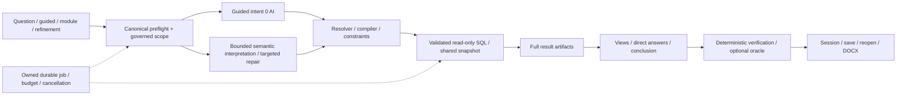

# Avengers Coffee Data Platform V3.4 — Architecture Review & Maturity Plan

Ngày review: **18/10/2026, Asia/Ho_Chi_Minh**. Trạng thái: **PLAN, chưa triển khai**.
Phạm vi: Data Platform; đọc thêm identity token contract để thiết kế integration, không sửa hệ thống identity/chatbot/Kubernetes/mobile/web-customer.

## 1. Executive Summary

V3.3 là nền Hybrid có governance thực tế, không phải demo LLM → SQL → chart. Các đường guided/free-text hội tụ về intent, resolver và compiler do server quản lý; read-only execution, bounded provider recovery, job idempotency, full-artifact answers và verification đã nối vào luồng sản phẩm. Giữ nền này.

Điểm yếu lớn hơn hiện nằm ở **ranh giới toàn platform**: API ngoài Analyst chưa có cùng security policy; chất lượng và hoàn tất ingestion chưa có bằng chứng đủ mạnh; hai đường dữ liệu không có identity chung; vận hành/CI còn thủ công; orchestration, semantic policy và UI tích lũy nhiều trách nhiệm.

Đề xuất V3.4: **PRESERVE → CONSOLIDATE → HARDEN → EXTEND**. Không thêm microservice. NOW triển khai security boundary, semantic contract consolidation/L03, data health/checkpoint/publication, observability nhỏ và cải thiện thống kê/UX có kiểm chứng. NEXT mới thí nghiệm hai instance và worker tách; FUTURE giữ ở design note.

Thứ tự ưu tiên: P0 correctness/security regressions; P1 semantic/trust; P2 data quality/governance; P3 operations/scale; P4 analytics/UX; P5 enterprise options. Phase number là thứ tự thi công, không thay severity. Security containment đi ngay Phase 1; RBAC đầy đủ Phase 4 phải xong trước mở quyền truy cập rộng.

**Không chạy lại live trong turn review.** Không sửa sản phẩm, migrations, deployment hoặc dữ liệu. Tệp này là deliverable triển khai cho Claude. Điểm là đánh giá kỹ thuật trong scope đồ án, sai số khoảng ±0,5; không phải chứng nhận production, enterprise parity hoặc phần trăm AI đúng.

### 1.1. Revision đã xác minh

- Đã `git fetch origin`, thành công; branch hiện tại `branch_thaian`.
- Local HEAD và `origin/branch_thaian`: **`f9a1a6ff8d3c88e1bc9954c134d7cef8bdcd050b`**, ahead/behind **0/0**.
- Commit: `feat: cap nhat dataplatform`, 18/10/2026 09:04:59 +0700. `git log -1 --format=%G?` trả `N`: commit này không có signature; không suy ra mọi commit đều unsigned.
- Working tree sạch trước tạo PLAN. Đã đọc diff/stat commit mới so với `ee8a00b1`, gồm production fixes, tests và artifacts V3.3. Không checkout/cherry-pick/merge.
- Handoff nói code chưa commit là **trạng thái lịch sử tại lúc nghiệm thu**. Hiện các thay đổi đó đã nằm trong commit `f9a1a6ff`; không dùng HEAD cũ làm baseline mới.
- Manifest run18 vẫn là bằng chứng lịch sử, không viết lại để đổi HEAD. Snapshot cũ có diff digest `e84143c287e9df90dbabd158c5def7858eb0b326347598517ad4783a600af391`.
- Chưa truy GitHub branch protection/ruleset qua API; không kết luận branch hiện unprotected. Cần admin kiểm ở Phase 8.

## 2. Verified Current Architecture

### 2.1. Request/report production path

Đã đọc thân hàm, không suy luận chỉ từ tên file:

1. `web-ui/src/views/AnalyticsView.tsx::handleOneClick` → `utils/analysisJobs.mjs` → `routers/ai.py::submit_analysis_job`. Preview vẫn qua `bounded_propose_plan`; generate/refine/reconcile là endpoints riêng.
2. `services/analysis_pipeline.py` là **facade re-export** `AnalysisPipeline` từ `agent_pipeline.py`, cộng `safe_failure`; không phải hai orchestrator độc lập.
3. `analysis_job_service.py::AnalysisJobs.submit/work` đăng ký owner/idempotency trong `JobRepository`, đặt deadline/observer/cancellation, gọi pipeline propose rồi generate; Redis là authoritative khi cấu hình production. ThreadPool 4 workers, local slots 12; repository có global active admission.
4. `agent_pipeline.py::{ui_context,guided_context,_propose}` gọi canonical preflight, normalize time/scope, quản lý session/request identity. `agent()` chọn `HybridAnalystPlanner` mặc định `planning_mode='one_shot'`; nhánh legacy vẫn có adapter.
5. `preflight_service.py::run` đọc cache/catalog, trả findings, capability, scope và typed actions; endpoint `/preflight` không gọi provider/analytical SQL. `mission_contract_service.py` dựng guided intent đã validate. READY ở input có thể là `interpretation_required`, không phải compiled/data success.
6. `hybrid_analyst_planner.py::run` → request anchors/metric locks/scope → semantic candidates/context → tối đa primary + targeted repair; `merge_repair` bảo vệ frozen fields. Provider không sở hữu executable graph hoặc SQL.
7. `analytical_resolver.py::AnalyticalResolver` normalize/compatibility/coverage/supporting operations; `analytical_query_service.py::AnalyticalQueries.prepare/run/execute_all` → `analysis_query.py::{build_plans,compile_sql,validate_sql,validate_results}` → `sql_service.py`.
8. Compiler path có table/column policy + AST validation; `query_execution_batch.py::report_snapshot` dùng repeatable-read/read-only, lock relations được compiler cho phép để chống TRUNCATE không MVCC-safe. Pool 12 connections, acquire khoảng 2s, statement timeout tối đa 12s và deadline còn lại.
9. `agent_pipeline.py::report` → `insight_service` → dashboard/derived charts → chart relevance → forecast/chart insights → view/direct-answer/conclusion → quality/replay → response bounding → persistence. `answer_requirement_service.py` đọc full artifacts, không tính total từ page/chart preview.
10. `AnalysisPipeline.reconcile` → `verification_reconciliation_service.py::OracleRunner/reconcile`, read-only, 0 AI; lưu kết quả vào session/report theo revision. Module dùng `analysis_module_service` + owner predicates ở repository; saved report/DOCX dùng `routers/reports.py` + verifier/docx.



### 2.2. Hai đường dữ liệu cần phân biệt

| Đường | Wiring đã đọc | Giới hạn thực tế |
|---|---|---|
| Operational replica → Analyst | `data-sync/sync.py` poll DB ứng dụng → PostgreSQL analytics base schemas → Silver SQL views → compiler Analyst | Analyst chủ yếu đọc Silver SQL, không trực tiếp đọc Gold Parquet; sync từng bảng chưa chứng minh snapshot nhất quán liên bảng |
| Batch medallion | `spark-jobs/entrypoint.sh` chạy **Python/pandas/pyarrow** Bronze → Silver → Gold Parquet/JSON, thêm Gold DB `to_sql` | Chưa phải Spark distributed execution, không có SparkSession/checkpoint/watermark trong các jobs đã đọc |
| Streaming observability | `kafka-producer/producer.py` poll created timestamps → Kafka → consumer → Bronze `streaming/...json` + `public.realtime_events` | Batch Silver lấy latest Parquet theo table; không thấy consumer JSON được merge vào Silver canonical facts; không được gọi là CDC end-to-end |
| Orchestration | Airflow DAG import Python jobs, retry 2; `max_active_runs=1`; compose `profiles: tools`, SequentialExecutor/SQLite | Có DAG trong repo không chứng minh scheduler đang chạy; không audit runtime Airflow/Kafka trong turn này |

`ARCHITECTURE.md` §11 là định hướng tương lai, có CDC/Spark/quality promises; không dùng như mô tả implementation hiện tại. UI platform/pipeline có một số dữ kiện dựng sẵn (§4), cũng không phải runtime evidence.

### 2.3. Baseline evidence và giới hạn kiểm chứng

Đã đọc handoff, PLAN/progress/checkpoint8, review gốc, hardening/completion và các phần V30→V33 liên quan; đọc runner, evaluator, live scorer, fixture browser và run18 summaries. R01–R13 trong review cũ là lịch sử đã được follow-up, không mặc định là bug còn mở.

Run18 ghi 1063 backend, 165 frontend, typecheck/build, 146 old +33 V3.3 eval PASS; 12 mocked +4 actual fixture browser; served browser 12 journeys; actual-job live 29/29, useful 24/25=96%, L03 thất bại. Turn review **không chạy lại full suite, browser hoặc live**, nên đó là bằng chứng nghiệm thu đã lưu, không phải kết quả test mới. Hai container healthy đã được đọc ở bước tiếp nhận bàn giao; chưa audit toàn stack/load/permissions DB thực tế.

## 3. Baseline Preservation Contract

Các invariant sau là release-blocking cho mọi phase:

- Một Hybrid meaning path; LLM không quyết metric formula, scope membership, access quyền hoặc SQL tùy ý. Guided/free-text/module/refine cùng compiler/validators.
- Known terminal capability trước provider và analytical execution. Metadata/value lookups/dry-run phải được đếm riêng, không gọi mọi I/O là 0 SQL.
- Giữ READY/CLARIFY/REDIRECT/UNSUPPORTED, input/compiled stage, pending runtime constraints và typed actions. Không chuyển unknown thành success.
- Governed South6/North4/Central6, source/version; finite set equality, exclusion/union/cohorts/unknown bucket, per-region Top N. Không coi taxonomy kho là toàn bộ địa lý hành chính.
- ≤1 interpretation +≤1 targeted repair +≤1 transport recovery, ≤3 physical HTTP/submission; reserve-before-send, failed/timeout/unknown outcome đều tính; không semantic model hopping.
- Giữ planning40s/job70s, provider total30s, attempt≤12s/connect≤2s, reserve5s và recovery window hiện tại trừ khi benchmark/ADR chứng minh thay đổi cần thiết.
- Job owner/idempotency/resume/cancel và durable counters không reset khi reconnect/restart. Không replay paid work có kết quả chưa biết.
- SQL allowlist/AST, read-only transactions, result guards, snapshot consistency, capacity limits. Policy security mới chỉ thu hẹp quyền hợp lệ, không bỏ validators.
- Tổng full population; AOV/rate/distinct đúng denominator; forecast future/current tách; signed driver, correlation không causation; no_data/insufficient/error không false green.
- Requirement-driven views; không floor chart cứng. Conclusion/evidence/caveat cuối phần phân tích; oracle `not_measured != matched`; không blended AI accuracy.
- Save/reopen/module/DOCX giữ provenance/verification; old reports không tự nâng lên verified theo policy mới. Async identity/epoch/reset/history vẫn đúng.
- Không xóa/skip các case cũ để xanh; giữ L03 và failed runs. Không rewrite historical manifests, reset ledger, commit/push/reset/clean.

## 4. Findings — severity, evidence, root cause, impact

Severity ở đây là **độ ưu tiên nâng cấp**, không tuyên bố đã exploit trên môi trường public. `Verified-static` là chứng minh từ control flow; `gap` cần test/runtime để định lượng.

| ID / mức | Evidence file/function | Root cause và tác động | Hướng xử lý / test |
|---|---|---|---|
| F01 P0, verified-static | `server.py` đăng ký routers không auth dependency; `routers/query.py:230::run_custom_query` → `execute_read_only`; executor chỉ gọi `validate_read_only_sql` | Read-only ngăn DML nhưng không phải dataset/PII authorization. Compiler Silver policy không được endpoint SQL Explorer áp cùng; route callable nếu API truy cập được | Containment Phase1: admin + explicit SQL policy/default disabled; Phase4 authorization toàn API; S01/S02 |
| F02 P0, verified-static | `browser_owner.py:9::browser_owner`; `routers/reports.py::{list_saved_reports,get_saved_report,delete_saved_report}`; `system.py::get_system_users` | Browser opaque cookie là ownership tạm, không account identity. Saved reports list/get/delete thiếu owner predicate; `created_by` do client gửi. Role list ở system UI không phải RBAC backend | Principal + resource access; quarantine ownerless saved reports; S03/S04 |
| F03 P1, verified-static | `data-sync/sync.py:301::sync_table_incremental`, `:374::update_sync_metadata` | Cursor lọc `source_ts > last_synced_at`, nhưng checkpoint là target `NOW()` sau load. Update commit muộn hoặc timestamp trước checkpoint có thể bị bỏ; cursor/data commit tách nhau. Hourly full dựa cùng last_sync nên bảng hoạt động liên tục có thể không đến lịch repair | Source upper-bound/composite cursor + overlap/upsert; independent full-reconcile schedule; D01–D04 |
| F04 P1, verified-static | `producer.py::fetch_and_publish`, `_state` memory, LIMIT và `>` timestamp; `consumer.py:140` auto commit, `flush_batch`, main clear buffer | Timestamp ties vượt page có thể mất; send asynchronous nhưng cursor tiến trước acknowledgement; restart replay; auto offsets không gắn sink durability, lỗi sink bị nuốt rồi clear buffer | Bounded at-least-once + idempotent sinks/checkpoint, không claim exactly-once; D05–D08 |
| F05 P1, verified-static | `bronze_ingestion.py:111::main`, `silver_transform.py:33/73`, `gold_aggregation.py::{get_latest_df_from_silver,save_to_gold_db,main}`, DAG `check_pipeline_health` | Chọn latest độc lập từng table, nuốt lỗi và tiếp tục; Gold `latest.json`/replace từng dataset, DAG kiểm object tồn tại có thể là object cũ. Không có run completion fence | Run manifest, required/optional contracts, publish committed version cuối, retry/replay; D09–D12 |
| F06 P1, verified-static | `silver_transform.py:95` numeric coercion→0; Gold `valid_statuses` gồm DA_XAC_NHAN trong vài aggregates nhưng canonical revenue chỉ HOAN_THANH/DANG_GIAO; `routers/marts.py::get_all_marts` AOV chia mọi orders | Missing/invalid bị diễn giải 0; nhiều business aggregation owners gây khác nghĩa giữa dashboard và Analyst. Chưa định lượng lệch số trên DB thật trong review | Typed rejects/quarantine, metric parity cho marts cùng tên; nếu khác định nghĩa phải đổi label/metadata, không đổi Analyst chuẩn; D13/M01 |
| F07 P1, verified-static | `routers/platform.py:525::get_data_quality`: query 3 counts nhưng score/status cố định, rule4–6/fixed timestamp; `:487::trigger_pipeline` chạy INSERT KPI nhưng trả logs Silver giả định | Operational presentation không bắt buộc có evidence. False confidence và endpoint trigger không đại diện full DAG | DataHealth computed contract; trigger trả actual action/run identity, không fabricated logs; D14/D15 |
| F08 P1, gap | `data_coverage_service.py::{_query,build_snapshot,peek}`; `_query` chỉ MIN/MAX fact clocks + success sync_history gần nhất; `semantic_catalog_validation.py::registry_drift` chỉ existence | Có per-fact stale/unknown đúng, nhưng chưa per-source load checkpoint/completeness/schema type/quality certificate; snapshot cache có thể cũ khi refresh fail | Mở rộng chính coverage thành DataHealth, không health engine thứ hai; H01–H05 |
| F09 P1, verified-static + live evidence | `scope_resolution_service.py:89::scope_issues` chỉ mở axis khi dimension đang có; `hybrid_analyst_planner.py:315::merge_repair`; run18 `known-live-failure.json` L03 | Draft thiếu grouping hoàn toàn; repair thêm city đúng cohort nhưng dimension không nằm target. Safety chặn đúng, target dependency thiếu → false block. Không phải transport mất payload | Reproduce capture offline; authorize đúng dependency của scope/cohort issue, giữ metric/time/other scope frozen; N01–N04 |
| F10 P2, verified-static | `semantic_preflight_contract.py::{decision_from_findings,evaluate_capability}`, `preflight_service.py`, `mission_contract_service.py`, resolver, chart relevance | Contract canonical đã có; rule production vẫn chia giữa input text recognition, guided validation, compiled constraints và presentation. Không phải mọi duplication đều sai: runtime/view guards cần riêng | Một rule implementation cho cùng static facts; adapters theo stage; preserve views/replay; C01–C04 |
| F11 P2, verified-static | `metadata/semantic_catalog.json`: 14.133 lines/508.457 bytes; 43 metrics/33 dimensions/18 subjects; 0/43 metric có `owner`; `AnalysisCatalog.__init__` hash toàn overlay | Business_definition/business_meaning, additive flags/new semantics, UI policy/aliases/examples/source scope cùng document; cosmetic metadata có thể invalidate meaning identity | Owner/stable IDs/lifecycle, diff classifier; chưa tách physical runtime artifact ở NOW; V01–V04 |
| F12 P2, gap | `provider_health_service.py` single recent state; `provider_credential_router.py::_state` cooldown local | Đã có health/cooldown/failover; thiếu rolling denominators, concurrency probing và multi-process coordination. Không có bằng chứng cần retry thêm | Dùng existing owners, metrics/cooldown tests; shared circuit chỉ khi multi-instance; P01–P03 |
| F13 P2, verified-static | `forecast_service.py::{backtest,forecast}` lựa chọn min backtest MAE; method có thể skip origins; interval Z80 residual/sqrt(h) | Engine có rolling CV/baseline/version và guards, không cần dựng lại; chưa common-origin selection diagnostics/calibration holdout. Cùng data chọn model và báo chất lượng có selection optimism | Common eligible folds, held-out diagnostics khi đủ data, interval empirical coverage; A01–A04 |
| F14 P2, design limit | `risk_watch_service.py::evaluate/classify`, `insight_service.py::{paired_observations,reconcile_driver_deltas}` | Governed rules/Pearson/delta hữu dụng nhưng chưa statistical anomaly/Spearman/robustness diagnostics; giới hạn capability, không phải tự nó là bug | Bổ sung nhỏ, gated theo history/sample/health, traceable stats; A05–A08 |
| F15 P1/P2, verified-static | `verification_reconciliation_service.py:65::reconcile` decrement budget sau success; `agent_pipeline.py:1187::reconcile` dùng stored artifacts rồi query kho hiện tại | Oracle lỗi có thể tốn nhiều attempts hơn max_oracle_queries; old report so với dữ liệu đã đổi có thể mismatch do different snapshot. Oracle dùng cùng metric definition nên không chứng minh độc lập nghiệp vụ/source completeness | Reserve query attempt trước runner, expose consistency/data epoch; different snapshot→incomparable/reconcile refreshed report; T01–T04 |
| F16 P2, verified-static | AST inventory:79 service modules/358 service-import edges, 76 router-transitive reachable; SCC lớn60; `agent_pipeline`1259, planner963, understanding1299 lines; `AnalyticsView`3143 | Imports lazy + adapter inheritance tạo coupling; report rendering/state/HTTP và policy trộn. SCC không đồng nghĩa runtime import crash hoặc tất cả calls được thực thi | Characterization + remove real reverse dependencies; strangler hooks/private helpers; X01–X03 |
| F17 P2, verified-static + gap | `analysis_job_service.py::{JobRepository,AnalysisJobs}`, `session_service.py` Redis/CAS, pool; in-process ThreadPool/cache/limiter | Có durable state và global admission, không phải stateless workers/queue. Accepted work gắn local executor, restart không tự recover safe work; session lock object local không đủ kết luận multi-instance correctness | NOW robust single instance; NEXT two-instance contention/CAS/cancel/load proof; O03–O05 |
| F18 P1/P2, verified-static | `.github/workflows/api-ci.yml` kiểm NestJS, không Data Platform job; `.claude/scripts/dp-test.sh` manual; scattered logging/timing | Bằng chứng tốt nhưng chưa CI required gate/structured cross-layer correlation; không có release trace/slo denominator thống nhất | Offline CI + bounded telemetry schema + release artifact identity; O01/O02/R01 |

Không đánh dấu ba module không router-import-reachable (`reference_accuracy`, `semantic_example_service`, `vector_rag_service`) là dead: tools/tests/entrypoint động còn phải tra. Không xoá helper `DataAnalystAgent`/`OneShotPlanner` vì Hybrid còn dùng lại. Không coi canonical replay tính lại conclusion là duplication cần bỏ: đó là ranh giới kiểm chứng có chủ đích.

## 5. Current Scorecard

Điểm chấm từ implementation và bằng chứng có sẵn, không copy rubric đầu vào. Một nhóm test mạnh không bù được endpoint quyền truy cập chưa đóng. “Hiện tại” không hàm ý runtime load/security đã được nghiệm thu.

| Area | Current | Lý do chính / evidence |
|---|---:|---|
| 1 Ingestion/Silver/Gold/Kafka | 5,4 | Atomic full-table replacement đã có; cursor/delivery/publication/completeness gaps F03–F06; batch là pandas |
| 2 Semantic control | 8,3 | Governed definitions/compatibility/scope/version/hash tốt; ownership/lifecycle/diff còn thiếu F11 |
| 3 NL/AI planner | 7,5 | Protected intent/repair, live96% trên25; L03 và corpus nhỏ F09 |
| 4 Capability/preflight | 8,1 | Canonical contract mọi Analyst paths; stage rule overlap và metadata drift F10 |
| 5 SQL/query | 7,1 | Compiler path khoảng8,3; toàn platform bị kéo xuống bởi direct explorer F01, budget/oracle F15 |
| 6 Provider reliability | 8,0 | Budget/deadline/durable counter/fault/live recovery có thật; rolling ops/local state F12 |
| 7 Forecast | 7,3 | Nhiều baseline, rolling origin/version/guards; chưa calibrated/selection diagnostics F13 |
| 8 Risk | 7,1 | Rule-based governed/0AI, scope đúng; anomaly history chưa có F14 |
| 9 Relation/driver | 7,0 | Pair accounting/signed delta/causal caveat; robust alternative diagnostics còn hẹp |
| 10 Chart/presentation | 7,8 | Requirement views, direct answers/provenance/paging; interaction còn đơn giản |
| 11 Verification/trust | 8,5 | Replay/mutations/independent query tốt; query independence không source independence, F15 |
| 12 Analyst UX | 7,7 | One-click/guided/chips/race protections; view lớn và nhiều control/state |
| 13 Test/eval | 8,4 | Offline→fixture→served→live/fault evidence; CI/security/ingestion/real load còn thiếu |
| 14 Data quality/metadata | 5,5 | Cached source bounds/drift có thật; platform quality false assurance F07/F08 |
| 15 Governance/security | 3,8 | SQL-report admin token, module owner/privacy; không auth/RBAC chung, saved ownership F01/F02 |
| 16 Observability/ops | 5,4 | Job counters/timing/readiness có; cross-stage telemetry/alerts/SLO chưa thống nhất |
| 17 Scale/multi-tenant readiness | 5,9 | Redis/CAS/artifacts/pool/admission là nền tốt; worker/process/policy isolation chưa chứng minh |
| 18 Maintainability | 5,7 | 79 modules, vòng concepts/import và UI/catalog lớn F16 |

Trung bình mô tả 18 mục khoảng **6,9/10**; không dùng để che P0 security hoặc làm go/no-go thay release gates.

## 6. Target Scorecard — 8+ bắt buộc, 9+ có điều kiện

| Area | Target NOW | Bắt buộc để đạt target / evidence cần | 9+ hoặc NEXT | NOT NOW |
|---|---:|---|---|---|
| Ingestion | 8,0 | Source cursor/replay/dedup/run publication/quality gates; D01–D15 | CDC/delete capture khi có nhu cầu đo được | Delta/Iceberg/Spark migration chỉ vì tên kiến trúc |
| Semantic | 9,0 | Owners/IDs/diff/lineage/compatibility parity; V01–V04+C | Signed semantic release, broad impact tooling | Semantic registry thứ hai |
| NL | 8,3 | L03 dependencies + diversified corpus + ≥95%/40 useful live | 9 cần corpus thực tế lớn hơn, longitudinal results | Regex từng câu; tự tin số giả |
| Capability | 9,0 | One evaluator per rule/stage parity/actions, no known terminal leakage | Rule explainability/impact coverage nâng cao | READY đồng nghĩa đã có dữ liệu |
| SQL | 8,7 | Auth/policy all entrypoints, least privilege, query budgets/cancel | 9 cần cost/load evidence trên workload lớn | LLM raw SQL, unrestricted cost EXPLAIN ANALYZE |
| Provider | 8,6 | Existing limits + rolling metrics/concurrent cooldown faults | 9 cần sustained observed SLO, multi-instance fault proof | Tăng HTTP/retry storm |
| Forecast | 8,2 | Common-fold diagnostics/version/data health/interval validation | Calibrated scope forecast nếu history đủ | LLM/AutoML/deep learning/exogenous data giả |
| Risk | 8,1 | Rules giữ nguyên + robust baseline đủ điều kiện + evidence | Seasonality-aware khi đủ2 chu kỳ | Composite risk score mới mặc định |
| Relation/driver | 8,1 | Spearman ties/guards/outlier sensitivity/independent totals | CI/lagged relation có design và sample đủ | Causal conclusions, p-value hàng loạt |
| Chart | 8,5 | Consistent unit/color/data navigation, typed inspect, view coverage | Cross-filter có provenance/version | Dashboard builder/general BI clone |
| Trust | 9,0 | Attempt budget, data-epoch consistency, semantic/formula replay; T | More independent reference fixtures | Oracle cùng formula thành chứng nhận nghiệp vụ |
| UX | 8,5 | Early typed choices/one-click/resume/auth states, private diagnostics | Multi-step investigation nếu evidence nhu cầu | Thêm wizard bắt buộc trước mọi report |
| Tests | 9,0 | CI + production boundary/security/data fault matrix + frozen40 | Operational canary theo release | Live mỗi commit hoặc chỉ tăng câu tương tự |
| DQ/metadata | 8,2 | DataHealth thật/source SLAs/completeness/schema/quality facts | Distribution drift khi có stable windows | Mua/thêm GE/Soda để thay vài rules đơn giản |
| Governance | 8,0 | Auth/RBAC/resources/export/row scope/audit/revocation tests | Fine-grain grants/workflow approval khi cần | Okta clone, full tenant compute |
| Ops | 8,1 | Trace→job→SQL/provider, denominators/SLO/runbooks/CI | OTel export/trend alerts ở môi trường có collector | Observability stack lớn bắt buộc |
| Scale | 8,0 readiness | Bounded single-instance, shared-policy identity, two-instance test | Dedicated worker giữ job protocol | Claim multi-tenant production/warehouse autoscale |
| Maintainability | 8,0 | Fewer owners/cycles, no contract duplication, extracted tested UI lifecycle | Further reduction theo measured churn | 30 module/service mới, arbitrary line limit |

Targets là **projection sau evidence**, không ghi DONE vì code trông đẹp. Scale8 là scale-ready trong workload demo có giới hạn, không multi-tenant isolation enterprise. Nếu chưa làm statistical Risk/relationship vì dữ liệu thiếu: công khai capability chưa có, điểm tương ứng chỉ khoảng7,5–7,8, không tự nâng8.

## 7. Target Architecture

Vẫn một analytics-api deployment, một web-ui, PostgreSQL/Redis/MinIO/Kafka hiện có. Chỉ thêm một số module nội bộ có boundary rõ, không orchestrator hoặc semantic engine mới.

```text
Authenticated Principal + versioned AccessPolicy
  → existing normalize/preflight/scope + authorized capability projection
  → existing guided OR bounded Hybrid interpretation
  → existing resolver/compiler + mandatory access constraints + DataHealth requirements
  → existing bounded read-only snapshot executor
  → artifacts carrying semantic/query/formula/data-health/policy identities
  → existing evidence/views/answers/conclusion/replay/oracle
  → owned persisted report/module/export

Replica sync + Kafka + batch medallion
  → versioned input contract + durable checkpoint + idempotent writes
  → staged run outputs + measured quality + committed run manifest
  → existing data_coverage_service assembles one DataHealth projection

Request/job/run IDs + structured telemetry + redacted audit accompany each boundary.
```

Một data epoch cho PostgreSQL replica có nghĩa **generation/vector per-source đã quan sát**, không tự suy ra transaction source chung. Object storage publication manifest và DB publication cần trạng thái riêng; không hứa distributed transaction giữa MinIO/Kafka/Postgres.

## 8. Responsibility Map

| Owner hiện tại/đích | Own | Không own |
|---|---|---|
| `AnalysisCatalog` + catalog validator | Definitions, compatibility references, source scope, stable semantic IDs, structural validation | Authenticated principal, measured data completeness |
| `semantic_preflight_contract` | Capability types + reusable static rule implementations + stage projection | Text NLP extraction, chart renderer, SQL execution |
| `preflight_service` / `mission_contract_service` | Input recognition/guided slots→canonical facts/actions | Tự tạo policy business mới |
| `request_anchors` / `scope_resolution_service` | User meaning locks + governed exact scope/cohorts | Row access entitlement; membership do LLM nghĩ ra |
| `hybrid_analyst_planner` | Bounded interpretation/targeted repair; delegate resolution | Transport retries, formula, access approval |
| `analytical_resolver` / `analysis_query` | Intent→operations/views→compiler/result invariants | UI state, provider health |
| `sql_service` / `query_execution_batch` | SQL safety/physical query timeout/snapshot/pool/cancel | Cho phép SQL chỉ vì principal tự khai admin |
| `agent_provider` / `provider_budget` / credential router | Transport/recovery; per-request reserve/deadline; credential cooldown | Semantic model hopping hoặc sửa nghĩa |
| `analysis_job_service` | Existing durable lifecycle/idempotency/claim/admission ledger | Semantic decision thứ hai, queue system mới |
| `insight_service` / forecast / risk | Governed deterministic calculations | LLM số liệu/causal inference tự do |
| `answer_requirement_service` / view service / chart services | Full-artifact answers, requirement coverage, presentation bindings | Mở rộng quyền hoặc chữa query sai bằng chart |
| `analysis_quality_service` / reconciliation | Replay/integrity và independent-shape numeric checks | Source truth certification khi chưa đo |
| `data_coverage_service` mở rộng | DataHealth cached projection, stale/completeness/quality association | Quét warehouse trong typing preflight |
| **Mới `access_policy.py`** | Principal verification adapter, RBAC/resource authorization, authorized scope/fingerprint | Identity provider, role database tùy tiện |
| **Mới `telemetry.py`** | Common context/events/counters/redaction, audit delivery adapter | Một job store hoặc business engine khác |
| Sync/Kafka/batch jobs + shared pipeline utility | Source checkpoint, idempotent publication, run/quality evidence | Cùng sửa semantic metric definitions độc lập |
| `AnalyticsView` + extracted hook | Route/container state phối hợp; 1 epoch/identity owner | Business capability engine client |

## 9. Consolidation Plan

| Giữ | Hợp nhất/bọc | Deprecate có điều kiện | Mới thực sự cần |
|---|---|---|---|
| `analysis_pipeline` public facade | Không nhân bản implementation vì facade | Không xoá facade đang có callers | Không |
| Capability types/evaluator hiện có | Static facts dùng cùng function ở preflight/guided/resolver; enum/code/action mapping một owner | Chỉ xoá branch duplicate sau parity | Không tạo capability service thứ hai |
| `metric_capability/additive_across` | Oracle, contribution, chart eligibility dùng cùng semantics theo axis; display legacy flag là projection | Direct boolean decisions sau migration caller | Contract diff tool, không runtime service |
| Time/scope normalization hiện có | Parse1 lần theo request context; normalize idempotent trong compatibility adapter | Re-parsing thừa trong hot path sau trace proof | Không viết parser mới |
| Conclusion builder + replay | Share pure calculation primitives, **replay vẫn independently invoked** | Chỉ bỏ lặp orchestration trình bày | Không cached verdict thay verification |
| Schema/Silver views | `db.py::WAREHOUSE_VIEWS` và `data-sync::WAREHOUSE_VIEWS` hiện overlap: generated/shared approved definition artifact, có parity kiểm trước | Startup DDL đã default off; xoá duplicate writer sau caller inventory | Tối đa1 shared pipeline utility package |
| Existing job/session/artifact stores | Thêm access policy epoch/cache dimensions và shared admission tests | Memory chỉ dev; không dùng làm production fallback | Không job repository mới |
| Catalog single runtime JSON | Derive semantic projections/hash classification từ cùng source; dedup cosmetic aliases khi semantic equality | Tách authoring fragments chỉ NEXT sau generated-output parity | Không runtime registry song song |
| Current UI components/utilities | Extract lifecycle/network hook rồi renderer, giữ callbacks/contracts | JSX duplicate sau screenshot/race parity | ≤2 hooks/components mới trong NOW |

Tối đa **2 net-new `services/*.py`** trong NOW: access policy và telemetry. Pipeline common là thư viện thuần dùng trong containers hiện tại, không service. Tool/tests/fixtures không tính service; phải báo tổng file/code delta để tránh đổi tên né complexity budget. Chỉ thêm abstraction khi đã có ≥2 callers và có duplication được chỉ rõ.

## 10. Data ingestion hardening

### 10.1. Replica sync là ưu tiên data correctness

- Mỗi dataset có contract: source identity/schema/key/update clock/delete strategy, timezone, required columns/types, owner, schema compatibility, expected cadence, full-reconcile interval.
- Cursor = `(source_updated_at, primary_key_tuple)` với ordering/keyset có giới hạn; source-side upper bound lấy đầu run. Nếu clock không đáng tin hoặc bảng không PK: full bounded snapshot/staging, không append duplicate âm thầm.
- Late transaction có timestamp cũ: composite cursor **chưa đủ**. Dùng overlap lookback + idempotent upsert + periodic full reconciliation trên lịch độc lập; record lookback assumption. Không hứa không mất mọi late write nếu không CDC/logical sequence. Nếu bounded lateness không bảo đảm, completeness remains unknown.
- Persist batch data/checkpoint cùng target transaction; checkpoint tiến sau acknowledged write. Failure sau commit trước notification phải replay idempotently. Tách `last_attempt_at`, `last_success_at`, `source_high_watermark`, `last_full_reconcile_at`; không dùng một NOW cho bốn khái niệm.
- Không giữ open source snapshot vô hạn. Full load đọc chunks từ source consistent snapshot nếu được; record snapshot interval và per-source generation. Các bảng cập nhật riêng không trở thành cross-source atomic bằng cách gán chung run_id.
- Delete: NOW bounded scheduled reconciliation/key anti-join trên fixture/staging đã duyệt; source soft delete nếu có. CDC hard delete là NEXT. Không TRUNCATE/DROP ngoài transaction, không tự chạy repair destructive trên DB thật.
- Schema add nullable compatible có thể auto sau validation; type narrowing/drop/PK change → quarantine/block affected dataset, giữ generation trước. DDL production/migration cần owner approval theo repo rule.

### 10.2. Kafka đúng delivery semantics

- Producer keyset `(updated_ts,key)` nếu update clock đủ; event ID ổn định từ source/table/key/version; persist cursor chỉ sau delivery future acknowledged; retry bounded/backoff jitter trong deadline poll, không loop mù.
- Consumer manual offset commit sau required sink durable. Chọn **Bronze durable là required**, realtime PostgreSQL là projection có replay; nếu buộc cả2, dùng stable event_id + per-sink replay status, không hứa atomic2sinks.
- Bronze object key deterministic theo topic/partition/offset-range; DB uniqueness `(topic,partition,offset)`/event ID; malformed event vào quarantine/DLQ cùng reason rồi mới commit theo policy, không mất offset âm thầm.
- Crash sau sink trước offset commit phải chỉ tạo1 logical event sau replay. Kafka replay không tự điều chỉnh canonical Silver facts cho đến khi adapter thực sự được implement/test; NOW công khai đây là event stream observability.

### 10.3. Batch publication

- Existing Python jobs nhận `run_id/as_of/input_manifest`, không tự chọn latest từng table. Run output immutable dưới run path; manifest có contract/schema hashes, source generations, row counts, rejects, required/optional statuses, checksums và lineage.
- Validate required outputs trước commit manifest; consumer chỉ đọc committed run. Missing required→failed/nonzero; optional missing→partial có disclosure. Không success log chung khi mọi aggregate đang warning.
- Gold DB publish: stage rồi transactional upsert/swap theo schema đã duyệt; không `to_sql(replace)` trực tiếp lên public current. Nếu writer fail, giữ published version trước; MinIO/DB states phân biệt. Health check kiểm expected **run_id+hash+quality**, không object tồn tại.
- Giữ pandas/Parquet/MinIO cho quy mô hiện tại; chunk/bound memory, đo peak RSS. Chỉ chuyển Spark/Delta/Iceberg khi dữ liệu/tính concurrent write/replay chứng minh giới hạn, không trong MUST-HAVE.

## 11. Semantic control plane hardening

Thêm metadata vào cùng nguồn quản trị: stable metric/dimension/dataset IDs, accountable team owner, semantic version, introduced/deprecated/replacement, unit/population/grain/time semantics, lineage references, source dataset IDs. 43 metrics hiện không có owner field; owner phải là role/team thật do chủ dự án xác định, không điền “admin” cho đủ validation.

`tools/catalog_contract_diff.py` mới (CLI offline) phân loại breaking/compatible/presentation: đổi formula/population/unit/grain/filter/scope membership/policy→meaning change và invalidate approvals; đổi label/help text→presentation. NOW giữ `catalog.fingerprint` hiện tại để bảo toàn sessions; thêm `semantic_fingerprint` **additive**, chạy shadow compare trước khi dùng selective invalidation. Không đột ngột đổi hash cũ khiến report/module cũ không mở được.

Compatibility graph derive từ `AnalysisCatalog`/resolver index, không maintain YAML thứ hai. Detect missing/type-changed columns và required join/key changes; affected capabilities unavailable, không disable mọi metric khi một source lỗi. Contract diff xuất impacted metric→mission/view/tests/saved definition IDs; report snapshot cũ giữ catalog version/formula, không apply định nghĩa mới vào số cũ.

NEXT mới tách catalog authoring theo subject với build deterministically tạo **một** runtime artifact; equality test sorted JSON/IDs/compiled plans bắt buộc. NOW không cần format/sort lại toàn14k lines gây diff khó review.

## 12. AI/NL planner reliability

L03 phải được replay bằng hai normalized interpreter outputs đã lưu, cùng public `propose→generate` fixture. Expected: HCM/Hà Nội tháng9, revenue, correct grouped cohort totals; provider ≤2 logical; không fallback all-scope.

Sửa `scope_issues`/repair targeting theo dependency: khi governed cohort comparison cần axis mà draft thiếu, issue phải chỉ rõ expected axis được resolver chứng minh. Cho phép đúng `dimension_ids` patch cho requirement đó cùng filters, **không** mở mọi grouping chỉ vì có scope error. Recheck all anchors/frozen metric/time/unrelated scopes và verify operations sau repair. Thêm negative cho period đổi, metric đổi, city khác, extra dimension, unrelated requirement, valid split-cohort representation; không ép mọi compare thành cùng1 representation.

Tiếng Việt normalization tiếp tục dùng `value_text`, alias metadata và spans gốc; test dấu/không dấu/spacing/case/typo hữu hạn cho entity lookup. Unknown typo→candidate choices/clarify, không tự chọn địa danh bằng fuzzy guess. Multi-clause requirements phải được coverage audit từng clause, không thu gọn mất qualifier để giữ max6 prompt.

Deterministic fallback chỉ khi tất cả requested slots và obligations đã bind (giữ `auto_guided` eligibility chặt). Chưa đủ nghĩa→clarify typed choices; không regex hardcode full câu L03 và không gọi LLM để “confirm” đáp án deterministic. Không thêm numeric model-confidence khi chưa calibration; dùng reason/status/which-fields-unresolved.

## 13. Capability/preflight consolidation

Mục tiêu là **one authoritative contract + one implementation per reusable rule**, không một hàm khổng lồ làm recognition/SQL/UX mọi tầng.

- Input stage: normalized recognized facts + user slot completeness + governed unsupported. Unknown semantic interpretation vẫn pending; trả `interpretation_required`, không fake compiled.
- Compiled stage: same static facts + actual IntentRequirement. Compatibility/grain/non-additivity/forecast eligibility gọi chung existing evaluator; guided chỉ validate input slots rồi dùng cùng evaluator.
- Runtime stage: actual rows/history/data health; chỉ runtime mới quyết no_data/sample sufficiency. UI không được đoán dữ liệu từ READY.
- Every constraint có stable code/stage/owner/status/blocking/requirement/action. Message translation projection từ reason code; typed actions patch state rồi preflight lại, không nối prompt.
- Chart relevance chỉ xác nhận view coverage và metric/source/transform bindings; policy method unsupported đã biết phải được expose trước provider/SQL. Giữ guard phòng thủ ở compiler/verifier, không xoá vì đã preflight.
- Authorized capability projection ẩn denied metrics/dimensions/lookup values; no terminal leakage ở legacy/modules/refine/Scan/SQL Explorer/export. 401/403 là security outcome, không ngụy trang thành NL ambiguity.

## 14. Query/security hardening

- Đóng `/api/query` bằng cùng `require_sql_admin` containment ngay Phase1; default disabled như report SQL. Sau RBAC, permission `sql.explore` + table/column/function AST policy, max statement/result bytes/time/complexity. SQL text của admin vẫn không là LLM bypass.
- Tách connection roles `warehouse_reader` (SELECT allowed views, no DDL/DML/unsafe function capability) và `report_writer`/pipeline writer. Transaction read-only giữ nguyên nhưng không thay database privileges. Không giả định role hiện tại least privilege; inspect grants read-only ở implementation, không in credentials.
- QueryBudget request-owned: physical SQL attempt reserve trước execute/dry-run/oracle, elapsed/row/byte/operations accounting; metadata queries riêng. Cache hit không tính physical query. Existing capacity contract làm owner limits, tránh duplicate config ở endpoint.
- Dùng AST complexity whitelist/joins/Cartesian/function restrictions và EXPLAIN không ANALYZE theo allowlist cho diagnostic admin; estimate units/rows threshold chỉ soft/admission ban đầu vì planner estimates không billing truth.
- Deadline/cancel bao gồm pool wait/lock wait/execute/fetch; set `lock_timeout`/statement timeout theo remaining. Concurrent reports không giữ snapshot connection chiếm pool dẫn deadlock: measure/control per-report max SQL concurrency, reserve exporter connection budget.
- Query audit chỉ hash + semantic IDs/authorized scope fingerprint/latency/row counts/status; raw SQL trong diagnostics admin nếu được phép, không log literals/rows/PII.
- Cache keys có principal access-policy version/entitlement fingerprint + semantic/catalog/time/scope/data epoch. Policy change invalidate; no cross-user sharing chỉ vì cùng question hash.

## 15. Provider reliability

Giữ `NativeAgentProvider` làm transport recovery owner; planner không resend/rotate do semantic failure. Existing credential router có cooldown60s/600s và health snapshot; mở rộng chúng, không tạo provider orchestrator.

NOW: rolling5m counts/success/error buckets/latency histograms, classify quota/auth/schema/semantic errors riêng; show observation age/unknown. Bounded concurrency protect half-open probe nếu cooldown policy dùng; một probe không cho cả đám retry. Respect short Retry-After khi còn recovery window; không sleep làm vượt40/70s. Không thêm exponential retry chain vào semantic submission. Background health không tự gọi paid provider.

Test current slot routing/body identity/503/reset/429/auth/invalid JSON + concurrent requests/cancel/reservation crash. Health chỉ dùng credential **slot category nội bộ**, tuyệt đối không key/fingerprint/headers; public không expose slot identifiers. NEXT shared cooldown/circuit state theo configured provider/model logical ID nếu chạy nhiều process; retry vẫn≤3 physical/request.

## 16. Forecast upgrade

Engine đã có naive/seasonal naive/moving average/SES/Holt/rolling backtest/MAE/RMSE/sMAPE/baseline/version3.0.0. **Không thêm model chỉ vì rubric liệt kê.**

NOW nâng `forecast_service`:

- Báo per-method origins/evaluated points/horizon/sample và chọn trên common eligible origins; method cần history dài không được hưởng lợi vì được chấm trên tập dễ hơn. Tie simplicity rule giữ.
- Khi đủ history, tách selection folds và validation tail; thiếu data thì disclose in-sample selection estimate, không pretend holdout. Baseline so trên cùng folds/horizon.
- Interval diagnostics empirical coverage trên held-out points theo horizon, sample count; interval80 vẫn “ước lượng”, không guaranteed80/95. Fallback naive nếu model improvement không bền theo threshold đã versioned.
- Missing periods phân biệt internal gap known zero/unknown source gap; không auto-zero invalid/missing data. Preserve trailing stale guard/current in-progress/future-only totals. Record health snapshot/hash, actual history hash, method/version/params/reference/cadence/unit.
- Outlier/level-shift diagnostics robust, hiển thị cờ; không winsorize silently thay actual history. Changepoint chỉ diagnostic đơn giản trước, không engine mới.

NEXT: scope-filtered ungrouped forecast chỉ sau policy change approved, equivalent history/sample/health checks và holdout từng cohort; update preflight/catalog/resolver cùng lúc. Grouped forecast separate effort có hierarchy/conservation. NOT NOW promotion/holiday/weather regressors/AutoML/deep learning vì chưa thấy governed exogenous facts trong forecast path.

## 17. Risk/anomaly upgrade

Layer1 giữ nguyên governed signals/threshold/selected signals/0AI Scan. Layer2 thêm **một** robust rolling baseline (median/MAD, fallback IQR khi scale phù hợp) trên complete historical buckets của metric có time source. Layer3 nếu Deep cần LLM thì chỉ diễn giải evidence, cùng provider budget.

Contract anomaly: signal_id/version, metric/formula, period/scope, baseline window, n, excluded periods, method/params, observed/expected/bounds, deviation, threshold direction, data health, evidence_id. Min history mặc định28 daily buckets hoặc8 complete weekly, seasonal variant cần≥2 cycles; validate per-signal metadata, không dùng mặc định cho mọi metric. MAD=0/short history/stale/incomplete→`not_applicable/insufficient_sample`, không green. Rates phải giữ denominator/exposure minimum, không phát hiện đơn thuần bằng raw rate.

Không chạy tất cả z-score/IQR/EWMA cùng lúc. Seasonal/EWMA là NEXT nếu dataset chứng minh robust baseline false positives. Rule breach và anomaly phải hiển thị riêng; không gom thành composite risk score. Inventory snapshot chỉ Layer1 cho đến khi có lịch sử thật. Scan vẫn0provider, thêm bounded SQL budget và disclose baseline query cost.

## 18. Relationship/driver upgrade

Giữ unique-key pair generation, complete accounting/missing/invalid/variance guards và stats trên toàn bộ pairs; preview≤200 không ảnh hưởng n/r. Thêm Spearman average ranks với tie handling và deterministic reproducibility; report Pearson/Spearman/sample/scatter caveats, không gọi một hệ số là nguyên nhân.

Outlier sensitivity: report robust flags và coefficient on full sample vs diagnostic subset **được gắn nhãn**, không tự xoá points để tăng tương quan. CI Fisher-z chỉ khi assumptions/sample hợp lệ; bootstrap fixed seed bounded là NEXT, không bắt buộc p-value ở NOW. Multiple testing/p-value/lagged search không mở mặc định.

Driver vẫn signed decomposition, independent current/previous whole-scope totals, equivalent complete periods, zero/missing/new/disappeared groups rõ. Add reconciliation identity `sum(group_deltas)=total_delta` trong tolerance; disclose residual nếu groups thiếu. Label “đóng góp vào chênh lệch”, không “nguyên nhân gây giảm”. No cross-population generic join.

## 19. Chart/analytical UX

Giữ resolver-owned ViewRequirement, scalar1KPI/evidence hợp lệ, broad3–6 là định hướng khi requirements thật yêu cầu, không floor. Ranking không tự padding chart. Units/colors/time axes/null states dùng formatter hiện có; threshold/negative delta có visual semantics nhất quán.

NOW entity inspect: click grouped mark→drawer đọc đúng artifact/page theo key, scope/time/metric/provenance; không provider. “Phân tích riêng nhóm” là explicit new governed request, có preflight, policy/version/lineage; không reuse report totals đã filter client thành full report. Compare periods qua typed refinement.

NEXT cross-filter chỉ khi selection được biểu diễn trong intent/version, re-run aggregates đầy đủ và lifecycle tests; client filter chỉ đổi displayed rows phải ghi nhãn rõ. “Why this chart” dùng view requirement/metric/grain/coverage deterministic, không prompt giải thích mới. Table/chart paging không đổi denominator, accessible empty/error/keyboard/mobile states được browser kiểm.

## 20. Verification/trust expansion

- Independent oracle attempt reserve **trước** runner; exception/timeouts vẫn consume allowance. `max_oracle_queries=3` là physical attempts, giữ `executed/failed/matched` riêng. Không dùng `max-budget` sau success làm actual-attempt count.
- Snapshot/data epoch: saved artifacts có result observed_at + per-source generations/contract/formula hashes. On-demand oracle đọc một report snapshot cho mọi oracle queries; so cùng snapshot/generation nếu còn khả dụng. Không giữ exported PG snapshot lâu qua session TTL để cản vacuum.
- Nếu report cũ và source đã đổi: `incomparable_snapshot` + offer refresh/reconcile, **không** quietly coi report sai hoặc coi oracle matched. Có thể đối chiếu source immutable run nếu implementation hỗ trợ; nếu không `not_measured`.
- Canonical additive semantics theo axis cho oracle; distinct_count không sum nhóm overlap chỉ vì legacy `additive=true`. Rate/AOV verify independent scalar numerator/denominator; mutations cho group/scope/date/unit/operand/rounding.
- Formula oracle vẫn cùng governed definition: label “độc lập query shape”, không source/formula independence. Một số core metrics có independent reference fixture SQL viết riêng + expected numbers/business-reviewed contract, không derive expected từ compiler cùng hàm.
- Persist chain: request meaning→intent→compiled operation→query hash→snapshot/data health→artifact hash→evidence→claim/view→saved report/export. Hash chống accidental mutation, không tự chống attacker có thể thay cả payload/hash; authorization/server-owned provenance là security boundary.
- Trust dimensions tách correctness/coverage/grounding/relevance/reconciliation/forecast diagnostics; never “AI accuracy97%”. Unknown completeness và oracle not_measured tiếp tục hiện caveat.

## 21. Data quality/metadata plane

**Mở rộng `data_coverage_service`, không dựng một health system song song.** Nguồn evidence từ ingestion manifests/checkpoint và bounded background probes; `routers/platform.py::get_data_quality` và workspace đều render cùng snapshot/projection theo quyền.

DataHealth v1 mỗi dataset: dataset_id, owner_team, source_id, schema_version/hash, load/run_id, source_watermark, last_attempt/success/full-reconcile, observation/expiry time, row_count, primary-key duplicate_count, required-null fractions, min/max business timestamps, freshness SLA, completeness state+certificate basis, rule version/results/denominator/severity, status+reason, impacted metrics. Không đưa raw PII/sample rows lên API.

Các trạng thái `healthy/degraded/blocked/unknown`; completeness riêng `complete/partial/unknown`, không suy healthy=complete. Source load success không đủ chứng nhận complete; cần extraction upper bound, key coverage, source contract và acceptance. Expired observation sau refresh fail→unknown/stale_snapshot, không trả green vô thời hạn. Sampled null/volume metrics ghi sampling; chưa đo→null/not_measured, không0.

NOW checks: key uniqueness, nonnull required, type/schema drift, valid amount/count domain, referential key coverage, per-source freshness và volume change với observed baselines. Volume0 khác query failure/missing source. Drift distribution PSI/K-S là NEXT sau stable baseline window, không fake population significance. Analyst requirements map metric lineage tới sources; blocked required source→fail/partial đúng contract, stale→warning hoặc block theo method policy (forecast/anomaly chặt hơn historical overview).

## 22. Governance/security

### 22.1. Identity boundary khả thi

Identity app hiện ký token có `sub/tai_khoan/role` (`identity-service/src/app.service.ts::login`), JwtModule secret-configured; chưa thấy issuer/audience/scope claims trong đoạn ký đã đọc. Không giả định đang có OIDC/JWKS hoặc Regional Manager entitlement.

NOW adapter xác minh token từ identity hiện tại với algorithm pinned, signature/expiry/sub checks; cấu hình verifier do operator inject, không đọc/copy secret vào repo. Nếu token legacy không có iss/aud, compatibility verifier phải được ràng buộc rõ vào deployment/provider trusted này, không accept issuer bất kỳ; không thêm claim bắt buộc mà token issuer chưa phát rồi làm hỏng login. NEXT dedicated audience/short-lived token exchange khi được mở scope identity. Không tin reverse-proxy header tự khai khi API8502 còn truy cập trực tiếp.

Không tạo password/user system khác. Web có login boundary dùng API identity hiện có qua proxy/path đã inventory ở implementation; token giữ memory hoặc server-backed HttpOnly session, không thêm token localStorage. Browser owner fallback chỉ dev explicit; production default deny khi chưa auth configured. CSRF/origin checks cho cookie state changes và server resource authorization đều cần; CORS không thay auth.

### 22.2. Permission model mặc định đề xuất

Đây là **chính sách thiết kế để chủ dự án duyệt ở Phase0**, không khẳng định existing business roles đã có grants:

| Role | Read aggregate | Scope | Save/export | SQL explorer / pipeline trigger / users |
|---|---|---|---|---|
| Platform Admin | Theo grants; admin không tự bypass PII | Assigned datasets; national nếu được cấp | Có permission riêng | SQL/trigger riêng và audit; users admin-only |
| Analyst | Governed non-PII metrics | Explicit dataset/scope grants | Own reports, export allowed | SQL mặc định không |
| Manager | Aggregate business reports | Assigned business scope | Own/shared approved reports | Không |
| Regional Manager | Aggregate regional | Assigned branch membership từ authorized grants | Trong scope được cấp | Không |
| Branch Manager | Aggregate branch | Assigned store IDs | Trong scope được cấp | Không |

Không infer security region từ reporting geography taxonomy; membership access là grants nghiệp vụ riêng, versioned. Không regional grant→deny; không regional manager được tự chọn national bằng UI. Metrics không có dimension map để enforce store permission→deny, không global fallback. Query requested scope vượt quyền→403 với lựa chọn trong quyền, không âm thầm widen; phần policy scope đang áp phải được disclose mà không lộ branch bị cấm.

Áp ở backend cho capabilities/scope lookups, jobs/propose/generate/refine/reconcile/results, modules, reports/save/list/reopen/export/delete, marts/stores/customers/products/platform/system/query. Resource grant deny trước metadata nhạy cảm/provider/SQL. JWT role chỉ map tới permission template được server quản trị; row entitlements lấy trusted grants, không payload client.

Principal/policy/scope identity đi vào session/approval/job/cache/artifact/export. Revocation giữa propose→generate, job running→complete, saved report→download phải recheck; unauthorized result không publish. Response từ cache và oracle cũng phải scope bound.

### 22.3. Persisted resources và schema approval

Saved reports hiện ownerless: cần additive owner_subject/owner_type/policy_version và audit/grant persistence nhỏ hoặc tương đương store bền. Không backfill owner theo client `created_by`, không cho người login đầu tiên chiếm dữ liệu cũ. Legacy reports vào admin-only/quarantine/read-only; claim ownership chỉ bằng administrator-approved mapping có audit.

**Implementation phải xin approval trước sửa `init-db/`/`migrations/` hoặc chạy DDL theo repo rule.** PLAN này thiết kế schema, chưa yêu cầu thực thi migration. Trong lúc chờ: ship containment, deny legacy report access ngoài admin, hoàn thành fixture/offline. Không tuyên bố governance8 nếu ownership/audit/grants production chưa persist đúng. Ưu tiên1 additive migration nhỏ, không schema rewrite; split warehouse reader/report writer roles là deployment SQL cần review tương tự.

Audit event append-only: actor opaque ID, action/resource, decision/reason, policy/scope/query hashes, request/job/run IDs, timestamps/outcome. Không log prompt/raw rows/tokens. Bounded durable spool khi sink lỗi; privileged write/export fail-closed nếu audit không thể reserve; read-only errors được metric/health rõ, không quietly discard. Retention/access admin, tamper-evident export optional NEXT; không claim cryptographic nonrepudiation.

## 23. Observability

Tận dụng job `stage_timings_ms`, provider attempt taxonomy, existing logging/readiness. Mới `telemetry.py` chỉ chuẩn hoá context/events/redaction và audit adapter.

- Server tạo request_id hoặc validate incoming trace context; job_id stable, report revision, pipeline_run_id/source_run_id join được. Internal actor IDs không làm metric labels.
- Spans: request.preflight, job.queue/planning/repair/resolve/execute/verify/persist, db.acquire/query/fetch, provider.physical_attempt, data.refresh/publish. ThreadPool propagate ContextVar bằng explicit captured context; job trace link lúc reconnect, không tạo paid job mới.
- Metrics: duration histograms, request/job outcomes by bounded reason/stage/mission, physical/logical/repair/recovery counters, SQL attempts/errors/rows, cache hit/miss, active/queue/rejected, data freshness lag, DQ status/rules, telemetry/audit dropped/spooled count. Không high-cardinality labels request_id/query text/store list.
- Structured logs cùng IDs, code/status/latency; redaction denylist+allowlisted fields; SQL/prose/headers không default log. Privileged diagnostics trong drawer/admin endpoint, không main UI.
- NOW JSON logs + in-process metrics export endpoint protected + minimal OTel API instrumentation/no-op khi disabled; collector/exporter optional config. Không deploy Grafana/Tempo/Prometheus bắt buộc.

Mục tiêu đo trên warmed local reference workload: preflight p95<50ms (cold riêng), planning p95≤40s, job p95≤70s; sample sizes/hardware/concurrency/cold/recovery nhóm rõ. Operational SLO tham khảo 7 ngày: internal SQL error<1% eligible queries, unexpected provider failure<5% attempted submissions, useful first-click≥95% frozen cohort. Auth denial/clarification/provider timeout không bỏ khỏi denominator liên quan; chưa đủ7ngày→chưa đo SLO, không report PASS.

## 24. Scalability

NOW robust1API instance: 4 job workers/12 admitted jobs/12 DB pool là baseline, không tăng tất cả cùng lúc. SQL snapshot exporter+reader tốn >1 connection/report; bound fan-out, separate budget cho metadata/health, backpressure trước provider. Per-principal quotas bổ sung global admission; 12 queued requests không được một owner chiếm mãi. Graceful shutdown ngừng nhận việc, cancel/mark uncertain đúng state, durable reservations giữ nguyên.

NEXT2instance proof: shared admission/cancel/policy cache invalidation, Redis CAS sessions, global slot/cooldown, lock fencing/lease expiry; fault after register-before-enqueue/claim-before-send/after-send-before-result. `JobRepository.create` ghi job/idem/active nhiều writes dưới lease lock: cần atomic registration transaction/Lua trên existing repository nếu injection chứng minh gap; không job system mới. Crashed uncertain paid job thất bại có lý do, không tự resend.

Dedicated worker chỉ khi load/queue wait chứng minh API thread executor là bottleneck. Trích `AnalysisJobs.work` vào worker process vẫn dùng record/version/claim/cancel/budget hiện tại; không đưa analytical jobs lên Kafka chỉ vì repo đã có Kafka. Multi-tenant compute isolation/full autoscaling warehouse là FUTURE; NOW principal isolation không phải tenant isolation.

## 25. Maintainability refactor

AST measurement (không import modules để tránh side effects): 79 service modules,358 directed intra-service import edges (kể cả lazy `from services import x`),76 reachable từ server/router import roots; SCC lớn60. Đây là **import graph upper bound**, không production runtime call count. 3 modules không reachable cần tools/tests scan trước deprecate. Frontend container3143 lines; backend lớn nhất understanding1299, agent_pipeline1259, docx1208, legacy1161, planner963.

Mục tiêu không ép số dòng tuỳ tiện. Phase1 baseline `tools/architecture_inventory.py` (CLI mới) lưu dependency/caller/ownership/mutability matrix. Bỏ reverse dependency có thật đầu tiên: planner import presentation helper từ orchestrator → chuyển pure function vào existing appropriate helper; facade/builder chỉ phụ thuộc xuống contract/calculation. Type imports `TYPE_CHECKING` nếu không runtime cần; không fake giảm cycles bằng dynamic import string.

`AnalysisPipeline.report`: tách prepare evidence / assemble presentation / verify-bound-persist bằng private functions existing owners; kết quả typed ReportContext chỉ nếu thay ≥2 dict contracts đang duplicate. Replay không gọi cached passed verdict. `AnalyticsView`: hook giữ one epoch/pending job/report identity; renderer nhận typed props; không tách mỗi button thành component. Giảm `any` ở network boundaries bằng existing `types/index.ts`, runtime decode critical response.

Acceptance: net service count≤81 NOW; không thêm SCC/reverse edges trong core path; loại ít nhất các reverse imports được inventory xác nhận, normalized output/SQL/identity equality. Không đặt mục tiêu xóa60 module khỏi SCC bằng kỹ thuật đổi cú pháp. Report measured before/after edges, changed callers và reasons; LOC không phải evidence correctness.

## 26. UX workflow

Giữ one-hit khi đủ thông tin: Question→debounced cached preflight→READY Analyze; CLARIFY slot choices→recheck; REDIRECT explicit action preserve metric/time/scope→recheck; UNSUPPORTED alternative có thật. Preflight chưa resolve semantics thì nói “sẵn sàng diễn giải”, không hứa report có dữ liệu.

Giữ7 modes, guided0AI/Scan0AI, scope source/version chips. NOW chỉ hiện scope/time/source health/applicable constraints/next action. SQL/internal failure history/counters nằm advanced source/verification drawer; không hiển thị raw schema/key/provider details trong main flow.

New auth/policy/data-health states: sign in/session expired/no_permission/source stale/incomplete/unavailable, không hiện retry chung cho deterministic deny. Preserve user draft khi auth refresh; authorization change invalidate report/session/storage keys theo principal; không mở history người trước sau logout/login. Reconnect cùng job/key; poll timeout không auto submit. Reset/mission/scope edit/history/reconcile/refine/export phải dùng cùng request/report ticket.

## 27. Testing/evaluation strategy

Pyramid dùng runner hiện có; offline mặc định `AI_OFFLINE=1`, external HTTP/warehouse blocked. Mock chỉ tại I/O boundaries; semantic expected outputs/SQL oracle không derive bằng function đang test. Property checks phải assert invariant (scope conservation/policy intersection/idempotence), không snapshot implementation string.

1. Unit pure contracts/stats/cursor/quality; contract enum/action/schema/backcompat.
2. Existing146+33 evaluator giữ nguyên IDs + V3.4 corpus **120 offline cases mới**: 17 categories ở dưới, chia deterministic expectations và recorded normalized intents; không gọi chúng là120 lần LLM hiểu đúng nếu offline.
3. Property/fuzz seed cố định (unicode/alias/scope algebra/time/ownership/cursor ties),50–200 variants/test property, bounded CI time.
4. Integration disposable Postgres/Redis/MinIO/Kafka adapter fixtures; crash/checkpoint/role grants; không DB thật.
5. FastAPI fixture actual routers/jobs/auth/resource/export. Browser mocked12 giữ, fixture4 giữ + at least8 new auth/data-health/inspect/lifecycle journeys.
6. Served browser on local build/API, read-only fixtures/owner thử riêng, no mocked API. Guided/Scan/reconcile0AI; server counters/meter assert0, không chỉ intercept UI request.
7. DB read-only smoke core metric parity/actual grants/timeouts/source health; document warehouse generation/hardware. Không mutate ingestion để tạo test trên DB thật.
8. Live frozen44 cases theo§33; fault injection separately accounted. Không chạy trong normal CI.

Offline120 category allocation: paraphrase10, ambiguity8, mixed/multi-clause8, unsupported8, geography12, time10, ranking6, compare8, trend6, forecast8, risk6, relationship6, multi-metric6, typo4, không-dấu6, partial4, contradiction4. Chia train/development/holdout labels; freeze holdout trước tuning. No exact sentence branch trong production. Expected meanings có stable metric/scope/time/view assertions và documented source availability.

## 28. CI/release strategy

Mới `.github/workflows/data-platform-ci.yml`: path-filter Data Platform + compose + dp scripts/workflow; backend Docker Python3.11/network isolated, web locked Node version/npm ci, typecheck/build, offline eval, catalog diff/architecture guard, diff check, reviewed secret scanner, lightweight mocked browser. PR workflow không credentials/external-provider/real warehouse. Data integration fixture CI có services pinned, job concurrency cancel superseded CI thôi, không cancel production analytical jobs.

Fixture API browser cần explicit fixture health/service start; `dp-test.sh all` mặc định chỉ12 mocked không đủ để claim16. Separate jobs ghi mode/fixture/served status/skips, exit nonzero đúng failure. Test count baseline≥1063/165 là floor, nhưng count không thay assertion quality hoặc bảo toàn case IDs.

Live workflow `workflow_dispatch`/release-only protected environment, preview destination/payload/corpus digest/global remaining budget, hard ceiling preflight; secrets runtime only/never logs/artifacts. Provider configure check boolean, không echo env. No automatic live on push.

Branch protection/rulesets do repo admin verify và enable required **specific job statuses**, reviewers/PR policy hợp nhóm; unsigned current commit là evidence local, signing lịch sử không là task phải rewrite. Không force-push/rebase ký lại. GitHub plan/permission có thể hạn chế feature; ghi NOT_CONFIGURED thay claim active.

## 29. Migration/backward compatibility

Mỗi work package: existing public caller→adapter/shadow calculation nếu cần→new result→parity/security tests→switch config→remove duplicate only after caller coverage. Không dual production truth indefinite.

- Semantic/catalog: additive fields/defaults, giữ IDs/hash cũ và report readers; new policy version trên new reports. Historical report readable nhưng “verified under old policy”, no auto-upgrade.
- Capability: giữ legacy presentation fields derived canonical, deprecation telemetry trước xoá; client READY không authoritative.
- Jobs: giữ version3/old reader nếu wire format compatible; new optional policy principal fields; nếu required identity đổi thì version bump với terminal old-job migration policy, không auto paid replay.
- Auth: explicit dev browser fallback; production closed by default. Ownerless saved reports không public migration; admin quarantine path giữ data. New permissions không ép thay user question scope lặng lẽ.
- Data: manifests incremental; adapter đọc legacy artifacts là unversioned/unknown, không sign thành complete. Writers chuyển từng dataset, previous published generation giữ nguyên; rollback reader+writer đồng bộ.
- UI: feature flag chỉ analytics additions/inspect; core canonical validation/security không được flag disable để demo.

## 30. Phase breakdown — thứ tự Claude thi công

### Phase 0 — Baseline / architecture inventory (P0)

- **Goal/why:** đóng revision, preservation/caller inventory và policy decisions trước đổi code. Existing handoff/evidence/run18, runner, server/router/import graph là đầu vào.
- **Files:** docs progress mới; `tools/architecture_inventory.py`, tests architecture contract nhỏ; không product behavior. Record new HEAD/diff/untracked digests, actual test env/versions.
- **Contracts/API:** inventory entries owner/caller/stage, legacy report/job/catalog versions; API unchanged. Chốt role→permissions, real owners, freshness SLAs/source lateness assumptions, schema request danh sách rõ.
- **Migration:** baseline actual1063/165/eval/browser; không replay paid acceptance. Read-only DB grants/runtime topology nếu cần, secret checks boolean.
- **Tests/acceptance:** offline baseline pass hoặc triage recorded; all known V3.3 matrices included; no assumed PASS. Branch/remote/corpus/ledger identity recorded.
- **Failure/rollback:** pre-existing regression→freeze affected change, keep evidence; only docs/tools rollback as chosen artifacts. Score unchanged; unlock next phases.

### Phase 1 — Consolidate responsibility + contain exposed boundaries (P0/P3)

- **Goal/why:** F01/F02 containment trước feature; giảm duplication thật mà không thay meaning. Existing facade, report SQL policy, orchestrator/helpers, UI lifecycle, duplicated view definitions.
- **Files:** `routers/query.py`, `report_sql_policy.py`, server/access_policy skeleton, `agent_pipeline.py`, planner reverse-helper caller, relevant existing helper; AnalyticsView extraction giới hạn. No new planner/job store.
- **Contracts/API:** admin SQL default denied, protected resource policy adapter; compat public pipeline APIs giữ. Unauthenticated access403/401 là intentional security change; không coi regression phải reopen.
- **Migration:** guard first, extraction từng pure function, normalized-report/compiled SQL equality. Ownerless saved resources admin quarantine; full ownership storage Phase4.
- **Tests/acceptance:** S01/S02/X01–X03; existing gate/race/browser pass; API direct request không bypass UI. Net services≤81; no new cycles.
- **Failure/rollback:** extraction mismatch→restore synchronized previous code artifact; **giữ security guard**, không rollback mở access. Projection maintainability6,4, SQL7,8/security4,8; chưa governance8.

### Phase 2 — Semantic/capability hardening (P1)

- **Goal/why:** F09–F11, L03 target dependency, single reusable rules; giữ server truth.
- **Files:** preflight/semantic contract/mission/request anchors/scope/resolver/planner/catalog/validator, catalog diff tool; UI actions only if wire projection thêm.
- **Contracts/API:** additive owners/lifecycle/semantic_fingerprint/constraints, stable legacy fields; old approval fingerprint remains until shadow parity. No arbitrary dimension relaxation.
- **Migration:** recorded L03 failing test trước patch; common-rule callers migrate từng entrypoint, compare normalized decisions. Catalog changes intent-affecting bump version/invalidate old plan.
- **Tests/acceptance:** N01–N04/C01–C04/V01–V04, T/G/Q100%, offline120 added; zero provider/analytical SQL known terminal.
- **Failure/rollback:** cohort repair widens scope→block release, revert target patch only; preserve safety frozen fields. Semantic8,8 (9 sau acceptance), capability8,8, NL8,0 offline; live score pending.

### Phase 3 — Data quality + ingestion/metadata (P1/P2)

- **Goal/why:** source correctness trước advanced analytics; F03–F08. Existing sync/Kafka/jobs/DAG/coverage/platform quality.
- **Files:** sync/producer/consumer/batch3/DAG, common pipeline utility, Docker packaging, data contracts, coverage/readiness/platform quality UI.
- **Contracts/API:** DataHealth v1 + SourceCheckpoint + PipelineRunManifest; legacy health fields derived. DDL minimal schema approval required, schema versioned; no live migration implicit.
- **Migration:** fixture-first; sync checkpoint shadow observations không advance current cursor; canary dataset to committed manifests; measure parity then switch. Legacy datasets remain unknown unless certified.
- **Tests/acceptance:** D01–D15/H01–H05, source restart/replay/boundary ties/partial publication; no false complete/green; per-dataset old generation preserved on error.
- **Failure/rollback:** incompatible schema/quality critical→affected source blocked/quarantine; pause writer, old committed generation reader; never delete warehouse. Ingestion8,0/DQ8,0 only after actual publication/replay proof.

### Phase 4 — Governance/security hoàn chỉnh (P0/P2)

- **Goal/why:** F02 ownership + full route inventory; no external rollout before completion. Existing browser owner/module/session/artifact/report stores, identity issuer adapter.
- **Files:** `access_policy.py`, server/all routers, report_sql_policy, common request contracts, pipeline/query/resolver cache keys, module/session/result/job stores, web auth/saved reports, telemetry audit adapter; approved additive migration.
- **Contracts/API:** Principal, PermissionDecision, AuthorizedScope and policy_version; unauth401/forbidden403, resource404 cross-owner as appropriate; JWT compatibility adapter documented.
- **Migration:** explicit grants, deny unknown; admin-quarantine legacy saved resources, approved owner mapping; new DB reader/writer credentials operator-injected. Old browser sessions do not auto claim accounts.
- **Tests/acceptance:** S01–S08 complete role×route×resource×scope matrix; revocation/cached/result-page/export/oracle/PII denied, audit durable; login flows browser. No policy-only-UI path.
- **Failure/rollback:** invalid grants deny/fail-closed; deploy previous **secured** bundle, disable exports if audit broken; don't reopen anonymous for demo. Governance8 only once persistence/deploy matrix passes.

### Phase 5 — Analytics engine/trust upgrades (P1/P4)

- **Goal/why:** F13–F15, stats có health support; preserve report semantics.
- **Files:** forecast/risk/insight/derived charts, answer/quality/reconciliation/verifier, metric metadata + associated presentation types.
- **Contracts/API:** versioned forecast diagnostics/anomaly evidence/Spearman; oracle attempted/successful/failed + consistency state additive; old reports same reader defaults not_measured.
- **Migration:** shadow compare old/new stats; keep core forecast policy (no grouped/filter) NOW; anomaly opt-in metric eligibility, rules always active. Verifier recomputes new evidence.
- **Tests/acceptance:** A01–A08/T01–T04, reference math fixtures/mutations, no future double count/causal text/full-pair loss; stale/unknown data disclosed.
- **Failure/rollback:** disable new analytic method flag, old deterministic rules/forecast preserved with version identity. Forecast8,2/risk8,1/relation8,1/trust8,8 pending full gate.

### Phase 6 — UX improvement (P4)

- **Goal/why:** use authoritative capability/health/auth, lower cognitive load; không redesign7modes.
- **Files:** AnalyticsView/hook/AnalystWorkspace/preflight/scope/VerificationPanel/Charts, types/utilities/persistence/browser specs.
- **Contracts/API:** typed slot actions, entity inspect read-only, report/access-policy identity; no second capability map. Behavior changes explicit health/permission states.
- **Migration:** container route facade/props adapter before removing duplicate JSX; no local-only build claim. Races preserved across auth/logout/history/export/inspect.
- **Tests/acceptance:** browser old12+fixture4 +≥8 new journeys, keyboard/mobile screenshots viewed; scope/denominator/provenance stable. Bundle hash matches serving container.
- **Failure/rollback:** revert presentation flag/build preserving backend security/new response compatibility; avoid stale responses. UX8,5/chart8,5 projection.

### Phase 7 — Observability/scalability (P3)

- **Goal/why:** shared telemetry and bounded single-instance; NEXT readiness proof only after correctness/security.
- **Files:** telemetry/job/provider/credential health/pool/coverage/readiness/session/result store, compose config, ops UI small; no new deployment required NOW.
- **Contracts/API:** telemetry event/context schema, metrics bounded labels; optional traceparent. Existing job wire/idempotency stays.
- **Migration:** JSON events first, exporter optional; concurrency settings baseline first. Two-instance fixture experiment separate config; worker extraction only if load proves requirement.
- **Tests/acceptance:** O01–O05, crash/concurrency/cancel/privacy faults; warm preflight990 requests benchmark, bounded memory/queue/pool, no duplicate physical send after reconnect/restart. No error swallowed as healthy.
- **Failure/rollback:** telemetry outage never resets paid budgets; privileged audit failure closed; restore concurrency knobs/artifacts. Ops8,1/scale readiness8,0 only within measured workload.

### Phase 8 — CI/full evaluation/acceptance (all priorities)

- **Goal/why:** nghiệm thu final integrated revision, không cộng các subset đẹp thành full pass.
- **Files:** workflow, runners/evals/live cases/browser/served tools/evidence builder, plan progress/release docs.
- **Contracts/API:** frozen corpus+denominators+approval ceiling/artifact manifests, no product API new. Admin branch policy out-of-band verify.
- **Migration:** offline→fixture→served0AI→DB read-only→approved live; deployment synchronized approved migrations/roles/source version/web/API. No recreate API losing global ledger.
- **Tests/acceptance:** toàn§33, honest skipped/not_measured/unavailable reporting; independent final review mapping findings→fix→test→evidence. Full suite once per final integrated revision, affected modules earlier.
- **Failure/rollback:** release FAIL/incomplete khi required gate fail/skipped; preserve all failed artifacts/global quota, fix offline rồi decide feasible rerun. Targets chỉ awarded sau measured evidence.

## 31. File-by-file expected changes

Đường dẫn dưới tương đối `data-platform/` trừ prefix khác. Các file “review/conditional” không phải lệnh sửa tất cả. Cột cuối chỉ test IDs ở§32; existing suites§33 vẫn chạy. Nếu source hiện tại sau fetch khác baseline, đọc diff trước khi áp.

| File | Trách nhiệm hiện tại / vấn đề | Proposed change & callers ảnh hưởng | Tests |
|---|---|---|---|
| `analytics-api/server.py` | Router registration/startup/readiness | Principal/telemetry dependencies, lifecycle shutdown; mọi router; no startup DDL | S01,O01,O03 |
| `analytics-api/common.py` | HTTP payloads/aliases | Additive policy/health response types where needed, client cannot supply principal grants | C04,S02 |
| `analytics-api/db.py` | General DB connections + duplicated views | Explicit read/write factories; shared approved views source; callers routers/sync | S02,D12 |
| `analytics-api/routers/query.py` | SQL Explorer/read-only only | Default disabled/admin/policy/QueryBudget; table listing authorized | S01,S02 |
| `analytics-api/services/report_sql_policy.py` | Report admin token/SQL safety | Reuse principal permissions + existing AST policy; compat dev token explicit | S02,S06 |
| `analytics-api/routers/reports.py` | Save/list/reopen/delete/export/preview | Owner predicates/legacy quarantine/export checks/audit, bounded errors | S03,S04,S06,T04 |
| `analytics-api/routers/ai.py` | Jobs/preflight/generate/refine/reconcile | Principal adapter, permitted capabilities/lookup values, trace IDs, existing gate remains | C01,S01,S05,O01 |
| `analytics-api/routers/analysis_modules.py` | Owned modules via browser | Account principal mapping/revocation, old modules no implicit claim | S04,S05 |
| `analytics-api/routers/platform.py` | DQ/pipeline/catalog/metrics dashboard | Actual DataHealth, guarded real trigger/action/run status, authorized scope | D14,D15,S07 |
| `analytics-api/routers/system.py` | Users/logs/role display | Admin-only, safe projections, paginated logs with actor rights | S07 |
| `analytics-api/routers/marts.py` | Dashboard aggregates | Permission scope+canonical metric parity, redefine differing KPI labels if intentional | M01,S08 |
| `analytics-api/routers/customers.py` | Customer BI/explorer | PII classification/projection/permission, scoped lookup; no unrestricted details | S08 |
| `analytics-api/routers/stores.py` | Store BI | Authorized scope intersection/deny, bound query/time | S08 |
| `analytics-api/routers/products.py` | Product BI | Dataset permissions/store policy feasibility, deny global fallback | S08 |
| `analytics-api/services/access_policy.py` **new** | No account authorization owner now | One Principal/RBAC/resource/scope/fingerprint module; cannot reuse browser_owner for identity; shared all above | S01–S08 |
| `analytics-api/services/browser_owner.py` | Opaque browser fallback | Explicit development-only compatibility adapter, no auth claims | S01,S04 |
| `analytics-api/services/semantic_preflight_contract.py` | Types+compiled evaluator | Reusable static rules/additivity/stable codes/stage projections; preflight/guided/resolver/oracle callers | C01–C04,V03 |
| `analytics-api/services/preflight_service.py` | Cached text recognition/actions | Extract facts, call common rules, expiry/authorized coverage projection; preserve0IO hot path | C01,H02,N03 |
| `analytics-api/services/mission_contract_service.py` | Guided→intent/slot validation | Static eligibility delegates common evaluator; contract still registry-derived | C02,N04 |
| `analytics-api/services/request_anchors.py` | Meaning identity/normalization | Reuse common normalization context, include policy/data refs where semantically required | N02,N03,S05 |
| `analytics-api/services/scope_resolution_service.py` | Governed finite sets/cohort guards | Precise missing-axis dependency/patch tests; user geography stays separate from authorization scope | N01,N02 |
| `analytics-api/services/analysis_intent.py` | Semantic envelope/delta/repair schema | Only needed additive precise repair target schema; preserve frozen field enforcement | N01,N04 |
| `analytics-api/services/hybrid_analyst_planner.py` | Interpretation/repair/resolution orchestration | L03 target dependency, reuse evaluator, remove true reverse helper import, bounded diagnostic | N01–N04,X01 |
| `analytics-api/services/semantic_candidate_service.py` | Candidate vocab | Authorized catalog projection, controlled ambiguity candidates; no prompt-specific rules | N03,S02 |
| `analytics-api/services/analytical_resolver.py` | Operations/coverage/compatibility | Common capability rules, policy mandatory filters, health requirements, additive provenance | C03,S05,H03 |
| `analytics-api/services/analysis_query.py` | Compiler/plan/results | Preserve AST/read-only guards; bound authorized filters and query evidence/version | S02,M01,T03 |
| `analytics-api/services/analytical_query_service.py` | Prepare/run/cache/full execution | QueryBudget/data/policy cache keys, snapshot attempt counters/provenance | O03,S05,T01 |
| `analytics-api/services/sql_service.py` | Validation/read-only execution | Physical attempt telemetry/budget, SQL Explorer policy boundary; no weakening grammar/AST | S02,O02 |
| `analytics-api/services/query_execution_batch.py` | Pool/snapshot/cancel | lock/acquire/fetch deadline, fan-out/admission budget, snapshot provenance | O03,T02 |
| `analytics-api/services/analytical_capacity_planner.py` | Limits/planning | Canonical query attempt/byte/concurrency policy owner, config validation | O03,T01 |
| `analytics-api/services/agent_pipeline.py` | Report orchestration/identity/persistence | Stage private helpers, principal/data fingerprints, safe reconciliation snapshot, no second pipeline | X01,T02,S05 |
| `analytics-api/services/analysis_pipeline.py` | Facade/safe failure | Keep re-export; unify new typed security/data/consistency errors projection | C04,S01 |
| `analytics-api/services/analysis_job_service.py` | Durable job/active/idempotency/worker | Principal/policy identity, telemetry, shutdown/atomic registration if fault shows need; keep ledger | O01,O04,S05 |
| `analytics-api/services/session_service.py` | Memory/Redis CAS sessions | Account-policy/cache epoch and explicit legacy reader; multi-instance conflict tests | S04,O04 |
| `analytics-api/services/result_artifact_store.py` | Full artifacts/hash/bounds | Policy-bound access/data lineage refs; no cross-principal cache leakage | S05,T04 |
| `analytics-api/services/analysis_module_service.py` | Definition/rerun/legacy mapping | Principal + versioned permissions/health at rerun; preserve canonical path | S04,C03 |
| `analytics-api/services/analysis_module_repository.py` | Postgres owner predicates | Stable principal owners, approved claim mapping only; retain predicates | S04 |
| `analytics-api/services/agent_provider.py` | Physical transport/resend | Telemetry per attempt, no semantic retry change | P01,O02 |
| `analytics-api/services/provider_budget.py` | Logical/physical/deadline reserve | Preserve numerical limits; expose metrics/events/redaction contract | P01,P02 |
| `analytics-api/services/provider_credential_router.py` | Slot cooldown/failover | Concurrency/half-open bounded coordination only if needed; NEXT shared state | P03 |
| `analytics-api/services/provider_health_service.py` | Recent sanitized transport state | Rolling bounded metrics/sample age/reason, no paid probe | P02,P03 |
| `analytics-api/services/forecast_service.py` | Statistical model selection/backtest | Common fold diagnostics/held-out calibration/version/health; preserve engine | A01–A04 |
| `analytics-api/services/risk_watch_service.py` | Governed rule Scan | Add eligible robust anomaly baseline/evidence; keep0AI/thresholds | A05,A06 |
| `analytics-api/services/insight_service.py` | Evidence/pairs/driver | Spearman/ties/sensitivity/independent totals; no causal prose | A07,A08 |
| `analytics-api/services/derived_chart_service.py` | Pair/driver views | Render new evidence with full/preview population labels | A07,U03 |
| `analytics-api/services/answer_requirement_service.py` | Full-artifact direct answer/replay | New health/anomaly/relationship obligations only, retain replay | T03,U02 |
| `analytics-api/services/chart_relevance_service.py` | Requirement/mission view relevance | Only presentation bindings/coverage; common eligibility caller | C03,U02 |
| `analytics-api/services/chart_insight_service.py` | Deterministic explanations/conclusion | Health/statistic caveats and evidence bindings, no new model narrator | A07,T03 |
| `analytics-api/services/view_requirement_service.py` | Actual view fulfilment | New statistical requirement validation; no chart floor | U02,T03 |
| `analytics-api/services/analysis_quality_service.py` | Restore/replay/mutations | Formula/source/policy fingerprints, new evidence recompute; no cached verdict | T03,T04 |
| `analytics-api/services/verification_reconciliation_service.py` | Independent query shape oracle | Attempt reservation, additive-over semantics, same-epoch/incomparable handling | T01–T03 |
| `analytics-api/services/verification_score.py` | Trust projections | New consistency dimensions, unknown stays separate; no blended accuracy | T02,U02 |
| `analytics-api/services/data_coverage_service.py` | Cached bounds/freshness | Single DataHealth assembly/expiry/per-source certificates/projection | H01–H05 |
| `analytics-api/services/readiness_service.py` | Dependency/catalog drift | Type/schema drift classification and health age, no paid probes/DDL | H04,O02 |
| `analytics-api/services/semantic_catalog_validation.py` | Logical/source semantics validation | Owners/IDs/lifecycle, duplicate field consistency, schema diff types | V01,V02,H04 |
| `analytics-api/services/analysis_catalog.py` | Governed index/hashes | Add semantic/formula lineage hashes without replacing old fingerprint NOW | V02–V04 |
| `analytics-api/services/docx_service.py` | Verified report export | Health/policy/version/consistency caveats; preserve final conclusion | T04,U04 |
| `analytics-api/services/telemetry.py` **new** | Logging/timing scattered now | Shared context/event/redaction/metrics + audit sink adapter, no stack service | O01,O02,S06 |
| `analytics-api/metadata/semantic_catalog.json` | Single semantic runtime artifact | Owner/lifecycle/source IDs/quality/forecast/anomaly specs; stable IDs, no bulk reformat | V01–V04,A |
| `metadata/data_contracts.json` **new** | No ingestion contract artifact | Physical ingestion key/clock/schema/lateness/publication contract, dataset IDs referenced by catalog; no metric definitions duplicated | D,H,V04 |
| `pipeline-common/pipeline_runtime.py` **new** | Repeated run/write status logic | Pure manifest/checkpoint/quality wire helpers imported by jobs; packaging in images, no API/server | D09–D12 |
| `data-sync/sync.py` | Replica polling/upsert/view creation | Source checkpoints/overlap/full reconcile/delete/schema/atomic metadata | D01–D04,D12 |
| `data-sync/test_sync.py` | Small sync suite | Preserve atomic TRUNCATE test; extend actual transaction cursor faults | D01–D04 |
| `kafka-producer/producer.py` | Source poll/event send | Durable acknowledged composite cursor/event ID/bounded batches | D05,D06 |
| `kafka-consumer/consumer.py` | Buffered auto-commit2sink | Manual offsets/idempotent required Bronze/projection replay/quarantine | D07,D08 |
| `spark-jobs/bronze_ingestion.py` | SQL→pandas Parquet | Chunked bounded snapshot/run inputs, propagate required failures | D09 |
| `spark-jobs/silver_transform.py` | Latest Parquet clean | Explicit committed run; schema/key/invalid-numeric rejects; quality manifest | D10,D13 |
| `spark-jobs/gold_aggregation.py` | Pandas/SQL fallback/replace | Exact run inputs/canonical KPI parity/staged publication/explicit fallback source | D11,M01 |
| `spark-jobs/entrypoint.sh` | Sequential Python runner | Pass run/context, honour partial/failed exit, no Spark claim | D09–D12 |
| `airflow/dags/daily_pipeline_dag.py` | Python task ordering/existence health | Propagate run_id/data contracts, current manifest health, explicit timezone/log status | D12,D15 |
| Pipeline `Dockerfile`s + `analytics-api/Dockerfile` | Image dependencies | Package shared pure runtime/contracts safely; no source secret copy | R01,D09 |
| `web-ui/src/views/AnalyticsView.tsx` |3143-line state/render/network | Extract lifecycle owner/render sections, auth/report identity/inspect flows | U01–U04,X03 |
| `web-ui/src/hooks/useAnalysisLifecycle.ts` **new** | Existing refs/epochs in view | Move existing logic with unchanged callbacks; one owner, no new job implementation | U01,X03 |
| `web-ui/src/components/workspace/AnalystWorkspace.tsx` | Guided/preflight/Risk controls | Typed auth/health/slot states; low cognitive load; no business rules copy | U01,U02 |
| `web-ui/src/components/workspace/QuestionPreflight.tsx` | Decision/actions display | Required field choices and stage/unknown clarity | C04,U02 |
| `web-ui/src/components/workspace/AnalysisScopePanel.tsx` | Scope UI | Authorized values + applied scope source/version, no region access inference | S08,U02 |
| `web-ui/src/components/report/VerificationPanel.tsx` | Oracle/trust drawer | Attempt/consistency/data-health/unknown labels | T02,U04 |
| `web-ui/src/components/Charts.tsx` | Chart renderers | Controlled entity-inspect callback, color/unit/accessibility, no client aggregate truth | U03 |
| `web-ui/src/types/index.ts` + existing utility declarations | Wire/UI types | New additive contracts; reduce boundary `any`, explicit historical defaults | C04,U04 |
| `web-ui/src/utils/{reportPersistence,verificationPresentation,preflightPresentation,analysisJobs}.mjs` | Persistence/decision/job adapters | New fields/identity/typed actions/backcompat, retain lifecycle semantics | U01,U04,T04 |
| `web-ui/src/views/{PipelinesView,DataCatalogView,SystemAdminView}.tsx` | Platform status/admin UI | Actual evidence/not_measured/denied and run identity, remove invented health claims | D14,D15,S07 |
| `web-ui/nginx.conf` | API proxy | Approved auth proxy path/forward verified context; no insecure header trust, normal timeouts | S01,U01 |
| `docker-compose.data.yml` | Local topology/env/roles/stores | Explicit auth/reader-writer config/telemetry, preserve volumes+ledger; no `down -v` | S02,O03,R01 |
| `analytics-api/tools/{architecture_inventory,catalog_contract_diff}.py` **new tools** | Missing review automation | Offline module/contract impact reporting; do not add runtime dependency | X01,V02 |
| `analytics-api/evals/semantic_cases_v34.json` **new fixture** + `semantic_eval_v30.py` | Existing old/V33 evaluator | Add120cases with stable IDs/expectations, preserve denominator/exit | N03,C03 |
| `analytics-api/evals/live_cases_v34.json` **new fixture** + `live_acceptance_v33.py` | Existing29cases/meter/job scorer | Extend via fixture parameter/scorer new consistency; keep V33 file immutable | R02,P01 |
| `.claude/scripts/dp-test.sh`, fixture script, existing fixture server | Manual runners | CI fixture/auth/data fault modes; nonzero failures; no paid default | R01,U |
| `.github/workflows/data-platform-ci.yml` **new workflow** | No DP CI now | Offline required checks/manual release gate/artifact IDs | R01 |
| `analytics-api/migrations/<next>_platform_governance.sql` **conditional** | Owner/checkpoint/audit metadata missing | Minimal additive columns/tables/index/roles after approval; no fact schema rewrite | S03,D01,R01 |

Estimated actual NOW touch **65–85 existing files**, **28–35 new files** (mostly tests/tools/fixtures/docs, only2 services), khoảng95–120 total. Riêng ma trận đã đề xuất15 module test backend mới và3 file pipeline tests; không giấu test files khỏi blast radius. Đây là estimate theo caller graph, không quota phải chạm đủ; grants/DB packaging tăng phạm vi. NEXT worker/catalog split/cross-filter có thể thêm10–20 files **không tính NOW**. Thay đổi hiện tại trong turn review: chỉ PLAN này.

## 32. Test-by-test expected additions

Tên mới là đề xuất cho implementation; chưa có test result mới trong turn này. Nhóm IDs có thể nhiều test methods/table-driven cases; không inflate bằng duplicated assertions.

| ID | File test dự kiến | Setup/expected assertion ở boundary |
|---|---|---|
| S01 | `tests/test_v34_access_policy.py` | Token missing/expired/bad algorithm/untrusted claims; every router inventory protected; dev fallback explicitly disabled production |
| S02 | `tests/test_v34_query_security.py` | Direct SQL/metadata explorer denied before DB; admin allowed AST table/column/functions; role cannot DDL/DML/read denied columns; timeout/cancel attempts |
| S03 | `tests/test_v34_report_ownership.py` | User A cannot list/get/delete/export B; spoofed created_by ignored; ownerless quarantined; migration fixtures do not auto claim |
| S04 | `tests/test_v34_report_ownership.py` | Modules/sessions/history/resource ownership, browser→account transition, logout/login identity isolation |
| S05 | `tests/test_v34_access_policy.py` | Grant revocation after proposal/during job/before result/cache/reconcile; unauthorized SQL/provider0; mandatory scope can't be removed by refinement |
| S06 | `tests/test_v34_audit.py` | Privileged export/trigger reserve audit durable; sink failure/spool bound/fail-closed; no prompt/rows/key/token in serialized events |
| S07 | `tests/test_v34_platform_routes.py` | Trigger/system/users/logs admin rights; actual action identity; error classification, not fabricated pipeline success |
| S08 | `tests/test_v34_access_policy.py` | Regional/branch grants×marts/stores/customers/products/lookups; deny unscopable facts; region taxonomy!=security entitlement |
| D01 | `data-sync/test_sync.py` | Many rows equal ts across page boundaries; composite cursor no skip, ack+checkpoint atomic on injected failure |
| D02 | `data-sync/test_sync.py` | Late commit with old source timestamp, overlap replay idempotent; lag exceeds supported bound→completeness unknown |
| D03 | `data-sync/test_sync.py` | Full-reconcile schedule independent of last incremental success; delete/restart/no-PK fallback no duplicate logical rows |
| D04 | `data-sync/test_sync.py` | Compatible column add vs type/drop/PK drift; failure keeps old data and checkpoint, metadata transaction rollback |
| D05 | `pipeline-tests/test_kafka_delivery.py` | Producer failure future after send leaves cursor unadvanced; restart replay stable event IDs |
| D06 | `pipeline-tests/test_kafka_delivery.py` | LIMIT timestamps ties, item keys, update clock/poll window; bounded backlog continuation |
| D07 | `pipeline-tests/test_kafka_delivery.py` | Crash sink ack→offset commit, duplicates replay into1event; required sink fail prevents commit/clear |
| D08 | `pipeline-tests/test_kafka_delivery.py` | Projection DB down but Bronze durable→replay later; malformed quarantine keeps offset/reason trace; no missing silent skip |
| D09 | `pipeline-tests/test_run_publication.py` | Bronze required source error nonzero, memory/chunk cap; common source run boundaries recorded |
| D10 | `pipeline-tests/test_run_publication.py` | Silver cannot mix newest orders with old items across runs; unpublished partial outputs invisible |
| D11 | `pipeline-tests/test_run_publication.py` | Gold failure midpublish keeps last committed generation, no partial latest; DB and object publication states explicit |
| D12 | `pipeline-tests/test_run_publication.py` | DAG health rejects old existing object/incorrect run hash, full retry idempotent; duplicated view-definition parity |
| D13 | `pipeline-tests/test_data_contracts.py` | Invalid money/null/type not zero; quarantine counts/fractions, duplicate/ref-integrity failures block required publication |
| D14 | `tests/test_v34_data_health.py` | Platform quality nonzero violations→computed failed/degraded status/score; unknown checks not fake0/100 |
| D15 | `tests/test_v34_platform_routes.py` | Pipeline endpoint logs actual bounded action/run; cannot claim Silver read when only KPI insert executed |
| H01 | `tests/test_v34_data_health.py` | Each source fresh/stale/load failed/incomplete/unknown; old success cannot mask current failed attempt |
| H02 | `tests/test_v34_data_health.py` | Expired background health after refresh failure→unknown; preflight0 provider/warehouse calls under990warm requests |
| H03 | `tests/test_v34_data_health.py` | Required source blocked→analysis blocked/partial correct, inventory snapshot still no historical fiction |
| H04 | `tests/test_v34_catalog_lifecycle.py` | Source type/PK/join schema drift affects dependent metrics only; type existence isn't enough |
| H05 | `tests/test_v34_data_health.py` | Complete certificate requires extraction proof; source MIN/MAX/NOW never upgrade unknown; partial-source watermark vector disclosed |
| N01 | Extend `test_v33_live_regressions.py` | L03 two actual normalized interpreter captures through public propose/generate fixture succeeds correct HCM/HN totals and ≤1repair |
| N02 | Extend `test_v33_identity.py` | L03 negative frozen metric/time/other scope/group axes mutation; split-cohort representation accepted if correct, wrong patch denied |
| N03 | `tests/test_v34_semantic_corpus.py` |120new category cases expected meaning/clauses/negation/time; seeded scope/normalization properties; typo ambiguous not guessed |
| N04 | `tests/test_v34_capability_parity.py` | Guided sufficient0AI vs edited prompt semantic path; deterministic fallback only when all obligations bind |
| C01 | `tests/test_v34_capability_parity.py` | Same normalized facts across preflight/jobs/propose/generate/refine/modules/Scan, known terminal no send/execute |
| C02 | Same | Mission slots and compiled evaluator agree; UI actions preserve unrelated metric/time/scope and preflight again |
| C03 | Same + existing eval | Non-additive/dimension/forecast/snapshot/mixed clauses; view checker never changes upstream business capability |
| C04 | Same + web utils | Legacy presentation fields derive canonical, input READY pending vs compiled READY; client cannot declare execution ready |
| V01 | `tests/test_v34_catalog_lifecycle.py` | Owner/ID/replacement/version validation, aliases collision, duplicate metadata conflicting definitions fail |
| V02 | Same | Formula/population/unit/grain/scope diff breaking; label-only presentation classification; impact refs complete |
| V03 | Same + existing V33 | Shared additive-across semantics distinct/AOV/rate/snapshot across compiler/oracle/chart, no naive total |
| V04 | Same | Old catalog/report/module readers preserve IDs/fingerprint; data contract source IDs resolve, no second metric definition |
| P01 | Extend `test_v33_provider_faults.py` | All success/error/timeout/recovery paths≤3 physical, reserve-before-send durable after crash; body/target exact |
| P02 | Same | Deadlines/recovery window/cancel unchanged; no background paid probe; rolling health denominators exact |
| P03 | Same + reliability suite | Concurrent cooldown/half-open/quota, no storm/credential semantic hopping; metrics no secrets |
| A01 | Extend `test_forecast_v30.py` | Different candidate min-history evaluated on common folds; report actual count/horizon no optimistic skipped fold comparison |
| A02 | Same | Independent fixed holdout series regime-shift/outlier/missing/zero/stale; no leakage/auto fake history |
| A03 | Same | Deterministic interval empirical coverage sample count, invalid calibration unavailable, baseline same fold |
| A04 | Same + V33 | Version/params/history hashes, future-only2months/current split, cadence vs metric unit |
| A05 | `tests/test_v34_anomalies.py` | Rule threshold behavior identical; robust baseline known anomaly/MAD0/insufficient/unknown, min denominators |
| A06 | Same | Scan0AI, signal IDs/scope/time/version evidence, monthly/seasonal unsupported not fabricated; bounded baseline queries |
| A07 | Extend `test_v33_pair.py` | Spearman ties independent hand fixture, duplicate/missing/outlier/zero variance, full1215vs200preview, no causal text |
| A08 | Same | New/lost groups/signed deltas/independent totals/conservation baseline equivalence; missing groups residual caveat |
| T01 | `tests/test_v34_oracle_consistency.py` |3failed oracle attempts exhaust budget, actual attempted count3 not0; timeout/cancel consume; no hidden fourth query |
| T02 | Same | Data generation changed since saved report→incomparable, same snapshot correct; no false numeric-mismatch blame/false matched |
| T03 | Extend `test_v33_verification.py` | Formula/scope/date/unit/denominator/statistic/conclusion mutation rejected; reference business fixture not computed by tested compiler |
| T04 | Same + DOCX fixture | Save/reopen/export tamper/legacy policy/health/consistency persist, permission recheck no data leak |
| M01 | `tests/test_v34_metric_parity.py` | Independent fixture orders statuses+AOV denominators, Gold/marts/Analyst same-name metric equality or explicit different definition label |
| O01 | `tests/test_v34_observability.py` | HTTP request→thread job→provider/SQL/report trace joins; reconnect same job trace links; no high-cardinality metrics |
| O02 | Same | Logging/error redaction, metrics delivery outage/recovery, health sample age, no secret/stringified rows |
| O03 | `tests/test_v34_job_operations.py` |12admitted/4workers DB12pool bounded; snapshot+fanout saturation, cancel lock/fetch/query/pool wait deadline, overload rejected before provider |
| O04 | Same integration |2API instances registration/CAS/lock lease/revocation/cancel/crash uncertain-send; ≤3paid reservations, no duplicate resume |
| O05 | Same + local load tool | Warm/cold/recovery latency, queue/memory/cache bound and graceful shutdown; not a whole-stack SLA |
| X01 | `tests/test_v34_architecture.py` | No new upward import edges in touched core layers; preserve facade/legacy callers; AST evidence not source substring behavior test |
| X02 | Existing fixture report tests | Normalized old/new pipeline outputs+SQL equality across representative missions, deliberate differences documented |
| X03 | Web utils + browser | Extracted lifecycle hook same epoch/abort/pending identity across propose/generate/refine/Scan/reconcile/reset |
| U01 | Extend mocked + `real-api.spec.ts` | Login/logout/reconnect/history/late responses no cross-principal stale report; old12races retained |
| U02 | Same | READY/CLARIFY/REDIRECT/UNSUPPORTED health/permission states; scalar no forced padding; no fake totals under paging |
| U03 | Same | Entity inspect artifact lookup0AI, clicked scope correct, explicit new-analysis preflight, keyboard/mobile |
| U04 | Same | Save/reopen/Word last conclusion/verification/health/version correct; forbidden export denied before generation |
| R01 | CI/runner fixture verification | Full/offline/fixture mode labels, nonzero on fail, fixture unavailable not skipped as pass, scanned artifacts hashes |
| R02 | Extend live harness regression tests | Frozen44/40 denominator, all44 required, rate threshold38/40, mutations fail, no cherry-pick; global ledger carry151 |

Ước lượng **120–200 backend/unit/integration test methods** +120 offline cases +25–40 web utility cases +8–12 browser journeys; test counts không cam kết chính xác trước implement. Data/Kafka adapters có real isolated integration subset; mocks không đủ chứng minh delivery semantics.

## 33. Release gates

### 33.1. Offline / integration / browser / security

| Gate | Điều kiện PASS | Evidence |
|---|---|---|
| Revision | branch/remote/HEAD/diff/untracked/catalog/policy/build IDs recorded, diff check clean, no secret | new run manifest/commands |
| Backend | Existing1063 retained + additions,0 failures/errors; no removed cases/changed expected business meaning sans ADR | isolated Docker3.11 full runner log |
| Frontend | Existing165 retained + additions, node tests/typecheck/prod build pass | logs + served JS hashes |
| Semantic |146old+33V33+120new, all applicable deterministic safety/T/G/Q100%, no dropped IDs; offline claims labeled | eval JSON/category failures |
| SQL | All entrypoints auth+AST/read-only/table/column/function policy; unsupported-before-provider/execution; timeouts/lock/cancel/attempt budgets | API/integration negative tests |
| Provider |1interpretation+≤1repair+≤1recovery,≤3physical, deadlines/reserve-before-send/idempotency/cancel; recovery real configured secondary in live | fault+durable ledger counters |
| Data quality | stale/incomplete/schema drift/required-null/duplicate/volume-zero vs missing; old success can't mask failure; run atomic publication/replay | manifests/checkpoint/fault fixtures |
| Security | Explicit role×route/resource/scope matrix100%; auth revocation/cache/oracle/export/legacy isolation; least-privilege DB tests | fixtures + actual grants smoke |
| Browser | old12mocked+4fixture retained,8new minimum incl free-text/guided/choices/redirect/unsupported/auth/reset/history/inspect/save/export | actual browser modes/traces/screenshots |
| Served | Current rebuilt UI/API config, real responses with0AI guided/Scan/oracle; asset identity verified | no response mocks + request counters |
| Trust | Canonical replay/mutations, oracle attempts bound, same-epoch vs incomparable behavior, end-to-end persistence | reference fixture and exported report |
| Observability |1request→job→provider/SQL/report joined IDs; trace thread propagation/redaction/drop counters exact | trace/event contract tests |
| Load/readiness | specified reference host,990warm preflight p95<50ms; cold separate; overload/cancel/pool safe;2instance if scale8claimed | workload/version/RSS/pool/latency evidence |
| CI | New offline required workflow green, fixture jobs explicit, branch admin policy verified or recorded pending | workflow URL/status + config check |

Branch policy pending là operational remaining work, không forge full governance/CI DONE; không yêu cầu sign lại lịch sử. Những NOW statistical capabilities chưa đủ dữ liệu phải test đúng unavailable, không coi unavailable là successful forecast/anomaly output.

### 33.2. Live design, denominator và budget đề xuất

Không thay `live_cases_v33.json`. Tạo V3.4 frozen cohort từ **29 case cũ**, giữ4expected clarify và25useful (L22 recovery trong useful), thêm15supported semantic cases độc lập → **44mandatory /40useful**, 0skipped. New cases cover không-dấu/paraphrase/mixed clauses/new row policy context/time/cohort/ambiguous entity resolution/risk/relation; eligibility phải rõ đủ data trước freeze. Deterministic/security/unsupported0AI cases riêng, không đưa vào40 để làm đẹp success.

Target **≥95%=≥38/40** useful first-click, stretch **≥97%=≥39/40**. Không claim37/40 đủ. L03 là mandatory improvement: offline correct + live correct trên frozen HCM–HN; nếu vẫn false block thì V3.4 L03 goal chưa xong dù38/40overall. Any wrong number/scope/permission/causal guarantee/secret leak là hard fail độc lập rate. All44run, same full run; no cherry-pick best of subsets. Full production `AnalysisJobs` + durable counters match external meter; failed/skipped nguyên denominator. Planning p95≤40s/job≤70s, semantic physical median≤1/max≤3; cold/recovery groups report riêng.

**Quota hiện có là151/160TOTAL, chỉ9remaining. PLAN không tạo egress/spending authorization mới.** Trước execution phải đọc global ledger hiện tại + repo snapshot/histories; nếu missing dừng paid work và recover counter bảo thủ. Không recreate API mất `/tmp` ledger; migrate ledger tới mounted persistent path giữ count/events+hash/lock/fsync, không đổi count về0.

Đề xuất **ceiling mới240TOTAL**, tức thêm80reservations so với trần đã duyệt160, và tại mốc151 có89remaining. Chỉ được dùng sau người dùng duyệt **tổng240**, cùng destination/payload hợp lệ; CLI `--approved-ceiling` không phải permission. Kế hoạch80reservations của V3.4:

- 40useful first attempts +4clarify tối đa4interpretation nếu chưa deterministic: dự trù44.
- Một recovery injected503 thêm1reservation (already includes successful L22 semantic attempt); tất cả injected faults vẫn tính.
- Dự phòng tối đa12targeted repairs và3additional transport recoveries trong full run: full envelope60.
- Offline-first diagnostics tối đa10physical, final verification subset tối đa10: tổng80, còn9headroom conservative. Không bắt dùng hết; trước full run reserve capacity còn≥60, không tiêu diagnostics làm full run bị skip.

Đây là **planned envelope**, worst-case44×3 có thể lớn hơn80; nếu nearing ceiling, dừng/trả incomplete, không tự vượt hoặc retry cho đẹp.80không đủ hai full runs với repairs; nếu full run fail cần sửa offline rồi chứng minh còn budget cho full mới hoặc xin nâng trần riêng, không ghép subset thành release. Deterministic/Scan/guided/preflight/export không gọi provider. No live mỗi commit.

Provider destination Google Gemini `generativelanguage.googleapis.com`, existing configured primary/secondary, câu hỏi+governed business metadata; không raw warehouse rows/PII. New actor fixtures gửi ID giả chỉ khi cần, không credentials/access grants nhạy cảm. Nếu destination/payload khác phạm vi cũ, phải duyệt rõ cùng ceiling. Turn review0HTTPprovider.

### 33.3. Evidence layout

`evaluation/v34/<run_id>/`: manifest HEAD/diff/untracked SHA, catalog/policy/data contract hashes, commands/env versions (không env values), exact case file digest, per-case expected/actual/status/failure, SQL/oracle/policy stats, checkpoint/run generations, counts/reservations/latencies, raw logs đã redact, screenshots/traces/bundle hashes, known failures và reviewer decisions. Không overwrite run18 hoặc diagnostic failures. `not_run`, `not_measured`, `incomparable`, `partial` là trạng thái thật, không map PASS.

## 34. Rollback strategy

- Trước mỗi switch giữ source/image/catalog/config identity đồng bộ, old/new wire readers và pre-deploy backup metadata theo approved runbook. Người dùng tự commit; Claude không commit/reset/restore/clean.
- Capability/repair regression: route lại existing validated implementation, giữ exact-scope safety; không mở frozen fields để tránh false block.
- Auth regression: rollback về last **secured** deployment; deny auth-dependent routes/export nếu configuration chưa đúng. Không bật anonymous production làm workaround.
- Data writer: pause affected source job, tiếp tục đọc previous committed generation có stale disclosure; preserve current+failed manifests/checkpoints. Không rewind checkpoint mù, replay có overlap/idempotency; không delete volumes/rows/history.
- Additive DB migration: expand/contract, old reader ignores new columns; rollback app trước, không drop audit/owners/checkpoint cột vừa có dữ liệu. Down migration destructive không tự chạy.
- Analytics/UX mới: feature flag new method/inspect, old rules/renderer compatible reader; report method/version remains pinned, không recompute historical report rồi gọi cùng version.
- Job/ledger: don't restore snapshot count thấp hơn consumed; preserve durable job counters/global reservation events; uncertain job terminal failure không auto redo paid work.
- Deploy API restart cùng container khi cần; web `--no-deps --build` sau checks. Không recreate API trong suite, không `down -v`.

## 35. Risks

Năm rủi ro lớn nhất:

1. **Authorization rollout thiếu một router/cache/export path.** Mitigation route inventory + default deny + principal/scope identity + full negative matrix; blast radius API-wide.
2. **Checkpoint “fix” tạo data loss/duplicate hoặc false completeness.** Mitigation source clock assumptions, overlap+independent reconcile, atomic checkpoint, real failure integration, generation rollback; không hứa CDC khi chưa có.
3. **Consolidation nới semantic safety/L03 target quá rộng.** Mitigation captures+negative frozen-field tests, compatibility adapters, output/SQL parity; no generic dimension unlock.
4. **Scope creep/complexity vượt đồ án.** Mitigation2new services cap, NOW/NEXT/FUTURE, bỏ optional regressors/distributed stack; phase gate trước extension; no30services.
5. **Evidence đẹp nhưng sai revision/snapshot/budget.** Mitigation final integrated hashes, data-epoch consistency, frozen denominator, full run không cherry-pick, persistent global ledger, no fake green DQ.

Rủi ro bổ sung: identity token chưa có audience/grants cần compatibility scope rõ; permission business owners chưa chốt; DDL approval/persistent audit có thể chặn rollout governance; OTel high-cardinality/privacy; Airflow/pandas RAM có thể không phù hợp data lớn; interval/anomaly diagnostics không đảm bảo statistical calibration khi history ít. Mỗi điều kiện thiếu được ghi pending/unavailable, không tăng score theo dự định.

Năm phần tuyệt đối không rewrite:

1. Governed catalog/resolver/compiler và stable semantic IDs.
2. Read-only/AST/result/snapshot safety boundary.
3. ProviderBudget + NativeAgentProvider single recovery owner + durable reservations.
4. AnalysisJobs/idempotency/session/artifact lifecycle hiện có.
5. Evidence/direct-answer/conclusion/canonical replay + independent oracle/Risk0AI/statistical forecast pipeline; mở rộng tại owner, không thay bằng LLM narrator/engine.

## 36. Definition of Done

### PLAN (turn review này)

- [x] Fetch remote, verify branch/HEAD, đọc commit/diff mới và reconcile với handoff cũ.
- [x] Truy production caller thật cho Analyst/free-text/guided/jobs/refine/modules/oracle/export và data pipelines.
- [x] Owners/overlaps/counts/cycles/legacy adapters có evidence và giới hạn static analysis.
- [x] Findings severity/root cause/impact/file/function; current/target score không chỉ sao rubric.
- [x] Preservation, consolidation, incremental migration, file/test map, live budget/global quota, gates và rollback rõ.
- [x] NOW/NEXT/FUTURE, scope/blast-radius/cost/5risks/5must-preserve; nguồn tham khảo chính thống.
- [x] Chỉ tạo document; không product patch/test implementation/deploy/paid call trong turn review.

### Implementation (Claude sau này; chưa thực hiện)

- [ ] Phase0–8 NOW đạt evidence trên final revision, every F01–F18 mapped fix/test/result; conditional limits ghi rõ.
- [ ] All V3.3 invariants + existing case IDs retained; no known number/scope/security bypass.
- [ ] No new planner/capability/job engine; net new services≤2; actual dependency/complexity report before/after.
- [ ] Source checkpoint/replay/run publication/DataHealth reflect measured truth; no fabricated quality/pipeline UI.
- [ ] Backend-auth/resource/scope/export/audit complete và approved minimal schema deployed; no ownerless leak.
- [ ] L03 offline+live fixed without broadening safety;40useful/44mandatory gate, no denominator manipulation.
- [ ] CI/offline/fixture/served/DB/read-only/live/fault gates§33 complete within actual authorization.
- [ ] Current deployment matches code/catalog/config/bundle identities; rollback artifacts and handoff updated.
- [ ] No secret/PII artifacts, no commit/push/reset/clean, no unrelated chatbot/K8s/customer app changes.

Nếu approval/schema/identity data chưa đủ, hoàn thành phần độc lập, báo chính xác component nào chưa thể rollout; không đóng governance/full-platform DoD hoặc báo COMPLETE chỉ vì full offline xanh.

## 37. Final score projection / handoff cho Claude

### 37.1. Sau từng phase

| Phase complete | Điểm có thể cải thiện sau evidence | Điều chưa được claim |
|---|---|---|
| 0 | Baseline6,9 mô tả giữ nguyên | Inventory không tự tăng maturity |
| 1 | Maintainability5,7→6,4; query7,1→7,8; security3,8→4,8 | Containment chưa RBAC toàn platform |
| 2 | Semantic8,3→8,8; capability8,1→8,8; NL7,5→8,0 offline | Live reliability mới chưa đo |
| 3 | Ingestion5,4→8,0; DQ5,5→8,0 | Không CDC/Spark/lakehouse transactions |
| 4 | Governance→8,0; SQL→8,7; scale foundation→6,8 | Không enterprise tenant isolation |
| 5 | Forecast→8,2; risk→8,1; relationship→8,1; trust→8,8 | Khi dữ liệu không đủ, advanced methods unavailable và điểm thấp hơn |
| 6 | UX→8,5; chart→8,5; maintainability→7,4 | Không general-purpose BI builder |
| 7 | Ops→8,1; provider→8,6; scale readiness→8,0; maintainability→8,0 | Chưa SLA7ngày/large-load production |
| 8 | Semantic9,0/capability9,0/trust9,0/test9,0; NL8,3 nếu live gate | Projection thành achieved chỉ khi measured gates đúng |

Có thể hợp lý nhắm≥9: semantic/capability/verification/testing trong governed workload đã định nghĩa. Chỉ nên nhắm8–8,5: ingestion/governance/ops/scale/maintainability/forecast/risk/relationship/UX; muốn9 ở những vùng này cần production workloads, richer data hoặc vận hành dài hạn vượt scope đồ án. Provider/query/chart khoảng8,5–8,7 hợp lý, không cần ép9.

### 37.2. Blast radius / cost thực tế

- **Cao:** auth all routers + cache/session/report ownership; source checkpoints/publication; catalog policy identity. Phải review/deploy riêng từng nhóm, không PR khổng lồ một lần.
- **Vừa:** planner repair/static-rule consolidation, DataHealth, oracle consistency, UI lifecycle extraction; giữ API adapters/fixture gate trước switch.
- **Thấp hơn:** additive diagnostics, corpus/tools/CI/docs; vẫn có privacy/performance checks.
- NOW khoảng95–120files gồm28–35new (đa số tests/tools);2new services,0new microservices. Optional NEXT không tính vào acceptance NOW.
- Full backend baseline544s trên DockerPython3.11aarch64; additions/integration dự trù12–20phút tổng backend+data fixture, web/typecheck/build1–3phút, mocked browser20–60s, fixture/served1–4phút mỗi nhóm. Final serial offline+integration+browser khoảng20–35phút/lần trên máy tương đương, CI cold dependency pulls có thể lâu hơn. Đây là estimate, phải record actual.
- Live44jobs tuần tự khoảng3–8phút nếu giống run18latency và pacing, worst-case hơn do timeouts; rate measurements tách pacing.≤80planned reservations V3.4 sau authorization240TOTAL, không live trong turn này.
- Effort khoảng15–25ngày kỹ thuật gồm tests/review/integration, chia thành PR/work package nhỏ; governance/schema/business-owner decisions có thể kéo dài. Không hứa một phiên agent hoàn thành toàn bộ platform security/data migration an toàn.

### 37.3. Lời giao việc

> Đọc PLAN V3.4 này cùng handoff/progress V3.3, fetch và verify branch_thaian/revision hiện tại trước khi code. Thực thi Phase0→1→2→3→4→5→6→7→8 theo gates; security containment Phase1 trước mở thêm API. Giữ Hybrid/catalog/compiler/read-only/budget/jobs/Risk0AI/forecast/evidence/replay đã đúng. Không tạo hệ semantic/capability/jobs song song; chỉ2new services tối đa nếu không có ADR/evidence khác. Tái hiện L03 offline bằng captures, sửa đúng target dependency, không nới frozen safety. Mọi source/policy/DQ/SQL/export path có negative tests. Không sửa schema/DDL trước approval cụ thể; không tự tiêu quota mới:151/160là lịch sử cần đối chiếu ledger thực, PLAN đề xuất240TOTAL cần authorization mới. Không đọc/in secret, không commit/push/reset/clean, không sửa chatbot/K8s/mobile/customer app. Cập nhật progress/findings→production path→tests→evidence sau mỗi phase; full final acceptance trên một revision và corpus frozen, giữ failed/skipped nguyên trạng. Không tuyên bố score target hoặc COMPLETE khi gate/data/permission chưa đo hay chưa deploy.

### 37.4. Nguyên tắc tham khảo từ nền tảng lớn

Tham khảo tài liệu primary vào18/10/2026; áp dụng dưới đây là **suy luận thiết kế cho repo**, không tuyên bố parity hoặc cần mua các nền tảng:

- Snowflake VQR quản trị câu hỏi/truy vấn đã xác nhận trong semantic model. Học việc curated expected meanings/reference cases có owner; repo này vẫn compiler server-owned, không copy kiến trúc NL→arbitrary SQL. [Snowflake Verified Query Repository](https://docs.snowflake.com/en/user-guide/views-semantic/verified-query-repository).
- Databricks kết hợp curated metadata/trusted assets và quyền truy cập data của end user. Học việc permission đi cùng semantic assets; không tạo Genie agent/service mới ở Avengers. [Databricks Genie setup/data access](https://docs.databricks.com/aws/en/genie-agents/set-up).
- Looker có model-level access grants dựa user attributes. Học việc server-authoritative grants và semantic access boundary; không xem scope picker UI là quyền. [Looker access_grant](https://docs.cloud.google.com/looker/docs/reference/param-model-access-grant).
- OpenTelemetry phân biệt traces/metrics/logs. Học context propagation và bounded telemetry chung; collector/backend triển khai khi cần, không bắt observability stack lớn. [OpenTelemetry signals](https://opentelemetry.io/docs/concepts/signals/).

Các hướng tương tự Power BI/Tableau/ThoughtSpot trong yêu cầu được áp dụng ở mức UX/governance principle; turn này không benchmark tính năng, pricing hoặc certify parity với các sản phẩm đó.
