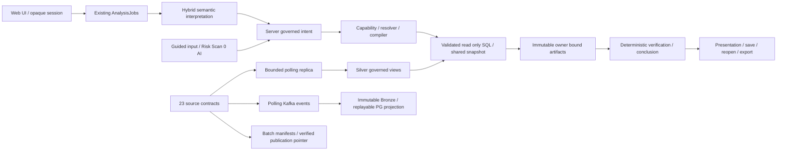

# V3.5 — FINAL HARDENING PLAN

Ngày lập: **19/10/2026**, múi giờ Asia/Ho_Chi_Minh. Trạng thái: **PLAN_READY / IMPLEMENTATION_NOT_STARTED**.

Phạm vi lượt này: chỉ tạo tài liệu này. Không sửa sản phẩm, schema, quyền, cấu hình triển khai; không restart, chạy suite hay gọi live provider. Những kiểm tra runtime bên dưới là quan sát đọc, không phải nghiệm thu V3.5. Goal Codex cũ đã được người dùng yêu cầu tạm dừng; tài liệu này không tự tiếp tục goal đó.

Tên V3.5 dùng cho bộ kế hoạch mở rộng dashboard theo nghiệp vụ và hardening cuối, giữ tên file người dùng yêu cầu. Đây chưa phải quyết định bump API/schema hay tuyên bố đã phát hành minor version.

## 1. Executive Summary

Thực hiện theo **PRESERVE → CONSOLIDATE → HARDEN → PROVE → FREEZE**. Giữ nguyên semantic architecture và các engine đã đạt; tập trung tám nhóm đang dưới 8: ingestion, streaming, risk, Data Quality, governance, operations, scale và maintainability. Đề bài ghi “18 nhóm” nhưng danh sách thực tế có **19 nhóm**; kế hoạch giữ đủ 19, không gộp để bỏ một nhóm yếu.

Ba yêu cầu mới của người dùng thuộc **NOW**, có gate riêng:

1. Login có ảnh nền cà phê toàn màn hình, form gọn bên phải, responsive và giữ opaque session hiện tại.
2. Báo cáo & Phân tích có **16 dashboard nghiệp vụ thực**, gồm đơn hàng, cửa hàng/kiosk, giao hàng, thanh toán, khuyến mãi, tồn kho, nhân sự và trải nghiệm khách hàng. Dùng metric/catalog và pipeline hiện có; mở dashboard không gọi LLM.
3. ADMIN truy cập được Khám phá và Quản trị qua policy backend đúng. Sửa cả nguồn danh sách người dùng sai, không chỉ bỏ thông báo 403 trên giao diện.

Không có tăng điểm trong lượt lập PLAN. Run6 đã đạt semantic live gate; hiện trạng Kafka lại chưa ổn định. Final chỉ đóng khi có bằng chứng của revision triển khai, nguồn đủ điều kiện được chứng nhận thật, hai API process chạy thật và CI đúng revision xanh. Chứng nhận kỳ nghiệp vụ là dependency có thể chặn Risk ≥8; không chuyển guard thành permissive để đạt điểm.

Ước lượng triển khai: **80–105 file riêng biệt**, khoảng **25–35 file mới** chủ yếu UI, test và fixture; **25–40 ngày công kỹ sư** cho một người gồm rollout và bằng chứng, chưa tính thời gian chờ quyền hoặc dữ liệu lịch sử. Không coi số file/test là mục tiêu. Giao diện login và sửa hai tab có thể giao sớm sau P2; toàn bộ FINAL còn phụ thuộc các gate dữ liệu và vận hành.

## 2. Verified Revision

### 2.1. Git, build và CI

| Mục | Kết quả kiểm chứng trong lượt PLAN |
|---|---|
| Repository / branch | `thaianlqd/cnm-avengers-coffee-microservices-AI` / `branch_thaian` |
| HEAD local | `eda390b84c90ef37d0081bcd16de84098d07d605` |
| Remote sau `git fetch origin` | `origin/branch_thaian` cùng SHA, ahead/behind **0/0** |
| Working tree trước lập file | Sạch; không có product changes của người dùng cần phân loại |
| Commit hiện tại | `eda390b8`, 19/10/2026 12:25:56 +07, `feat: cap nhat dataplatform v34` |
| Baseline V3.4 trước commit này | `f9a1a6ff8d3c88e1bc9954c134d7cef8bdcd050b` — tham chiếu lịch sử, không gọi là HEAD |
| Bundle đang phục vụ cổng 8501 | `/assets/index-BrCyyeAb.js`; chưa chứng minh toàn bộ runtime image đồng nhất HEAD chỉ bằng tên bundle |
| Remote CI đúng HEAD | [Run 39204546690](https://github.com/thaianlqd/cnm-avengers-coffee-microservices-AI/actions/runs/39204546690): **5/5 jobs success**, tạo 19/10/2026 05:26:12Z |
| Branch protection | GitHub endpoint protection trả 404 “Branch not protected”; applicable branch rules trả `[]` |
| Lượt PLAN | Không trigger CI, không commit/push, không gọi paid provider, không thay ledger |

Năm CI job đã xanh: backend semantic offline; web/types/build/mocked browser; actual HTTP fixture/browser; PostgreSQL/MinIO/Kafka pipeline fixtures; source/evidence/Gitleaks. CI tồn tại và chạy xanh **khác** với CI đã bắt buộc trước merge; branch hiện chưa được bảo vệ.

### 2.2. Runtime đọc được, cần chụp lại ở P0 triển khai

| Mục | Quan sát và giới hạn |
|---|---|
| Policy sau đúng bootstrap `server` | Version `3.4.0-local-admin-governed`; canonical hash `c4c31535bfdbd4c545a037518ffa5698ea50ebb8347cb9812b6bcbe14d80ce94`; chỉ role ADMIN, national scope, không subject override |
| ADMIN permissions | `analytics.read`, `platform.read`, `reports.save`, `reports.export`, `reports.legacy`, `sql.explore`; **thiếu `system.read`** |
| SQL Explorer | SQL mode **disabled**, dù ADMIN có `sql.explore` |
| Auth / storage | `identity_login_session`; session Redis, artifact Redis; OTel disabled |
| Replica | 23 checkpoints, 0 lỗi checkpoint tại quan sát; 0 `completeness=complete`; max checkpoint age khoảng **92,5 giây**. Đây là một snapshot, chưa phải SLA 15 phút |
| Batch pointer | `daily_medallion`, run `run_a8496f9e21384a52bd68f6bb540dd050`, manifest hash `52298949003b1350dcc801df99070411985dbb08ee3b2d6c17acaf36a8dacd89`, published `2026-10-19T05:16:55.492431Z` |
| Kafka runtime | Producer **exited / exit 0 / restart 0**; consumer **restarting / exit 1 / restart 15**, không OOM. Log lọc exception class thấy `EndpointConnectionError`, `NameResolutionError`; chưa xác định endpoint/cấu hình gốc |
| API / data-sync | Đang running, restart 0 ở lần quan sát |
| Ledger | **457 reservations**, 457 events; SHA256 `b3c07acb5db22752fd0f69937e42fa49f64ac9cba448332ff8e22dcb490db40d`; ceiling được báo trong hồ sơ gần nhất **480**, còn **23**. Counter không tự cấp quyền chi tiêu |

Không đọc/in `.env`, token, mật khẩu hay nội dung credential profile. DB được truy vấn đọc qua factory hiện có. Import bootstrap để kiểm policy không chạy lifespan/startup. Import `load_policy()` riêng trước bootstrap có thể đọc repo deny-all; kết quả đó **không đại diện policy triển khai**. Flag startup DDL đúng trong source là `ANALYTICS_INITIALIZE_WAREHOUSE_ON_STARTUP`, mặc định false; cần xác nhận giá trị effective ở P0 bằng allowlist, không suy từ tên env đoán.

Pointer batch đã được đọc lại; lượt này không tải/verify lại toàn bộ object MinIO. Bằng chứng hash/readback trước đây nằm trong V3.4 acceptance, không trình bày như vừa chạy lại.

### 2.3. Tài liệu và bằng chứng nền

Đã đối chiếu `CLAUDE.md`, `.claude/rules/{general,data-platform,token-budget}.md`, `docs/SYSTEM_OVERVIEW.md`, `AI_V34_PLATFORM_MATURITY_PLAN.md`, progress, `AI_V34_ACCEPTANCE_REPORT_20261019.md`, các V3.3 final/review và handoff liên quan, source production và `evaluation/v34/implementation-20261019/`. Handoff cũ chỉ giải thích lịch sử.

`analytics-api/evaluation/v34/live44-20261019-r6/result.json` ghi **44/44, 0 skip, useful 39/40, overall 43/44, hard failures 0**, release gate PASS; generated `2026-10-19T05:11:59.917181Z`. Entry `analysis_jobs`; 44 reservations trong run (43 external + 1 injected), total 457 từ prior 413; counters match. Frozen case SHA `5fc5eb47fd515d314c5d1d7186a9306c5c262bfac4dca3c1d1ccc206d29bda2c`. Planning p95 2788,48 ms, job p95 3108,39 ms; physical median 1, max 2. Gate này thuộc semantic workload, không chứng minh Kafka, certificate hay hai instance.

Báo cáo V3.4 ghi backend 1254, web 180, browser 32 và pipeline unit có chỗ **41/chỗ 43**. Đây là counts lịch sử, chưa chạy lại lượt này; P0 lấy CI logs/artifacts để thống nhất. Report còn ghi “chưa commit/remote CI pending” đã lỗi thời. Offline 146 + 33 + 120 có evidence trước đó; report thừa nhận chưa rerun đầy đủ sau L30 cuối. Không biến test cũ thành pass trên candidate V3.5.

## 3. Current Architecture

`agent_pipeline.AnalysisPipeline` là facade/orchestrator; `HybridAnalystPlanner` còn dùng helpers của `OneShotPlanner` và `DataAnalystAgent`, không phải hai planner production cần xóa. Resolver/compiler/catalog là truth owner; replay/conclusion verification là kiểm chứng có chủ đích, không phải duplication cần gom mất tính độc lập.

Static inventory hiện tại: **81 service modules, 395 service-import edges, 78 router-transitive reachable, largest SCC 58**. Static router scan đếm 72, actual `server.app.routes` có **75 HTTP routes**; phải inventory method + route template thực, không dùng số 72 làm mẫu số bảo mật. LOC: AnalyticsView 3163, agent_pipeline 1324, hybrid planner 1051, catalog 14912; LOC chỉ chỉ dẫn vị trí audit.

Catalog runtime vẫn một artifact `analytics-api/metadata/semantic_catalog.json`: **43 metrics**, 16 domain profiles. `analysis_missions` có 8 entries: overview, compare, ranking, trend, composition, forecast, risk_watch, relationship. Current metadata có sáu missions visible (overview, compare, ranking, trend, forecast, risk_watch); cộng Câu hỏi tự do thành bảy chế độ sản phẩm. composition và relationship vẫn là backend/legacy capabilities, không visible như mode độc lập. Giữ đúng bảy chế độ này, Risk Scan 0-AI và mọi saved/legacy ID; không thêm/xóa mode chỉ để khớp số8entries.

## 4. Preservation Contract

| Invariant | Gate bắt buộc sau mỗi thay đổi liên quan |
|---|---|
| LLM chỉ hiểu semantic intent | Không metric formula, denominator, SQL, quyền hay numerical verification do model quyết định |
| Một semantic/capability/compiler/job engine | Cùng catalog + `AnalysisIntentEnvelope` + resolver + AnalysisJobs; không queue mới vì Kafka đang tồn tại |
| Catalog/meaning | Stable IDs, source mappings, additive-over, compatibility, lineage, governed filters và fingerprints không đổi chỉ do tách file |
| Capability | READY / CLARIFY / REDIRECT / UNSUPPORTED; source/provider outage không giả UNSUPPORTED |
| Provider | ≤1 interpretation + ≤1 repair + ≤1 transport recovery, tổng ≤3 physical attempts/submission; reserve-before-send; không model hopping |
| SQL | AST + Silver table/column/function allowlist, read-only transaction, timeout, snapshot, bounded attempts/rows/bytes/pool |
| Verification | Deterministic reconciliation, independent query shape, ranking/denominator, evidence-grounded conclusion, forecast backtest giữ nguyên |
| Risk | Scan 0-AI; unknown completeness không xanh; statistical anomaly chỉ qua certificate hợp lệ |
| Identity / ownership | HttpOnly opaque session, policy/version fingerprint, server subject, cross-account cache/job/report/module/artifact isolation |
| Lifecycle | Idempotency, durable counters, bounded admission, cancel, reconnect không gửi lại paid work |
| Report | Save/reopen/export lineage, typed entity inspect 0-AI, old reports decode; không tính lại số âm thầm từ live DB |
| Evidence | Giữ failed runs, skipped/unknown/unavailable và frozen denominators; không sửa case expectation để xanh |

## 5. What V3.4 Already Solved

1. Run6 đã đạt 39/40 useful, không hard failure; L03 improvement và L30 repair safety đã có captured regressions. L21 là useful failure còn lại; L29 vẫn cần theo dõi nondeterminism, không exact-text patch.
2. Auth đã có Identity login → opaque Redis session, policy principal và resource isolation; không cần thay Identity service hoặc đưa JWT vào localStorage.
3. AnalysisJobs đã có Redis state/admission/counter, ownership, reconnect và bounded work; không khởi tạo job system mới.
4. Replica đã có 23 contracts/339 columns, upper bound, overlap/upsert, checkpoint cùng transaction, independent full reconcile và credential riêng.
5. Kafka đã có governed contracts, manual offsets, Bronze trước commit, quarantine và replayable projection; vấn đề hiện tại là vận hành chưa ổn, không được viết lại như V3.4 chưa có delivery controls.
6. Batch có manifests, publication fence, role/profile batch riêng và privacy projections; đã có run published thật.
7. Forecast common-origin/diagnostics, relationship safeguards, oracle snapshot consistency, artifact-backed inspect và operational UI trung thực đã được cải thiện.
8. Workflow DP đã chạy đủ năm job xanh trên current HEAD, có zero-external-I/O fixture và scanner. Không lập kế hoạch “thêm CI từ đầu”.

## 6. Remaining Findings

`Static` = đọc control flow; `Runtime` = đọc trạng thái hiện tại; `Gap` = chưa đủ evidence. Severity là ưu tiên release, không tuyên bố đã exploit.

| ID | Mức / bằng chứng | Phát hiện / ảnh hưởng | Đóng tại |
|---|---|---|---|
| F01 | P0 / Runtime + static | Policy ADMIN thiếu `system.read`; `/api/warehouse/tables` còn require SQL admin trong mode disabled. Hai tab bị chặn đúng theo config hiện tại nhưng sai intent ADMIN đã chốt | P2, T04–T07 |
| F02 | P0 / static `system.get_system_users` | Dùng `pg_roles` làm người dùng ứng dụng; tự ghép email, last_login không phải dữ liệu đăng nhập. Cấp quyền đơn thuần sẽ hiện dữ liệu sai | P2, T07 |
| F03 | P0 / static `route_permission` | Path heuristics và default `analytics.read`: route mới chưa declared vẫn có thể được cho phép | P2, T04 |
| F04 | P0 / Runtime | Kafka producer dừng, consumer restart 15 với endpoint/DNS errors; historical delivery pass không chứng minh stream hiện ổn | P4, T22–T25 |
| F05 | P1 / static + Runtime | DQ chỉ 3 rules; checkpoint đặt unknown và DataHealth luôn projection certificate=None; 23/23 chưa complete | P3, T11–T16 |
| F06 | P1 / static | `cursor_keys` có persist nhưng WHERE incremental là timestamp overlap, chưa phải composite keyset pagination | P4, T17–T20 |
| F07 | P1 / Gap | Anomaly guard đúng nhưng không có production certified closed-period path; snapshot parity chưa đủ chứng minh không có late business facts | P3/P5, T15/T16/T27 |
| F08 | P1 / static + Gap | Worker enqueue/cancel connections local, cooldown local; lock TTL/claim/crash recovery chưa đủ hai-instance proof | P7, T30–T37 |
| F09 | P1 / static + Gap | Telemetry process-local; chưa scrape/aggregate các process, Kafka health, exact counters hay local operational soak | P6/P7, T28/T29/T38 |
| F10 | P1 / static | `request_anchors.refinement_anchors` import planner `apply_delta`; largest SCC58, orchestration lớn, dual UI tab state; LOC split không giải quyết dependency | P1, T01–T03 |
| F11 | P1 / user request + static | Login centered/plain; chỉ bốn BI tabs, chưa có hub theo 16 domain; kiosk canonical có sẵn nhưng chưa có dashboard riêng | P8, T39–T45 |
| F12 | P1 / static | `run_custom_query` chưa gọi durable `telemetry.audit`; warehouse samples có PII/câu hệ thống không phù hợp allowlist | P2, T05/T08 |
| F13 | P1 / Gap | Chưa chứng minh Gold/marts/Analyst cùng generation và cùng metric denominator; Top20 mart không được làm global total | P4/P8, T21/T42 |
| F14 | P2 / Runtime + docs | Acceptance stale, counts pipeline41/43; branch protection/rules chưa cấu hình; Overview còn null→0 cần audit | P0/P8/P10, T43/T47 |

## 7. Root Cause Analysis

**Lỗi hai tab có ba lớp độc lập.** `deploy_v34_governance.py` sinh permission list thiếu system.read. `SystemAdminView` kiểm permission đó nên chặn ngay. Explorer GET metadata còn gọi `report_sql_policy.require_sql_admin`, đòi cả `sql.explore` lẫn mode trusted_admin; runtime đang disabled. Không phải browser quên nhận role ADMIN, không sửa bằng hardcode `role==='ADMIN'` rồi bỏ server checks.

Config bootstrap `server.py` hiện chỉ load public settings allowlist: auth mode, Identity login URL, access policy path, audit spool directory và OTel flag. **Không có SQL mode**; chỉ ghi SQL mode vào `.runtime/deployment.json` sẽ không bật được gate. Kế hoạch phải sửa explicit config allowlist/validation hoặc compose env không secret, rồi kiểm effective mode sau bootstrap.

**Data completeness bị đứt cả producer lẫn consumer metadata.** `advance_checkpoint` set unknown/certificate null mỗi load; `dataset_health` cũng luôn trả unknown/certificate None. Có JSONB certificate sẵn ở migration027 nhưng chưa có chứng minh/validator/propagation. Guard anomaly không phải nguyên nhân lỗi; bỏ guard chỉ làm sai số tự tin hơn.

**Scale thiếu coordination ở vài responsibility, không thiếu Redis nói chung.** Durable jobs/sessions/artifacts đã có; cooldown, cancel handle và enqueue/recovery vẫn process-local. Tăng API replicas trước khi có crash/fencing proof có thể lặp paid work hoặc mất accepted job. Ingestion timestamp overlap giải quyết một số late writes nhưng chưa có keyset pagination; cần giữ overlap/reconcile khi thêm cursor tie-break.

**Maintainability là dependency direction và state ownership.** Pure delta nằm trong planner tạo helper→orchestrator reverse import; `AnalyticsView` trộn request/resume/refinement/report persistence/render và local tab với store tab. Existing `useAnalysisLifecycle` mới quản refs/epoch/controller, chưa phải owner toàn bộ request lifecycle. Không tạo hook coordinator thứ hai bên cạnh nó.

## 8. Current Strict Scorecard

Đây là **strict review gần nhất do người dùng cung cấp**, không phải chấm lại trong lượt này. Runtime mới có thể làm operational confidence thấp hơn; nhất là streaming không được gọi là “ổn định 7.8 đã đạt”. Bằng chứng tĩnh và snapshot hiện tại chỉ xác định gap.

| Nhóm | Điểm review gần nhất | Hiện trạng bằng chứng |
|---|---:|---|
| Ingestion / replica / B-S-G | 7.8 | Bounded replica/publication có; cursor và certificate/parity còn gap |
| Kafka / streaming | 7.8 | Delivery fixtures có; runtime hiện không healthy |
| Semantic Control Plane | 8.8 | Preserve; không rewrite catalog/compiler |
| NL / AI Planner | 8.1 | Run6 PASS; L21 fail, L29 nondeterminism còn giới hạn |
| Capability / Preflight | 8.8 | Preserve; dashboard adapter phải dùng cùng decision |
| SQL safety / execution | 8.6 | Preserve; bổ sung audited Explorer và cross-process cancel |
| Provider reliability | 8.5 | Bounded budget có; shared cooldown chưa prove |
| Forecasting | 8.3 | Preserve guards/backtest/interval diagnostics |
| Risk / cảnh báo | 7.8 | Statistical path chưa production certified source proof |
| Correlation / driver | 8.2 | Preserve paired observations/non-causal narrative |
| Chart / presentation | 8.1 | Views theo requirement có; thêm curated dashboards/parity |
| Verification / Trust | 9.0 | Preserve independent verification / snapshot lineage |
| Analyst UX | 8.2 | Login/dashboard/admin request mới chưa thực hiện |
| Testing / evaluation | 8.7 | CI5jobs xanh; two-process/ops/certificate evidence thiếu |
| Data Quality / metadata | 7.6 | 3 rules, 23 unknown completeness |
| Governance / Security | 7.8 | Auth foundation có; route default, audit, admin truth còn gap |
| Observability / operations | 7.4 | Chưa multi-process aggregation/soak |
| Scale readiness | 6.8 | Chưa có hai API process proof |
| Maintainability | 6.5 | SCC58, reverse dependency, mixed UI responsibilities |

## 9. Target Scorecard

Chỉ được chuyển target sang achieved sau kiểm chứng đúng production path, negative tests, runtime evidence và limitation tương ứng. Không tính average che một nhóm dưới 8.

| Nhóm | Target có điều kiện | Evidence mở khóa |
|---|---:|---|
| Ingestion | ≥8.1 | T17–T21; polling/reconcile/parity thực, không CDC |
| Streaming | ≥8.1 | T22–T25 + healthy bounded soak, đúng Bronze/offset/replay |
| Semantic | ≥8.8 | Catalog/meaning equality + frozen regressions; template refs validated |
| NL | ≥8.2 | Preserve run6, current-candidate offline/captured paraphrase evidence; live chỉ khi cần. Không tự cộng 0.1 vì refactor |
| Capability | ≥8.8 | Cùng decisions, preflight zero-I/O, unsupported before provider/SQL |
| SQL | ≥8.6 | Existing safety + route/auth/audit + cancel/snapshot/pressure tests |
| Provider | ≥8.5 | Bounded sends và shared cooldown/fencing hai process |
| Forecast | ≥8.3 | Existing regression/common folds/intervals/insufficient-history gates |
| Risk | ≥8.1 | T26/T27 + ít nhất một real eligible certified closed-period source |
| Correlation | ≥8.2 | Existing paired/exposure/constant-value/non-causal tests |
| Chart | ≥8.2 | 16 dashboards requirement-driven + artifact inspect + denominator parity |
| Trust | ≥9.0 | No wrong number/scope; independent oracle và immutable lineage |
| UX | ≥8.3 | Login visual/accessibility, admin journeys, hub/drill/export e2e |
| Testing | ≥9.0 | Meaningful new failure/crash/2-process cases + all current HEAD CI gates |
| DQ | ≥8.2 | Tier1 contract-derived measurements, negative cases, real certificates |
| Governance | ≥8.3 | 100% route declarations, actual deployed policy, DB role smoke, audit fail-closed |
| Ops | ≥8.2 | Exact aggregation/privacy/trace + 15-minute local soak, not production SLO |
| Scale | ≥8.0 | Actual two-process contention/crash/load proof, bounded resource usage |
| Maintainability | ≥8.0 | Ownership/import graph/state-owner improvements + behavior parity |

## 10. Why Every <8 Category Is Currently <8

| Nhóm | Thiếu gì thật sự | Điều không đủ để nâng điểm |
|---|---|---|
| Maintainability 6.5 | Pure contracts còn import planner, SCC58, giant functions nhiều stage và UI nhiều owners | Tách file, chuyển module sang folder khác hoặc giảm LOC |
| Scale 6.8 | Chưa claim/cancel/recovery/cooldown/provider reservation proof giữa hai process | Hai client vào cùng process hoặc Redis unit tests đơn lẻ |
| Ops 7.4 | Counter process-local; không aggregated stage/data/stream observations và denominator soak | `/health` xanh, bật OTel API nhưng không exporter/collector |
| DQ 7.6 | Chỉ3 rules, certificate chưa thực hiện/propagate, nhiều critical domains chưa đo | Empty count=0, freshness tốt hoặc test mocks duy nhất |
| Governance 7.8 | Route fallback, quyền ADMIN thiếu, SQL audit gap, pg_roles giả người dùng | Thêm role badge/UI bypass hoặc policy chỉ trong repo |
| Ingestion 7.8 | Cursor key chỉ lưu; parity/delete/lateness và same-generation comparison chưa đủ | Polling chạy5phút hoặc min/max timestamp có vẻ mới |
| Streaming 7.8 | Runtime đang lỗi, chưa đo lag/recovery hiện tại; delivery proof cần giữ khi harden | Có Kafka container, producer exit0 hoặc report cũ nói pass |
| Risk 7.8 | Chưa chạy anomaly thực trên certified closed-period history | Bỏ completeness guard, threshold Scan hay synthetic fixture alone |

## 11. Final Target Architecture

Giữ đường free-text hiện tại. Thêm **curated dashboard adapter** trong existing guided path: `dashboard_id + validated time/scope` → server builds governed intent → cùng capability/compiler/jobs/SQL/artifact/verification/presentation. Metadata dashboard chỉ tham chiếu metric/dimension/filter IDs và layout; không chứa SQL/formula tùy ý hay gọi model để dựng dashboard.

Một runtime catalog; một DataHealth projection; một route-policy declaration registry; một durable job repository; một provider physical reservation owner. API replicas chia sẻ Redis namespace theo môi trường; local workers/SQL connections vẫn local có fenced identity/cancel watcher. Polling workers tiếp tục độc lập với analytical jobs.

Data path bổ sung certificate từ periodic reconciliation → existing checkpoint JSONB → validated DataHealth → capability/statistical risk. Dashboard metric source dùng catalog canonical Silver; Gold/marts chỉ dùng khi lineage/generation/semantics tương đương đã chứng minh. Operational metrics export Prometheus từ mỗi process và scrape aggregation nhẹ, không bắt buộc OTel backend.

## 12. Responsibility / Ownership Map

| Responsibility | Owner hiện tại → owner đích | Boundary giữ / callers |
|---|---|---|
| Semantic definitions | `AnalysisCatalog` + single semantic_catalog → giữ | Compiler, preflight, metrics, templates đọc IDs; UI không copy formula |
| Intent delta | Planner `apply_delta` → `analysis_intent.apply_delta` pure | Planner re-export tương thích; request_anchors import pure contract |
| Planner workflow | `HybridAnalystPlanner.run` → giữ orchestrator; private pure stages cùng owner | Không sửa repair targets/frozen fields vì refactor |
| Analysis execution/report facade | `AnalysisPipeline` → giữ facade; report presentation qua `analysis_presentation` và `analysis_response_service` | Existing session/artifact/verifier owners tiếp tục riêng |
| UI request/resume/cancel | AnalyticsView + existing useAnalysisLifecycle refs → mở rộng đúng hook đó | View chỉ dispatch/render; account boundary thuộc App/authSession |
| UI saved report/export | AnalyticsView → proposed `useReportActions` với existing reportPersistence | Không tạo auth/job state thứ hai trong hook |
| UI report display | AnalyticsView → proposed `ReportWorkspace` composition | Reuse VerificationPanel/ChartInsight/ForecastPanel; không chia nhỏ vì LOC |
| Route auth | AccessMiddleware heuristics → explicit route registry + access_policy enforcement | Exact method/template, public allowlist hữu hạn, unknown deny |
| Explorer | query router + report_sql_policy → giữ; metadata `warehouse.read`, execution `sql.explore` + trusted_admin | Same AST/column authorization, durable audit |
| App administration | system router pg_roles → policy/account adapter truth | Identity service ngoài scope; DB role health tách nhãn, không giả directory |
| DQ/certificate | data contracts + sync/checkpoint → giữ ownership nguồn; DataHealth validates/projects | Không thêm health engine thứ hai |
| Distributed jobs | AnalysisJobs/JobRepository → giữ; fenced CAS/recovery/cancel coordination | Không Kafka job queue hoặc new microservice |
| Provider coordination | credential router local → same router + shared Redis atomic leases | Budget/transport không migrate vào planner |
| Telemetry | telemetry.py → giữ instrumentation/export owner | Tiny optional scraper, bounded labels; audit durable riêng với metrics |
| Curated dashboards | chưa có → workspace catalog templates + existing guided_context | Metadata endpoint adapter ở existing ai router, no second planner |

## 13. Maintainability Plan

### 13.1. Nhỏ, có characterization trước switch

1. Chuyển pure `apply_delta` từ planner vào `analysis_intent.py`; `request_anchors.refinement_anchors` không import planner nữa. Giữ old import re-export ít nhất một compatibility cycle. Test nested delta/frozen scope/time/metric/anchors trước và sau phải byte-equivalent phần meaning.
2. `HybridAnalystPlanner.run` hiện ~560 lines: tách private stages parse/validate/repair orchestration theo responsibility trong cùng owner, giữ `run` entry và observer order. Không đổi prompts, repair target policy, fallback hoặc semantic normalization để làm refactor tiện hơn.
3. `AnalysisPipeline.report` ~409 lines: facade gọi existing presentation/response owners cho pure formatting; verification, persistence và artifact access không bị đưa vào formatter. Characterize report/schema/order/hash-relevant payload, aliases, provenance, saved/reopen.
4. `AnalyticsView`: mở rộng existing `useAnalysisLifecycle` quản submit/resume/cancel/epoch/refine orchestration. `useReportActions` chỉ save/open/delete/export/version UI actions. `ReportWorkspace` chỉ render report sections. View giữ input/workspace orchestration. Account login/logout vẫn App/authSession; không copy.
5. Bỏ dual owner tab: `usePlatformStore.analyticsSubTab` là owner route/tab, local derived selection chỉ khi transient. Report/form drafts có owner/account/schema version, invalidate một chỗ khi đổi time/scope/mission/account.
6. Truy các reverse edges `readiness_service → hybrid_analyst_planner` (catalog probe), telemetry→catalog/capacity và provider→catalog. Chỉ cắt edge sau chứng minh helper responsibility; readiness dùng catalog validation owner, telemetry nhận primitive typed events thay vì import analytical orchestration. Không xóa legitimate legacy adapter hoặc independent verification.

### 13.2. Catalog và duplicated truth

Không tách runtime JSON thành nhiều nguồn. NOW thêm validation cho dashboard refs, DQ dependency projection và deterministic fingerprints. Authoring split chỉ làm nếu khó review thật: deterministic build một artifact, semantic projection equality exact, stable IDs/aliases, classify cosmetic vs meaning changes; chưa có nhu cầu thì giữ nguyên file lớn hợp lý này.

Lập rule-owner ledger: metric/formula/denominator = catalog/compiler; scope = access_policy + scope resolver; normalization = existing normalizer; capability = preflight contract/resolver; display = presentation; retry = transport/router; DQ = contracts/DataHealth. UI labels/adapters và oracle independent computation được ghi riêng, không gom mất ranh giới.

### 13.3. Architecture metrics trước/sau

| Metric | Trước | Acceptance sau |
|---|---:|---|
| Service modules | 81 | Ưu tiên ≤81; nếu thêm route-policy helper ngoài services vẫn đếm toàn bộ Python modules riêng, không giấu complexity bằng đổi folder |
| Import edges | 395 | Không tăng core reverse edges; target giảm sau cut list, báo exact added/removed edges; số edges thuần không phải score |
| Largest SCC | 58 | P1 phải phá ít nhất một real core cycle và giảm SCC; target kế hoạch <58. Nếu cut list không đạt, báo blocker maintainability và review boundary lại, không bỏ nodes khỏi inventory |
| Concrete reverse edge | anchors → planner.apply_delta | **0** edge này; intent contracts không import orchestration/provider/DB/UI |
| Core reverse-layer edges | Cần P0 classify 395 edges | 0 new, mọi retained edge có rationale/compat caller và guard; không coi tất cả lazy imports là lỗi |
| Giant responsibilities | View request+resume+refine+persistence+render; report facade formatting+coordination | Một owner mỗi lifecycle như §12, facade chỉ orchestration; evidence call graph/caller map |
| UI lifecycle owners | Hook refs + view handlers; dual tab | Exactly1 owner request epoch/controller/resume,1 account boundary,1 tab store,1 report actions; stale response không mutate state |
| Business rule owners | Cần P0 audit references | Không metric/formula/denominator/scope truth mới trong UI/templates/marts; all duplicates classified |

SCC target là release criterion cần chứng minh, không suy mức giảm từ việc chuyển một hàm. Ghi before/after bằng cùng inventory tool, cùng node inclusion, compatibility exports và touched callers. Maintainability8 còn đòi behavior parity và reviewer reasoning qua owners, không chỉ đạt các con số.

## 14. Security / Governance Plan

### 14.1. ADMIN và hai tab

Ma trận rollout đã chốt: **chỉ ADMIN dùng Data Platform**, owner nghiệp vụ 23 nguồn là admin; không mở manager/branch user trong FINAL. Test synthetic nonADMIN/scoped principals vẫn phải deny/isolate đúng.

| Surface | Proposed permission/config | Kết quả cần có |
|---|---|---|
| Quản trị đọc | ADMIN thêm `system.read` qua governed policy deployment | Tab tải thông tin quyền thật, audit/log/health đã phân quyền; không phát sinh CRUD tài khoản |
| Khám phá metadata | New declared `warehouse.read` cho ADMIN, catalog projection được authorize | Xem danh mục/schema/safe examples dù SQL execution disabled |
| Chạy SQL read-only | ADMIN `sql.explore` + explicit mode trusted_admin, startup validates | AST/allowlist/columns/functions/timeouts/500rows+truncation/audit; không DML, DDL, PII |
| Trigger pipeline | Vẫn permission riêng, không tự grant vì ADMIN label | Chỉ action thật có audit và explicit capability; không fabricate full pipeline |

`project_tables` nằm trong **access_policy.py**, hiện lọc table theo dataset grant. Mở rộng projection an toàn cho columns/descriptions/examples theo catalog + column policy; không dùng regex sensitive-name làm quyền duy nhất. Safe sample SQL sinh từ allowed projection, chạy fixture xác nhận; bỏ samples email/phone/address/plate và mặc định `pg_stat_user_tables` khỏi Explorer nghiệp vụ. DB role health nếu giữ là metadata riêng, không đưa vào SQL Explorer arbitrary introspection.

`get_system_users`: không dùng pg_roles để kết luận user ADMIN/viewer. Nếu existing Identity integration có authorized read-directory endpoint phù hợp, dùng adapter với timeout/least privilege; không thêm endpoint/sửa Identity trong scope này. Nếu không có, hiển thị **vai trò/policy Data Platform và tài khoản đang đăng nhập đã xác thực**, user directory count/last_login = unknown với lời giải thích, không giả danh sách. Snapshot “chỉ ADMIN” là policy restriction, không có nghĩa chỉ có1account trong Identity.

### 14.2. Explicit route policy / default deny

Tạo registry method + canonical route template, gồm permission, resource/scope hook, CSRF requirement, durable-audit requirement, public reason. Public health/login/session/bootstrap/static routes phải khai báo rõ; `/docs`, OpenAPI, catch-all frontend không được vô tình mở protected API hoặc override `/api/*`. CORS OPTIONS xử lý riêng không bypass actual method authorization.

Strangler: registry trước, legacy mapper chỉ dùng cho known frozen routes trong giai đoạn migrate; test adapter equality; sau kiểm inventory đầy đủ chuyển unknown → deny. Release: **actual protected method/template set − declared set = ∅**, stale declaration cũng fail. Newly registered dummy route không có metadata bị deny dù caller là ADMIN. Giữ resource owner và dataset checks sau route permission; không thay mọi route thành `system.read`.

Default deny và kiểm quyền mỗi request theo [OWASP Authorization Cheat Sheet](https://cheatsheetseries.owasp.org/cheatsheets/Authorization_Cheat_Sheet.html). Policy snapshot/fingerprint bind job/session/artifact; khi revoke giữa job phải dừng trước provider/query/persist và không trả cached artifact từ quyền cũ. In-flight SQL cancel theo §21; HTTP status không leak existence cross-account.

### 14.3. Session, JWT, DB role, audit

Giữ opaque HttpOnly Redis session, SameSite/origin CSRF, logout revoke, 401 clear account caches/remount. Production ưu tiên identity_login_session; raw JWT cookie/legacy bearer chỉ explicit legacy deployment, không implicit fallback. Review custom verifier: HS256 pin, constant-time signature, size/duplicate JSON claims, exp/nbf/iat type + clock tolerance, issuer/audience, secret strength, legacy opt-in; test negative vectors trước cân nhắc thư viện mới. Không log credential, sessionID hay JWT.

Startup validated policy path/version/hash; malformed/missing production policy fail closed, không silent repo fallback hay development principal. SQL mode chỉ từ public allowlist/config đã validate. Deploy dry-run hiển thị permission diff/hash, không in profile. Metadata/readiness permission và SQL execution tách nhau.

Verify actual analytics reader/report writer/pipeline/batch roles không superuser/createdb/createrole, không schema owner; API startup DDL effective false. Migrations026–028 và gói replica/Kafka/batch đã triển khai trước đây: kiểm applied state/grants, **không xin duyệt lại chỉ vì bắt đầu V3.5**. Nếu reader thiếu SELECT metadata như `public.sync_history`, chuẩn bị exact narrow grant/review rồi xin approval phần mới; không chuyển về DB owner.

Save/delete/export/SQL/pipeline trigger phải reserve durable audit evidence trước privileged side effect, operation outcome update rõ; audit sink fail nhưng local durable spool đã fsync thì có thể tiếp tục theo policy hiện hữu. Cả DB audit và spool không durable → deny. SQL audit lưu hash/owner/policy/action/status/rowcount, không raw SQL rows/PII. SQL read-only vẫn là privileged access cần audit.

## 15. Data Quality Plan

Mở rộng **DataHealth hiện có**, không thêm Great Expectations/Soda hoặc health service. `data_contracts.json`: 23 sources,339 columns; 12 incremental,11 full snapshot. Admin owner, planned interval **300s**, acceptable lag **900s** đã được người dùng chốt. Không cần hỏi lại owner/SLA.

| Tier / ví dụ | Checks phù hợp, severity theo metric dependency |
|---|---|
| Tier1 orders/items/stores/products | PK null/dup; required metric/join keys; nonnegative numeric theo business domain; quantity positive; enum known; join integrity; time sane; schema type/column drift; load/freshness; measured volume |
| Tier1 khi dùng payments/delivery/users/reviews | Transaction status/amount; delivered time/order keys; actual delivery denominator/exposure; user ownership/identity-safe projection; rating range/review keys. Từng rule theo contract, không một regex áp tất cả |
| Tier2 hỗ trợ | PK/schema/freshness/load; optional domain checks chỉ khi source contract quy định |
| Snapshot sources | Snapshot as-of + age, no fake historical trend; absent update clock không coi last business event là sync clock |

16 dashboards làm payments, delivery, loyalty, staff, inventory, review… thành critical đối với dashboard tương ứng. Critical set lấy union dependencies của metric được bật, không chỉ orders để số DQ đẹp. Dataset không đo được báo unknown và dashboard bị degraded/blocked theo dependency; có thể render phần độc lập nhưng không badge “tất cả tốt”.

Rule registry khai báo vào existing contracts, evaluator và API metadata derive từ cùng source; exact equality test cho coverage. Rule có ID/stable severity, scope/query projection, measured_at/run/checkpoint generation, observed/expected và reason; không dump bad rows/PII. Bounded query timeout/row summaries, offline preflight chỉ đọc cached health, refresh ngoài hot path; stale cache không thành latest healthy.

Volume baseline cần observed history theo đúng source/cohort/clock và ít nhất7 successful comparable reconciliations trước cảnh báo định lượng; không đủ → `not_measured`, không dùng ngưỡng tự nghĩ. Empty table thành `empty_measured`, query error thành `unavailable`, chưa đo thành `unknown`; tất cả khác zero valid metric. Health healthy/degraded/blocked/unknown độc lập completeness complete/partial/unknown. No distribution drift model trong NOW.

## 16. Completeness Certification Design

### 16.1. Hai assertion khác nhau

**Snapshot parity** chứng minh target bằng projection source trong một MVCC snapshot bounded, không chứng minh source đã nhận hết đơn của một kỳ kinh doanh. **Closed-period completeness** còn cần event-time boundary, lateness/late-commit basis và closure được nghiệp vụ xác nhận/kiểm soát. Fresh sync, COUNT equality hoặc MAX(timestamp) không tự cấp assertion thứ hai.

PostgreSQL repeatable-read giữ snapshot nhất quán trong transaction; đây là cơ sở parity, không phải bảo đảm late-arrival từ nghiệp vụ. Xem [PostgreSQL16 transaction isolation](https://www.postgresql.org/docs/16/transaction-iso.html). Không dùng một scalar transaction ID để claim snapshot chung xuyên hai database.

### 16.2. Proposed certificate v1 trong JSONB hiện có

Fields tối thiểu: certificate_version/kind; dataset_id; source/projected-schema fingerprint; contract fingerprint; run_id/checkpoint generation; source snapshot begin/end; source upper bound + extraction range + timezone; projected source count/ordered key digest/content digest; target same-projection count/digests; full reconcile/delete reconciliation result; all required DQ check IDs/statuses; target generation; issued_at/expires_at; failure set; lateness_basis/closed-through nếu kind=closed_period; producer/validator version; canonical certificate hash. Không chứa key list/raw rows/secret.

Proof process:

1. Periodic full reconcile đọc source trong repeatable-read, canonical typed projection/order bằng PK; stream batch với bounded memory. Source digest tính trong chính extraction pass, không COUNT/hash full table thêm mỗi5phút.
2. Upsert/full snapshot target trong existing transaction theo approval cũ; so target cùng projection/key order trong transaction trước commit. Dùng explicit typed serialization null/decimal/timezone, không hash SQL text hay stringify tùy tiện. Nếu target masking khác source, compare đúng projection đã govern; excluded sensitive fields không được claim verified.
3. Required schema/PK/domain/FK checks pass; generation CAS và target rows/checkpoint/certificate commit cùng transaction. Digest mismatch/failure → partial/unknown với reasons, không complete. Crash trước commit giữ snapshot cũ; commit outcome unknown đọc lại generation trước retry.
4. Incremental refresh làm certificate cũ không còn mô tả current target: invalidation/generation mismatch mặc định, không giữ badge complete. Có thể giữ immutable closed-period artifact riêng khi proof rõ không bị mutable rows ghi đè; không suy complete current snapshot từ old certificate.
5. DataHealth đọc/validate JSONB, hashes/version/generation/expiry/dependencies; propagate certificate scope tới canonical Silver view bằng actual lineage, không copy boolean của một bảng sang join nhiều nguồn.
6. Risk request kiểm coverage đúng cohort/metric/grain/time range, closed buckets, join dependencies đều hợp lệ và no missing/duplicate period. Source uncertain clock, unresolved deletes hoặc late writes ngoài basis → unknown_source.

### 16.3. Eligibility và chi phí

NOW chứng minh snapshot parity trên **ít nhất orders + items + stores + products** khi reconciliation đủ quyền/projected columns; các dashboard khác chỉ certify nếu dependency đủ proof. Tables không reliable update clock được chứng minh snapshot qua full reconcile, không certify mọi lịch sử. Delete detection dựa periodic full reconcile; polling không phải CDC.

Anomaly ≥8 cần **ít nhất một source/time range thật đủ closed-period eligibility**. Owner admin/SLA 15 phút chưa xác nhận quy trình khóa kỳ hay giới hạn late commit. Implementation phải đọc read-only historical evidence và đưa đề xuất kỳ đã đóng cho admin xác nhận nếu không suy được từ source guarantee. Nếu nghiệp vụ cho phép backdate vô hạn/không có freeze, giữ unknown và ghi Risk ≥8 **BLOCKED**, không dùng synthetic data thay real-source evidence. Chỉ yêu cầu quyết định khi đã có concrete period/evidence, không hỏi lại toàn bộ SLA ngay ở PLAN.

Cost gate: record source rows/bytes/time/CPU/query count; memory batch bounded theo current fetch size, không materialize full table. Hash target/source bằng index scan với statement timeout ở periodic full; nếu full reconcile không kết thúc trong slot trước 900s, giảm scope/chạy maintenance window và giữ unknown, không tăng timeout vô hạn. JSONB field hiện hữu đủ thiết kế; new DDL không mặc định cần.

## 17. Ingestion Plan

`sync_table_governed` hiện dùng inclusive timestamp overlap/upsert và upper bound; giữ semantics này. `cursor_keys` chưa tham gia keyset predicate nên chưa được gọi là “composite cursor đã xong”.

1. Bên trong fixed extraction window `[previous_cursor-overlap, source_upper]`, paginate `(clock, primary_key_tuple)` lexicographic, deterministic ASC, strict greater-than **page cursor**, inclusive lower bound chỉ trang đầu. Ties > page size không mất và không loop. Composite PK typed ordering/null constraints derive từ contract, không nối string.
2. Durable checkpoint watermark chỉ advance sau hoàn tất toàn window + same transaction data/checkpoint. Không dùng page max làm successful watermark nếu dừng giữa window; crash rollback hoặc resume staging phải có proof rõ. Giữ overlap cho timestamp có late visibility; checkpoint keyset không giải quyết writes commit muộn ngoài overlap.
3. Hourly/full schedule độc lập incremental success; tất cả 11 snapshot-only tables đi full projection path. Actual loop hiện sleep 300s sau cycle (~331s trong quan sát trước): đổi monotonic fixed scheduled starts, không overlap cycles, overrun skip/catchup bounded và metric schedule lateness; max age 900s là SLA, không hứa exact real-time.
4. Source timezone typed và UTC checkpoint; DST/backdated/server-clock skew fixtures; no clock→snapshot, không chọn heuristic bất kỳ column timestamp. Delete reconciliation/key mismatches phải invalidate completeness.
5. Schema additive/missing/type/PK drift: contract validates trước target write; incompatible block, giữ old committed snapshot, alert; không API startup tự ALTER. Approved migrations công khai riêng nếu thực sự cần.
6. Full reconcile metrics/certificate §16; restart/crash before/after checkpoint test. Full TRUNCATE+INSERT replica đã được duyệt trước cho đúng 23 nguồn; không mở rộng sang source, bảng khác hay reset offsets.
7. Batch source_runs/schema/contract fingerprints → Gold/marts/Analyst comparison cùng generation/snapshot. Mismatched generations báo incomparable, không chọn latest từng bảng hoặc blend sums. Replay existing manifest path có audit, không rerun source ingestion chỉ để so số.

## 18. Streaming Plan

### 18.1. Khôi phục vận hành trước

P4 điều tra read-only Docker network aliases, MinIO readiness/service endpoint và filtered exception chronology; không in env credential/URL query secrets. Xác nhận producer exit0 do intentional stop hay lifecycle bug bằng state/timestamps, không suy. Chuẩn bị diff/diagnostic trước safe restart theo authorization triển khai; PLAN không thực hiện restart. Không reset offset, consumer group, producer checkpoint hay xóa Bronze để làm lag xanh.

### 18.2. Semantics phải chứng minh

| Boundary | Required guarantee / failure behavior |
|---|---|
| Producer identity | Source PK + version/clock identity ổn định qua restart; scope đúng 24 columns / 3 tables đã duyệt |
| Poll page / ties | Deterministic `(clock,key)` page; equal timestamps >500 rows không bỏ sót |
| Ack → cursor | Tất cả sends được broker acknowledge trước durable cursor; timeout/unknown ack có thể replay với identity ổn định |
| Backlog | Bounded page/batch/deadline, no unbounded memory; report remaining/lag, không full scan source mỗi tick |
| Bronze → offsets | Immutable verified Bronze durable trước manual commit; failure trước durability không commit |
| Malformed | Bounded quarantine raw retention theo policy, log reason/hash/position, không in sensitive event body |
| Projection | Broker-position dedup, PG projection retry/replay từ Bronze; projection fail sau Bronze không mất replayability |
| Restart | Crash ở ack/cursor/Bronze/projection/offset windows: at-least-once, deterministic sink results, duplicates quan sát được |

Topic/partition/end offset/committed offset lag đo bounded (9 partitions hiện hữu nếu inventory còn đúng); last observed event, last durable Bronze commit, projection/replay backlog và last failure. Offset lag 0 khi producer chết không phải healthy; missing observation = unknown. Time lag phải nói event clock nào, không dùng source business timestamp như transport delay nếu chưa define.

Worker telemetry emit sau actual durable action; platform endpoint đọc bounded shared snapshot. Local 15-minute soak cần producer/consumer running, restart tăng 0 trong window, Bronze tiến khi fixture/source event có thật; nguồn im lặng hiển thị idle, không bịa event. Không tạo đơn thật chỉ để thử stream; dùng isolated fixtures hoặc sự kiện nghiệp vụ tự nhiên có quyền đọc. Đây vẫn **polling event observability**, không CDC, exactly-once hay canonical Silver real-time.

## 19. Risk / Anomaly Plan

Giữ threshold rules, subset Scan 0-AI, median/MAD, exposure safeguards. `robust_anomaly` / `evaluate_anomaly` tiếp tục yêu cầu healthy + complete + valid certificate; đổi input health propagation từ §16, không nới guard.

Test matrix: certified closed history có outlier→measured; unknown→unknown_source; stale/blocked→unavailable/degraded; insufficient periods→insufficient_history; missing bucket và duplicate period→ineligible; MAD=0 dùng behavior đã govern, không chia 0 hay auto flag tất cả; rate metric phải minimum denominator/exposure và đúng numerator/denominator, không ratio average. Numeric fixture đủ normal/outlier/zero variance, no future leakage.

Real-source evidence lưu certificate hash/range/generation, anonymized aggregate series, reason/method/threshold/eligible bucket count và result. **Measured no-anomaly** là hợp lệ nếu series đủ điều kiện; không bắt dữ liệu thật phải có outlier. Tách “đo được và không phát hiện” với “chưa đo được”. Không causal narrative/composite fake risk score. Current source không đủ thì capability unavailable đúng, Risk ≥8 vẫn pending cho tới real eligible source path.

## 20. Observability Plan

Chọn **Prometheus-compatible `/metrics` + optional lightweight Prometheus scrape profile**, tái dùng `telemetry.py`; không dựng tracing cluster. Giữ `/api/system/metrics` JSON compatibility. `/metrics` chỉ internal scrape/network và permission đã declared; không public toàn Internet hoặc nhét auth token vào URL/log. Optional OTel SDK/exporter về sau nếu cần span backend; OTel API alone không được tính là distributed tracing đã vận hành.

| Plane | Measures bắt buộc |
|---|---|
| HTTP | accepted/completed/denied/failed, status class, duration |
| Job stages | queue/planning/repair/validation/execution/verification/persist/cancel duration/outcome; active/queued/rejected |
| SQL | pool wait/utilization, snapshot slot wait, query/fetch latency, attempts, rows/bytes, timeout/capacity/cancel |
| Provider | physical reserved/sent/unknown/success/429/503/timeout; recovery/half-open/failover/latency; no extra retry |
| Data | last success/lag/stale/blocked/schema drift/DQ/checkpoint/certificate status/publication age |
| Stream | per known topic/partition lag, source/worker/lastBronze/projection/replay state |
| Durability | audit pending/delivery failures, cache hit/miss, Redis/CAS failures, recovery indeterminate |

Process counters scrape riêng từng instance; Prometheus sum/rate đúng semantics counter reset. Shared global admission/data health gauges không cộng duplicate từ 2 API: query max hoặc một authoritative exporter, ghi ownership từng metric. Worker observations qua namespaced Redis hoặc existing metadata write path; không thêm DB grants mặc định. Counter physical send đối chiếu durable ledger, không cộng cả reserve lẫn send thành 2 attempts.

Labels chỉ enum stage/status/category/provider slot và stable configured instance name. request_id/job_id/account/store/SQL/prompt/token không label. Trace/log carry IDs đã pseudonymize khi cần, ContextVar propagate HTTP→worker→SQL/provider/persist; no account crossover ở reused threads. Default missing trace không bịa success.

**15-minute local operational soak**: fixed workload/profile + host/container limits + two scrape targets, sample≤5s; eligible operations là accepted supported requests và scheduled source refresh attempts trong window. 5xx, source/provider outage, timeout, canceled-by-system count failure; auth denied/invalid inputs/client requested cancel ghi riêng và không trộn vào success denominator. Không loại outage khỏi availability bằng cách gọi “không eligible”. Startup warmup tối đa60s công khai ngoài measurement, không xóa lỗi giữa window.

PASS: no unexplained counter delta; audit durable loss 0; critical source age≤900s throughout observed samples hoặc explicit fail; no unbounded queue/pool/memory; trace continuity cho 100% controlled fixture jobs; no privacy leak/forbidden labels; worker restarts tăng 0. Proposed availability threshold≥99% trong eligible local fixture window, ghi counts exact và p95/p99. Đây **không phải SLO production 7 ngày**. Instrumentation theo [Prometheus practices](https://prometheus.io/docs/practices/instrumentation/), giữ label cardinality bounded.

## 21. Scale / Two-instance Plan

### 21.1. Audit và thay đổi nhỏ trong owner hiện tại

`JobRepository` đã có Redis guard/MULTI/unknown-commit readback, global 12 active, owner 4; `AnalysisJobs` workers 4 / local semaphore 12; worker_token/deadline fencing đã có. Guard lock TTL 5s cần CAS/fenced version để stale holder không ghi sau expiry. Dùng atomic Redis transaction/Lua bounded nếu cần, không giữ distributed lock xuyên provider/SQL. Tham khảo [Redis transactions](https://redis.io/docs/latest/develop/using-commands/transactions/) về atomic operations và optimistic check; lock tồn tại không tự chứng minh crash safety.

1. Register + idempotency + admission mutation atomic; unknown commit readback không tạo second job. Claim worker token/version/lease, terminal persist single-winner CAS. Release admission idempotent cả success/failure/timeout/cancel/crash.
2. Safe recovery accepted-before-enqueue hoặc claimed-before-provider chỉ khi durable reservation count 0 và lease/fence chứng minh old worker hết quyền. After reserve/send unknown outcome → indeterminate/fail-closed, **không auto-resend**. Same idempotency reconnect trả cùng terminal/indeterminate; không duplicate paid call/report.
3. Cancel B cập nhật durable cancel signal; owning worker A watcher đọc signal và gọi **local `Connections.cancel()`**, không mở API arbitrary backend PID cancel. Test SQL đang block thật, cancel latency≤2s trên fixture; query deadline làm backstop. Revoke policy kiểm tại side-effect boundaries, cancel local SQL khi watcher thấy invalid policy.
4. Provider cooldown hiện `_state`/threading lock process-local: shared Redis TTL state, atomic half-open lease theo credential slot/model/config fingerprint; dùng Redis TIME/TTL cho cross-process clock, local monotonic cho elapsed. Redis failure production deny coordinated attempt, không silent local recovery storm. Physical reservations giữ same durable budget owner.
5. Auth/session Redis CAS/result artifacts giữ ownership+policy+schema/data epoch; test stale version/conflict/reload. ContextVar copy tới executor một chỗ, clear khi worker trả về; không globally cache principal.
6. Shutdown chỉ drain own instance futures/claims; instance B không cancel A khi B stop. Admission cleanup fencing không xóa running work khác.

### 21.2. Resource envelope đề xuất, phải đo rồi freeze

Global active 12, owner 4 giữ. Hai API có workers 2 mỗi instance, SQL reader pool **6/instance** thay hardcoded 12, query concurrency≤2/report và snapshot slots 2/instance (coordinator + up to 2 readers); tối đa 12 analytical reader connections tổng. Đếm riêng metadata/readiness/report-writer/direct connections và enforce deployment cap, không claim 12 là toàn bộ DB nếu factory khác mở thêm. Reference DB budget đề xuất max 20 app connections, reserve≥5 cho ops; xác nhận DB max_connections/host baseline trước freeze, giảm admission nếu thiếu.

Fixture workload concurrency **1/4/8/12/20**, hai synthetic accounts; owner 4 và global 12 khiến số accepted/rejected tùy distribution nhưng **đúng math tại cùng barrier**. Profile global cap dùng≥3 principals fixture để chạm 12; two-account fairness tối đa 8 và không được sửa owner cap để “đủ 12”. Requests vượt cap phản hồi bounded 429 với actionable retry-after, không accepted queue vô hạn.

Deterministic provider fixture (0 paid), representative rows/bytes gần configured artifact ceiling nhưng trong limit; real PostgreSQL sleeps/locks/timeouts, Redis shared. Mỗi profile ≥3 repeats sau fixed warmup, lưu p50/p95/p99 queue/planning/SQL/end-to-end, RSS/CPU, pool peak, rejected/canceled/indeterminate counts. Proposed p95 planning≤40s/job≤70s gồm queue trong bounded supported workload, p99 report riêng không giấu outliers; no deadlock/no leaked lease/no unbounded growth. RSS ceiling ban đầu≤1GiB/API, total≤2GiB tại20 offered jobs trên declared reference host; nếu không đạt, giảm admitted concurrency theo phép đo và review requirement, không nâng limit âm thầm.

### 21.3. Actual two-process proof

Hai container/OS process API, distinct boot IDs/ports, shared **isolated fixture Redis/PostgreSQL/artifacts**, requests HTTP luân phiên; không dùng hai TestClient cùng interpreter. Crash injection test-only worker hooks/process termination trong fixture, không expose production debug route. Mandatory cases: same idempotency simultaneously; reconnect A→B; cancel B→SQL A; revoke mid-job; CAS conflicts; same-account contention; two-account fairness; global cap; pool pressure; provider send budget; restart A; cross-principal cache isolation.

Crash boundaries: registered-before-enqueue; claimed-before-provider; reserved/sent unknown; after SQL execute; before artifact/persist. Mỗi case nêu accepted outcome/recovery classification, single report, no duplicate send, no leaked admission; uncertain network outcome không được gọi exactly-once. Kafka không dùng làm job queue; local executor giữ nếu fixture chứng minh đủ.

## 22. UX Final Polish

### 22.1. Login theo yêu cầu mới

Desktop dùng ảnh cà phê/không gian quán toàn màn hình, overlay tối chuyển gradient để chữ đọc tốt. Bên trái brand “Avengers Coffee / Data Analytics Platform” và câu mô tả ngắn; **form bên phải rộng360–400px, tối đa420px**, right margin clamp48–96px; card bo góc16–20px, nền sáng, border/shadow nhẹ, icon/label tinh gọn. Không thêm KPI/đối tác/chứng chỉ giả lên login.

Ảnh local proposed `web-ui/public/images/data-login-coffee.webp` ≤300KB, license/provenance ghi trong acceptance; WebP/AVIF phù hợp, fallback solid/gradient nếu asset lỗi, không external tracking/CDN bắt buộc. Asset tạo/chọn ở implementation, không tạo thêm artifact ở lượt PLAN. Form có username/password, show/hide accessible, autocomplete đúng, error inline, disabled+loading chống duplicate submit, Enter submit, focus ring, no password persisted/logged. Giữ authSession/accountcache/logout/401 semantics.

Visual acceptance: 1366×768,1440×900,1920×1080; tablet768px; mobile320/375/390px không horizontal overflow, card maxwidth và background dịu, field/CTA≥44px. Screenshot/check focus/contrast trên ảnh thật, large text/zoom200%, keyboard, reducedmotion; text contrast≥4.5:1 theo [WCAG contrast minimum](https://www.w3.org/WAI/WCAG22/Understanding/contrast-minimum.html). Auth works khi ảnh không load; no layout jump che submit.

### 22.2. Analyst flow và trạng thái lỗi

Main flow: question → understood intent → scope/time → next action → analyze → result → conclusion. Giữ bảy visible product modes (free text + sáu visible missions), backend IDs và current input workflows. CLARIFY hiển thị field thiếu và compatible choice; REDIRECT có alternative; không retry khi account chưa được cấp quyền hay SQLmode disabled. Retry chỉ source transient/provider retryable theo server outcome, không generic resend job.

Drawer advanced: provenance, verification, DataHealth, query/provider diagnostics. Main UI không show catalog hash/worker/SCC/credential slot. User nhìn được kỳ/phạm vi, đơn vị/denominator, updated-as-of và partial/unavailable bằng ngôn ngữ nghiệp vụ.

Explorer/System phân biệt401(session expired),403(permission),SQL execution disabled(metadata vẫn có),source unavailable vàempty measured. Lỗi chỉ của active view, không globalbanner từ tab cũ. Explorer mặc định “Danh mục dữ liệu”, có safe SQL examples và panel SQLread-only khi allowed; System hiện policy access/audit/datahealth thật. Không để admin nhìn một câu deny trống cả màn hình khi đã cấu hình đúng.

## 23. BI / Chart Preservation and Dashboard Expansion

### 23.1. Dashboard hub

Báo cáo & Phân tích mở **hub theo nhóm nghiệp vụ**: Kinh doanh, Vận hành, Khách hàng, Chất lượng trải nghiệm. Card có tên, câu hỏi trả lời, source readiness và as-of. Tìm kiếm/lọc category, không dàn16 tab ngang. Bốn BI views hiện tại còn deep-link/compatibility entry; saved reports và AI workspace có entry riêng rõ ràng.

Hub chỉ fetch metadata/readiness projection, **không chạy16 queries/jobs khi mount**. Chọn card mới tải dashboard; time/scope shared filters được server validate, reset về preset rõ ràng. Mỗi dashboard2–6panels có ích theo requirement, không ép minimum4charts. Request epoch/cancel ngăn dashboard cũ overwrite selection mới. Mobile một cột, desktop2–4cards/row; skeleton/empty/error/partial thật, không fake numbers.

Proposed catalog key `analysis_registry.workspace.dashboard_templates`: stable ID/version/title/domain; metric/dimension/filter references; view requirements/layout/health requirements. Không SQL/formula tùy ý. Metadata GET proposed `/api/ai/dashboards` trong existing router có declared permission. Execute qua existing `/api/ai/analysis-jobs`, thêm optional `dashboard_id`/template_version; `AnalysisPipeline.guided_context` tạo deterministic governed intent. Dashboard ID xung đột free-text/guided input→400. `common.py::AiTextToReportRequest` cần additive preset fields và explicit validation cho hai dạng input: old question path vẫn bắt buộc nonempty prompt, preset path bắt buộc valid ID/version và time/scope đúng kiểu. Catalog resolution/auth ở server facade, không trong Pydantic validator; server canonicalizes preset trước existing execution path, không nhận arbitrary client intent/formula. **0 provider attempts** khi mở preset, đổi filters, inspect/export; không gọi planner để viết prompt hộ.

Preset ID/version và resolved meaning phải có trong `AnalysisPipeline.request_signature`, job payload/idempotency digest, proposal/approval/cache fingerprint và saved lineage. Hai dashboard khác nhau không reuse cùng cached approval vì prompt label giống nhau; template version đổi không được âm thầm chạy report meaning cũ. T39/T42 kiểm đồng thời các trường hợp này.

### 23.2. 16 dashboard NOW và số liệu đúng nghĩa

D01–D16 là proposed template IDs; metrics dưới đây có trong current registry. Panel chỉ dùng compiler-supported operations/compatible dimensions. Combination không hỗ trợ thì bỏ panel hoặc ghi unavailable có lý do; không invent joins/formulas. Time filter chỉ áp dụng khi metric có time semantics phù hợp.

| ID / dashboard | Metric refs thực | Views / câu hỏi phục vụ | Guard quan trọng |
|---|---|---|---|
| D01 Doanh thu & đơn hàng | revenue, order_count, aov, order_completion_rate, order_cancellation_rate | KPI, daily trend, status/channel comparison, store ranking | Revenue status/denominator khác total order count; partial dates rõ |
| D02 Sản phẩm & danh mục | quantity_sold, product_revenue, item_revenue | Product/category rank, contribution, quantity/revenue, item detail | Item/product revenue không tráo order revenue; grouping phải compatible |
| D03 Cửa hàng & khu vực | store_revenue, store_order_count, store_aov, purchasing_customer_count | Store ranking/comparison, city/reporting_region, trend | Canonical region; không âm thầm bỏ stores thiếu dimension |
| D04 Kiosk | store_revenue, store_order_count, store_aov | Kiosk subtype/ranking/trend; so với loại khác khi compatible | store_type group: KIOSK_NHUONG_QUYEN + KIOSK_VE_TINH; không name heuristic |
| D05 Giao hàng & tài xế | total_deliveries, delivery_count, delivered_count, failed_or_cancelled_delivery_count, delivery_success_rate, avg_delivery_minutes, driver_rating | Delivery status, success/exposure, duration, driver ranking | Full eligible population, không Top20 global rate; delivery-source health |
| D06 Thanh toán | payment_count, payment_revenue | Method/gateway/status, transaction trend, aggregate detail | Transaction amount≠order revenue; no double-count/refund confusion/PII |
| D07 Khuyến mãi & voucher | voucher_revenue, discount_amount, voucher_order_count, promotion_redemption_count | Campaign rank, discounts/redemptions, trend | Redemption khác attribution; không causal lift/ROI thiếu cost |
| D08 Khách hàng & hội viên | customer_count, purchasing_customer_count, total_spent | Customer population/activity, compatible loyalty segments | total_spent là lifetime, không period revenue; không names/phone/email |
| D09 Tồn kho & cảnh báo | stock_quantity, low_stock_count | Current stock, low-stock list, compatible category/store grouping | Snapshot as-of; không historical stock/forecast/stockout-cost giả |
| D10 Ca làm & chấm công | shift_count, late_count, late_shift_rate | Shift/status, lateness counts/rates/exposure, trend | Minimum exposure; không personal ranking từ quá ít shifts |
| D11 Đối soát thu ngân | total_cash_difference, system_cash_revenue, reconciled_shifts, large_cash_discrepancy_shift_count | Store/shift deltas, measured reconciliation, discrepancies | Difference sign/unit đúng; không cáo buộc fraud |
| D12 Đánh giá sản phẩm | avg_product_rating, review_count | Product rating/count, trend; distribution nếu có governed field | Weighted/catalog semantics; exposure warning; không average-of-averages |
| D13 Đánh giá cửa hàng | avg_store_rating, store_review_count | Store comparison, counts/ratings, trend | Không trộn product/store reviews; kèm exposure |
| D14 Khảo sát khách hàng | survey_response_count | Response trend/cohort/store breakdown chỉ khi dimensions hỗ trợ | Questionnaire/score chưa registered→unavailable; không sentiment score giả |
| D15 Yêu thích sản phẩm | favorite_count | Favorites rank/distribution, aggregate detail | Favorites≠purchases; không conversion rate thiếu linked denominator |
| D16 Giờ cao điểm | hourly_orders, order_count, revenue | Hour/weekday distribution; compatible heatmap; store/kiosk filters | Timezone Asia/Ho_Chi_Minh, partial period rõ; không claim staffing optimum |

Kiosk đã có canonical `store_type`: `silver.chi_nhanh.loai_diem_ban`, aliases kiosk/kisok/kiốt và value groups. Không regex theo tên quán.16 business entries phải có nội dung riêng meaningful, không16 cards copy cùng chart doanh thu.

### 23.3. Analytical / verification invariants

Ranking giữ full-population denominator; artifacts giữ typed entity IDs. Click inspect0AI không dùng label regex để build SQL. Narrow scalar/ranking có thể1–2views; broad question3–6views hữu ích. Comparison có comparison thật; trend không vẽ missing period=0; forecast có actual/forecast interval/backtest; risk không xanh khi unknown; relationship dùng paired entities/non-causal narrative. Advanced cross-filter builder sang NEXT; safe time/scope filters và artifact drilldown ở NOW.

Save/reopen/export preset giữ template version + actual meaning + scope/time + artifacts + certificate/data epoch/policy hash; update template không đổi report đã lưu. CSV/DOCX cùng values/units/denominators/lineage; implementation render DOCX để kiểm long Vietnamese text/charts/tables. Overview chỉ zero khi measured zero. Gold/marts Top20 có `global_aggregate_safe=false`: dùng ranking, không tính global totals/percentages.

## 24. CI Plan

`.github/workflows/data-platform-ci.yml` hiện có PR/push path filters cho DP/compose/scripts/workflow/scanner config; Node20/npm ci; Python3.11 Docker; contents:read; concurrency cancel; backend network-none; actual HTTP fixture; PG/Redis/MinIO/Kafka fixtures; Gitleaks8.30.1 pinned; artifact retention14days. Giữ locks/nonzero exit; không secrets/live provider trên PR.

Thêm route inventory/architecture/DQ certificate/template tests vào existing jobs. Two-process/aggregation proof bằng bounded fixture job hoặc extension job, isolated network/volumes. Full15min release soak có thể chạy isolated manual runner; không bắt mọi small PR mất15phút, nhưng candidate release phải có artifact của soak. Trigger paths bao phủ new fixtures/config/assets/hooks.

Scanner trước upload; không raw auth/session/cookie/prompt/PII trong Playwright traces. Evidence có commands/exit status/counts/revision/hash. CI hôm nay chỉ baseline; candidate mới cần run đúng revision. Repo admin cấu hình branch protection với actual check names; PLAN không sửa settings. Thiếu quyền thì ghi release gate PENDING, không gọi CI required đã hoàn tất.

## 25. Evaluation Strategy

Order: targeted offline → captured deterministic replay → semantic regression → DB/Redis/S3/Kafka fixtures → actual HTTP/browser → two-process/load/crash → read-only deployed smokes/soak → optional live cuối. Không full suite mỗi file; dùng repo helper/runner cô lập env, không direct unittest discover từ production env.

Giữ existing test/case IDs;146 legacy +33 V33 +120 V34 và live44 frozen file. Reference 120 hash trong report `8b6f9164fde3a3dad0b43c27c6da75c2d8e137b561abefd975afbc55605aaefa` cần đối chiếu actual file ở P0; không sửa expectations cho refactor. Captured L03/L21/L29/L30/L41/L43 gồm paraphrases, frozen fields và negative scope/metric cases. Không “fix” L21 bằng claim bảo đảm kết quả kinh doanh hoặc exact-text regex.

Metamorphic: accents/mixed clauses/filter order/equivalent time; unrelated edit không đổi metric/denominator/scope. Parameterized16 presets×valid/invalid permission/time/health, không cần paid provider. Health query errors/certificate tamper/revoke/cancel/crash phải fail-closed.

Implementation evidence directory proposed `evaluation/v35/<candidate-id>/`: immutable manifest revision/dirty diff/catalog/contracts/policy/templates/build; commands/exit codes/test IDs/counts; topology/host limits; runtime counters/latencies/graphs; sanitized screenshots; certificate summaries không PII; ledger before/after; failures/limitations/rollback. Không overwrite V34 runs. not_run/not_measured/unknown/incomparable/unavailable không được map PASS.

## 26. Live-provider Budget Proposal

**Lượt PLAN:0 calls. Default implementation FINAL:0 calls** nếu planner/prompt/repair/meaning behavior giữ nguyên và equivalence gates chứng minh được. Presets/login/routes/metrics không cần Gemini. Không tự xin quota/reset ledger/recreate counter.

Nếu semantic behavior đổi hoặc equivalence chưa đủ, implementation chuẩn bị proposal sau offline pass; chỉ chạy khi user approve destination/payload/cases/physical cap cụ thể:

| Mục | Proposed envelope — chưa cấp execution approval bởi PLAN |
|---|---|
| Destination | Existing Google Gemini `generativelanguage.googleapis.com`; configured primary/secondary, same model; no new model route |
| Payload | Questions + governed semantic metadata/synthetic anchors cần thiết; không raw warehouse rows/PII/token/password/credentials |
| Cases | Frozen L03/L21/L29/L30/L41/L43; subset theo actual blast radius, tối đa6 cases; không đổi expectations |
| Physical cap |≤3/case,≤18 reservations/run; gồm repair/recovery/injected faults; không retry ngoài budget |
| Ledger tại planning |457/480; nếu không ai dùng thêm, max18→**475/480**, còn5 headroom; đọc actual ledger trước execution |
| Preconditions | Explicit approval, offline green, durable counter/lock/fsync identity, remaining≥proposed cap, không overlapping live worker |
| Stop | First hard wrong number/scope/permission/leak; untrusted counter/unknown reservation; deadline/cap/ceiling; không auto-rerun cho đẹp |

Subset không phải full 44 release pass. Run6 là historical full gate của semantic revision đó. Nếu thay đổi rộng cần full44, runner cần headroom≥60; hiện23 không đủ. Hoàn thành offline/review rồi trình concrete full-run/new-ceiling proposal nếu cần, không suy approval cũ cho phép nâng trần. Không hỏi quota trong lượt PLAN.

## 27. File-by-file Change Map

Đây là thay đổi **dự kiến**, chưa triển khai. Alias relative `data-platform/`: `S=analytics-api/services/`, `A=analytics-api/`, `W=web-ui/src/`, `P=pipeline-tests/`, `C=pipeline-common/`. `../` là repository root; `+` là file mới dự kiến. Test files trong §28 cũng thuộc file map. File ngoài map cần ghi rõ responsibility, caller, test và rollback trước khi thêm.

Rollback: **R1** compatibility facade/UI cũ; **R2** policy/config version cũ, fail-closed; **R3** certificate về unknown, giữ dữ liệu committed; **R4** drain workers, image cũ, giữ ledger/checkpoint/offset/artifacts; **R5** tắt exporter/scraper, giữ audit; **R6** entry BI cũ, vẫn đọc được report mới; **R7** patch workflow/config, giữ evidence. Không rollback bằng git reset/restore hoặc xóa thay đổi của người dùng.

| File | Current responsibility | Problem | Proposed change | Why change | Callers | Regression risk | Tests | Migration compatibility | Rollback |
|---|---|---|---|---|---|---|---|---|---|
| S/analysis_intent.py | Intent contracts | Delta helper ở planner | Own pure `apply_delta` | Cắt reverse edge | planner, anchors | Meaning/frozen fields | T01,T03 | Re-export old import | R1 |
| S/request_anchors.py | Anchors/refinement | Import planner | `refinement_anchors` gọi pure intent helper | Đúng dependency direction | pipeline, planner | Anchor binding | T01,T03 | Same anchor contract | R1 |
| S/hybrid_analyst_planner.py | Semantic workflow | `run` nhiều stage | Giữ `run`, private stages; re-export delta | Dễ reasoning | pipeline | Repair/provider order | T01,T03,T46 | Same prompts/meaning | R1 |
| S/agent_pipeline.py | Analysis facade | Formatting trộn coordination; thiếu preset entry | `report` delegate pure formatting; `guided_context` validate dashboard; `request_signature` bind template version | Một pipeline | jobs, analysis_pipeline | Report/meaning | T02,T39–T42,T46 | Same public methods/aliases | R1,R6 |
| S/analysis_presentation.py | Display projection | Formatting còn ở facade | Pure typed artifact/summary formatting | Rõ owner | pipeline | Numbers/units | T02,T42 | Same report values | R1 |
| S/analysis_response_service.py | Response adapter | Assembly trộn orchestration | Own response assembly; không DB/verification | Giữ ranh giới | pipeline | Response aliases | T02,T46 | Old reports decode | R1 |
| S/readiness_service.py | Readiness | Planner import để probe | Gọi catalog validator, bounded health | Cắt reverse edge | server health | False healthy | T01,T29 | Same health schema | R1 |
| S/analysis_catalog.py | Canonical registry | Thiếu template projection | Read/validate template references | Không thêm UI truth | guided, preflight | Fingerprints | T03,T39 | Classify cosmetic/meaning | R1,R6 |
| S/semantic_catalog_validation.py | Catalog validation | Chưa validate presets | Validate metric/dimension/filter/operation refs | Reject invalid template | catalog/tools | Startup failures | T03,T39 | Existing catalog valid | R6 |
| A/metadata/semantic_catalog.json | Single runtime artifact | Chưa có 16 presets | Add workspace templates referencing existing metrics | Business discovery | catalog/UI | Semantic identity | T03,T39–T42 | Stable IDs; no formula edits | R6 |
| S/access_policy.py | Principal/auth/authz | Path fallback; table-only projection | Registry adapter; preserve SQL/meaning checks; safe `project_tables` | Default deny | middleware/routers | Access widening | T04–T10,T33 | Same principal/resource rules | R2 |
| A/route_policy.py (+) | Chưa có | Thiếu declaration owner | Method/template registry; no DB/provider imports | One route policy owner | middleware/inventory | New route denied | T04 | Known-route adapter during migration | R2 |
| S/report_sql_policy.py | SQL gate/AST | Metadata cần SQL mode | Metadata permission riêng; execution vẫn trusted_admin | Explorer dùng được | query/reports | SQL bypass | T05,T08 | Same execution policy | R2 |
| A/routers/query.py | Warehouse/SQL API | Samples unsafe; thiếu audit | `get_warehouse_tables` safe catalog; `run_custom_query` durable audit | Correct admin access | Explorer | Sensitive data | T05,T08 | Additive metadata fields | R2 |
| A/routers/system.py | System users/logs | pg_roles giả user identity | `get_system_users` dùng policy/account truth; DB health tách riêng | Honest administration | SystemAdminView | Old field expectations | T07,T09 | Nullable unknown directory fields | R2 |
| A/server.py | Bootstrap/auth/routes | SQL setting chưa load; route inventory gap | Explicit config validation; declared routes/metrics | Config thật có hiệu lực | ASGI | Startup/auth | T04,T06,T10,T29 | No implicit DDL; same auth API | R2,R5 |
| A/tools/deploy_v34_governance.py | Policy deploy | ADMIN thiếu permissions | Dry-run diff/hash; system.read/warehouse.read; SQL config | Sửa effective policy | operator | Overgrant | T06,T09 | Preserve credential profiles | R2 |
| S/data_coverage_service.py | DataHealth/DQ cache | 3 rules; bỏ certificate | `dataset_health`, refresh, summary từ contracts + validated certificate | Real DQ | preflight/platform/risk | Cost/false green | T11–T16 | Existing states, additive fields | R3 |
| metadata/data_contracts.json | 23 source contracts | Thiếu rule/eligibility specs | Dataset tier/check/clock/lateness references | One contract source | sync/health | Business assumptions | T11,T12,T17 | Same 23 sources/339 columns | R3 |
| C/pipeline_runtime.py | Checkpoint/manifests | Always unknown; no proof validator | Pure certificate builder/validator; atomic `advance_checkpoint` payload | Atomic proof | sync/batch/health | False certificate | T13–T16,T20 | Existing JSONB; old decode | R3 |
| data-sync/sync.py | Replica worker | Keyset/schedule/proof gaps | `sync_table_governed` window pagination/digest; `main` fixed schedule | Polling correctness | compose worker | Data loss | T13,T17–T20 | Keep overlap/cursors; no source DDL | R3,R4 |
| data-sync/test_sync.py | Unit fixtures | Missing tie/schedule cases | Characterize pagination/timezone/crash/schedule | Meaningful regression | test runner | Fixture assumptions | T17,T19 | Fixture only | R7 |
| C/producer_runtime.py | Poll/ack/cursor | Need tie/restart evidence | `poll_stream` preserve ack fence; health callback | Delivery correctness | producer | Cursor advancement | T22,T24 | Same event/state IDs | R4 |
| kafka-producer/producer.py | Source event worker | Exit/health unclear | `main/fetch_and_publish` bounded lifecycle telemetry | Stable operations | compose | Retry loop | T22,T25 | Same 24 columns/3 tables | R4 |
| C/stream_runtime.py | Bronze/projection/offset | Replay health missing | `flush_records/project_records` emit after durable actions | Exact sink boundaries | consumer/replay | Commit ordering | T23–T25 | Same Bronze keys/dedup | R4 |
| kafka-consumer/consumer.py | Consumer lifecycle | DNS/endpoint restart loop | `get_minio/main/flush_batch` readiness/backoff diagnostics | Restore runtime | compose | Commit on sink failure | T23–T25 | Same group/offsets | R4 |
| spark-jobs/gold_aggregation.py | Gold publication | Same-generation parity unproved | `run_silver_aggregations/main` lineage projections if needed | Compare correct metric | batch | Denominator drift | T21,T42 | Same manifest/schema | R4 |
| A/routers/marts.py | BI reads | Mixed generations/TopN totals | Validate publication metadata; incomparable disclosure | Dashboard trust | BI | Legacy response | T21,T42 | Additive generation fields | R6 |
| A/routers/platform.py | Platform/health API | Need DQ/stream projection | Delegate to existing health/stream owners | No duplicate truth | platform UI | Query fanout | T11,T25,T29,T43 | Existing aliases | R1 |
| S/risk_watch_service.py | Rules/MAD | No valid certificate input | `evaluate_anomaly` consumes scoped proof; keep guards | Eligible statistical path | Risk Scan | False signal | T26,T27 | Scan 0-AI unchanged | R3 |
| S/telemetry.py | Events/spans/audit | Local counters/missing stages | `event/span/snapshot/audit` bounded export/instrumentation | Operational evidence | API/workers | Privacy/overhead | T08,T28,T29,T38 | Existing JSON snapshot | R5 |
| A/requirements.txt | API dependencies | Exporter packaging | Small pinned Prometheus client if needed | Stable export | API build | Dependency drift | T28,T47 | No mandatory heavy SDK | R5 |
| S/analysis_job_service.py | Repository/jobs | Claim/cancel/recovery gaps | Fenced register/mutate/work/cancel/finish/shutdown | Two-process correctness | job API | Duplicate paid work | T30–T37 | Versioned records; old jobs drain | R4 |
| S/provider_credential_router.py | Credential cooldown | Process-local state | Shared TTL/half-open lease in same owner | No recovery storm | provider transport | Provider outage | T34,T35 | Same retry/budget contract | R4 |
| S/provider_budget.py | Physical reservation | Cross-process proof needed | Harden atomics only if fixture finds gap | Reserve-before-send | transport/jobs | Budget loss | T34,T35,T46 | Append-only ledger | R4 |
| S/query_execution_batch.py | Pool/snapshot/cancel | Hardcoded 12/process | Validated pool/slot config; local cancel watcher hooks | Bound two-API resources | SQL/compiler | Snapshot deadlock | T32,T36,T37 | Same read-only/timeouts | R4 |
| S/session_service.py | Session/Redis CAS | Conflict proof missing | Harden CAS only if integration exposes gap | Preserve session owner | jobs/pipeline | Lost update | T31,T33,T37 | Old session decoder | R4 |
| S/result_artifact_store.py | Immutable artifacts | Policy/epoch isolation proof missing | Validate cache binding if missing; preserve owner/hash | No cached leakage | query/report/inspect | Invalidation | T31,T33,T37,T42 | Old artifacts read-only | R4 |
| A/common.py | Typed request contracts | Chưa có preset input variant | `AiTextToReportRequest`: dashboard_id/version + structural mutual-exclusion validation; old prompt rules retained | API contract rõ | ai router/jobs/pipeline | Invalid/ambiguous input | T03,T39,T42 | Old requests giữ validation/aliases | R1,R6 |
| A/routers/ai.py | Analyst/jobs/workspace | No preset metadata contract | Declared metadata GET; optional dashboard_id in existing jobs | Reuse execution | hub/AI UI | Ambiguous request | T04,T39–T42 | Old payload valid | R6 |
| A/tools/architecture_inventory.py | Static graph | Auth scan incomplete | Comparable graph + separate actual-route/layer report | Measurable architecture | CI/tools | False improvement | T01,T04 | Same node inclusion | R7 |
| W/App.tsx | Auth/mount | Plain centered login | Keep auth boundary; delegate visual LoginView; scoped errors | Requested design | main | Session/cache | T10,T40,T44 | Same cookies/401/logout | R1 |
| W/views/LoginView.tsx (+) | Chưa có | Missing right-side form | Pure form props/visual/accessibility; no auth store | Focused UI | App | Focus/errors | T44 | No API change | R1 |
| web-ui/public/images/data-login-coffee.webp (+) | Chưa có | Need background | Optimized local image, recorded provenance | User design | LoginView | Size/contrast | T44 | Gradient fallback | R1 |
| W/index.css | Global styles | Responsive polish | Scoped auth/dashboard styles/tokens | Consistent layout | UI | CSS bleed | T40,T44 | Existing styles preserved | R1,R6 |
| W/views/AnalyticsView.tsx | Workspace container | Many lifecycles; four BI tabs | Thin orchestration + hub, delegate established owners | Maintainability/UX | PlatformApp | State races | T02,T40–T45 | Old tabs/deep links | R1,R6 |
| W/hooks/useAnalysisLifecycle.ts | Epoch/controller refs | Handlers remain in view | Own submit/resume/refine/cancel lifecycle | Single job UI owner | AnalyticsView | Stale responses | T02,T40 | Same storage/owner keys | R1 |
| W/hooks/useReportActions.ts (+) | Chưa có | Persistence/export mixed in view | Actions through existing reportPersistence | Report action boundary | AnalyticsView | Saved report loss | T02,T45 | Same APIs/versions | R1 |
| W/components/report/ReportWorkspace.tsx (+) | Chưa có | Display in giant container | Compose existing chart/forecast/verification sections | Clear rendering owner | views | Presentation meaning | T02,T42,T45 | Same artifact contract | R1 |
| W/views/DashboardHubView.tsx (+) | Chưa có | No business hub | Category/search/cards; metadata only | Discovery | AnalyticsView | Query fanout | T39,T40 | Legacy BI reachable | R6 |
| W/components/BusinessDashboard.tsx (+) | Chưa có | No curated renderer | Existing report composition + filters/states | Meaningful business views | hub | Wrong panel data | T40–T43 | Shared report contract | R6 |
| W/utils/dashboardPresentation.mjs | Chart display | Preset metadata projection | Display layout only; no formula/SQL | One presentation path | BusinessDashboard | Units/null handling | T41,T42 | Existing exports | R6 |
| W/utils/dashboardPresentation.d.ts | Types | New metadata fields | Additive synchronized declarations | Runtime/type coherence | TS callers | Type mismatch | T41,T47 | Existing types | R6 |
| W/store/usePlatformStore.ts | Tabs/cache | Dual tab owner; cross-view errors | Single tab; account/policy-bound cache; active-view error | Predictable state | views/hooks | Cache leakage | T02,T40,T43 | Version draft keys | R1 |
| W/views/DataExplorerView.tsx | Catalog/SQL UI | Entire view blocked | Separate metadata/SQL states, safe examples | ADMIN access | PlatformApp | Permission bypass | T05,T40 | Same SQL results | R2 |
| W/views/SystemAdminView.tsx | Administration UI | Missing grant/fake users | Policy/account truth + audit/health | Honest admin view | PlatformApp | Identity confusion | T07,T40 | Nullable fields | R2 |
| W/views/OverviewView.tsx | KPIs | Unknown can become zero | Nullable measured states/as-of caption | No false zero | PlatformApp | KPI semantics | T43 | Measured zero remains zero | R1 |
| W/utils/authSession.mjs | Account boundary | New login needs regression | Preserve behavior; patch only if needed | Session continuity | App/store | Privacy | T10,T44 | Opaque cookie only | R1 |
| W/utils/authSession.d.mts | Auth declarations | New form props if needed | Types synchronized with runtime | Contract clarity | App | Type drift | T10,T47 | Existing exports | R1 |
| P/compose.fixture.yml | Isolated service fixtures | No two-API topology | Add two API processes/provider fixture/unique namespace | Real integration | CI/scripts | Wrong DB target | T30–T38 | No production profiles/volumes | R7 |
| P/integration_two_api.py (+) | Chưa có | No process harness | HTTP barriers/crash/load tests; sanitized evidence | Scale proof | CI | Timing flakiness | T30–T38 | Fixture only | R7 |
| P/fixtures/provider_server.py (+) | Chưa có | Need fake transport meter | Deterministic faults/delays/send counts; no egress | Zero-paid concurrency | process harness | Invalid proof | T34,T35 | Fixture only | R7 |
| ../docker-compose.data.yml | Local runtime | Resource/config/network diagnosis | Reviewed public settings/pool; network fix only if proved; optional metrics profile | Effective deployment | operators | Restart blast radius | T09,T25,T38,T47 | Preserve volumes/ports/profiles/ledger | R2,R4,R5 |
| ops/prometheus.yml (+) | Chưa có | No scrape aggregation | Internal targets/queries, shared-gauge semantics | Minimal ops | collector | Double gauges | T28,T29,T38 | Opt-in profile | R5 |
| ../.github/workflows/data-platform-ci.yml | Five-job CI | New gates missing | Extend architecture/security/templates/two-process fixtures | Current revision proof | GitHub Actions | Cost/secrets | T47 | Keep existing gates | R7 |
| ../.claude/scripts/dp-pipeline-test.sh | Fixture entry | Need two-process command | Explicit fixture profile, safe target assertion, failure exit | Reproducibility | CI/developer | Production target | T30,T47 | Existing commands valid | R7 |
| AI_V34_ACCEPTANCE_REPORT_20261019.md | Historical summary | Stale current claims | Dated correction/forward link during implementation | Evidence honesty | reviewer | History rewrite | T48 | Preserve old run results | R7 |
| AI_V35_ACCEPTANCE_REPORT.md (+) | Chưa có | Need final report | Revision/runtime/19 categories/gates/limitations | Final handoff | user/reviewer | Overclaim | T48 | No old evidence overwrite | R7 |

Không sửa file chỉ để đủ map: rows có “if needed” được đóng bằng evidence không cần patch. Preserve-first với session_service, provider_budget và authSession. Không sửa chatbot, Identity, customer apps hay k8s ngoài scope. New tests/assets/config chỉ tạo ở implementation; lượt PLAN chỉ tạo một tài liệu này.

## 28. Test-by-test Map

Alias relative `data-platform/`: `A/tests=analytics-api/tests`, `P=pipeline-tests`, `E=web-ui/tests/e2e`, `U=web-ui/src/utils`. `+` = test file mới dự kiến. DB mutation: **F** = chỉ isolated fixture DB/Redis/S3/Kafka; **RO** = runtime thật chỉ đọc; **0** = không DB. T27 quan sát worker reconcile đã được duyệt, không ghi source hay sửa DB thủ công. T49 live là optional, cần approval riêng.

| Test ID | Test file | Setup | Action | Expected result | Why needed | Unit/integration/e2e/live | Paid provider? | DB mutation? | Acceptance phase |
|---|---|---|---|---|---|---|---|---|---|
| T01 | A/tests/test_v34_architecture.py | Baseline graph, classified edges | Compare graph; import pure intent | Reduced SCC/cut cycle; no anchors→planner/new reverse edge | Boundary proof | unit/static | No | 0 | P0/P1 |
| T02 | E/analyst-workspace.spec.ts + U/analysisJobs.test.mjs | Delayed replies/resume/refine/artifacts | Switch account/tab/time; cancel/reopen | Single lifecycle owner; no stale state; same requests/results | Characterize refactor | unit/e2e | No | F | P1/P8 |
| T03 | A/tests/test_v35_preservation.py (+) | Captured intents/repair/catalog/reports | Old/new owner comparison; delta negatives | Same meaning/frozen fields/denominator/SQL plan | Semantic parity | unit/offline | No | 0 | P1/P9 |
| T04 | A/tests/test_v35_route_policy.py (+) | Actual routes incl public/fallback/dummy | Inventory and unauthorized calls | 100% declared; unknown denied; resource checks retained | Default deny | integration | No | F | P2 |
| T05 | A/tests/test_v34_query_security.py | ADMIN permissions; mode off/on; restricted columns | Metadata + safe/unsafe sample SQL | Metadata works with execution off; execution read-only/allowed only | Explorer safety | integration | No | F | P2 |
| T06 | A/tests/test_v34_access_policy.py | Generated policy/effective bootstrap | Config/hash/reload; malformed settings | Intended ADMIN permissions; SQL setting loaded; no silent fallback | Actual deployment contract | unit/integration | No | F | P2 |
| T07 | A/tests/test_v35_admin_views.py (+) + E/platform-v34.spec.ts | Policy/account truth; no directory; fake PG roles | System API/tab as ADMIN/nonADMIN | ADMIN works; no fake user/email/count; other roles denied | Admin root cause | integration/e2e | No | F | P2/P8 |
| T08 | A/tests/test_v34_audit.py | DB audit fails/spool works; both fail | SQL/save/delete/export/trigger | Durable audit before effect; both fail→deny; no raw rows/secrets | Audit fail-closed | integration | No | F | P2 |
| T09 | P/acceptance_api_ownership.py | Least-privilege fixtures then deployed role summary | Probe grants/startup flag/policy hash | No API superuser/owner/DDL; only intended access | Actual roles | integration/RO smoke | No | F then RO | P2/P9 |
| T10 | A/tests/test_v34_identity_login_session.py + U/authSession.test.mjs | Expired/revoked/forged cookies/JWT/origin | Login/exchange/logout/CSRF/account switch | HttpOnly opaque; invalid claims denied; caches clear; no JWT persisted | Auth preservation | unit/integration | No | F | P2/P8 |
| T11 | A/tests/test_v34_data_health.py | 23 contracts; null/dup/domain/FK/schema/freshness faults | Refresh/project dependencies | All critical checks measured; honest states; healthy≠complete | DQ breadth | unit/integration | No | F | P3 |
| T12 | P/test_data_contracts.py | Tiers/339 columns; observed history | Generate rules/metadata; too little baseline | Exact equality; volume not_measured until eligible | Single DQ truth | unit | No | 0 | P3 |
| T13 | P/test_completeness_certificate.py (+) | MVCC full snapshot/typed data | Source/target digest; crash/delete | Atomic rows/checkpoint/cert; bounded memory; exact parity | Certificate producer | integration | No | F | P3/P4 |
| T14 | A/tests/test_v35_certificate_health.py (+) | Valid/tampered/expired/wrong-generation proofs | Project DataHealth/Silver/cache; incremental update | Only valid scoped proof accepted; stale proof invalidated | Proof propagation | unit/integration | No | F | P3 |
| T15 | P/test_completeness_certificate.py (+) | Snapshot parity but late/backdated event; no closure | Request closed-period assertion | Snapshot proof allowed; unsupported business completeness refused | Prevent false complete | integration | No | F | P3 |
| T16 | A/tests/test_v35_certificate_health.py (+) | Multi-source closed-period metric | Change one join/schema/period/cohort | Unknown/ineligible; no boolean copied across views | Statistical eligibility | integration | No | F | P3/P5 |
| T17 | data-sync/test_sync.py | Ties exceed page size/composite PK/late commit | Page/restart fixed window | No skip/loop; target correct; overlap retained | Actual cursor usage | unit/integration | No | F | P4 |
| T18 | P/integration_sync_pg.py | 23 sources/no-clock/timezone/delete/schema faults | Incremental/full reconcile | Fail before incompatible write; atomic snapshot; full reconcile handles deletes | Replica correctness | integration | No | F | P4 |
| T19 | data-sync/test_sync.py | Fake monotonic clock/overrun | Schedule cycles/backoff/timeouts | No overlap; fixed starts; bounded catch-up; lateness visible | Schedule/SLA | unit | No | 0 | P4 |
| T20 | P/integration_sync_pg.py | Crash/unknown commit | Kill/reconnect/read generation/retry | Old or new complete atomic state; no false advance | Durable checkpoint | integration | No | F | P4 |
| T21 | P/acceptance_metric_parity.py | Same generation + deliberate mix/TopN | Compare compiler/Gold/marts values | Same units/status/denominator; mix=incomparable; TopN≠global | Batch/BI truth | integration/RO | No | F then RO | P4/P8 |
| T22 | P/test_stream_rollout.py | >500 ties/ack faults/55P03 cap | Poll/restart producer | Stable IDs; ack before cursor; bounded retry | Producer delivery | unit/integration | No | F | P4 |
| T23 | P/test_stream_delivery.py | Malformed/large/duplicate events; sink faults | Flush/replay crash windows | Verified Bronze before commit; bounded quarantine; position dedup | No event loss | integration | No | F | P4 |
| T24 | P/integration_kafka.py | Actual Kafka/MinIO/PG fixtures | Crash/restart at delivery boundaries | Replay converges; no offset reset or loss | Broker integration | integration | No | F | P4 |
| T25 | P/acceptance_streaming_rollout.py | Faulted endpoint fixture + reviewed runtime | Recover/observe lag/idle/15 minutes | Producer+consumer+Bronze truth; restart delta 0; no false healthy | Current runtime blocker | integration/RO | No | F then RO | P4/P9 |
| T26 | A/tests/test_v35_risk_certified.py (+) | Certified/unknown/stale/MAD=0/missing/exposure fixtures | Scan/evaluate anomaly | Measured or unavailable correctly; traceable outlier; 0-AI | Positive/negative risk path | unit/integration | No | F | P5 |
| T27 | P/acceptance_risk_certification.py (+) | Real eligible closed period + governed proof | Observe reconcile→cert→health→risk | Measured anomaly/no-anomaly with valid scoped proof; else BLOCKED | Production path | runtime acceptance | No | RO observations; existing approved worker writes | P5/P9 |
| T28 | A/tests/test_v35_metrics_export.py (+) | Known counters on two instances/restarts/shared gauges | Scrape/aggregate/privacy inputs | Exact totals/reset behavior; bounded labels/no secrets | Aggregation | integration | No | F | P6 |
| T29 | A/tests/test_v34_observability.py | Traceparent/thread reuse/provider/source/audit faults | Execute controlled stages | Continuous context; correct failures; no principal crossover | Stage/trace coverage | integration | No | F | P6 |
| T30 | P/integration_two_api.py (+) | Two OS processes/shared Redis/barrier | Same idempotency; kill before enqueue | One job/owner; recovery only before reserved send; bounded admission | Distributed race | integration | No | F | P7 |
| T31 | P/integration_two_api.py (+) | Same/different accounts; CAS conflicts | Reconnect A→B; session/artifact access | Same result; honest conflicts; no cache leakage | Reconnect/isolation | integration | No | F | P7 |
| T32 | P/integration_two_api.py (+) | SQL blocked on A | Cancel from B | SQL canceled ≤2s in fixture; terminal once; resources released | Cross-process cancel | integration | No | F | P7 |
| T33 | P/integration_two_api.py (+) | Mid-job policy revocation/stale artifact | Revoke before send/query/persist; cross-account fetch | No unauthorized work/results; SQL cancellation; invalid cache rejected | Active authorization | integration | No | F | P7 |
| T34 | P/integration_two_api.py (+) | Metered fake provider/shared cooldown/faults | Race half-open/reservation across APIs | One probe; ≤3 sends/job; no retry unknown send | Paid transport safety | integration | No, fake meter | F | P7 |
| T35 | P/integration_two_api.py (+) | Claimed/reserved/sent/SQL/persist crash barriers | Kill/restart A at each boundary | Safe recovery or indeterminate; no duplicate send/report | Crash safety | integration | No, fake meter | F | P7 |
| T36 | P/integration_two_api.py (+) | Offers1/4/8/12/20; ≥3 principals global, two fairness | Three repeats/profile; pool/large-artifact pressure | Exact global 12/owner 4; bounded pool/RSS; no deadlock; p95/p99 | Bounded scale | load integration | No | F | P7 |
| T37 | P/acceptance_job_redis.py | Drain/CAS/TTL/Redis outage | Stop B while A works; expire stale lease | Own work only; fenced writes; no production memory fallback | Lifecycle edges | integration | No | F | P7 |
| T38 | P/acceptance_operational_soak.py (+) | Two APIs/workers/scraper; declared host; 15min | Controlled workload/faults/resources | §20/21 thresholds; errors counted; exact counters | Operational proof | integration/soak | No | F; optional runtime RO | P6/P7/P9 |
| T39 | A/tests/test_v35_dashboard_templates.py (+) | 16 template refs/kiosk/policy fixtures | Metadata/guided presets/invalid inputs | Valid governed intent; input variants strict; version/signature isolation; no UI formula/SQL/LLM | Preset semantics | unit/integration | No | F | P8 |
| T40 | E/dashboards-v35.spec.ts (+) | 16 domains/delayed jobs/actual HTTP fixture | Select/filter/switch/deny/empty/mobile | No hub fanout; active job only; meaningful views/actionable states | Dashboard journey | e2e | No | F | P8 |
| T41 | U/dashboardPresentation.test.mjs (+) | Null/partial/rate/lifetime/template payloads | Display projection/version | Correct units/denominator/kiosk; no false zero/formula | UI truth | unit | No | 0 | P8 |
| T42 | A/tests/test_v35_dashboard_templates.py (+) + E/dashboards-v35.spec.ts (+) | Full population/TopN/duplicate labels | Inspect/filter/save/export/verify | Typed entity IDs; 0-AI; full denominator; export parity | BI trust | integration/e2e | No | F | P8 |
| T43 | E/platform-v34.spec.ts + U/platformData.test.mjs | Unknown vs measured0; 403/DB faults | Navigate Overview/System/Explorer/dashboard | Correct state/as-of; unknown≠0; errors scoped to view | F07/UX honesty | unit/e2e | No | F | P8 |
| T44 | E/login-v35.spec.ts (+) | Auth fixture/background failure/desktop/mobile/zoom | Wrong/right login; keyboard; expired/logout | Right card/background; no overflow; focus/errors; opaque session/cache | Explicit login request | e2e/visual | No | F | P8 |
| T45 | E/analyst-workspace.spec.ts + E/real-api.spec.ts | Old/new reports/modules/long Vietnamese DOCX | Save/reopen/refine/version/export/render | Same values/lineage/ownership; readable old report/document | Export/lifecycle preservation | e2e/integration | No | F | P8/P9 |
| T46 | Existing backend tests + offline eval runners | AI_OFFLINE=1; egress blocked; captured runs | Standard full runner + frozen146/33/120 | 0 required failures/skips/dropped cases; semantic parity | Full baseline | offline/integration | No | F only | P9 |
| T47 | Existing workflow/build/typecheck/scanner | Current candidate/locks/fixtures | Local final then remote CI | 0 failures; no secrets; all required jobs on current revision | Release evidence | CI | No | F only | P9/P10 |
| T48 | Acceptance manifest validation in inventory tool/tests | Current manifest/historical hashes | Check revision/bundle/policy/schema/checkpoints/ledger | No stale claims/history rewrite; all19 evidence links valid | Honest handoff | static/runtime RO | No | RO | P9/P10 |
| T49 | Existing live44 runner, targeted selection | Explicit approval + enough quota + offline pass | ≤6 frozen cases through AnalysisJobs | Exact ledger; ≤18 physical; stop hard failure; label subset | Semantic blast radius only | optional live | Yes, approval required | Normal job/audit writes, no source mutation | P11 |

Shared test builders chỉ khi có reuse thật. Không thêm test một-một cho helper để tăng count. Pipeline migrations/writes chỉ chạy trong isolated fixture; harness phải từ chối production connection profile. Required tests không skip vì thiếu service: tạo đúng fixture hoặc gate FAIL.

## 29. Migration / Backward Compatibility

| Change | Migration strategy / permission boundary |
|---|---|
| ADMIN policy | Add system.read/warehouse.read qua concrete review; giữ ADMIN-only/national/default deny. Version/hash mới; revalidate active authorization. Không xin lại quyền Kafka/replica cũ |
| SQL mode | Explicit public-config allowlist + dry-run. trusted_admin chỉ sau AST/audit/reader checks; metadata tách riêng. Không blanket SELECT PII/schema-owner |
| Routes | Freeze known routes, adapter parity, migrate đủ rồi unknown deny; public routes khai báo rõ |
| Certificate | Existing JSONB/completeness fields của migration027; payload versioned. Missing/unsupported/expired proof→unknown. Không cần DDL mặc định |
| Cursor | Decode checkpoint cũ; first new cycle vẫn inclusive overlap, full reconcile nếu cần. Không reset watermark/counter; lỗi giữ committed state |
| Job coordination | Versioned record/CAS/lease fields; drain old workers trước mixed-version deployment. Unknown paid state không được auto-recover bằng resend |
| Shared cooldown | Namespaced Redis keys + TTL/config fingerprint. Redis failure production fail-closed; local state cũ không thành global truth |
| Pool | Validated public limits, deploy hai API sau fixture proof; cấu hình single instance vẫn hợp lệ |
| Templates/reports | Optional dashboard_id/template_version; không có ID vẫn đi old path. Saved artifact giữ meaning/version; old reports decode read-only |
| UI/auth | Same cookie/session/origin/account storage keys; account/cache invalidation và saved modules giữ nguyên |
| Operations | Internal metrics route khai báo; optional scraper; giữ JSON snapshot; missing observations=unknown |
| Docs | Acceptance mới theo candidate; correction có ngày cho summary cũ, không rewrite failed run JSON |

**Approval mới chỉ khi có thay đổi thật ngoài scope đã duyệt:** new real DDL/role/GRANT/repair/TRUNCATE ngoài đúng23 replica tables; Identity directory scope mới; branch protection setting; live run cụ thể; business closure basis chưa có source guarantee. Chuẩn bị exact diff/SQL/test/rollback trước hỏi. Không mặc định thêm migration hay hỏi lại read-only/reversible work đã được giao.

**Ràng buộc user bổ sung ngày 19/10/2026:** Chỉ tab Trợ lý AI được sử dụng API key/gọi provider. Mọi tab khác (dashboard, tổng quan, báo cáo lưu, Explorer, quản trị) phải dùng SQL hoặc xử lý xác định; không tự resume tác vụ AI ngoài tab Trợ lý AI. Góp ý ngữ nghĩa từ báo cáo lưu chuyển sang Trợ lý AI và chờ người dùng gửi.

## 30. Phase Breakdown

Mỗi phase là một patch set nhỏ có thể review. Gate fail thì dừng phần phụ thuộc, tiếp tục việc độc lập an toàn. Exact files/functions tại §27 và tests tại §28 là phần của từng phase; “không migration” là không DDL, vẫn có versioned config khi ghi rõ.

### P0 — Final Baseline + Inventory (1–2 ngày công)

- **Objective / why:** Freeze revision/runtime/evidence để tránh thi công theo handoff cũ. Files: architecture_inventory, workflow, acceptance/progress để đọc; future V35 manifest để ghi. Không sửa product ở bước này.
- **Functions / owner:** `inventory`, `server.app.routes`, effective-policy loader sau bootstrap; human summary → machine-readable inventory + reviewer interpretation. Không thêm service.
- **API / migration / compatibility:** Additive inventory schema, immutable baseline hashes; không đổi API/DB. Không chạy startup chỉ để inspect.
- **Tests / fixtures / evidence:** T01 baseline/T48; CI artifacts, actual route inventory, contract/tier dependencies, ledger, read-only runtime/grants/applied026–028 summary; không secret values.
- **STOP / rollback:** HEAD/counter/bootstrap identity không rõ hoặc fixture có thể nhắm production → dừng. Chưa có runtime change để rollback; giữ record lỗi.
- **Score / remaining risk:** Không tăng điểm. Runtime có thể thay đổi sau capture; cần recheck trước acceptance.

### P1 — Maintainability Boundaries (3–5 ngày công)

- **Objective / why:** Cắt reverse dependencies/state ownership trước mở rộng UI. Files: analysis_intent, request_anchors, hybrid planner, agent_pipeline, analysis_presentation/response, readiness; AnalyticsView, useAnalysisLifecycle, useReportActions, ReportWorkspace, store, inventory.
- **Functions / current→new owner:** planner.apply_delta→analysis_intent; anchors import pure owner; planner.run private stages; pipeline.report formatting→existing presentation owners; view submit/resume/refine/cancel→existing lifecycle hook; save/export→report actions; display→ReportWorkspace.
- **API / migration / compatibility:** Giữ re-export/facade/signatures, prompts/meaning/output aliases. Không DDL; một tab owner trong store; draft/report giữ account/version.
- **Tests / fixtures / evidence:** T01–T03, affected T45/T46; captured intents/reports, late-response/account switch UI fixtures, same-algorithm graph/SCC/caller report. Không live.
- **STOP / rollback:** Đổi frozen fields/provider count/report numbers; không chứng minh cycle cut hoặc tạo second coordinator → dừng; R1 compatibility facade/UI.
- **Score / remaining risk:** Maintainability hướng8 chỉ sau final gates. Compatibility import có thể tạo lại cycle; audit cả tool/test callers.

### P2 — Security / ADMIN Access (3–4 ngày công)

- **Objective / why:** Sửa ADMIN deny từ backend và bỏ fake user directory. Files: access_policy, route_policy+, report_sql_policy, query/system routers, server, governance tool, Explorer/SystemAdmin; registry review toàn actual routes.
- **Functions / current→new owner:** route_permission heuristics→declared registry; giữ authorize_route/resource checks; project_tables safe columns; get_warehouse_tables metadata riêng; run_custom_query durable audit; get_system_users dùng policy/account truth. SQL public setting được bootstrap thật.
- **API / migration / compatibility:** Policy version thêm system.read/warehouse.read; nullable directory fields; trusted_admin execution sau checks; unknown-route deny. Không DDL mặc định. Nếu reader thiếu quyền metadata, chuẩn bị narrow GRANT review rồi xin duyệt phần mới.
- **Tests / fixtures / evidence:** T04–T10; actual HTTP/auth/JWT/CSRF/audit-failure fixtures; deployed policy hash/mode và read-only grant summary khi được giao rollout; ADMIN tabs/direct API, nonADMIN deny.
- **STOP / rollback:** Policy chỉ trong template, SQL mode không load, undeclared route, PII/unaudited query/fake users/secret leak → dừng; R2 fail-closed config/UI.
- **Score / remaining risk:** Governance≥8.3, SQL preserve; admin request chỉ done khi runtime verified. Giữ scoped legacy denial và dataset dependencies.

### P3 — Data Quality + Certificate (3–5 ngày công)

- **Objective / why:** Critical checks đủ rộng và proof thật. Files: contracts, data_coverage_service, pipeline_runtime, sync proof hook, metadata validation, certificate fixtures.
- **Functions / current→new owner:** QUALITY_RULES hardcoded→contract-derived checks trong cùng DataHealth; dataset_health validates/projects certificate; sync full reconcile sản xuất proof; pipeline_runtime canonical hash/validator + atomic checkpoint payload.
- **API / migration / compatibility:** Certificate v1 trong existing JSONB; missing proof vẫn unknown; giữ23 sources; không DDL. Closure/lateness basis cần source/business evidence, không suy từ SLA.
- **Tests / fixtures / evidence:** T11–T16: typed MVCC/crash/delete/tamper; ít nhất 4 critical-source snapshot proofs và DQ coverage theo toàn active dependencies; đo cost/expiry/generation. Real writes chỉ qua existing approved worker operation.
- **STOP / rollback:** False complete/tamper accepted/query unbounded/non-atomic generation hoặc thiếu quyền mới → dừng; R3 unknown, giữ old committed rows.
- **Score / remaining risk:** DQ≥8.2 cần runtime measurements. Snapshot parity chưa đóng business period; P5 có thể còn bị chặn.

### P4 — Ingestion / Streaming / Publication (3–5 ngày công)

- **Objective / why:** Polling correctness và khôi phục Kafka hiện tại. Files: sync, pipeline_runtime, producer_runtime/producer, stream_runtime/consumer, platform/marts; Gold/compose chỉ nếu parity/diagnosis chứng minh cần.
- **Functions / current→new owner:** sync_table_governed keyset trong overlap window, main fixed schedule; poll_stream ack/cursor; flush_records Bronze/manual commit; worker main bounded failure; same-generation BI metadata. Existing owners giữ nguyên.
- **API / migration / compatibility:** Giữ PK/cursor/event IDs/topic/group/manifests/profiles. Không source/schema DDL/offset reset; không gọi CDC/exactly-once; không mở rộng approved scope.
- **Tests / fixtures / evidence:** T17–T25; real isolated PG/Kafka/MinIO tie/crash/replay; filtered network/runtime observations; reviewed worker rollout +15min restart delta/lag/Bronze evidence; same-generation metric parity.
- **STOP / rollback:** Delivery-order violation, source write, unresolved DNS/restart loop, lag unknown giả healthy, denominator mismatch → dừng; R4 giữ offsets/Bronze/checkpoints/pointer.
- **Score / remaining risk:** Ingestion8.1/streaming8.1 chỉ sau runtime proof. Late writes ngoài overlap vẫn phụ thuộc full reconcile; lag phải công khai.

### P5 — Risk on Certified Health (1–2 ngày công, có thể chờ nghiệp vụ)

- **Objective / why:** Statistical path dùng được mà không nới guard. Files: risk_watch_service, health projection, risk certificate tests/runtime harness.
- **Functions / current→new owner:** evaluate_anomaly/robust_anomaly consume validated scoped proof; existing engine vẫn sở hữu MAD/rules/exposure. Không second risk service.
- **API / migration / compatibility:** Additive reason/provenance, Scan 0-AI giữ nguyên, không DDL. Ghi concrete real period và closure basis.
- **Tests / fixtures / evidence:** T26/T27 + T16; outlier fixture và real eligible history với measured result (không có anomaly cũng hợp lệ); certificate hash/range/series/exposure.
- **STOP / rollback:** Không có eligible real closed period, missing buckets/lateness chưa chứng minh hoặc guard bị bỏ → Risk ≥8 BLOCKED; tiếp tục phase độc lập. R3 statistical unavailable, threshold Scan vẫn có.
- **Score / remaining risk:** Risk≥8.1 chỉ khi real path đạt. Source cho backdate vô hạn có thể khiến mục tiêu không khả thi bằng code đơn thuần.

### P6 — Observability Aggregation (2–3 ngày công)

- **Objective / why:** Stage/data/stream visibility qua nhiều process với complexity nhỏ. Files: telemetry, server metrics route, job/query/provider instrumentation, platform projection, worker hooks, optional ops/prometheus.yml/compose/requirements.
- **Functions / current→new owner:** event/span/snapshot/export/audit counters; owners emit bounded typed events; scraper chỉ collect, không business logic. Exporter không import analytical orchestrator.
- **API / migration / compatibility:** Giữ JSON snapshot; declared internal metrics route, versioned label schema; không DDL/mandatory OTel backend.
- **Tests / fixtures / evidence:** T28/T29/T38; two-target known counter/restart/shared-gauge fixtures; context HTTP→executor→SQL/provider/persist; privacy/cardinality scan và local soak.
- **STOP / rollback:** Double-count sends/gauges, secret/high-cardinality labels, unbounded memory, audit bị yếu đi → dừng; R5 tắt optional export/scrape, giữ audit.
- **Score / remaining risk:** Ops≥8.2 sau P7/P9 soak. Process counters có reset; durable ledger không reset; so sánh đúng loại measurement.

### P7 — Two-instance Scale Proof (4–6 ngày công)

- **Objective / why:** Chứng minh bounded scale qua hai process thật, không thêm queue. Files: analysis_job_service, credential router, query_execution_batch; session/artifact/provider budget chỉ sửa khi gap được chứng minh; fixture compose/integration_two_api/provider_server/script.
- **Functions / current→new owner:** JobRepository register/mutate fenced CAS; AnalysisJobs work/cancel/finish/shutdown/safe recovery; shared half-open lease trong existing credential router; configured pool/slots/local cancel watcher; existing session/artifact ownership giữ nguyên.
- **API / migration / compatibility:** Versioned job/Redis/public settings; drain old workers trước mixed versions; không DDL/new queue/ledger reset. Fixture không được dùng production profile.
- **Tests / fixtures / evidence:** T30–T38 actual HTTP/two OS processes; crash5 windows; owner 4/global 12/fairness; concurrency1/4/8/12/20,3repeats; p95/p99/RSS/pool/admission/send meter/artifact evidence.
- **STOP / rollback:** Duplicate send/report, leaked result, stale claim write, deadlock, resend unknown paid state hoặc thiếu process proof → dừng; R4 drain về known single instance, retained unknown state fail-closed.
- **Score / remaining risk:** Scale≥8, provider/SQL preserved, testing hướng9. Host capacity có thể buộc giảm admission; phải review requirement, không nâng memory/DB limits âm thầm.

### P8 — Login / Dashboard Hub / UX / Documentation (4–6 ngày công)

> Cập nhật yêu cầu user 19/10/2026 19:30: ưu tiên giao diện tổng quan nhỏ gọn, mọi diễn giải/kết luận mở khi bấm. Kiểm tra visual render Word được hoãn khỏi lượt UX hiện tại; giữ chức năng xuất hiện có, không tuyên bố DOCX đã qua visual QA.

- **Objective / why:** Hoàn thành3 yêu cầu mới và giảm cognitive load. Files: App/LoginView/asset/CSS, AnalyticsView/hub/BusinessDashboard/report/store, Explorer/System/Overview, dashboardPresentation/types, catalog/validator/common.py/guided_context/request_signature/ai router.
- **Functions / current→new owner:** App giữ auth; LoginView pure form; hub metadata only; preset→existing guided_context/jobs deterministic; hook giữ request lifecycle, report actions giữ persistence, server giữ metric truth.
- **API / migration / compatibility:** Optional dashboard_id/version + metadata GET; old4BI tabs/deep links/reports còn adapter; auth cookie/origin không đổi; không DDL.
- **Tests / fixtures / evidence:** T39–T45/T02/T10;16 domains valid/empty/unavailable; kiosk canonical group; admin HTTP journeys; desktop/mobile right-card screenshots; DOCX rendering/CSV parity; provider meter không tăng.
- **STOP / rollback:** Fake/copy charts, mất scope, LLM dựng preset, denominator đổi, unknown→0, password stored, chỉ visual không auth proof → dừng; R1/R6 UI cũ, vẫn đọc report mới.
- **Score / remaining risk:** UX8.3/chart8.2 và maintainability confirmation. Mức sẵn sàng dữ liệu khác nhau: giải thích panel unavailable, không invent metric.

### P9 — Full Local Acceptance (1–2 ngày công)

- **Objective / why:** Một candidate qua toàn bộ required gates. Files: existing runners/harnesses, evidence manifest, V35 acceptance; không thêm feature.
- **Functions / owner:** Standard run_tests_v29/offline eval/browser/pipeline runners; reviewer đánh giá release, không tạo reporting service mới.
- **API / migration / compatibility:** Không đổi contract/DDL; freeze HEAD + dirty diff hash nếu user chưa commit, served bundle/catalog/policy/config. Sửa sau gate phải revalidate affected gates và revision identity.
- **Tests / fixtures / evidence:** T01–T48 required; backend/web/type/build; historical32 browser cases và additions;146/33/120; pipeline/two-process/15min soak; read-only runtime grants/replica/batch/risk/stream. Counts thực tế, không dùng số tests dự kiến làm PASS.
- **STOP / rollback:** Required failure/skip/missing certificate/process proof/privacy issue → dừng release; rollback component theo §31, giữ failed artifacts.
- **Score / remaining risk:** Candidate qualified local, chưa FINAL khi remote CI chưa đủ. Phân biệt isolated fixtures và deployed runtime; unknown không PASS.

### P10 — Remote CI / Release Evidence (1 ngày công + chờ user/admin)

- **Objective / why:** Current-candidate CI và release policy có bằng chứng thật. Files: workflow/scripts/new acceptance/dated V34 correction; branch settings là external admin action.
- **Functions / owner:** GitHub Actions jobs + branch-rule inventory; repo admin sở hữu required checks, người dùng commit/push theo repo rule. Agent không tự push để lấy CI.
- **API / migration / compatibility:** Exact commit/bundle/policy/cert/counter identity; không DDL. Branch protection setting mới cần admin authorization.
- **Tests / fixtures / evidence:** T47/T48: tất cả required jobs đúng SHA + artifacts, actual required checks/rules, deployed alignment,19 category evidence links.
- **STOP / rollback:** CI của SHA cũ, dirty candidate không map remote, branch protection pending bị gọi complete, stale summary → release pending; R7 workflow/config patch, giữ lịch sử.
- **Score / remaining risk:** Testing9/governance release evidence chỉ khi đạt. User commit/push và admin settings là dependencies ngoài source patch.

### P11 — Optional Bounded Live Semantic Check (0–0,5 ngày công nếu cần)

- **Objective / why:** Chỉ kiểm transport thật khi semantic behavior đã đổi cần evidence mới. Files: existing live runner/cases read-only, new run outputs.
- **Functions / owner:** Existing AnalysisJobs/provider budget/ledger; không alternate execution. Corpus/expectations frozen.
- **API / migration / compatibility:** Không API/DDL changes; explicit destination/payload/case/cap approval + actual ledger đủ remaining. Default không cần,0 calls.
- **Tests / fixtures / evidence:** T49: tối đa6 cases/18 physical theo §26 sau offline green; counter/external meter/outcomes đầy đủ; không gọi subset là full44.
- **STOP / rollback:** Theo §26; không retry cho đẹp/nâng quota. Không rollback ledger; giữ failed run và sửa offline.
- **Score / remaining risk:** Chỉ evidence NL/provider liên quan; không tăng DQ/ops/scale. Semantic change rộng có thể cần full44 vượt headroom23 hiện tại.

Effort tổng **25–40 ngày công**, không cộng lại phần việc trùng ownership. Chưa gồm chờ dữ liệu/approval/admin/commit. Login/P2 có thể được bàn giao trước, không đồng nghĩa FINAL.

## 31. Rollback Plan

| Component | Safe rollback / proof |
|---|---|
| Pure refactor/UI | Reviewed patch hoặc recorded previous image/facade; không reset user work; verify old report/epoch/account behavior |
| ADMIN/policy/SQL | Recorded policy hash/version/public settings; SQL mode disabled fail-closed; metadata permission riêng; revalidate/revoke authorization theo policy |
| Route policy | Known-route adapter chỉ nếu unknown vẫn deny; không rollback thành permissive fallback cho route mới |
| DQ/certificate | Tắt issuer, project unknown; giữ certificates để audit và committed replicas; không fake complete |
| Replica | Drain ở transaction boundary; compatible checkpoint decoder; không source write/repair ngoài approval; rollback dữ liệu cũ cần review riêng |
| Kafka | Giữ group/offset/checkpoint/Bronze; code rollback; replay vị trí đã review nếu cần; không reset offset0 |
| Batch | Giữ verified publication pointer cho tới candidate pass; failed run không publish; pointer rollback phải verified/audited, không mix latest tables |
| Jobs/provider | Stop admission, drain/classify claims, về single API known image; giữ ledger/job/artifact; unknown paid state indeterminate, không resend |
| Metrics | Tắt optional export/collector; audit/core telemetry còn; giữ evidence; thiếu observability thì gate pending |
| CI/docs | Reviewed workflow patch, retain failure artifacts; dated correction, không sửa kết quả lịch sử |

Triggers: wrong number/scope/security leak, false certificate, lost event/checkpoint, duplicate send/report, deadlock/unbounded resource, privacy leak. Fixture rollback rehearsal trước rollout. Data/privilege rollback destructive có thể cần approval mới; “rollback” không cấp quyền TRUNCATE/reset offset/drop volume.

## 32. Risks

| Risk | Likelihood / impact | Mitigation / boundary |
|---|---|---|
| Không có verifiable closed period | High / Risk ≥8 blocked | Separate snapshot proof; concrete period/source evidence cho admin; không nới guard |
| Kafka endpoint/network chưa sửa được | Medium-high / streaming8 blocked | Filtered diagnosis, sink recovery fixtures + runtime soak; không reset offsets |
| Refactor đổi repair/fingerprint | Medium / severe trust regression | Pure moves, captured negatives/re-exports/equality; stop meaning drift |
| Preset trở thành second semantic engine | Medium / duplicated truth | References only; same guided/compiler; no UI SQL/formula |
| Hai API resend unknown paid work | Medium / severe cost/safety | Fenced claim/reservation; indeterminate; crash/send-meter fixture |
| 16 dashboards làm chậm mount | Medium / UX/DB pressure | Hub metadata only, lazy selected dashboard, bounded panels/cancel/admission |
| 16 domains mở rộng critical DQ scope | High / effort | Union dependencies; real measurements; honest partial/unavailable |
| Không có Identity directory adapter | Medium / directory unavailable | Policy/current-account truth; unknown count; không pg_roles giả user |
| Thiếu repo admin/user commit | Medium / release pending | Hoàn thành reviewable local patch/check names; remote gate pending rõ |
| Full digest/reconcile tốn nguồn | Medium / lag/SLA | Stream trong periodic full, index/timeout/cost; không full hash mỗi5phút |
| Fixture dùng nhầm production | Low / severe | Isolated namespaces/network/target assertions; refuse real credentials |
| Score tăng vì docs tồn tại | High / invalid acceptance | 19 row evidence matrix, independent review, unknown/not_run không PASS |

## 33. Definition of Done

### PLAN deliverable — lượt lập kế hoạch (baseline)

- [x] Verified current HEAD/remote/clean baseline; source/runtime/CI đối chiếu, không dựa stale handoff.
- [x] Đủ19nhóm,8nhóm<8; preservation/owners/root causes và conditional targets.
- [x] Login ảnh nền/form bên phải,16 business dashboards incl kiosk, ADMIN hai tab trong NOW với server-side fixes.
- [x] File/function/test/phase/rollback/approval/budget map đủ để triển khai và kiểm chứng.
- [x] Không product/schema/grant/restart/paid call; đúng1 document mới.

### FINAL implementation — cập nhật 19/10, local đã kiểm chứng / release pending

Chi tiết currentcandidate và các giới hạn tại [báo cáo nghiệm thu V3.5](AI_V35_ACCEPTANCE_REPORT_20261019.md). G15 vẫn pending currentcommit/remoteCI/requiredbranchrules; full backend cuối 1.299/1.299 PASS; xem manifest và scanner receipt hiện hành. Không FINAL/100% trước các gate còn thiếu.

- [x] F01–F14 có fix/evidence hoặc explicit blocker; không defer critical NOW item rồi báo FINAL.
- [ ]19 categories mỗi nhóm≥8 theo evidence §9/§34; reviewer ghi achieved và link, không average.
- [x] Login được kiểm desktop/mobile/accessibility và auth/session journey.
- [x] ADMIN truy cập Explorer/System actual API + served UI; metadata/SQL/audit tách đúng; không fake users.
- [ ]16 dashboard entries có meaningful content,0-AI preset path, full denominator, honest state, inspect/save/export parity.
- [x] Tier1 DQ measured; real certificates cho critical eligible sources; risk measured trên ít nhất1 real closed period; unknown guard còn.
- [x] Replica/publication/Kafka crash/replay/runtime healthy; không CDC/exactly-once claim.
- [x] Actual two-process crash/fairness/cancel/reconnect/resource/send proof; không second job engine.
- [x] Exact aggregation/trace/privacy/audit và15min local soak; ghi rõ khác production SLO.
- [ ] Current-candidate offline/browser/pipeline/semantic/remote CI green; actual branch protection verified hoặc release pending.
- [x] Current code/bundle/policy/contracts/migrations/checkpoints/manifest/ledger identities; rollback/handoff; scanner receipt kiểm soát secret/PII artifacts.

Thiếu real risk certificate/two-process/CI/protection thì hoàn thành việc độc lập nhưng FINAL=`INCOMPLETE/BLOCKED_BY_<gate>`, không COMPLETE/100%.

## 34. Release Gates — PASS / FAIL

| Gate | PASS exact | FAIL / không được gọi PASS |
|---|---|---|
| G00 Revision/evidence | HEAD/diff/catalog/contracts/policy/templates/bundle/runtime identities và valid links; reviewed changed-file manifest | Stale SHA, bỏ qua dirty product changes |
| G01 Preservation/semantic | Required tests + applicable146/33/120,0failed/0dropped; frozen meaning/captured parity | Wrong number/scope/denominator; edited expectations/cherry-pick |
| G02 Architecture | No new core reverse edge; anchors→planner0; real cycle cut/largest SCC<58 cùng inventory; single lifecycle/rule owners | LOC split only; đổi node inclusion để làm đẹp graph |
| G03 Route/security | 100%actual protected method/template declared; unknown deny; cross-account/CSRF/JWT negatives pass | API fallback public, client role bypass, scope leak |
| G04 ADMIN/policy | Effective version/hash/mode; ADMIN intended grants; metadata usable; audited read-only SQL; System truth | Template only, ignored SQL setting, fake users/PII |
| G05 DB/audit | Actual least-privilege roles; startup DDL false; durable preaudit; both sinks fail→deny | DB owner fallback; unaudited query; secret/rows logs |
| G06 DQ | 100%active critical dependency checks measured; negatives; honest empty/error/unknown/volume baseline | Three rules only; fabricated score; healthy⇒complete |
| G07 Certificate | At least4 eligible critical source parity proofs (orders/items/stores/products), same generation; scoped join validation | COUNT only; missing snapshot/digest; tampered/stale proof accepted |
| G08 Ingestion/batch | Tie/late/delete/schema/crash tests;23 source health observed; same-generation parity or incomparable | Skipped ties, premature watermark, mixed latest tables |
| G09 Streaming | Real broker replay; healthy deployed workers/restart delta 0in15min; bounded lag/Bronze/projection observations | Stopped producer, restart loop, lag 0 used as health alone |
| G10 Risk | Fixture + at least1 real certified closed-period history measured; unknown/stale/bucket/exposure guards;0AI | Fixture only; freshness assumed completeness; relaxed guard |
| G11 Ops | Exact two-process aggregation/trace, bounded labels, durable audit, §20soak pass | Single-process snapshot only; excluded outages; production SLO claim |
| G12 Scale | Actual two OS processes, T30–T38; no duplicate send/report/leak; bounded cap/pool; load profiles measured | Two clients one process; resend unknown work; unbounded resources |
| G13 UX/BI | Login background/right form + auth/mobile;16 meaningful presets; no LLM/fanout; inspect/export/denominator parity | Fake/copy charts; unknown→0; PII; lost scope |
| G14 Required tests/build |0 required failures/errors/skips; backend/web/types/build/browser/pipeline current candidate pass | Mostly pass, dropped tests, only old served bundle |
| G15 Remote/release policy | All required jobs green on candidate commit; admin verifies actual required checks/rules | Older SHA CI; CI merely exists but called required |
| G16 Provider/live | Immutable consistent ledger;0 unapproved calls;≤3 physical/job; if needed approved subset≤18, no hard fail | Counter reset, quota upgrade, repeated reruns, subset called full44 |
| G17 Acceptance/freeze | All19 categories with production/negative/runtime/limitation evidence; NOW gates PASS | Any category<8 or missing proof hidden by average/doc score |

G07 snapshot proof và G10 business closure là hai gate khác nhau. G07 PASS không tự làm G10 PASS. Wrong number/scope/security/privacy, false certificate hoặc event loss là hard release FAIL, độc lập useful rate hay score. Báo cáo implementation dùng tiếng Việt, ghi PASS/FAIL/PENDING rõ, không “cơ bản đạt”.

## 35. Final Score Projection

| Checkpoint | Có thể nâng sau evidence | Không được claim |
|---|---|---|
| P0 | Không tăng điểm | Inventory không sửa capability |
| P1 + regressions | Maintainability hướng8 nếu graph/owners/behavior đạt | Split file alone không đủ |
| P2 | Governance8.3; SQL≥8.6 preserved; ADMIN access verified | Không enterprise IAM/tenant isolation |
| P3/P4 | DQ8.2, ingestion8.1, streaming8.1 với runtime proof | Không CDC/exactly-once/all23historically complete |
| P5 | Risk ≥8.1 khi real closed-period path measured | Thiếu real proof→pending/<8 |
| P6/P7 | Ops8.2, scale8.0; provider8.5/SQL8.6 preserved | Không HA/cloud autoscale/7-day SLO |
| P8 | UX8.3/chart8.2; maintainability confirmed | Không general BI builder/kiosk funnel thiếu source |
| P9/P10 | Testing9.0; semantic8.8/capability8.8/trust9.0 preserved; other §9 targets reviewed | Không đạt≥8 khi required gate pending |
| P11 nếu cần | Fresh semantic transport proof cho NL target8.2 | Không tăng DQ/ops/scale từ live AI |

Code xong nhưng thiếu evidence/reviewer thì ghi **target / not_yet_awarded**. Mỗi score phải trả lời: capability thật? production path dùng? negative test? runtime proof? failure mode? limitation? Không tăng điểm trong lượt PLAN.

## 36. NOW / NEXT / FUTURE

| NOW — FINAL thesis release | NEXT — sau bảo vệ | FUTURE — enterprise/cloud |
|---|---|---|
| P0–P10 required; P11 nếu cần/approved | Authoring split nếu review cost thực sự cần | CDC/Debezium có business requirement |
| Small refactors/reverse edges/state owners | Distribution drift khi đủ baseline | Delta/Iceberg khi cần lakehouse |
| ADMIN tabs/effective policy/default deny/audit/opaque auth | Advanced cross-filter/report builder | Multi-tenant compute/autoscaling |
| Contract DQ/real eligible certificates/risk proof | Identity directory CRUD qua approved API | HA/multi-region topology proof |
| Polling/reconcile/Kafka delivery/runtime fix | More dashboards khi có registered metrics/data | Kubernetes/new microservices theo scope thật |
| Minimal metrics/15min soak/actual two APIs | Longer production SLO evidence | Large observability/tracing stack |
| Login background/right form +16 domain hub/0-AI presets | Kiosk conversion funnel nếu có source mới | Spark migration/AutoML chỉ khi workload cần |
| Preserve all19 categories, conditional score proof | Richer forecasting khi có history dài | Snowflake/Databricks clone ngoài scope |

Không chuyển two-process/certified risk/default deny sang NEXT để gọi FINAL≥8. Không khả thi vì dữ liệu/quyền thì nói rõ blocker và việc đã hoàn thành, không đổi rubric.

## 37. Handoff Instructions for Implementation Agent

1. Đọc CLAUDE.md/applicable rules và phase đang làm. **Lượt này user giao PLAN; chưa tự triển khai product.** Goal cũ paused giữ nguyên cho tới user resume.
2. Khi được giao triển khai, fetch/verify current branch/HEAD/diff và effective policy sau bootstrap. HEAD có thể khác eda390b8; không checkout/reset/restore/ghi đè user work. Classify thay đổi và cập nhật baseline.
3. Freeze P0 manifest/score baseline/case hashes/route inventory/contracts/tier dependencies/grants/ledger. Giữ failed runs/counters/approved scope. Không đọc/in secrets hoặc raw docker config/inspect.
4. Theo thứ tự **P0→P1→P2→P3→P4→P5→P6→P7→P8→P9→P10**, P11 optional cuối. Có thể bàn giao UI draft/P2 sớm, không skip dependency. Mỗi patch có reproducer/characterization/gate; không full suite/live mỗi change.
5. Mỗi phase ghi owner/caller/API/config/migration diff, tests run/not_run, runtime evidence, stop/rollback, remaining findings. New file ngoài map cần rationale; không thêm engine/service chỉ để tăng điểm.
6. Authorization cũ còn đúng scope: admin owner23 sources;300s / 900s SLA; ADMIN-only; exact Kafka permissions/profile; replica23 sources/full reconcile; batch profile đã áp dụng. Không recreate/xin lại chỉ vì phiên mới. Không suy rộng sang new DDL/role/source writes/offset resets. Phần mới cần concrete review/test/rollback trước hỏi.
7. Hoàn thành yêu cầu login ảnh nền/form bên phải,16 business dashboards/kiosk canonical, ADMIN Explorer/System root causes + honest identity. Không cắt UX khỏi NOW.
8. Nếu real closed period thiếu proof, lấy read-only evidence và hỏi business closure cho **kỳ cụ thể** sau khi chuẩn bị proposal; giữ Risk gate blocked, tiếp tục việc độc lập. Remote CI/user commit/admin branch settings là dependencies riêng, ghi rõ.
9. Default0 paid calls. Nếu semantic behavior đổi, proposal §26 trên actual ledger rồi xin approval cụ thể; không nâng ceiling/reset/rerun chọn kết quả đẹp. Giữ40 useful / 44 mandatory và historical Run6.
10. Final report tự đủ: current revision/CI/bundle/policy/migrations/checkpoints/certificates/stream/ledger;19 achieved-or-pending scores/evidence; tests/failures/limitations; rollback và manual journeys login→hub→kiosk/delivery→inspect/save/export, ADMIN Explorer/System. Không commit/push theo repo rule. Chỉ FINAL khi required G00–G17 PASS; optional gate not_required phải có lý do.

**Đây là kế hoạch có thể triển khai và kiểm chứng; chưa có product fix hay score mới được đạt trong lượt lập PLAN.**
